# 📜 Voidbloom / Shadowspore – Update-Log & Changelog

Alle Änderungen, neuen Features, Rebalancing-Werte und technischen Anpassungen chronologisch sortiert.

---

## [V0.8.5 Beta] – 2026-11-14
### ✨ Steine von Hallgrat & Wunder der Wiese: Weltwunder, Nacht-Geheimnisse, fertiges Hallgrat & Freiluftsalon

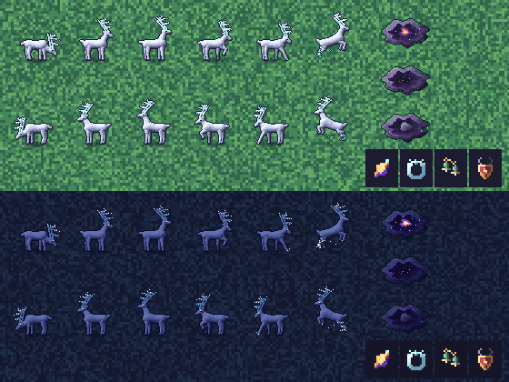

> *Hinter den Schiefer-Vordächern von Hallgrat schimmert warmes Honiglicht auf frisch verlegten Steingassen, während weit draußen auf den Wiesen drei uralte Weltwunder erwachen: Über dem Glockenteich schwingt ein alter Turm, zwischen schlafenden Wächtern flackern Feuerschalen, und in klaren Nächten scharrt der Weiße Kronenhirsch unter fallenden Sternensplittern verborgene Schätze frei.*

---

> [!IMPORTANT]
> **Der nächste große Baustein Richtung V0.9!** V0.8.5 vollendet die gesamte Architektur von **Hallgrat** im Westen (inklusive diagonaler Steinhäuser und überarbeiteter Gassen), erweckt die **drei einmaligen Weltwunder**, **Nacht-Wunder** und **Wasser- & Kultur-POIs** im Wiesenbiom, und bringt den stimmungsvollen **Freiluftsalon („Spiegelplatz“)** sowie ein praktisches **Mod-/Entwickler-Menü** ins Spiel!

---

### 🏰 1. Hallgrat im Westen: Steinmetz-Häuser, Diagonale Gassen & Honiglicht (`🔵 REWORK` `🟣 NEU`)

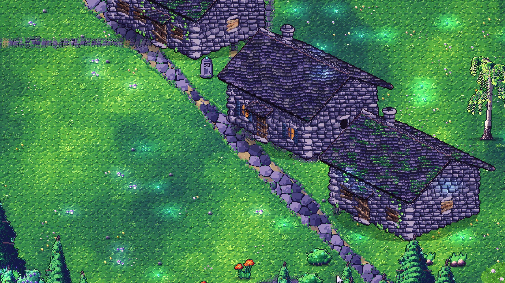

* **Überarbeitete Steinmetz-Architektur (`🔵 REWORK`):** Alle Gebäude in Hallgrat (Wohnhäuser, Hallen, Torhaus, Laden, Stallungen, verlassene Häuser & Marktstände) wurden komplett auf den Maßstab von Ellie angepasst, bestehen aus denselben behauenen Quadern wie die Stadtmauern, tragen violette Schieferdächer samt kleinem **Eingangs-Vordach** und leuchten nachts mit ruhigem **Honiglicht** hinter den Fenstern.
* **Diagonale Häuser an schrägen Wegen (`🟣 NEU`):** Entlang schräger Straßen – etwa direkt am Ende des Westwegs vor dem Osttor – stehen Häuser jetzt authentisch **diagonal gedreht (`48°`)**, sodass Vorder- und Seitenfassade gleichzeitig sichtbar sind und nahtlos am Wegrand sitzen.
* **Gassenpflaster auf den Plätzen (`🔵 REWORK`):** Steinmarkt, Karrenhof und Nordgasse wurden auf sauberes Gassenpflaster mit langen Randsteinen umgestellt.

---

### 🌟 2. Die drei Weltwunder & Nacht-Wunder des Wiesenbioms (`🟣 NEU`)

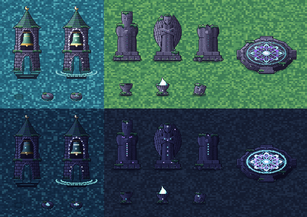

#### 🏛️ Drei einmalige Weltwunder
* **Der Glockenteich:** Ein halb versunkener Glockenturm im See samt Trittsteinen auf dem Wasser – wer das Rätsel am Ufer löst, birgt unter anderem das neue **Glockenteich-Gehänge**.
* **Der Kreis der Schlafenden Wächter:** Mächtige steinerne Wächterstatuen und alte Feuerschalen im Kreis – entfacht die Schalen im richtigen Zusammenspiel!
* **Das Blumen-Amphitheater:** Ein überwuchertes, kunstvoll verziertes Blüten-Podium mitten in der offenen Landschaft.

#### 🌙 Nacht-Wunder & neue Kultur-Orte am Wasser
* **Weißer Kronenhirsch & Sternschnuppen-Krater (`🟣 NEU`):** In der Nacht tauchen glühende **Sternschnuppen-Krater** mit **Sternerz** auf – und wer sich leise an den seltenen **Weißen Kronenhirsch** heranschleicht, wird mit dem **Kronenhirsch-Reif** belohnt!
* **Spuren der Vergangenheit (`🟣 NEU`):** Entdeckt verfallene **Alte Wassermühlen**, **gebrochene Steinbrücken** (perfekt für einen gezielten Schattenschritt!), einsame **Fischerstege** sowie Gedenksteine des **Roten Ordens** (inkl. **Ordenssiegel der Wacht**).

---

### 🪞 3. Freiluftsalon „Spiegelplatz“ & Mod-Menü (`🟣 NEU`)

* **Der Freiluftsalon (`🟣 NEU`, Stufe 1):** Ein offener Holzpodest-Platz unter einer leichten Stoff-Pergola mit Laterne, Regal voller Tücher & Fläschchen und einem großen, im Abendhimmel-Türkis und Violett schimmernden **Standspiegel**. Ellie kann sich via `E` („PLATZ NEHMEN“) auf den Samtstuhl setzen, woraufhin die Kamera sanft heranzoomt. *(Die komplette Frisuren- & Outfit-Auswahl folgt im nächsten Schritt!)*
* **Neues Mod-Menü (`🟣 NEU`):** Im Pausenmenü zieht ein übersichtliches **Mod- / Werkzeug-Menü** mit Kategorien und Suchfilter ein, um Items, Wetter, Cheats und Weltzustände blitzschnell zu testen.

---

### ⚖️ Vorher → Nachher: Die wichtigsten Neuerungen im Überblick

| Bereich | Vorher (V0.8.4 Beta) | Nachher (V0.8.5 Beta) |
| :--- | :--- | :--- |
| **Hallgrat-Gebäude** | Fehlendes Hochhaus-Asset, gerade Platzierung | Komplett gerenderte Häuser im Ellie-Maßstab, **diagonale `48°`-Ansichten** & Honiglicht-Fenster |
| **Wiesenbiom-Welt** | Makro-Habitate, Aussichtspunkte & Ordensspuren | Zusätzlich **3 Weltwunder** (*Glockenteich*, *Schlafende Wächter*, *Amphitheater*), **Kronenhirsch**, **Sternschnuppen-Krater**, **Wassermühlen** & **gebrochene Brücken** |
| **Neue Schätze** | Wüsten- & Ordensfunde | **4 neue Talismane & Erze** (*Sternerz*, *Kronenhirsch-Reif*, *Glockenteich-Gehänge*, *Ordenssiegel*) |
| **Dorfleben** | Karawane & Standardgebäude | Neuer **Freiluftsalon („Spiegelplatz“)** mit animiertem Stoffsegel, Spiegelglanz & Sitz-Kamerafahrt |

---

> [!WARNING]
> **Bekannte Ecken & Kanten dieser Beta:**
> * Im automatisierten Weltwunder-Testskript tritt aktuell noch ein Skript-Fehler beim erzwungenen Wetterwechsel auf; im normalen Spielverlauf sind die Weltwunder unabhängig davon in der Welt platziert.
> * Beim **Freiluftsalon** ist aktuell Stufe 1 (Sitz-Animation & Kamerafahrt) live – das eigentliche Umzieh-Fenster für Ellies Frisuren und Outfits folgt gemeinsam mit den letzten Bausteinen zu **V0.9**.

✦ ──────────────── ❖ ──────────────── ✦

## [V0.8.4 Beta] – 2026-11-14
### 🌅 Horizonte im Aufbruch (V0.9-Vorbote): Zenitwarte, Wüsten-Ökosystem, Karawane, Hallgrat & Lebendige Wiese

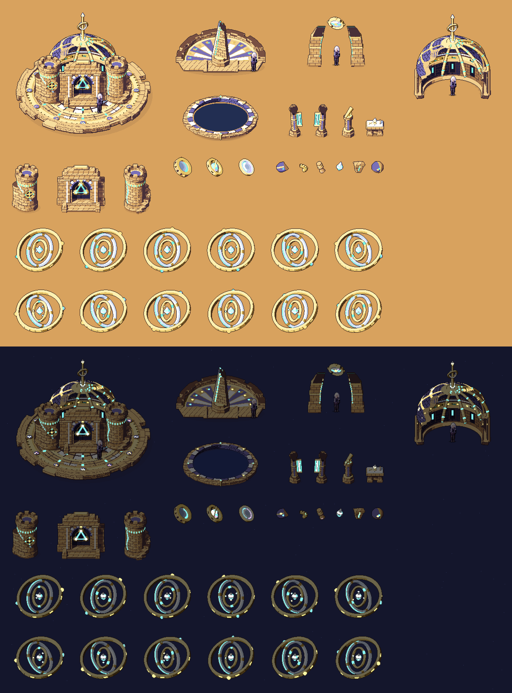

> *Über den Golddünen flimmert die Mittagshitze, während an der fernen Nordspitze die alten Ringe der Zenitwarte wieder im Sternenlicht drehen. Auf dem neuen Westweg mahnen moosbewachsene Meilensteine an das steinerne Hallgrat im Glaskamm, im heimischen Tal läutet die Karawanenglocke am Brunnenplatz – und zwischen Urtannen, Windwiesen und Aussichtsklippen erwacht das ganze Land zum Leben.*

---

> [!IMPORTANT]
> **Ein großes „Mid-Work“-Zwischenupdate auf dem direkten Weg zu V0.9!** V0.8.4 legt die mächtigen Fundamente für das kommende Groß-Update: Die **Quarzwüste** wächst um Hitze, Wetter, 6 Tierarten, aktive Ruinen, den ersten Quarzwächter & die **Zenitwarte**; dazu starten **Joruns Karawane**, die ersten Stufen der Weststadt **Hallgrat**, der **Wiesenbiom-Ausbau** sowie Ellies neues **Outfit- & Haar-Layer-System**. Einige Teile befinden sich bewusst noch im Aufbau und werden gemeinsam mit den nächsten Schritten zu **V0.9** vollendet.

---

### ☀️ 1. Quarzwüste Stufen 3–7a: Hitze, Tierwelt, Aktive Ruinen & die Zenitwarte (`🟣 NEU`)

<b>🏜️ Von der Mittagshitze bis zum Zerbrochenen Himmelswerk – alle neuen Wüsten-Systeme</b>

#### 🔥 Klima, Mittagshitze & Magisches Wüstenwetter
* **Sonnenhitze (`ERHITZT` / `ERFRISCHT`):** Tagsüber unter freiem Himmel bremst die Mittagssonne Ellies Ausdauer-Regeneration um bis zu **`30 %`** und erhöht Sprint-/Schattenschritt-Kosten um **`+15 %`** (sichtbar am goldenen Schimmer der Ausdauerranke und Ellies neuer **Schweiß-Abwisch-Geste**). Schatten unter Palmen/Torbögen, Oasenwasser (`ERFRISCHT`), Kühlfrüchte sowie weiße Sinterquarz-Platten (halbierter Hitzeaufbau) bringen schnelle Abkühlung.
* **Kein Regen – stattdessen Resonanzwind & Quarzgewitter:** Normales Regenwetter wird in der Wüste vollständig abgefangen und in **Singenden Resonanzwind** sowie trockene **Arkane Quarzgewitter** (violett-bernsteinfarbene Magieblitze & schneller ladende Zauberkristalle) übersetzt.

#### 🦊 6 neue Wüstentiere im eigenen Tag-/Nacht-Ökosystem
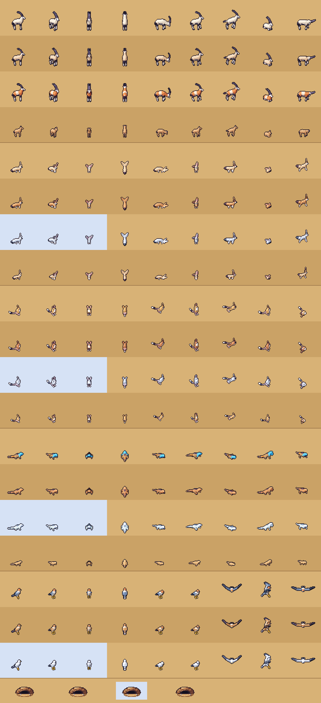
* **Kronen-Oryx:** Zieht in kleinen Herden im Gänsemarsch, trinkt am Oasenwasser, sucht mittags echten Schatten und senkt bei Gefahr die langen Säbelhörner.
* **Dünen-Fennek:** Dämmerungs- und nachtaktiver Fuchs mit rotierenden Riesenohren, eigenen Sandbauten und hohen Mäuselsprüngen.
* **Pinselohr-Springmaus:** Zweibeiniger Hüpfer mit Quastenschwanz, Sand-Staubbad und Hinterfuß-Trommelalarm.
* **Sonnenquarz-Agame:** Tagaktiver Wärmespezialist auf weißen Quarzplatten, dazu **Sonnenfalke** am Himmel und **Gold-Skarabäus** im Sand.

#### 🔮 Aktive Quarzruinen, neue Erze & erster Quarzwächter
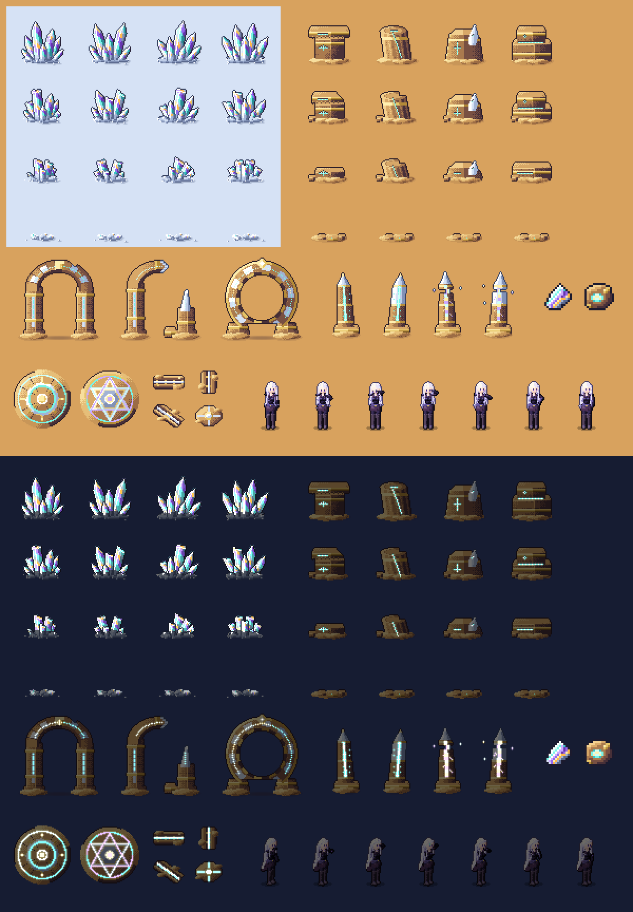
* **Neue Rohstoffe & Prüfungen:** Abbaubare **Prisma-Adern** (*Prismensplitter*) & **Ruinen-Bruchstein**, schattenwerfende **Quarz-Torbögen**, zauberleitende **Lichtleit-Rinnen**, **Resonanz-Obelisken**, **Quarz-Siegelkreise** sowie **2 neue Prismensiegel-Prüfungen der Wächterin**.
* **Quarzwächter (`🟣 NEU`, Stufe 6 begonnen):** Der erste Gegner der neuen Konstrukt-Familie tarnt sich unscheinbar auf weißem Bodenquarz, erwacht beim Abbauen oder Betreten seines Reviers mit drei Stein-/Strahlenangriffen und ist besonders anfällig gegen die **Spitzhacke**.

#### 🔭 Die Zenitwarte (*Das Zerbrochene Himmelswerk*) (Außenanlage)
* Am Nordende der Karawanenstraße krönt die monumentale **Zenitwarte** das Tafelberg-Massiv: mit gespaltenem Ekliptik-Tor, **180°-Sonnenuhr** samt Echtzeit-Schattenwurf, Windharfen-Prismentrasse, Gipfel-Rotunde mit **3 Sternenschlössern**, drehender **Armillarsphäre**, Teleskop-Linsen, **Sternenspiegel-Becken** und **Polar-Okular** zur Kartenaufdeckung. *(Begehbarer Innenraum, neue Zauberstäbe & Quests folgen bis V0.9.)*

---

### 🐂 2. Die Karawane: Fahrender Händler Jorun am Brunnenplatz (`🟣 NEU`)

* **Lebendiger Marktbesuch:** Sobald euer **Brunnenplatz** steht, reist Händler **Jorun** mit seinem **Planwagen** und einem zotteligen **Moosbüffel** in unregelmäßigen Abständen (`2–5 Tage`) über den alten Karrenweg ins Dorf und bleibt **`1–2 Tage`**.
* **Aufklappbarer Stand & echte Waren:** Am Platz klappt der Wagen zur Theke auf und legt Joruns wechselndes Angebot sichtbar aus. Er verkauft seltene Güter sowie Saatgut und zahlt Aufpreise für **„Gesuchtes“**; nachts und bei Sturm schließt der Stand. Karte und Stadt-Tab zeigen Anreise und Verbleib. *(Mid-Work: eigenes Porträt & finale Dialogtexte folgen bis V0.9.)*

---

### 🏰 3. Hallgrat im Westen & der Westweg (Stufen 1 & 2) (`🟣 NEU`)

* **Der 790-Tile-Westweg:** Nördlich von Glimmrast zweigt eine alte, gepflasterte Straße bis vor das **Osttor** auf dem fernen Glaskamm ab – gesäumt von **15 alten Meilensteinen** (alle 50 Tiles), deren Kristalle in Stadtnähe violett und am letzten Stein nachts türkis flackern.
* **Stadtgrundriss & Mauerwerk:** Die sechs Bezirke von **Hallgrat** (u. a. Forum um die Wächterin, Markt, Torstraße, Westmauer & reservierte Stallungen) stehen bereits im Gelände samt umgefärbtem **Mauerwerk und gemeißelten Steintreppen**. *(Gebäude, Mauern & Bewohner folgen auf dem Weg zu V0.9.)*

---

### 🌲 4. „Die Lebendige Wiese“ & Anpassbares Aussehen (`🟣 NEU`)

* **Makro-Landschaften & Entdecker-Orte im Wiesenbiom:** Neue Großzonen wie **Tiefer Urforst** (mit riesigen **Urtannen**, goldenen/silbernen **Lichtschächten**, Moosteppichen, Pilzringen & versteckten **Waldschreinen**), offene **Windwiesen** mit Leitblumenmeeren und alte **Weideflächen** (Obstbäume, Wassermühlen, Einzel-Eiche).
* **Panorama-Aussichtspunkte & Roter Orden:** Hochgelegene **Aussichtspunkte** belohnen Klettertouren mit weitem Kamera-Schwenk, ruhiger Entdecker-Stimmung und großzügiger Kartenaufdeckung; verlassene **Wachtürme & Patrouillenlager des Roten Ordens** erzählen von Valdrics Vergangenheit.
* **Ellies Outfit- & Haar-Layer-System (`🟣 NEU`):** Ellies Sprites wurden auf modulare Haar- und Gewand-Ebenen umgestellt (inkl. erster Farbvarianten wie *Reisegewand*, *Blutsamt*, *Waldläufer* & *Nachtseide* als Grundlage für kommende Garderobe-Features).

---

> [!WARNING]
> **Mid-Work-Hinweis für diese Zwischen-Beta:**
> V0.8.4 bündelt mehrere noch wachsende Großbaustellen auf dem Weg zu **V0.9**: Bei **Hallgrat** fehlen noch die finalen Häuser-Assets (im Log zeigt sich noch ein fehlendes Gebäude-Bild), **Joruns Karawane** nutzt noch Platzhalter-Texte ohne eigenes Porträt, und beim neuen **Quarzwächter** schlägt 1 von 16 automatisierten Prüfungen noch fehl. All das wächst in den kommenden Schritten sauber zu **V0.9** zusammen!

✦ ──────────────── ❖ ──────────────── ✦

## [V0.8.3 Beta] – 2026-11-13
### 🏜️ Die Singenden Dünen & das Herz der Stadt: Quarzwüste, Brunnenplatz, Stadtbau 2.0 & neue Prüfungen

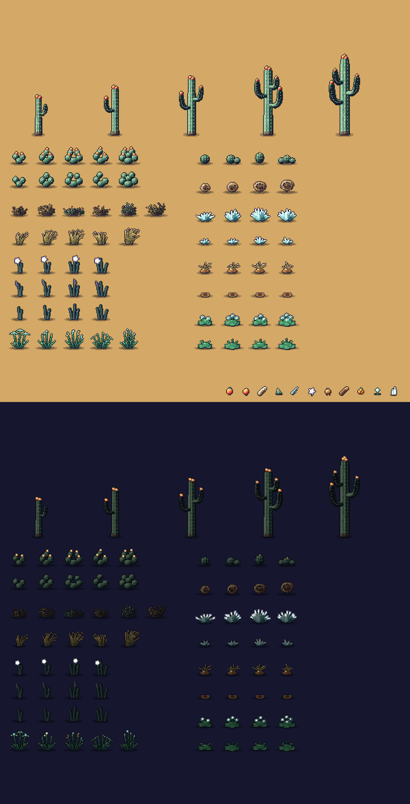

> *Weit hinter der nördlichen Küstenwiese trocknet das Grün zu goldener Strohsteppe, reißt in warmen Ockerlehm auf und öffnet sich in die endlosen Golddünen der Quarzwüste – durchzogen von leuchtenden Kristalladern und verborgenen türkisklaren Oasen. Zurück in der Heimat fällt der erste Grundstein auf den Dorfplatz, Wasser plätschert im neuen Brunnen, und unter alten Wurzeln wie im Spiegel der Sterne erwachen zwei neue Prüfungen der Wächterin.*

---

> [!IMPORTANT]
> **Ein gewaltiges Welt- & Stadt-Update!** V0.8.3 erschließt mit der **Quarzwüste** das größte neue Biom seit dem Hexenwald (samt **4 Quarzoasen**, **13 neuen Wüstenpflanzen & Felsen** sowie **11 frischen Items**), baut den **Stadtbau** komplett zum interaktiven Bauplan-Erlebnis um, macht den **Brunnenplatz** zum neuen Herzen jeder Stadtgründung und bringt **Wurzelgeflecht** & **Sternenspiegel** in die Rätselwelt!

---

### 🏜️ 1. Neues Biom: Die Quarzwüste („Sonnenquarz-Öde“) (`🟣 NEU`)

Im hohen Norden der Welt (`165.784` Tiles – über **4× so groß wie der Hexenwald**) erstreckt sich ein völlig neues Expeditionsgebiet mit nahtloser Landanbindung:

* **Organischer `96`-Tile-Klimaübergang:** Die Wiese wandelt sich allmählich über goldene **Sonnenstroh-Steppe** und rissigen **Ockerlehm mit Sandzungen** bis hin zu windgeriffelten **Gold- und Bernsteindünen**.
* **Sinterquarz & schnelleres Vorankommen:** Seltene, strahlend weiße **Quarz-Ausbisse** (~`3,6 %` der Fläche) schimmern Tag und Nacht mit scharfen Kristallfacetten. Wer über glatten Quarz läuft, bewegt sich spürbar schneller (`1,04×` Tempo) als im weichen Dünensand (`0,94×` Tempo), während der Passatwind feine Sandfahnen über die Dünen treibt.
* **Quarz-Sandstein-Klippen & 4 Quarzoasen:** Geschichtete Sandstein-Tafelberge mit kristallinen Adern ragen aus den Dünen; im Herzen der Wüste warten **vier variable Quarzoasen** mit grünem Ufersaum, klarem Türkiswasser, Sonnenpalmen und abbaubaren **Sonnenquarz-Felsen**.

<b>🌵 Alle 13 neuen Wüstenpflanzen, Oasen-Gewächse & 11 Items im Überblick</b>

* **Wüsten- & Klippenflora:** **Kronen-Säulenkaktus** (*Kronenfeige*, *Kaktusholz*, *Kaktusmark*), **Sonnenfeigen-Kaktus** (*Sonnenfeige*, *Kaktusmark*), **Sandigel** (*Kaktusmark*), **Wüstendorn**, **Steppenroller** (stäubt goldene Samen im Wind) & **Dünengras**.
* **Quarz- & Dünen-Raritäten:** **Glasaloe** (*Quarzaloe* an Quarzrändern), **Königin der Nacht** (blüht **nur nachts** leuchtend weiß-violett → *Nachtkaktusblüte*) & **Sandknolle** (zweihändig aus dem Goldsand ziehen).
* **Oasen-Flora & Bergbau:** **Sonnenpalme** (*Sonnendattel*, *Palmenholz*), **Quarzschilf**, **Quellblume** (*Quellblüte*) & abbaubare **Sonnenquarz-Felsen** (*Sonnenquarz* + *Stein*, wächst in 3 Tagen nach).

---

### ⛲ 2. Der Brunnenplatz & Stadtbau 2.0: „Jeder Bau ist ein Ereignis“ (`🔵 REWORK` `🟣 NEU`)

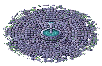

* **Der Brunnenplatz gründet die Stadt (`🟣 NEU`):** Nach der Renovierung der Hütte ist das Land beansprucht – aber erst der **Brunnenplatz** gründet eure Stadt wirklich und dient als Voraussetzung für alle weiteren Bauwerke. Neue Trampelwege laufen zu seinem gepflasterten Rand, die Kartenflagge sitzt auf dem Brunnen, und bei Fertigstellung verkündet ein großes Banner die Stadtgründung!
* **Neues Bauplan-Menü & Weltvorschau (`🔵 REWORK`):**
  * Alle Bauwerke erscheinen als illustrierte **Bauplan-Karten** mit Live-Mini-Vorschau, Kosten-Chips, Licht- & Wert-Zugewinn. Gesperrte Gebäude sind als violette Bauplan-Silhouetten sichtbar, damit ihr immer seht, was als Nächstes wartet.
  * In der Welt zeigt die Vorschau den **neuen goldenen Lichtkreis** sowie alle Büsche und Gräser im Räumungs-Radius mit weißen Ringen.
* **Grundstein, Gerüst & „Anpacken“ (`🟣 NEU`):** Beim Platzieren fällt ein echter **Grundstein** mit Rune, Materialien fliegen ein, ein **Holzgerüst** wächst mit dem Fortschritt mit – und haltet ihr `E` (**„ANPACKEN“**), hilft Ellie aktiv mit **dreifachem Bautempo (`×3`)** und Funkenflug!
* **Lichtweihe & Druckwelle (`🟣 NEU`):** Ist ein Bauwerk fertig, zerschlägt ein weiß-türkiser Lichtblitz das Gerüst, eine sichtbare **Druckwelle** fegt über die Wiese, Bäume schwanken mit Nadelregen, weiche Pflanzen im Radius werden entwurzelt und ihr Ertrag fliegt automatisch ins **Stadtlager**!
* **Stadtbanner, Wappen & Stufen-Zeremonie (`🟣 NEU`):** Wählt im Stadt-Menü aus **8 Stadtfarben** und **12 Wappen-Glyphen**. Beim Betreten der Stadt oder bei einem Stufenaufstieg rollt ein im Wind wehendes Stoffbanner herab, während der Lichtrand pulsiert und jede neue Stadtstufe spürbar **mehr Lichtreichweite** schenkt (`+8 %` bis `+32 %`).

---

### 🧩 3. Zwei neue Prüfungen der Wächterin: Wurzelgeflecht & Sternenspiegel (`🟣 NEU`)

Beide neuen Rätseltypen stehen ab sofort in je **drei Schwierigkeitsstufen** in der speziellen **Rätselwelt** zum Ausprobieren bereit:

* **Das Wurzelgeflecht (*Keimling*, *Geflecht*, *Altes Geflecht*):** Löscht den schiefen **Herzwürfel**, um ein unterirdisches Geflecht aus leuchtenden Wurzeln und Steinwürfeln zu wecken! Jeder berührte Würfel kippt sich und seine verbundenen Nachbarn um – erschwert durch wachsende **Keimwürfel**, unantastbare **Dornwürfel** und **Einwegwurzeln**.
* **Der Sternenspiegel (*Sichel*, *Rabe*, *Wächterin*):** Tragt leuchtende **Mondsteine** frei in alle acht Richtungen an das Ufer eines stillen Teiches und legt exakt das gespiegelte **Sternbild** aus dem Wasser nach – bei den höheren Teichen sogar gedreht über die Nacht und abhängig von **Voll- oder Neumond**!

---

### ✨ 4. Ladescreen-Update, Pixelgenaue Arm-Verdeckung & Feinschliff (`🔵 REWORK` `🟡 FIX`)

* **Silhouetten-Ladescreen zur Wegstein-Wächterin (`🔵 REWORK`):** Statt vor der Spinne zu fliehen, schreiten Ellie und zwei zufällige Begleiter nun gemeinsam mit einem **Raben** und einem **türkisen Irrlicht** über einen schwebenden Felspfad. Am Ende des Ladens erscheint die **Wegstein-Wächterin** in heller Silhouette, ihre Lichtsäule erwacht und die Gruppe löst sich in aufsteigende Sternlichtfunken auf!
* **Pixelgenaue 3D-Arm-Verdeckung (`🔵 REWORK`):** Ellies neuer 3D-Schwertarm verschwindet nun pixelgenau hinter ihrem silbernen Haar, Gesicht und Mantel, statt komplett vor oder hinter ihr umzuspringen.
* **Questtafel-Story-Icons & Bugfixes (`🟣 NEU` `🟡 FIX`):** Die großen Story-Aushänge (Torben, Spiegelhexe, Mornath, Seehexe) tragen eigene **Siegel-Illustrationen**; im Quest-Fortschritt und beim Bauablauf für Torbens Schmiede wurden zudem Ablauf-Fehler behoben.

---

### ⚖️ Vorher → Nachher: Die wichtigsten Neuerungen im Überblick

| Bereich | Vorher (V0.8.2 Beta) | Nachher (V0.8.3 Beta) |
| :--- | :--- | :--- |
| **Nordgrenze** | Offene Küste & Meer | **Quarzwüste** (`165.784` Tiles) mit `96`-Tile-Übergang, **4 Oasen** & **13 neuen Pflanzen/Felsen** |
| **Stadtgründung** | Nach Hütten-Renovierung direkt gegründet | **Brunnenplatz** als Pflicht-Herzstück + eigene Wege & Gründungsbanner |
| **Stadtbau** | Passives Warten am Seilrahmen | **Bauplan-Menü**, Grundstein, Gerüst, **`E` Anpacken (`3×`)**, **Druckwelle** mit Ernte & **8 Farben / 12 Wappen** |
| **Welt-Rätsel** | Irrlichtspur, Hortkrähe, Rabenhandel | Zusätzlich **Wurzelgeflecht** & **Sternenspiegel** (je 3 Stufen in der Rätselwelt) |
| **Ladescreen** | Flucht vor der Void-Spinne | Pilgerzug mit **Rabe & Irrlicht** zur erwachenden **Wegstein-Wächterin** |
| **3D-Griff-System** | Arm wechselt als Ganzes vor/hinter Ellie | **Pixelgenaue Tiefen-Verdeckung** hinter Haar, Gesicht & Mantel |

---

> [!TIP]
> **Ausblick auf die nächsten Ausbaustufen:** Die **Quarzwüste** wächst in kommenden Updates weiter! Geplant sind unter anderem **Sonnenhitze-Mechaniken**, magische **Quarzgewitter**, eigene Wüstentiere (*Fennek*, *Quarz-Eidechse*, *Gold-Skarabäus*) sowie mächtige **Quarz- und Steinkolosse** als neue Gegnerfamilie – und auch **Wurzelgeflecht** & **Sternenspiegel** ziehen bald in die reguläre Spielwelt ein.

✦ ──────────────── ❖ ──────────────── ✦

## [V0.8.2 Beta] – 2026-11-12
### ⚔️ Klingen, Krähen & wilde Pfade: 3D-Waffenphysik, erste Welt-Rätsel, Schmied Torben & Hexenwald-Fauna

> *Nördlich der Lichtung hallt dumpfer Stahl auf nackten Fels. Zwischen schwelenden Erzadern kämpft der Schmied Torben allein gegen die schleichende Dunkelheit – während auf verschlungenen Waldpfaden scheue Irrlichter aus alten Steinschalen steigen, beringte Krähen glänzende Schätze hüten und Ellies Klinge zum ersten Mal mit echtem Gewicht durch die Nacht schneidet.*

---

> [!IMPORTANT]
> **Die Prüfungen der Wächterin beginnen!** In V0.8.2 erwachen die ersten drei Welt-Rätsel zum Leben: Folgt der scheuen **Irrlichtspur**, gewinnt das Vertrauen der **Hortkrähe** und handelt mit dem alten **Raben am Westhang**. Gleichzeitig bekommt Ellie ein komplett neues **3D-Griff- und Schwung-System**, ein organisches **Lianen-Inventar**, **Sprechblasen** direkt in der Welt und mit **Torben** ihren lang erwarteten Dorfschmied!

---

### 🗡️ 1. 3D-Griff-System & echte Waffenphysik (`🔵 REWORK` `🟣 NEU`)

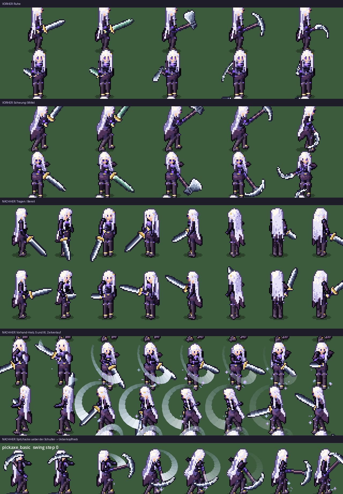

Schluss mit steif gedrehten 2D-Waffen! Ellies rechte Hand und jede geführte Waffe oder jedes Werkzeug bewegen sich jetzt im **echten 3D-Raum** – nahtlos abgestimmt auf ihr Charaktermodell, ihre Blickrichtung und Licht/Schatten der Spielwelt:

* **Zwei-Knochen-Arm im Pixel-Look (`🔵 REWORK`):** Ellies Schwertarm wird mit Schulterkappe, pflaumenfarbenem Ärmel, schwarzer Leder-Armschiene samt violettem Leuchtband und Handschuh exakt wie ihr linker Arm gezeichnet – inklusive Hit-Flash, Nässe, Nebelschleier und Tageslicht-Stimmung.
* **Spürbares Gewicht & Feder-Trägheit (`🟣 NEU`):** Im Ruhezustand reagiert die Waffe über eine gedämpfte Feder auf Ellies Bewegungen und Drehungen. Jede Kategorie hat eigene Haltungen für **Tragen**, **Bereit** (direkt nach einem Hieb) und **Sprinten** – Spitzhacke und Hacke ruhen lässig über der Schulter, die Sichel tief, die Gießkanne aufrecht am Henkel.
* **Kreuzende X-Hiebe & Überkopf-Schläge (`🟣 NEU`):** Vorhand und Rückhand schneiden als gekreuztes **X** durch den 3D-Raum (`48°` / `-42°` Neigung), während schwere Werkzeuge (Axt, Spitzhacke, Hacke) wuchtig über den Kopf geschwungen werden. Die Schwungspur und abfliegende Funken folgen exakt der Bahn der Klingenspitze!

---

### 🧭 2. Die ersten Welt-Rätsel: Irrlichtspur, Hortkrähe & Rabenhandel (`🟣 NEU`)

<b>✨ Drei Geheimnisse abseits der Wege – klicke für alle Details & Fundorte</b>

#### 🌿 Irrlichtspur – *Nördlich der Hütte*
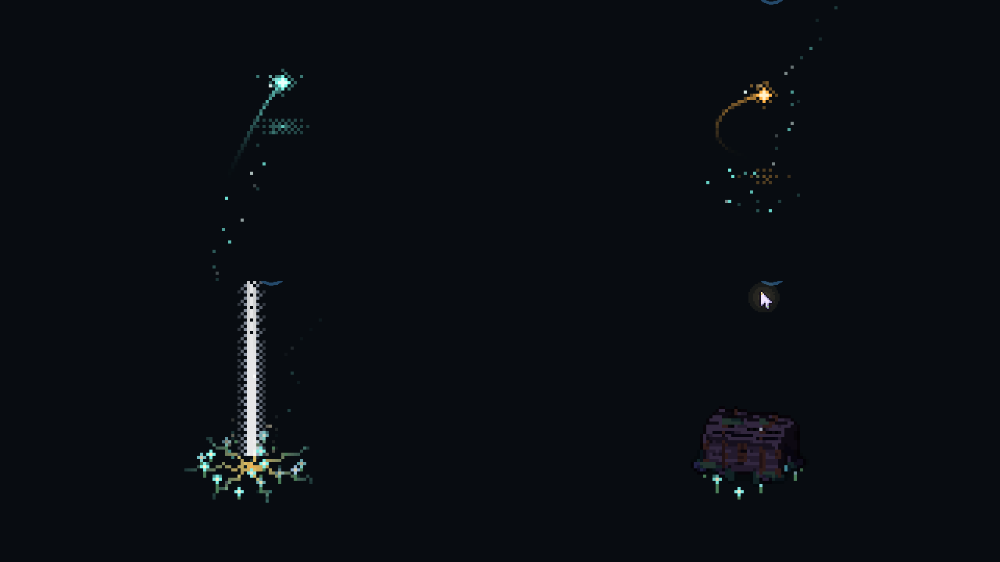
* Aus einer moosbewachsenen Steinschale löst sich ein scheues, blau schimmerndes **Irrlicht** und schwebt auf geschwungenen Bahnen durch den Pass entlang der Leere.
* **Ruhig bleiben!** Das Irrlicht fliegt knapp schneller als Ellies Gehtempo (und deutlich gemächlicher beim Schleichen), aber langsamer als ihr Sprint. Wer zu hastig stürmt, erschreckt es – es huscht voran, und verlischt es ganz, kehrt es nach **`7 s`** in die Schale zurück.
* Am versteckten Ziel hinter dem Hügel vollführt es eine leuchtende Spirale, stürzt herab, lässt einen Ring aus Leuchtblumen erblühen und ruft in einer Lichtsäule eine **Wurzelkiste** herbei.

#### 🪶 Die Hortkrähe – *Östlich vom Fluss*
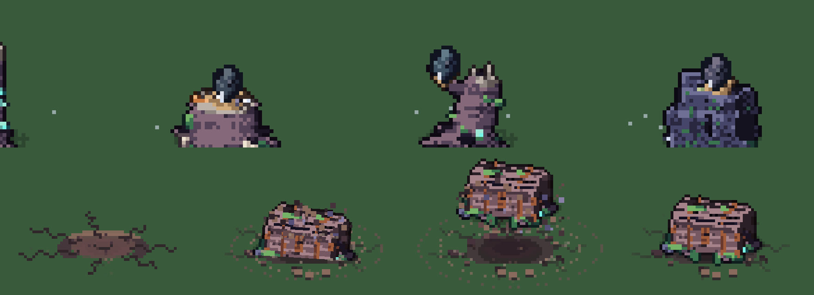
* Eine einzelne Krähe mit kleinem **Silberring am Bein** wacht auf einem verwitterten Stumpf. Nähert euch langsam mit **Sonnenkernen** oder **Samenflocken** in der Hand und haltet still!
* Nach dem Füttern krächzt sie zweimal, fliegt im weiten Bogen zu einem verborgenen **Erdhaufen** und scharrt dort, bis ihr aufschließt.
* Mit `E` („AUSGRABEN“) oder drei gezielten Hieben eurer **Hacke** bricht eine **Wurzelkiste** unter Erdbrocken und Rissen direkt aus dem Boden!

#### 🦅 Der Rabenhandel – *Selten, am Westhang*
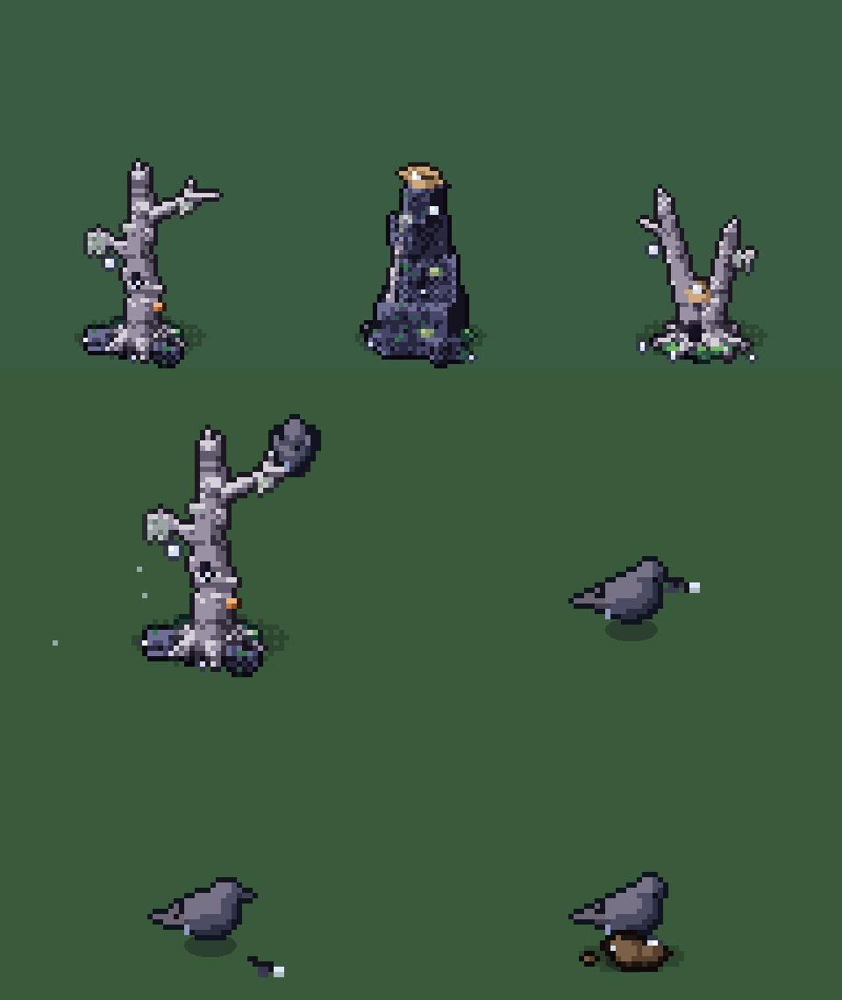
* An einem knorrigen **Bleichbaum** westlich des Flusses sitzt ein alter, stolzer Rabe mit einem Ring aus Rabenstahl – und er will kein Vogelfutter, sondern **etwas Glänzendes**!
* Über `E` („ANBIETEN“) öffnet ihr ein eigenes Tauschfenster. Gefällt ihm euer Stück (**Seeglimmer, Mondstein, Silberkette, Eisenbarren, Moras Splitter oder Kristalle**), behält er **1 Stück als Pfand** und fliegt über **drei Stationen** um den Hügel. Hebt jede herabflatternde **schwarze Feder mit Silberspitze** auf! *(Lehnt er ein unscheinbares Geschenk dreimal am Tag ab, dreht er euch bis zum nächsten Morgen den Rücken zu.)*
* Am Ziel bricht eine **Mondsiegeltruhe** aus der Erde – inklusive eurem hinterlegten Pfand!

> [!TIP]
> **Flüssigeres Truhen-Aufräumen:** Bereits geöffnete Beutetruhen lösen sich nun schon nach **`10 s`** (statt bisher `45 s`) wieder auf – und alle drei Truhen-Klassen zeigen beim Öffnen neu gestaltete, animierte Innenleben-Details (geflicktes Leinen, Sternenkarten-Futter, Münzstapel & Samt).

---

### 🔨 3. Schmied Torben & die erweiterte Questtafel (`🟣 NEU` `🔵 REWORK`)

* **Hammerschlage im Norden (`🟣 NEU`):** Sobald eure **Questtafel** steht, ruft euch ein neuer Aushang in den Norden: Findet Torben an seinem Eisenvorkommen, wehrt gemeinsam einen Schatten-Hinterhalt ab, sammelt Holz, Kiesel, Bretter und Eisenerz, errichtet die **Schmiede** im Dorf und schmelzt euren ersten **Eisenbarren**!
* **Torben als Dorfbewohner (`🟣 NEU`):** Nach Abschluss zieht der wortkarge Schmied dauerhaft ins Dorf ein – mit eigenen Gesprächen, Schmiede-Angeboten und täglichen Aufträgen an der Questtafel (**Eisenerz**, **Feuerholz** & **Schattenspinnen-Jagd**).
* **Klare Story-Kette an der Questtafel (`🔵 REWORK`):** Die Werkbank-Quest leitet nun nahtlos in den Bau der **Questtafel** über, und die großen Boss-Abenteuer (**Spiegelhexe**, **Mornath**, **Seehexe**) erscheinen jetzt sauber gestaffelt als goldene Story-Aushänge auf dem Brett!

---

### 🌿 4. Neues Lianen-Inventar, „Licht gegen Leere“-Menü & Welt-Sprechblasen (`🔵 REWORK` `🟣 NEU`)

* **Organisches Lianen-Inventar (`🔵 REWORK`):** Öffnet ihr euren Rucksack, ranken lebendige Zweige ins Bild! Auf der linken Seite steht **Ellie in ihrem Ritualkreis** und folgt mit dem Blick eurem Mauszeiger:
  * **Talismane** hängen als funkelnde Anhänger an einer Girlande über ihrem Kopf.
  * **Rüstung** & **Hand-Ausrüstung** baumeln an zwei seitlichen Lianen.
  * **Rucksack-Plätze** wachsen als belegte Äste von rechts herein – leere Felder zeigen klare Piktogramme, passende Slots leuchten beim Ziehen auf, und jedes Item schimmert in seiner Seltenheitsfarbe.
* **Silhouetten-Ladescreen (`🟣 NEU`):** Beim Spielstart wandern Ellie und zwei zufällig gewählte Begleiter (aus **Valdric**, **Gustav** und **Torben**) als helle Silhouetten über einen scrollenden Steinpfad – bis die echte **Void-Spinne** die Gruppe aus dem Bild jagt und die Iris in die Spielwelt aufspringt.
* **Hauptmenü „Licht gegen Leere“ (`🔵 REWORK`):** Die alte Rankentafel weicht einem dynamischen Schattenkampf: Leere-Tentakel und funkelnde Augenpaare drängen zum Lagerfeuer, während alle `14 s` Schockwellen und Glutstöße die Dunkelheit zurückschleudern und die Menüpunkte als leuchtende Lichtschrift aus dem Feuer steigen.
* **Sprechblasen direkt über den Figuren (`🟣 NEU`):** Story-Szenen und Gespräche abseits von Vollbild-Porträts schweben jetzt als elegante **Sprechblasen direkt über Ellie, den Siedlern oder Wegweisern** in der Spielwelt!

---

### 🐾 5. Lebendiger Hexenwald & belebte Flussufer (`🟣 NEU` `🔵 REWORK`)

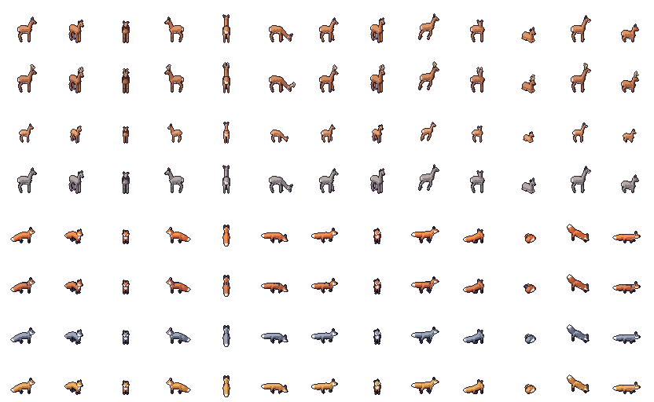
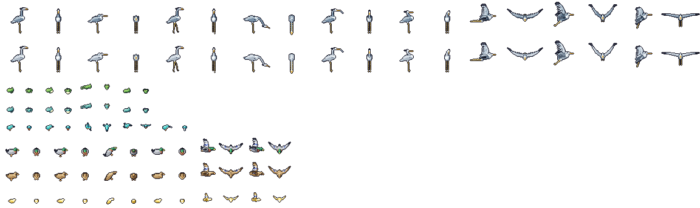

* **Hexenwald- & Waldbewohner (`🟣 NEU`):** Durch die Wälder streifen ab sofort **Wildschweine** (samt gestreiften Frischlingen), scheue **Luchse**, kletternde **Eichhörnchen**, geheimnisvolle **Hexenziegen** (mit Zicklein) und **Hexenkröten**. In den Baumkronen und Stämmen sind zudem **Spechte** (die rhythmisch hämmern!), **Eichelhäher** und **Rotkehlchen** unterwegs.
* **Neuer Flussbewohner & feinere Tier-KI (`🟣 NEU` `🔵 REWORK`):** Am Wasser tummeln sich nun flinke **Otter** in kleinen Gruppen; **Reiher** und **Enten** erhielten detailliertere Animationen und eine verfeinerte Flucht- und Alarmwahrnehmung.
* **Dichtere Flora & faire Eröffnungsregeln (`🟢 BUFF` `🟡 FIX`):** Wildbüsche, Beerensträucher und Bäume erhielten frische Wuchs-Varianten; während des verwundeten Nacht-Intros vor der Hütte bleiben Heilpflanzen und Sträucher jetzt konsequent gesperrt, damit die Eröffnungssequenz ihre volle Spannung behält.

---

### ⚖️ Vorher → Nachher: Die wichtigsten Neuerungen im Überblick

| Bereich | Vorher (V0.8.1 Beta) | Nachher (V0.8.2 Beta) |
| :--- | :--- | :--- |
| **Waffen & Werkzeug** | 2D-Sprite um die Hand gedreht, 2-px-Linienarm | Echtes 3D-Griff-System mit 2-Knochen-Arm, Schulter-Haltung, Feder-Trägheit & X-Schwungbögen |
| **Inventar** | Klassisches Raster-Menü | Organische Zweig-, Girlanden- & Lianen-Ansicht mit Ritualkreis-Ellie & Piktogrammen |
| **Welt-Rätsel** | Konzept & erste Prop-Assets | **Irrlichtspur**, **Hortkrähe** & **Rabenhandel** komplett spielbar |
| **Schmied & Progression** | Schmiede nur vorbereitet | **Torben**-Quest im Norden, Schmiede-Bau, Eisenbarren & Story-Aushänge ab Questtafel |
| **Dialoge & Menüs** | Vollbild-Box & Ranken-Menü | In-World-Sprechblasen, Silhouetten-Ladescreen & „Licht gegen Leere“-Hauptmenü |
| **Truhen-Auflösung** | `45 s` nach dem Öffnen | `10 s` nach dem Öffnen (+ animierte Truhen-Innenleben) |

---

> [!WARNING]
> **Bekannte Ecken & Kanten dieser Beta:**
> * Im automatisierten Quest-Durchlauf für Torben schlägt der Headless-Testskript-Lauf aktuell noch fehl (u. a. durch eine fehlende Fels-Textur im Lager-Prop und abweichende Bau-Prüfungen im Testskript). Im normalen Spielablauf stehen die Quests bereit – meldet uns gern, falls euch am Nordlager etwas auffällt!
> * Weitere **Prüfungen der Wächterin** (*Runenreihe*, *Schweigender Hain*, *Rissläufer*, *Die letzte Laterne*) befinden sich bereits in Vorbereitung und folgen in den nächsten Updates.

✦ ──────────────── ❖ ──────────────── ✦

## [V0.8.1 Beta] – 2026-11-12
### 🏆 Schätze aus dem Licht: Drei Beutetruhen-Klassen, Ketten-Reliquiare & Boss-Himmelsstürze

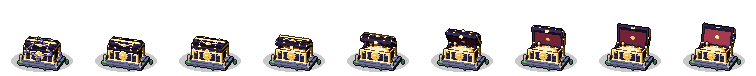

> 📜 ***Aus einem ledergebundenen Ordensbuch in Valdrics Truhe, daneben eine alte Seite aus den Schriften der Wächterin:***  
> *„Nur die Würdigsten durchtrennen die Leere-Ketten eines echten Glutreliquiars. Innen ruht jenes karmesinrote Samtfutter unseres alten Ordens, behütet von zwei Wachskerzen und einem Sonnenherz aus reinem Bernstein. Doch seit den jüngsten Erschütterungen kehrt etwas Unerwartetes zurück: Fällt ein gewaltiges Schattenwesen wie Mornath oder die gefallene Spiegelhexe, zerstreuen sich seine Schätze nicht länger achtlos im Staub – eine blendende Lichtsäule trägt den Reliquienschrein direkt vom Himmel herab vor die Füße der Sieger!“*

---

> [!IMPORTANT]
> **So erlebt ihr die neuen Beutetruhen direkt in V0.8.1:**  
> Sowohl **Mornath (Sky Cleaver)** als auch **Morwenna (die Spiegelhexe)** lassen **`2,8 s`** nach ihrem Fall jetzt ein prachtvolles, legendäres **Glutreliquiar** in einer Lichtsäule niedergehen – gefüllt mit sämtlichen Bossschätzen, Reliquien und zusätzlichen Truhen-Ziehungen! *(Frei platzierte Schatztruhen in der Wildnis sowie zugehörige Rätsel folgen in kommenden Updates.)*

> [!TIP]
> **Das Beste kommt zuletzt – und wartet 5 Minuten!**  
> Jede Truhe wirft ihre Schätze nach Seltenheit sortiert nacheinander aus dem Deckel (*das wertvollste Stück zuletzt!*) und gewährt ganze **`300 s` (5 Minuten)** Zeit zum Einsammeln. Im Koop spendiert jede Truhe zudem **`+1` Extra-Ziehung** pro weiterem Verbündeten innerhalb von **`200 px`**!

---

### 🌟 Die Großen Highlights

#### 1. 🪙 Drei Beutetruhen-Klassen mit einzigartiger Öffnungs-Inszenierung
Vom bemoosten Wanderer-Kasten bis zum magisch gefesselten Ordensschrein verfügt jede Seltenheitsstufe über maßgefertigte Pixel-Art, eigene Lichtwirkung und ein spürbares Öffnungsritual:

* **Wurzelkiste (Gewöhnlich):** Verwittrtes Pflaumenholz, rostige Eisenbänder, ein kleines Vorhängeschloss, zartes Moos und ein schwach glimmender Teal-Pilz.
  * *Öffnen (`E` antippen):* Das Schloss springt auf, der Deckel knarrt empor – gefüllt mit **`15–45` Kupfer**, **`10 XP`**, `2–3` gewöhnlichen Wildfunden (Beeren, Heilkräuter, Eisenerz, Seile, Saatgut, kleine Tränke) und mit `30 %` Chance auf einen ungewöhnlichen Fund (Barren, Harz, Stufe-2-Trank, *Silberkette* oder einen ersten *Stufe-1-Kristall*)!

* **Mondsiegeltruhe (Selten):** Schieferblaues Eisenholz mit blauen Stahlbeschlägen, violettem Samt im Inneren und einem kalten blauen **Mondstein-Siegel**, während kristalline Splitter an der Rückseite emporwachsen.
  * *Öffnen (`E` halten für `0,9 s` – „SIEGEL BRECHEN“):* Ein leuchtender Runenring füllt sich am Boden, ehe das Siegel in blaue Splitter birst und Mondfunken gen Himmel spiralen! Garantiert **`70–160` Kupfer**, **`35 XP`**, **1 garantierten seltenen Fund** (*Stufe-3-Kristall/Verstärker*, *Stufe-4-Trank*, *Stufe-2-Spezialtrank*, *Schattenkern* oder *Wuchtreif*), `2–3` seltene Materialien (*Fluchsilber*, *Stufe-2-Kristalle*, *Eisenplatten*) und `1–2` gewöhnliche Vorräte!

* **Glutreliquiar (Legendär):** Schwarzer Lack und feinstes Goldfiligran auf einem Steinsockel, gekrönt von zwei Kerzen, dem *Sonnenherz* aus Bernstein und karmesinrotem Samt – fest umschlossen von **violett-schwarzen Leere-Ketten**!
  * *Öffnen (`E` halten für `1,6 s` – „FESSELN LÖSEN“):* Die Ketten glühen von Violett zu hellem Gold, sprengen mit klirrendem Funkenflug auseinander, das *Sonnenherz* blitzt grell auf, und eine **Lichtsäule** samt Schockring sowie Münzfontäne schleudert die Reichtümer empor! Enthält **`350–700` Kupfer**, **`110 XP`**, **1 garantierten epischen Fund** (*Stufe-4-Kristall/Verstärker*, *Stufe-5-Tränke*, *Stufe-3-Spezialtrank*), **`35 %` Chance auf 1 legendären Fund** (**Stufe-5-*Sternstein* / *Krone*** oder *Schweigtropfen*), `1` weiteren seltenen Fund plus edelste Materialien (*Schattenkerne*, *Leereslacke*, *Eisenplatten*, *Fluchsilber*).

💎 <b>Beute-Almanach: Alle Truhenwerte, Haltezeiten & Garantien im Überblick (Klicken zum Entfalten)</b>

| Truhentyp | Seltenheit | Interaktion | Kupfer & XP | Garantierte Beute-Highlights |
|---|---|---|---|---|
| **Wurzelkiste** | Gewöhnlich | `E` antippen (`0,0 s`) | `15–45` Kupfer / `10 XP` | `2–3×` Wildvorräte + `30 %` Chance auf Barren / Stufe-1-Kristall |
| **Mondsiegeltruhe** | Selten | `E` halten (`0,9 s`) | `70–160` Kupfer / `35 XP` | **`1×` Seltener Fund** (Stufe-3-Kristall, Stufe-4-Trank, *Wuchtreif*) + `2–3×` seltene Mats |
| **Glutreliquiar** | Legendär | `E` halten (`1,6 s`) | `350–700` Kupfer / `110 XP` | **`1×` Epischer Fund** (Stufe-4-Kristall/Trank) + **`35 %` Legendärer Fund** (Stufe-5-*Sternstein*/*Krone*, *Schweigtropfen*) + `1×` Seltener Fund |

*(Hinweis: Geschmiedete Waffen, Boss-Reliquien wie die Rissfeder sowie Moras Spiegelscherbe erscheinen niemals zufällig in regulären Beutetruhen.)*

---

#### 2. ☄️ Boss-Reliquiare: Spektakulärer Himmelssturz nach Mornath & Morwenna
Statt wertvolle Bossbeute nach dem Todesstoß lose im Gras zu verstreuen, belohnt V0.8.1 eure Siege ab sofort mit einer imposanten Ankunft aus dem Licht:

* **Verzögerter Himmelssturz (`2,8 s`):** Kurz nach der Todesanimation von **Mornath (Sky Cleaver)** oder **Morwenna (die Spiegelhexe)** durchschneidet eine gigantische Lichtsäule den Himmel, und ein legendäres **Glutreliquiar** kracht mit Schockring, Staubwolke und Kamerabeben zu Boden!
* **Durchdachte Landepunkte & Rückkämpfe:** *Mornaths* Truhe landet gezielt südlich des Sonnensiegels (sodass das Replay-Hologramm jederzeit frei begehbar bleibt), *Morwennas* direkt an ihrem Fallort. Auch jeder wiederholte **Rückkampf über ein Hologramm** beschert erneut ein volles Reliquiar!
* **Prall gefüllt & Gesichert:** Jedes Boss-Reliquiar vereint alle klassischen Bossschätze, **`1×` garantierten seltenen Bonusfund + `1–2×` seltene Zusatzmaterialien**, schüttet Kupfer/XP zuverlässig an alle beteiligten Kämpfer aus (selbst wenn ein Verbündeter kurz zuvor fiel) und entlässt exklusive **Boss-Reliquien** (*Rissfeder*, *Moras Spiegelscherbe*) ganz am Ende persönlich für ihren rechtmäßigen Finder! Ungeöffnete Bosstruhen werden im Spielstand gesichert; geleerte Exemplare verblassen nach **`45 s`**.

---

### ⚖️ Balance & Spielwerte auf einen Blick

| Status | Bereich / Parameter | Vorher (V0.8.0) | Jetzt (V0.8.1) | Auswirkung im Spiel |
|---|---|---|---|---|
| 🟣 `NEU` | **Beutetruhen (3 Klassen)** | Keine Beutetruhen | **Wurzelkiste, Mondsiegeltruhe, Glutreliquiar** | Abgestufte Öffnungsrituale, garantierte Kristalle & Effekte |
| 🔵 `REWORK` | **Boss-Beute (Mornath / Morwenna)** | Lose Items am Boden | **Legendäres Glutreliquiar (`2,8 s` Himmelssturz)** | Inkl. `1× rare_finds` + `1–2× rare_mats` & Reliquien-Finale |
| 🟢 `BUFF` | **Liegezeit von Truhenbeute** | Standard-Dropdauer | **`300 s` (5 Minuten)** | Kein Stress beim Sortieren und Teilen nach schweren Kämpfen |
| 🟢 `BUFF` | **Koop-Beute-Skalierung** | Feste Drop-Anzahl | **`+1` Ziehung pro Verbündetem (`200 px`)** | Gemeinsame Schatzsuche lohnt sich ohne Beutekürzung |

---

### 🔮 Sneak Peek: „Prüfungen der Wächterin“
*„Unter uralten Bäumen, auf verbrannten Leere-Narben und vor verwitterten Steinzirkeln wurden bereits erste geheimnisvolle Sonnenuhren, Runenstelen, Spinnenhain-Schreine und silberberingte Hortkrähen gesichtet... Noch ruhen diese uralten **Prüfungen der Wächterin** still im Schatten – doch schon bald werden sie jene Abenteurer herausfordern, die Wind, Licht, Schattenschritt und Stille meistern!“*

✦ ──────────────── ❖ ──────────────── ✦  
*Im Glanz goldener Lichtsäulen und gesprengter Ketten,*  
**Euer Shadowspore-Entwicklerteam 🏆✨**

---

## [V0.8.0 Beta] – 2026-11-11
### ✨ Kristall, Seehexe & Federkiel: Magiesystem mit 50 Kristallen, Bleichgabel-Stab, Ilvas Seegrenze & das neue Quest-Tagebuch

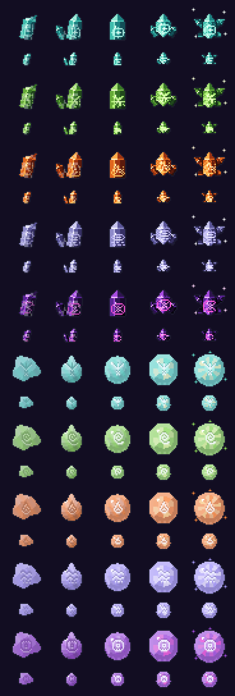

> 📜 ***Aus einem Brief von Ilva der Seehexe an Esma, verschlossen mit getrocknetem Seeschilf:***  
> *„Alte Freundin – spürst du das Zittern im Wasser bis hoch in deinen Turm? Die Leere drückt härter gegen mein Südufer als je zuvor, und unter den Kiefern des Westsees pressen die Schatten das Licht tief in den Grund, bis die ersten Steine wieder singen. Zwei deiner Fluchsilber-Bänder liegen auf meiner Schnitzbank bereit: eines für die Hexenulme, und eines für jene widerspenstige Gabel aus Bleichholz. Schick mir den Schützling vorbei, sobald der Spiegel zerbrochen ist – und sag dem kleinen Silberkopf, sie soll sich alles sauber aufschreiben, ehe der Nebel es frisst!“*

---

> [!IMPORTANT]
> **So startet ihr in die Magie (Freischaltung):**  
> Nach dem Sieg über die Spiegelhexe (*Morwenna*-Quest abgeschlossen) und ab **Charakterstufe 10** hängt am Schwarzen Brett der goldene Story-Aushang *„AM WESTSEE BRENNT KEIN LICHT“*. Er weist euch über den neuen *Seepfad* in den tiefen Westen zu Ilvas Pfahlhaus am Hexenwald-See!

> [!TIP]
> **Taktik-Tipp – Doppelzinken & Nebeltarnung:**  
> Kombiniert auf der seltenen **Bleichgabel** zwei gegensätzliche Schulen (z. B. *Glutschwarm* + *Leerenschlund*): Wirkt ihr die zweite Zinke binnen **`3 s`** per Rechtsklick nach dem Linksklick, löst der **GABELSCHLAG (Zwiespalt)** mit ganzen **`x1,5` Verstärkung** aus! Und ein *Nebelschleier* entzieht euch im Gefecht sogar den Blicken von **Mornath** und **Morwenna**!

---

### 🌟 Die Großen Highlights

#### 1. ✨ Neues Magiesystem: 5 Elementar-Schulen, 50 Kristalle & 2 Zauberstäbe
Magie zieht als eigenständiges, flexibles Kampfsystem in Shadowspore ein – **ohne klassische Manaleiste**! Jeder eingesetzte Kristall speichert die Magie selbst, leuchtet an der Stabspitze und lädt sich nach dem Wirken eigenständig wieder auf:

* **Zauberkristalle & Verstärkerkristalle (je 5 Seltenheitsstufen):**
  * **Zauberkristalle** (*SPLITTER → SCHERBE → KRISTALL → HERZSTEIN → STERNSTEIN*) sind spitz, natürlich gewachsen und in ihrer Schulfarbe gesättigt; **Verstärkerkristalle** (*ROHSCHLIFF → TROPFEN → LINSE → FACETTE → KRONE*) sind rund, milchig geschliffen mit silberweißer Gravur.
  * Auf **Stufe III** und **Stufe V** schaltet jeder Stein eine mächtige Sondereigenschaft frei!
  * **Sockeln im Inventar:** Klickt einen Kristall im Inventar direkt auf den Zauberstab in der Hotbar; ein Rechtsklick entnimmt ihn wieder (zurück in die Tasche – entnommene Kristalle starten beim erneuten Einsetzen wieder leer). Der *Schattenschritt* bricht jede Zauberanimation sofort ab!
* **Zwei Zauberstäbe mit eigenem Stil:**
  * **Hexenulmenstab (Gewöhnlich):** Die gedrehte Wurzel aus Hexenulme trägt `1` Zauberfassung und `1` Verstärkerfassung (alle 5 Stufen). Wird in Ilvas Einstiegsquest geschmiedet oder aus `4× Hexenulme`, `2× Fluchsilber` und `1× Seeglimmer` hergestellt.
  * **Bleichgabel (Selten, ab Vertrauen `30` bei Ilva):** Der erste **Doppelzinken-Stab**! Beide Zinken tragen je eine eigene Zauber- und Verstärkerfassung (`LMT` wirkt die lange Zinke, `RMT` die kurze – jede lädt separat):
    * **GABELSCHLAG:** Wirkt ihr die zweite Zinke innerhalb von **`3 s`** nach der ersten, entfaltet ihr Zauber **`x1,25`** Stärke!
    * **GLEICHKLANG:** Zwei Kristalle derselben Schule laden **`15 %` schneller**!
    * **ZWIESPALT:** Gegensätzliche Schulen (*Licht ↔ Leere*, *Wurzel ↔ Glut*, *Licht ↔ Nebel*) laden zwar `10 %` langsamer, katapultieren den *Gabelschlag* aber auf vernichtende **`x1,5`**!
* **Welt-Interaktion der Magie:** *Licht*-Zauber verursachen `+50 %` Schaden gegen Schattenwesen (während *Leere* an ihnen `-50 %` anrichtet); kein Zauber verletzt unschuldige Wildtiere oder Mitspieler. Alle Zauber werfen Zielhilfen am Cursor (im Nebel des Hexenwalds können Halluzinationen falsche Ladebereitschaften vorgaukeln!).

🔮 <b>Grimoire: Alle 5 Zauberkristalle & 5 Verstärkerkristalle mit Stufen-Perks (Klicken zum Entfalten)</b>

| Zauberkristall | Schule | Wirkung (Stufe I → V) | Stufe III (Meilenstein) | Stufe V (Meisterwerk) |
|---|---|---|---|---|
| **Bannlicht** | **LICHT** | `36–56 px` Lichtschein um Ellie für `5–10 s`; `6–17 DPS` gegen Schatten (`18–12 s` CD) | **BANNKREIS:** Gilt nachts als echter Lichtschutz-Kreis | **SONNENKERN:** Stößt alle `2 s` einen `0,9x` Lichtring aus |
| **Wurzelgrund** | **WURZEL** | `30–46 px` Wurzelkreis bis `110 px` weit für `6–11 s`; heilt **`2–4,5 %` LP/s** (`24–15 s` CD) | **DORNEN:** Peitscht Schatten im Kreis (`3–5` Schaden/s) | **LEBENSBLÜTE:** Überheilt über Max-LP & löscht Brennen |
| **Glutschwarm** | **GLUT** | `1–5` zielsuchende Splitter (`140–180 px`), `9–20` Schaden (mehrfach aufs selbe Ziel **`x1,5`**!) + Brand `3–7 DPS` (`9–7,5 s` CD) | **FUNKENSPRUNG:** Bei Tod springt das Feuer `64 px` weiter | **GLUTHERZ:** Letzter Splitter explodiert im `30 px` Glutring |
| **Nebelschleier** | **NEBEL** | `4–8,5 s` Tarnung für gewählten Spieler (`170 px`) oder sich selbst; Spinnen, Brecher & **Bosse** verlieren Ziel (`30–22 s` CD) | **IRRSPUR:** Hinterlässt `3 s` Trugbild-Lockvogel | **SCHLEIERKREIS:** Vernebelt auch Verbündete in `40 px` |
| **Leerenschlund** | **LEERE** | Kostet **`10–7 %` Max-LP**; saugt `2,2–3,1 s` im `44–62 px` Kreis (`48–74 px/s`), beißt für `18–50` Schaden & **`4–6 %` Heilung/Opfer** (`16–12 s` CD) | **SATTER SCHLUND:** Ab `3+` Opfern doppeltes Ladetempo | **LEERER STERN:** Verschlingt Feinde `< 20 %` LP für 2x Heilung |

| Verstärker | Familie | Passende Schulen | Bonus (Stufe I → V) | Stufe III | Stufe V |
|---|---|---|---|---|---|
| **Brennglas** | Licht | Licht | Brand-Schaden **`+15–60 %`** | **WEITER SCHEIN:** `+15 %` Radius | **NACHBRAND:** `2,0x` finale Flammen-Detonation |
| **Wildwuchs** | Wurzel | Wurzel | Wirkdauer **`+15–60 %`** | **WEITE WURZELN:** `+15 %` Radius | **BLÜTENSCHLUSS:** `+8 %` Heilstoß beim Verblühen |
| **Zunder** | Glut | Glut | Brand-DPS & -Dauer **`+15–60 %`** | **FUNKENFLUG:** `+1` extra Splitter | **AUFLODERN:** Doppelter Schaden auf bereits Brennende! |
| **Dunst** | Nebel | Nebel | Schleier-Dauer **`+15–60 %`** | **FLÜCHTIG:** `-15 %` Abklingzeit | **NEBELWAND:** `34 px` Schutz-Nebelwolke bleibt `+4 s` |
| **Hunger** | Leere | Leere | Lebensrückfluss **`+15–60 %`** | **WEITER SCHLUND:** `+15 %` Sog-Radius | **ZWEITER BISS:** Schnappt nach `0,5 s` nochmal zu (50 %) |

---

#### 2. 🧝‍♀️ Die Seehexe Ilva, ihr Pfahlhaus am Westsee & Das Rohstein-Handwerk
Am äußersten Westrand des Hexenwalds öffnet sich ein völlig neuer Handlungsort zwischen Wasser und Leere:

* **Ilvas Pfahlhaus am Hexenwald-See:** Über den neuen *Seepfad* erreicht ihr das schiefe Bleichholz-Pfahlhaus am Südufer – bewacht von **9 Bannsteinen** in einem **`250 px`** großen Lichtring. Sobald der Bannsteinring erwacht ist, respektiert die Nacht ihn als sicheren Hafen, und innerhalb des Rings trübt **keinerlei Halluzination** mehr den Blick!
* **Innenraum & Atmosphäre:** Draußen plätschert der Steg samt Kahn und Tret-Schleifrad; drinnen erwarten euch ein leuchtendes **Resonanzbecken** voller wachsender Kristalle, Schnitzbank, Schleiftisch, Kristallwand, Astrolabium und Mondphasen-Mobile.
* **Einstiegsquest „Der Ring am See“:** Klopft an Ilvas verriegelte Tür, füttert die drei rissigen Bannsteine mit frischem *Seeglimmer*, schlagt einen Schatten-Hinterhalt am Ufer zurück, erlebt den Bau eures ersten *Hexenulmenstabs* und besteht eure erste Magie-Prüfung!
* **Neue Sammel-Rohsteine:**
  * **Seeglimmer (`lake_glimmer`):** Glimmt ausschließlich **nachts** im flachen Uferwasser des Hexenwald-Sees (auch selten beim Angeln am Haken – Vorsicht vor dem lauernden *Lichtfischer*!) und verbirgt bereits beim Fund einen geheimen **Zauberkristall** (Stufen I–IV)!
  * **Seemondstein (`lake_moonstone`):** Glitzert **tagsüber** zwischen den Uferkieseln und verbirgt einen geheimen **Verstärkerkristall**!
* **Ilvas Handwerkskunst (*LÄUTERN*, *SCHLIFF*, *STÄBE*, *KAUFEN/VERKAUFEN*):**
  * **LÄUTERN (Kostenlos!):** Ilva wäscht eure gesammelten Rohsteine gebührenfrei im Seebecken rein und enthüllt per schimmernder *Enthüllungskarte*, welcher Kristall seit dem Fund in ihnen schlummerte!
  * **SCHLIFF (3 → 1 Veredelung):** Verschmelzt **`3` identische Kristalle oder Verstärker** mit Zusatzmaterialien und Kupfer garantiert ohne Fehlschlag zur nächsthöheren Stufe – so schmiedet ihr ab Vertrauen `60` mit *Schattenkernen* und *Moras Spiegelscherbe* sogar legendäre **Sternsteine** und **Kronen (Stufe V)**!

🔨 <b>Schliff-Tabelle: Kristall-Aufwertung (Stufe II → V bei Ilva) (Klicken zum Entfalten)</b>

| Zielstufe | Seltenheit | Bedarf (Kristall / Verstärker) | Materialbedarf | Kupfer | Benötigtes Vertrauen |
|---|---|---|---|---|---|
| **II (Scherbe / Tropfen)** | Ungewöhnlich | `3×` Stufe I | `2× Seeglimmer` / `2× Seemondstein` | `40` / `35` | `0` |
| **III (Kristall / Linse)** | Selten | `3×` Stufe II | `3× Rohstein` + `2× Leerensplitter` | `120` / `110` | `20` |
| **IV (Herzstein / Facette)** | Episch | `3×` Stufe III | `4× Rohstein` + `2× Schattenkern` | `320` / `300` | `40` |
| **V (Sternstein / Krone)** | Legendär | `3×` Stufe IV | `3× Schattenkern` + `1× Moras Spiegelscherbe` | `800` / `760` | `60` |

---

#### 3. 📖 Das Neue Quest-Tagebuch (`J`) & Einzel-Fokus
Das bisherige HUD-Zweigsystem weicht einem stimmungsvoll illustrierten, aufschlagbaren **Quest-Tagebuch (`J`)**:

* **Zwei Reiter & Filter:** Blättert per `Q` / `E` oder Klick zwischen **OFFEN** und dem vollständigen **ARCHIV** (inklusive Filtern nach *Alle*, *Geschichte* und *Aufträge*). Wer mag, schaltet in den Einstellungen das *Tagebuch ohne Animation* direkt ein.
* **Ellies Gedanken & Skizzen:** Zu Story-Meilensteinen (Erwachen, Valdrics Name, Hüttenreparatur, Gustavs Rettung, Werkstatt) notiert Ellie eigene Erinnerungen samt handgezeichneten Skizzen direkt ins Buch; Tafel-Aufträge erscheinen inklusive angepinntem Originalzettel, Lohnübersicht und exakter Frist!
* **Klarer Einzel-Fokus:** Statt vieler überlagernder Nebenzweige heftet ihr das Lesezeichen per **FOKUSSIEREN** auf genau eine aktive Aufgabe. Genau dieser Fokus erscheint im HUD-Questzweig sowie mit **KARTE** direkt als Sprungpunkt auf der Weltkarte. Angenommene Tafel-Zettel lassen sich zudem über **AUFGEBEN** sauber abbrechen, ohne bereits gesammelte Güter zu verlieren.

---

#### 4. 🎭 Großes Charakter-Porträt-Overhaul
Die Gesichter von Shadowspore erstrahlen im einheitlichen, handabgestimmten **`103 × 153` Pixel-Art-Format**:

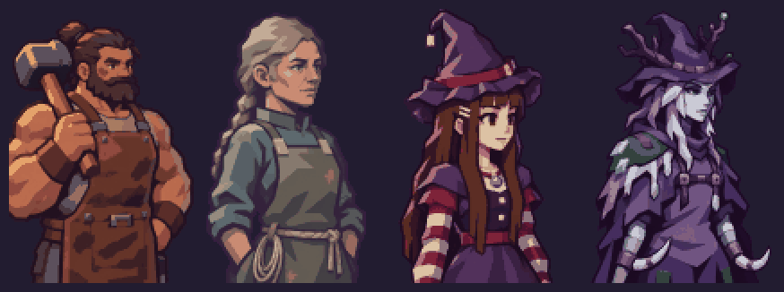

* **Neue Dialogporträts:** **Torben**, **Esma (Nebelhexe)** und **Morwenna** erhalten brandneue Charakterporträts im Dialogfenster!
* **Überarbeitete Klassiker:** **Maren** wurde komplett neu gestaltet; der **Ritter / Valdric** tritt in Version 3 an, und **Ellie** erhält ihr verfeinertes Porträt `v4` (inklusive eigenem Verwundet-Zustand).

🖼️ <b>Charakter-Parade: Alle wichtigen Figuren im Direktvergleich (Klicken zum Entfalten)</b>

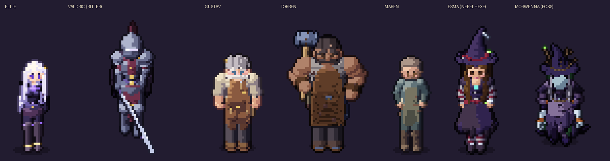

---

#### 5. 🎒 Einklappbare Hotbar, Getrennte Koop-Spielstände & Welt-Politur
* **Automatisch einklappende Hotbar:** Nach **`6,5 s`** ohne Slotwechsel sinken die Hotbar-Slots sanft nach unten ein (`24 px` tiefer, `34 px` schmaler je Seite), sodass ihr deutlich mehr Sicht auf Kämpfe und Landschaft habt – Level/XP sowie Gesundheits- und Ausdauerranken bleiben immer sichtbar. Jedes Umschalten, Inventaröffnen, neue Item oder gehaltene Stack entfaltet sie in **`0,08 s`** wieder!
* **Getrennte Solo- & Koop-Spielstände + Treue Gast-Identität:** Wer eine Mehrspieler-Partie hostet (*KOOP FORTSETZEN*), speichert ab sofort in einem eigenen Koop-Spielstand – euer Solo-Abenteuer bleibt unangetastet! Zudem besitzen beitretende Freunde nun eine feste Identität: Inventar, angelegte Kristalle, XP, Kupfer, Talente, Rohstein-Würfe, Tafel-Aufträge und eigene Tagebuch-Seiten bleiben beim erneuten Beitreten erhalten.
* **Schwarzes Brett – Kennenlernen-Regel:** Nur Bewohner, mit denen ihr bereits persönlich gesprochen habt (z. B. Esma oder Ilva erst nach eurem Besuch), hängen reguläre Tagesaufträge, Anlässe oder Steckbriefe auf; bei noch unbekannten Story-Absendern steht *„UNBEKANNT“*.
* **Schwimmen im Hexenwald-See:** Tiefes Wasser löst die Schwimm-Animation im Zuge des neuen Sees und der nächtlichen Seeglimmer-Suche jetzt wieder direkt ohne Wat-Schwelle aus.

---

### ⚖️ Balance & Spielwerte auf einen Blick

| Status | Bereich / Parameter | Vorher (V0.7.1) | Jetzt (V0.8.0) | Auswirkung im Spiel |
|---|---|---|---|---|
| 🟣 `NEU` | **Magiesystem & Stäbe** | Keine Zauberstäbe | **5 Schulen (50 Steine), `2` Stäbe** | Kristalle in Hotbar-Stäben laden sich selbst ohne Mana auf |
| 🟣 `NEU` | **Doppelzinken-Stab (Bleichgabel)** | Nur Einzelstab-Konzept | **`2` Zinken (`x1,25` / `x1,5` Kombo)** | *Gleichklang* (`-15 %` CD) oder *Zwiespalt* (`x1,5` Gabelschlag) |
| 🟣 `NEU` | **Schauplatz & NPC: Seehexe Ilva** | Nur leerer See im Westen | **Pfahlhaus, `250 px` Bannring & Quest** | `Seepfad`, sicherer Bannring gegen Nebel, *Läutern* & *Schliff* |
| 🟣 `NEU` | **Sammel-Rohsteine (See)** | Keine Ufer-Steine | **`Seeglimmer` (Nacht) & `Seemondstein` (Tag)** | Verbergen vorbestimmte Kristalle I–IV zum kostenlosen *Läutern* |
| 🔵 `REWORK` | **Boss-Verhalten bei Nebeltarnung** | Greifen Spieler immer an | **Mornath & Morwenna verlieren Ziel** | *Nebelschleier* unterbricht gezielte Verfolgung & Angriffe |
| 🟣 `NEU` | **Quest-Tagebuch (`J`)** | Mehrere HUD-Nebenzweige | **Vollwertiges Buch + `ARCHIV` + Fokus** | Ellies Skizzen/Gedanken, Auftragszettel, Einzel-Fokus & Abbrechen |
| 🟣 `NEU` | **Charakter-Porträts** | Teilweise ohne Bild | **Neue Bilder für Torben, Esma, Morwenna, Maren, Valdric, Ellie** | Einheitlicher `103 × 153` Pixel-Art-Look in Dialogen |
| 🟢 `BUFF` | **Einklappbare Hotbar** | Immer voller Rahmen | **Faltet nach `6,5 s` um `24 px` ein** | Mehr freie Sicht im Gefecht & bei Erkundungen (`0,08 s` Aufklappzeit) |
| 🟢 `BUFF` | **Koop-Speicherung & Identität** | Geteilter Save / Gäste flüchtig | **Separater Koop-Save & feste Gäste** | Gast-Inventare, Talente, Kristalle & Tagebuch überdauern Neustarts |
| 🔵 `REWORK` | **Brett-Bekanntheit & Tiefwasser** | Jeder Bewohner hängt Zettel; `56 px` Wat-Schwelle | **Erst ab Kennenlernen; direktes Schwimmen** | Verhindert Spoiler-Zettel & passt zum tiefen Hexenwald-See |

---

### 🔮 Sneak Peek: Was erwartet euch als Nächstes?
*„In Ilvas Kristallwand spiegelt sich längst mehr als nur Wasserlicht – tiefe Adern von unbekanntem Quarz schimmern auch tief unter dem alten Steinbruch. Während sich eure ersten Zauberstäbe im Schein des Bannrings erwärmen, warten in den Schächten des Westens ganz neue Rohkristalle darauf, dem Felsen entrissen zu werden...“*

✦ ──────────────── ❖ ──────────────── ✦  
*Mit singenden Kristallen und frischer Tinte,*  
**Euer Shadowspore-Entwicklerteam ✨📜**

---

## [V0.7.1 Beta] – 2026-11-11
### 🕳️ Risse in der Leere & Gedächtnis der Stadt: Schattenschritt, Schwarzes Brett-Ausbau, Steckbriefe, Dreistufige Gangarten & Hexenwaldsee

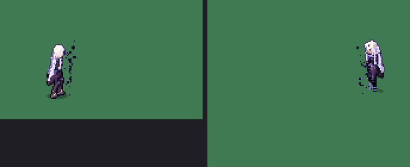

> 📜 ***Gefunden zwischen frischer Morgentau-Tinte am Schwarzen Brett:***  
> *„Kaum bricht die Dämmerung durch den Frühnebel, rascheln am Dorfplatz schon die ersten Pergamente im Morgenwind. Eine kleine Knospe über dem rechten Pfosten pocht wie ein Herz aus Licht – ein Eilbrief vom Zimmermeister! Nach dem letzten Unwetter klaffen Lücken in der Palisade, und am linken Rand nagelt jemand mit zitternder Hand einen neuen Steckbrief an: ‚DER KLOTZ‘ hat die Nacht überlebt und schleicht noch irgendwo im Süden. Eine Krähe flattert auf die Dachschindeln herab, zupft ein vergilbtes Blatt von gestern vom Brett und verschwindet im Himmel über dem neuen See im Hexenwald...“*

---

> [!IMPORTANT]
> **Fähigkeiten-Umbau („Schattenschritt“ ersetzt „Schattenblink“):**  
> Der bisherige *Schattenblink* wurde archiviert und durch den neuen **Schattenschritt** (`Alt` / Gamepad `B`) abgelöst. Der dritte Talentzweig im Fähigkeitsgraphen trägt ab sofort den Namen **LEERE** – bestehende Spielstände werden beim Laden automatisch auf den neuen Skill übertragen!

> [!TIP]
> **Taktik-Tipp zum Ausweichen:**  
> Der *Schattenschritt* bricht sofort jeden Schwertschlag, jede aufgeladene Attacke (kostenlos!) und selbst Ernte- oder Trank-Animationen ab. Wer dabei eine Richtung hält, nimmt sein volles Tempo – selbst einen laufenden Sprint – nahtlos mit durch den Leere-Riss!

---

### 🌟 Die Großen Highlights

#### 1. 🕳️ Neue Leere-Fähigkeit: Der Schattenschritt (`Alt` / Gamepad `B`)
Die erste und zentrale Technik des **LEERE**-Zweigs ersetzt den bisherigen Blink durch einen reaktionsschnellen, wuchtig inszenierten Ausweichschritt:

* **Sofortiger Ausweichschritt:** Ellie reißt einen zackigen Riss in die Luft und schlüpft geradlinig **`54 px`** weit in Laufrichtung – oder im Stand direkt auf den Mauszeiger zu (stoppt sicher vor Wänden; bei unter `12 px` Platz wird kein Schritt verbraucht).
* **Wahrer Abbruch („True Dodge Cancel“):** Kann aus absolut jeder Aktion heraus aktiviert werden – bricht laufende Schwertkombos in jeder Phase, aufgeladene Angriffe (ohne Verlust), Pflücken, Essen und Trinken sofort ab. Nach dem Schritt ist das Schwert umgehend wieder bereit.
* **Schutzfenster & Schwung:** Während Auflösung und Rematerialisierung gewährt der Schritt **`0,26 s`** Unverwundbarkeit gegenüber direkten Treffern (anhaltende Effekte wie Gift oder Brand ticken normal weiter). Bei gehaltener Lauftaste sprintet oder läuft Ellie ohne Verzögerung am Zielort weiter.
* **Kosten & Talisman-Synergie:** Kostet **`14 + Level` Ausdauer** (`15` auf Stufe 1) bei **`0,8 s`** Abklingzeit. Talismane mit der Eigenschaft **SCHRITTPAUSE** (wie die legendäre *Rissfeder* mit `-30 %` Cooldown und `+40 %` Sturzflug-Bonusschaden) verstärken direkt den Schattenschritt.
* **Spektakuläre Riss-Optik:** Beim Absprung löst sich Ellie von ihrer Vorderkante aus mit Glitch-Streifen pixelweise in einen violett glühenden Leere-Riss auf, hinterlässt einen zerfallenden Bodenring samt Schattenfleck und materialisiert sich auf der Gegenseite wieder.

🎞️ <b>Zeitlupen-Studie: Pixel-Auflösung & Leere-Riss im Detail (Klicken zum Entfalten)</b>

---

#### 2. 📜 Großer Ausbau des Schwarzen Bretts: „Das Gedächtnis der Stadt“
Das Schwarze Brett auf dem Dorfplatz erwacht endgültig zum Leben und reagiert ab sofort aktiv auf Vorräte, Wetter, Mondphasen, Übergriffe und erledigte Heldentaten:

* **Eine lebendige Tafel:**
  * **Neuigkeiten-Knospe:** Über dem rechten Pfosten leuchtet und atmet eine kleine Knospe. Ungelesene Aushänge lassen sie schnell pulsieren, Funken aufsteigen und ihr Nachtlicht heller scheinen (*Türkis* normal, *Gold* Story-Siegel, *Rot* Eil- oder Steckbrief). Sobald ihr das Brett öffnet oder **`2 s`** davor steht, gelten die Zettel als gelesen.
  * **Alternde Pergamente (4 Stufen):** Normale Zettel vergilben über die Tage (`+40 %`), werfen am unteren Rand Wellen, bekommen Eselsohren, verblassende Tinte und hängen am letzten Tag schief am Nagel (Story-Siegel altern nie).
  * **Wind, Regen & die Brett-Krähe:** Windböen lassen Zettelecken flattern; bei Regen weicht das Papier blaugrau durch und die Tinte verläuft (unter dem Brettdach besser geschützt). Abgelaufene Zettel bleiben kurz als „Geister“ hängen, bis eine Dorfkrähe auf dem Dach landet und sie abzupft – oder der Wind sie hinabweht.
  * **Direktes Melden beim Auftraggeber:** Fertige Aufträge werden ab sofort direkt beim jeweiligen Bewohner abgegeben (`110 px` Reichweite) – auch bei **Esma** im Hexenturm! Zudem gewährt jeder angenommene Zettel eine **persönliche Frist von mindestens 2 Tagen**, selbst wenn er draußen am Brett abläuft.
* **6 Reaktive Stadt-Anlässe (mit *Warum*-Vermerk):**
  * **Lager-Mangel („DAS LAGER IST LEER“):** Sinken Holz (`< 20`), Faser (`< 6`) oder Stein (`< 10`), bittet Gustav gezielt um Nachschub (`+20 %` Lohn).
  * **Nach dem Sturm („WEGEN DES STURMS“):** Nach Unwettern hängen morgens Eilaufträge für Reparaturholz.
  * **Nach dem Vorstoß („NACH DEM VORSTOSS“):** Kamen Monster bis ans Dorflicht heran, benennt Valdric den betroffenen Sektor samt Himmelsrichtung und Art für eine Vergeltungsjagd (`+40 %` Lohn).
  * **Neumond-Nachtjagd („NEUMOND“):** Bei Neumond startet Valdric ab Tag 3 Jagden auf `4–6` Wesen (`+50 %` Lohn), die **ausschließlich bei Nacht** zählen!
  * **Vollmond-Blüte („VOLLMOND“):** Esma sucht seltene Nachtblüten wie *Mondglocken* und *Nebellilien* (`+40 %` Lohn).
  * **Feuchte Tage („ES HAT GEREGNET“):** Nach zwei Regentagen fragt Esma nach frisch sprießenden Pilzen (`+20 %` Lohn).
* **Eilzettel mit rotem Wachssiegel:** Laufen noch am **selben Abend vor der Dämmerung** ab (max. `1` gleichzeitig, aus Sturm-Anlässen oder mit `12 %` Aufwertungschance ab Vertrauen `20`), zahlen dafür **doppeltes Kupfer, doppelte XP, doppeltes Vertrauen** und ein **garantiertes Bonus-Item**!
* **Steckbriefe & „Gezeichnete“ Elites:**
  * Überlebt ein nächtlicher Elite den Morgengrauen-Rückzug (`7 s` Flucht), verbrennt er nicht länger, sondern entkommt mit eigenem Namen (z. B. *„Der Klotz“*, *„Brecher vom Rand“*, *„Steinschulter“*)!
  * In späteren Elite-Nächten kehrt er mit **`+10 %` extra Lebenspunkten je überlebter Nacht** (bis maximal `3` Nächte) zurück.
  * Am linken Brett-Pfosten hängt ein eigener **Steckbrief mit Tintenskizze und Strichliste**. Jeder Koop-Spieler, der den Steckbrief angenommen und den Gezeichneten im Kampf **mindestens einmal getroffen** hat, erhält den vollen Lohn (`420+` Kupfer, `+20 %` je überlebte Nacht, `90 XP`, `+12` Vertrauen und sicher `void_slag`)!
* **Ehrentafel, Dankband & Wachsende Tafel:**
  * Neuer dritter Reiter **EHRENTAFEL** im Brettfenster mit Stadt- und Spielerzählern, Verewigung gefallener Gezeichneten sowie **7 freischaltbaren Titeln**, die ihr aktiv tragen könnt (auch im Pausenmenü unter *STADT* sichtbar!).
  * **Das Dankband:** Unter dem Brett pendelt eine Schnur mit den letzten **`12`** bunten Dankeszetteln der Stadt.
  * **Wachsende Tafel:** Bei **25, 50 und 100** erledigten Stadtaufträgen wächst die maximale Anzahl einfacher Aushänge jeweils um **`+1`** (bis zu `6` Plätze) – sichtbar gekrönt durch eine neue Laterne, ein zweites Schindelpaar und ein Ehrenschild!

🏆 <b>Übersicht: Alle 7 freischaltbaren Ehrentitel (Klicken zum Entfalten)</b>

| Titel | Bedingung | Kategorie |
|---|---|---|
| **HANDLANGER** | `5` abgeschlossene Tafel-Aufträge | Allgemeine Aufträge |
| **VERLÄSSLICH** | `15` abgeschlossene Tafel-Aufträge | Allgemeine Aufträge |
| **RÜCKGRAT DER STADT** | `40` abgeschlossene Tafel-Aufträge | Allgemeine Aufträge |
| **DUNKELRÄUMER** | `30` über die Tafel erlegte Kreaturen | Jagd-Aufträge |
| **EILBOTE** | `5` rechtzeitig erfüllte Eilzettel | Eilaufträge |
| **NAMENSJÄGER** | `1` besiegter Gezeichneter | Steckbriefe |
| **JEDERMANNS FREUND** | Aufträge für `4` verschiedene Bewohner erledigt | Dorfgemeinschaft |

---

#### 3. 🧭 Quest-Ast & Weltkarten-Integration
Angenommene Aushänge vom Schwarzen Brett fügen sich jetzt nahtlos ins HUD und die Weltkarte ein:

* **Mehrere Quests im HUD-Zweig:** Unter der Hauptquest hängen ab sofort bis zu **3 angenommene Tafel-Zettel als eigene kleine Nebenzweige** mit Farbkodierung (Creme für Beschaffung, Rot für Jagd, leuchtendes Türkis bei Abgabebereitschaft) und Zähler (`7/12`); überzählige Zettel werden als `+N` gebündelt. Bei Eilzetteln tickt rund um die Knospe ein roter **Frist-Ring**. Gibt es keine Story-Quest, übernimmt der oberste Zettel selbst den großen Hauptzweig! Im Reiter *ANGENOMMEN* bestimmt ihr per **`E` (`VERFOLGEN`)**, welche Zettel im HUD sichtbar sind.
* **Dynamische Kartenmarker:**
  * **Fertige Aufträge:** Zeigen direkt auf dem jeweiligen Auftraggeber (wandert mit!) ein angepinntes Zettel-Symbol samt „MELDEN <Name>“ und Richtungspfeilen am Kartenrand.
  * **Such- & Fundbereiche:** Gestrichelte goldene Ringe markieren Wuchsgebiete für Vollmond-Pflanzen (z. B. *Mondglocke* & *Nebellilie* im Nebelwald), rote Ringe das gemeldete Einsatzgebiet nach einem nächtlichen Vorstoß.
  * **Steckbrief-Fadenkreuz:** Ein pulsierendes **magenta Fadenkreuz** und ein **`40 m` Suchkreis** weisen euch zum letzten Sichtort des entkommenen Gezeichneten!
* **Kulante Wegpunkt-Erkennung:** Bei normalen *Erreichen*-Questzielen genügt nun auch ein nahes Vorbeistreifen (innerhalb des doppelten Radius beim Weitergehen), damit der Schritt zuverlässig fortschreitet.

---

#### 4. 🌊 Welt-Erweiterung: Der Hexenwald-See & neue Flussläufe
Die Nordwest-Region des Hexenwalds wurde um natürliche Gewässer erweitert, ohne bestehende Spielstände zu brechen:

* **Neuer Binnensee („Hexenwald-See“):** Ein malerischer, rund **`28 × 24` Kacheln** großer Waldsee (ca. `2.100` Kacheln Fläche) liegt nun eingebettet auf Ebene 0 im Hexenwald – komplett mit vierstufiger Türkis-/Blau-Tiefenschattierung und Uferglanz auf der Weltkarte.
* **Zwei neue Flussverbindungen:** Ein nördlicher Zufluss schließt die Lücke zwischen dem Süd-Bogen des Nordflusses und dem Westfluss nahe des Hexenturms, während ein zweiter Lauf den neuen Hexenwald-See nach Norden entwässert.
* **Entspanntes Durchwaten von Bächen:** Schmale Bäche und flache Furten durchwatet Ellie nun bequem (erst nach **`56 px`** Strecke oder **`1,0 s`** Verweilen in tiefem Wasser wechselt sie ins Schwimmen; Seen werden wie gewohnt geschwommen). Außerdem verbleibt beim Klettern oder Ausstieg ans Ufer kein hartnäckiger Schwimmring mehr.

---

#### 5. 🏃 Dreistufiges Gangarten-System, Animations-Politur & Welt-Optik
Ellies Bewegung und die Spielwelt fühlen sich spürbar dynamischer, geschmeidiger und stimmungsvoller an:

* **Gehen, Joggen & Sprinten (`104 → 124 px/s`):**
  * Ellie erhält einen eigenen **dritten Gang – das aufrechte Joggen** – und ein erhöhtes **Sprint-Spitzentempo von `124 px/s`**.
  * Welcher Zyklus läuft, bestimmt ab sofort ihre **echte, aktuelle Geschwindigkeit**! Wird sie im dichten Hexenwald-Nebel, auf zähem Untergrund oder verwundet gebremst, joggt sie natürlich statt unrealistisch auf der Stelle zu sprinten. Beim Stehenbleiben schwingt ihr Schritt sanft bis zum Füßeschluss (`0,22 s`) aus.

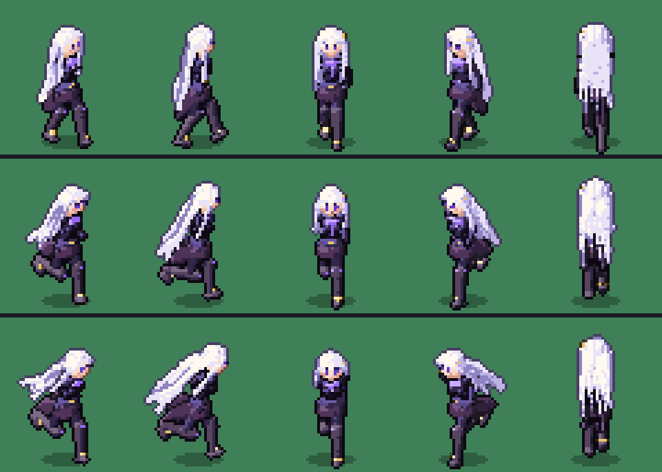

* **Überarbeitetes Gehen & Schleichen:** Der normale Gehzyklus wurde beruhigt (kein unnatürliches Hinken mehr), und beim Schleichen sinkt die Oberkörper-Neigung von `0,44` auf **`0,27`** – so bleiben Ellies Kopf und Pony aufrecht im Blickfeld statt vornüber zu hängen.

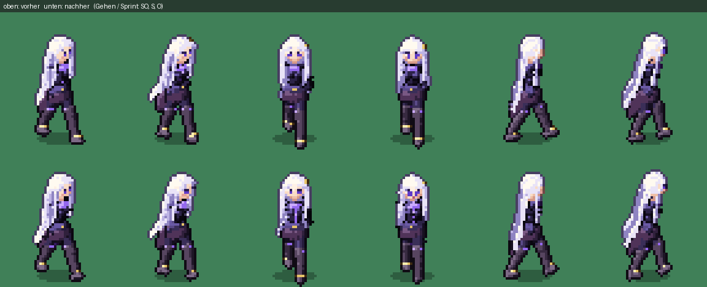

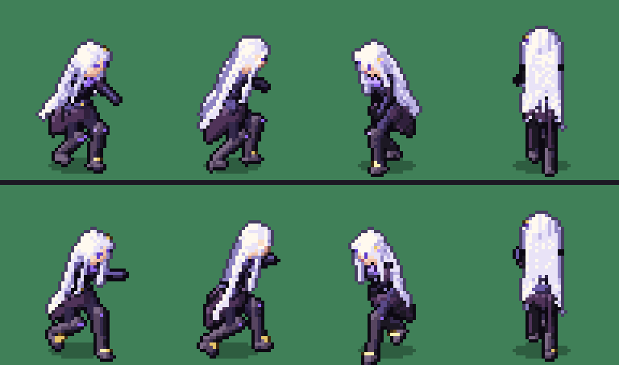

* **Animiertes HUD-Wettericon:** Neben der Tageszeit-Anzeige erscheint ab sofort **immer** ein eigenes lebendiges Pixel-Wettericon (rotierende Sonne, Mondsichel, treibende Nebelbänke, fliegende Sturmböen, dynamisch dichter Regen oder aufzuckender Blitz).
* **Weichere Wolken & lebendige Regentropfen:** Wolkendecken schmiegen sich mit geschmeidigen Rändern statt harten Dither-Punkten in den Himmel; Regentropfen auf Flüssen, Seen und Pfützen variieren Größe, Reichweite und Häufigkeit deutlich stärker zwischen Nieselregen und Starkregen.
* **Einheitliche Pixeldichte & Klee-Save-Fix:** Krummholz auf Höhenzügen und nachgesäte Wildpflanzen behalten exakt die einheitliche Pixelgröße der gesamten Spielwelt. Zudem werden ausgeschnittene Kleefeld-Stellen beim Laden eines Spielstands nun wieder fehlerfrei wiederhergestellt.

---

### ⚖️ Balance & Spielwerte auf einen Blick

| Status | Bereich / Parameter | Vorher (V0.7.0) | Jetzt (V0.7.1) | Auswirkung im Spiel |
|---|---|---|---|---|
| 🔵 `REWORK` | **Ausweichfähigkeit (LEERE)** | Schattenblink (`Leertaste`) | **Schattenschritt (`Alt` / `B`)** | `54 px`, `0,8 s` CD, `14 + Lvl` Ausdauer, `0,26 s` Schutz & Abbruch |
| 🟢 `BUFF` | **Sprint-Geschwindigkeit** | `104 px/s` | **`124 px/s`** | Spürbar flinkeres Entkommen und Überqueren großer Lichtungen |
| 🟣 `NEU` | **Jog-Zyklus (Dreistufig)** | Nur Gehen & Sprint | **Gehen / Joggen / Sprinten** | Animation passt sich echter Geschwindigkeit im Nebel/Schlamm an |
| 🔵 `REWORK` | **Schleich-Haltung (Torso)** | Neigung `0,44` | **Neigung `0,27`** | Aufrechterer Kopf und ruhigerer Schleicher-Gang |
| 🟢 `BUFF` | **Bäche durchwaten** | Sofortiges Schwimmen | **Ab `56 px` / `1,0 s` tiefem Wasser** | Kurze Bäche und schmale Furten lassen sich direkt durchwaten |
| 🟣 `NEU` | **Stadt-Anlässe (Brett)** | Reine Zufallszettel | **6 reaktive Welt-Anlässe** | Lagerlücken, Sturm, Vorstöße, Neumond (`+50 %`), Vollmond & Regen |
| 🟣 `NEU` | **Eilzettel & Persönliche Frist** | Keine Eilzettel; Aushang-Ende | **Dämmerungs-Frist (2x Lohn) + min. `2 T`** | Doppelte Belohnung & garantierter Extra-Drop am Brett |
| 🟣 `NEU` | **Steckbriefe (Gezeichnete)** | Elites verbrennen morgens | **Fliehen (`+10 %` HP/Nacht), `420+` Kupfer** | Eigener Steckbrief, Fadenkreuz & Belohnung für jeden Treffer |
| 🟣 `NEU` | **Ehrentafel & Wachstum** | Max. `4` einfache Zettel | **7 Titel, Dankband, bis `6` Plätze** | Brett wächst bei `25 / 50 / 100` erfüllten Stadtaufträgen |
| 🟣 `NEU` | **HUD & Karten-Marker** | Nur Hauptquest sichtbar | **Bis `3` Nebenzweige & Marker** | Fundbereiche, Einsatzkreise, Auftraggeber-Pins & Fadenkreuz |
| 🟣 `NEU` | **Hexenwald-See & Flüsse** | Kein Binnensee dort | **`28 × 24` See + 2 neue Flussarme** | Neuer Anlaufpunkt und natürliche Gewässer-Verbindung im Forst |
| 🟢 `BUFF` | **Wetter-Icon & Wolken** | Nur Text bei Unwetter | **Ständiges Pixel-Icon & weiche Wolken** | Klares Wetter-Feedback direkt an der Uhr ohne Dither-Härte |

---

### 🔮 Sneak Peek: Was erwartet euch als Nächstes?
*„Mit dem neuen Hexenwald-See füllen sich auch die versteckten Wasseradern westlich des Dorfes – doch tief unter dem Uferschlamm glüht noch immer unbekanntes Erz. Während Valdric seine neuesten Steckbriefe sammelt, bereitet sich ein völlig überarbeitetes Kapitel-System für kommende Abenteuer vor...“*

✦ ──────────────── ❖ ──────────────── ✦  
*Durch Schattenrisse und klare Fluten,*  
**Euer Shadowspore-Entwicklerteam 🕳️📜**

---

## [V0.7.0 Beta] – 2026-11-11
### 🌾 Ernte, Sturm & Spiegelscherben: Ackerbau, Dynamische Wetterfronten, Schwarzes Brett, Boss Morwenna & Leere-Alchemie

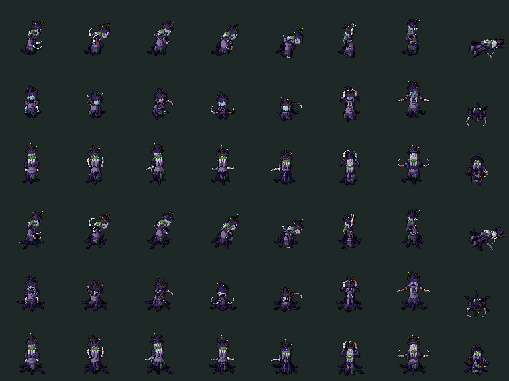

> 📜 ***Aus einem durchnässten Brief von Gustav an der Dorfpforte:***  
> *„Wer hätte gedacht, dass aus dem Schlamm dieser einsamen Lichtung einmal etwas sprießen würde? Die ersten Beete sind gehackt, und der Knollenkeim streckt zarte Blätter dem Himmel entgegen. Doch blickt nach Süden, Freunde... Über dem Hexenwald braut sich ein Sturm zusammen. Der Himmel verfärbt sich giftgrün, Blitze zucken durch die Ulmen und die Raben kreischen wie besessen um ihren alten Baum. Haltet eure Gießkannen bereit, wetzt die Sicheln und werft einen Blick auf das neue Schwarze Brett am Dorfplatz – es gibt viel zu tun, ehe die Nacht hereinbricht!“*

---

> [!WARNING]
> **Wetterwarnung & Sturmnacht:**  
> Bei Starkregen und Gewitter dunkelt die Welt merklich ab. Regentage wässern eure Felder zwar automatisch, doch im Schutz des Donnergrollens schleichen Schattenkreaturen leiser heran. Bringt eure Ernte rechtzeitig ins Trockene!

> [!TIP]
> **Taktiker-Hinweis zur Ernte:**  
> Wer seine Beete ununterbrochen jede Nacht wässert, erhält bei der Ernte den begehrten *Pflege-Bonus* (+1 zusätzlicher Ertrag). Wundblatt-Pflanzen müssen nach dem Pflücken nicht neu gesät werden – sie wachsen von selbst alle zwei Nächte nach!

---

### 🌟 Die Großen Highlights

#### 1. 🌾 Ackerbau & Farming-System (Die Kategorie ACKER)
Die Selbstversorgung des Dorfes erreicht eine völlig neue Dimension: Gustav schaltet nach der Fertigung der ersten Werkzeuge die neue Bau-Kategorie **ACKER** frei!

* **Scholle brechen mit der Hacke:** Mit der geschmiedeten Hacke brecht ihr den rohen Erdboden in gehackte Ackerfurchen auf. Durch mehrmaliges Harken hält die Furche länger vor dem Verwildern.
* **Dynamische Feld-Verschmelzung:** Platzierte 3x3-Felder verschmelzen an den Kanten nahtlos miteinander zu zusammenhängenden Großäckern mit bröseligen Rändern und feinen Krümeln.
* **Wildsamen & Aussaat:** Beim Pflücken von Wildpflanzen erhaltet ihr nun wertvolles Saatgut:
  * **Knollenkeim (45 % Chance bei Erdknollen):** Gedeiht in 4 Nächten zu 2–3 schmackhaften Knollen.
  * **Glutmöhrensamen (50 % Chance bei Glutbeeren):** Wächst in 5 Nächten heran und leuchtet bei Nacht mit feurigem Glanz auf dem Feld.
  * **Nachtrübensamen (50 % Chance bei Nachtrüben):** Reift in 6 Nächten zu schimmernden Rüben heran.
  * **Wundblattsamen (40 % Chance bei Wundblättern):** Benötigt nur 3 Nächte und wächst danach alle 2 Nächte automatisch nach!
* **Gießen & Feuchtigkeits-Glanz:** Mit der Gießkanne versorgt ihr die Saat mit lebenswichtigem Wasser. Nasse Erde färbt sich tiefdunkel und glitzert in der Sonne. Nur gewässerte Beete wachsen über Nacht weiter.

📖 <b>Farming-Almanach: Wachstumszyklen & Pflege (Klicken zum Entfalten)</b>

| Feldfrucht | Saatgut | Wachstumsdauer | Ertrag | Besonderheit |
|---|---|---|---|---|
| **Erdknolle** | Knollenkeim | 4 Nächte (1-1-2) | 2–3 Knollen | 35 % Chance auf Samenrückgabe |
| **Glutmöhre** | Glutmöhrensamen | 5 Nächte (1-2-2) | 1–2 Möhren | Leuchtet nachts auf dem Acker |
| **Nachtrübe** | Nachtrübensamen | 6 Nächte (2-2-2) | 1–2 Rüben | Hohe Nährkraft für Alchemie |
| **Wundblatt** | Wundblattsamen | 3 Nächte (1-1-1) | 1–2 Blätter | Wächst alle 2 Nächte nach (`regrow`) |

---

#### 2. ⛈️ Dynamisches Wettersystem & Himmelsdynamik
Das Wetter zieht als lebendige Kraft über Shadowspore und formt Umwelt, Sicht und Gameplay.

* **10 Dynamische Wetterlagen:** Von strahlendem *Klar* und sonnigem *Heiter* über *Nieselregen*, gleichmäßigen *Regen*, prasselnden *Starkregen*, peitschenden *Sturmwind* bis hin zu dichten *Nebelbänken* und tosenden *Gewittern*.
* **Räumliche Wolkenfelder & wandernde Schatten:** Echte Wolkendecken treiben mit der Windrichtung über die Kontinente und werfen scharfe, wandernde Wolkenschatten auf Wiesen und Klippen.
* **Atmosphärische Gewitter & Blitze:** Bei Unwettern zucken reale Blitze vom Himmel, erhellen für Sekundenbruchteile das Land und lassen Doppelblitze aufzucken. Im Hexenwald leuchten Blitze in giftigem Smaragdgrün!
* **Unterstand & Lebenswelt:** Dichte Baumkronen spenden natürlichen Regenschutz. Flüsse und Seen bilden Regenkringel, und Regentage gießen automatisch jedes angelegte Feld im Dorf!
* **Einfluss auf die Jagd:** Starkregen und Sturm dämpfen Geräusche (Monster-Alarmreichweite sinkt um bis zu 40 %), während seltene Gewitterfische bei Unwetter an die Wasseroberfläche drängen.

---

#### 3. 📋 Das Schwarze Brett (Quest-Tafel im Dorf)
Auf dem Dorfplatz kann nun das monumentale **Schwarze Brett** (`quest_board`) errichtet werden.
* **Bürger-Aufträge & Kopfgelder:** Anschläge von Gustav, Valdric und Torben bieten Belohnungen für Ressourcenlieferungen, Monsterjagden und Erkundungen.
* **Fortschritt & Aushänge:** Neue Zettel und Pergamente flattern dynamisch im Wind und informieren über anstehende Events und Welt-Meilensteine.

---

#### 4. 🪞 Voll spielbar: Bosskampf gegen Morwenna, die Spiegelhexe
Der zweite Story-Boss erwacht im Schieferkessel am Großen Rabenbaum zu vollem Leben!

* **Vollständiges 3-Phasen-Gefecht:**
  * **Phase 1:** Harzschnitt-Kombos, wendige Schatten-Finten und zeitversetzte Wurzelspeere aus dem Boden.
  * **Phase 2 („Der Spiegel zerbricht“):** Zersplitterung der Maske, Scheren-Zangenangriffe und erste permanente Glitch-Klone, die im Takt mit Morwenna zuschlagen.
  * **Phase 3 („Die Hexenstunde“):** Morwenna entfesselt zwei Klone gleichzeitig, sperrt das Areal mit Fluchspiegel-Käfigen ab und startet rotierende Karussell-Angriffe.
* **Die Raben als Verbündete:** Fliegt Morwenna im Glitch-Swap auf eine andere Position, kreischen die Raben in den Baumkronen zielsicher über dem echten Original!
* **Legendäre Beute:** *Moras Spiegelscherbe* (`mora_shard`) für Alchemie und Veredelung sowie Replay-Hologramm zur Wiederholung des Kampfes.

---

#### 5. 🧪 Erweiterte Alchemie: Spezial- & Leere-Sude
Esmas Kessel im Hexenwald bietet ab sofort Zugriff auf 4 mächtige Spezial-Tranklinien in je 3 Reifegraden:
* **Aschenhaut (I–III):** Reduziert erlittenen Feuerschaden um 40 % bis 60 %; Stufe III macht 60 Sekunden lang völlig immun gegen brennenden Boden.
* **Klarblick (I–III):** Bis zu 120 Sekunden absoluter Schutz vor Halluzinationen im Nebel; Pflückpflanzen funkeln golden und Schattenmonster verraten sich durch glühende Augen.
* **Irrlichtsud (I–III):** Beschwört ein treues Irrlicht herauf, das die Dunkelheit bannt und Schattenmonster zurückscheucht (steigert im Gegenzug die Aufmerksamkeit der Nacht).
* **Leere-Trank (I–III):** Reißt für bis zu 7 Sekunden eine Mini-Leere um Ellie auf – massiver Void-Schaden gegen umstehende Feinde mit bis zu 75 % Lebensraub!

---

#### 6. ⚔️ Animationen & Gameplay-Feinschliff
Alle Charakter-Animationen wurden von Grund auf überarbeitet und auf maximale Flüssigkeit poliert.

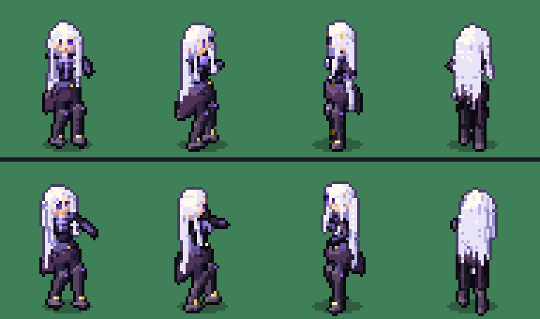

* **Dynamischer Vorher-Nachher-Sprung:** Ob Laufen, Sprinten, Schleichen, Brustschwimmen, Kraulen oder die 5-Stufen-Schwertkombo – Übergänge greifen geschmeidig ineinander.
* **Präzises Hit-Feedback:** Schläge fühlen sich wuchtiger an, Waffenschweife ziehen sauber durch die Luft und Trefferzonen passen sich pixelgenau an.

---

### ⚖️ Balance & Spielwerte auf einen Blick

| Status | Bereich / Parameter | Vorher | Jetzt (V0.7.0) | Auswirkung im Spiel |
|---|---|---|---|---|
| 🟣 `NEU` | **Ackerbau-Kategorie ACKER** | Keine | **Freischaltbar bei Gustav** | Felder, Hacke, Gießkanne & 4 Saatgut-Arten |
| 🟣 `NEU` | **Ernte-Pflegebonus** | – | **+1 Extra-Ertrag (`ripe_bonus`)** | Belohnt tägliches Wässern ohne Aussetzer |
| 🟣 `NEU` | **Wundblatt-Nachwachsen** | Einmalige Ernte | **Alle 2 Nächte (`regrow: 2`)** | Dauerhafte Heilkräuterquelle auf dem Acker |
| 🟣 `NEU` | **Dynamisches Wettersystem** | Starres Licht | **10 Wetterlagen & ziehende Wolken** | Von Sonnenschein bis Unwetter mit Blitzen |
| 🟢 `BUFF` | **Feld-Bewässerung bei Regen** | Manuell mit Kanne | **100 % automatisch gegossen** | Regentage sparen Zeit und Gießkannenschwünge |
| 🟢 `BUFF` | **Schleichen bei Unwetter** | 100 % Alarm | **Bis zu -40 % Alarmreichweite** | Monster hören Schritte bei Regen und Sturm schlechter |
| 🟣 `NEU` | **Gewitter-Angeln** | Standardfische | **Spezielle Gewitter-Beißrate (0.85)** | Seltene Fische drängen bei Sturm an die Oberfläche |
| 🟣 `NEU` | **Schwarzes Brett (Dorf)** | – | **Errichtbar für Quests & Kopfgelder** | Zentraler Anlaufpunkt für Bürger-Aufträge |
| 🟣 `NEU` | **Bosskampf Morwenna** | Nur Konzept | **Vollständig spielbar (3 Phasen)** | Glitch-Klone, Klon-Tausch & Spiegelscherben |
| 🟣 `NEU` | **Spezial-Tränke (4 Linien)** | Nur Heilung/Ausdauer | **Aschenhaut, Klarblick, Irrlicht & Leere** | Bis zu 75 % Lebensraub und Feuer-Immunität |
| 🟢 `BUFF` | **Charakter-Animationen** | Starre Frames | **Komplett geglättete Animations-Loops** | Spürbar flüssigeres Laufen, Schwimmen & Kämpfen |

---

### 🔮 Sneak Peek: Was erwartet euch als Nächstes?
*„Unter dem tiefen Grollen der Gewitterfront hallt ein metallischer Klang aus dem Westen wider. Gustav hat alte Grubenpläne entrollt, und Torben bereitet schwere Spitzhacken vor: Das Tor zu den **Alten Tiefenminen** steht kurz vor der Öffnung... Macht eure Laternen bereit!“*

✦ ──────────────── ❖ ──────────────── ✦  
*Mit leuchtenden Sporen und geschärften Klingen,*  
**Euer Shadowspore-Entwicklerteam 🌿⚔️**

---

## [V0.6.2 Beta] – 2026-11-10
### 🪞 Echo der Zerrissenen: Boss-Enthüllung Morwenna, Höhenstufen-Verdeckung, Mornath-Arena-Polishing & Kampffeinschliff

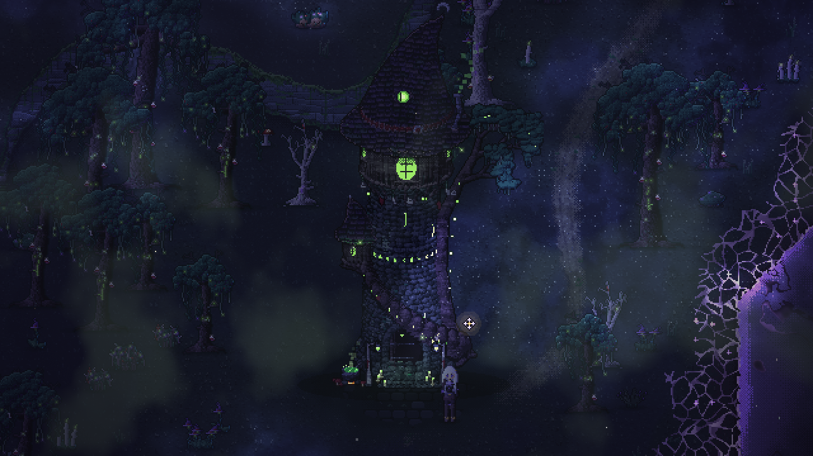

> 📜 ***Aus den Warnungen des alten Kriegers Valdric an der Schwelle zum Schieferkessel:***  
> *„Ellie... sieh dir das Siegel an jener zerbrochenen Klinge am Fuße des Rabenbaums an. Das dort in der Mulde ist kein gewöhnliches Ungeheuer des Forsts. Das ist Morwenna... die Großhexe des Alten Zirkels, von der die Chroniken berichten! Sie fiel damals nicht im Großen Riss – sie versuchte, ihre zerfallende Seele in das unsterbliche Herzholz des Baumes zu binden. Doch die Leere fraß ihren Zauber mitten im Vollzug. Sie existiert in einem ewigen, schmerzhaften Zerrissenwerden – und saugt dem Heiligtum der Raben die pure Lebenskraft aus. Tretet ihr nur mit klarem Geist und geschärfter Klinge entgegen...“*

---

> [!WARNING]
> **Gefahr am Schieferkessel:**  
> Morwenna bedient sich unberechenbarer Glitch-Klone und blitzartiger Scheren-Angriffe. Wenn sie Spiegelscherben heraufbeschwört, lauscht den Rufen der Raben in den Wipfeln – sie kreisen nur über der *echten* Hexe!

> [!TIP]
> **Taktiker-Hinweis zur Höhenstufe:**  
> Dank des neuen Höhenstufen-Systems könnt ihr Klippenkanten nun gezielt nutzen, um feindlichen Geschossen zu entgehen. Beachtet jedoch, dass höher gelegene Felsplateaus Angreifer unterhalb verbergen können.

---

### 🌟 Die Großen Highlights

#### 1. 🪞 Boss 2: Morwenna, die Spiegelhexe (Die Zerrissene)
Mit Morwenna betritt der zweite monumentale Story-Boss die Welt von Shadowspore! Ihr Treiben im Schieferkessel des Hexenwalds bedroht das gesamte Gefüge der Region.

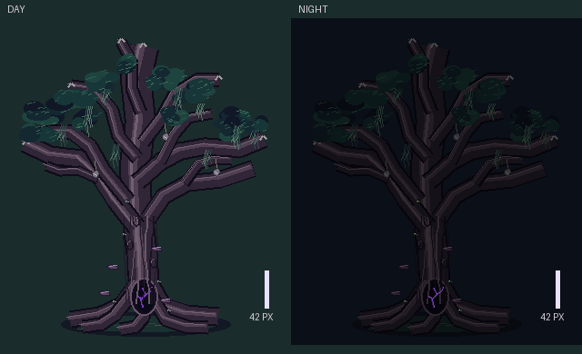

* **Die Tragödie des gescheiterten Wandels:** Morwenna existiert in einem permanenten, instabilen Transmutations-Limbus zwischen physischer Materie und Leere. Ihr Leib wird nur noch durch die Lebenskraft des uralten Rabenbaums zusammengehalten.
* **Unberechenbares Glitch-Verhalten:**
  * **Micro-Stutter & Spasmen:** Nach heftigen Schlägen friert ihr Körper kurzzeitig in knisternden Standbildern ein oder zuckt unwillkürlich zur Seite.
  * **Zweistimmigkeit:** Morwennas Stimme ist gedoppelt – eine erhabene Hexe überlagert von einem schneidenden Void-Echo.
  * **Permanente Scanline-Klone:** Flüchtige Raum-Fragmente ihrer Existenz unterstützen sie im Kampf. Sie besitzen keinen Bodenschatten und lösen sich bei Treffern in Nebel auf.
  * **Glitch-Swap:** Morwenna kann jederzeit blitzschnell die Position mit einem Klon tauschen *(Achtet auf die kreisenden Raben – sie markieren das Original!)*.
* **Mehrphasiger Gefechtsverlauf:**
  * **Phase 1 (100 % – 66 % HP):** Rasende Zick-Zack-Sprints, 3-teilige Harzschnitt-Kombos, Wurzelspeere aus dem Lehmboden und verlangsamender Fluchsaft.
  * **Phase 2 (66 % – 33 % HP – „Der Spiegel zerbricht“):** Eine Druckwelle schleudert Angreifer zurück; Morwennas Gesichtsmaske zersplittert. Erste permanente Glitch-Klone spalten sich ab, Scheren-Zangenangriffe und an Schieferfelsen abprallende Spiegelscherben setzen euch zu.
  * **Phase 3 (33 % – 0 % HP – „Der Schrei des Rabenbaums“):** Morwenna zapft die Hauptwurzeln an. Der gesamte Kessel gerät in Flammen; Fluchspiegel-Käfige sperren den Bewegungsraum ab, während sie zum finalen Vernichtungsschlag ausholt.

📖 <b>Boss-Dossier: Morwenna, die Spiegelhexe (Klicken zum Entfalten)</b>

| Eigenschaft | Detail |
|---|---|
| **Klassifizierung** | Gefallene Großhexe / Instabiles Void-Phänomen (Boss 2) |
| **Arena & Ort** | Schieferkessel am Großen Rabenbaum (Hexenwald, Tile 879, 914) |
| **Waffen** | Zwei verrostete Zeremonien-Sicheln aus Fluchsilber |
| **Schwachstelle** | Micro-Stutter nach schweren Scheren-Hieben; Klon-Entlarvung über die Raben |
| **Phasen-Schwellen** | Phase 1 (100 %), Phase 2 (66 %: Spiegelbruch), Phase 3 (33 %: Wurzel-Entfesselung) |

---

#### 2. 🏔️ Höhenstufen-Verdeckung & Klippenschatten (Elevation Occlusion)
Die räumliche Tiefe der Spielwelt wurde grundlegend modernisiert:
* **Echte visuelle Klippenüberhänge (`ReliefOverhang`):** Wenn Spielfiguren, Gegner oder Gegenstände südlich unterhalb einer Felskante stehen, werden sie nun physikalisch und perspektivisch korrekt von der Felswand überdeckt (`z_index = 1`).
* **Schattenwurf an Felswänden:** Höhere Plateaus werfen saubere Schattensäume auf die darunterliegenden Wiesen und Schieferböden.
* **Präzisierte Kletterkanten:** Die Erkennung von `WallClimb` richtet sich nun exakt nach den vertikalen Felsstufen aus.

---

#### 3. ⚔️ Mornath-Arena-Polishing & Schockwellen-Rework
Der Kampf gegen den Himmelsspalter Mornath in der Feuerarena wurde visuell und spielmechanisch auf Hochglanz poliert:
* **Schockwellen-Geometrie (`ShockRing`):** Vollständig überarbeitete Schockwellen mit dynamischer Segmentierung, optischen Bodenverzerrungen und pixelgenauer radialer Schadensabfrage.
* **Stabile Brandfelder (`PixelFlames`):** Brennende Arenazonen flackern ruhiger, besitzen optimierte Partikelraten und verursachen verlässlichen, synchronisierten Flächenschaden.
* **Leerenbarrieren (`RiftWall`):** Geschärfte Partikelränder und glasklare Begrenzungslinien während der Phasenwechsel.

---

#### 4. 🎯 Kontextsensitiver Cursor & Schadenszahlen-Overhaul
* **Dynamische Cursor-Glyphen:** Das Fadenkreuz passt sich nun automatisch der Spielsituation an:
  * 🏹 Fernkampf-Visier beim Spannen von Bögen
  * ✋ Greifhand an erntebaren Pflanzen und Kisten
  * 🪶 Feder-Symbol bei der Annäherung an zähmbare Vögel
  * 🧗 Klettersymbol an besteigbaren Felswänden
  * 🗡️ Geschärfter Kampffokus im Nahkampf
* **Schadenszahlen mit Flugparabel:** Zahlen steigen nicht mehr starr nach oben, sondern federn in sanften Bögen zur Seite. Kritische Treffer pulsieren hervorgehoben und sind farblich nach Schadenstyp codiert.

---

#### 5. 🐾 Lebendige Wildnis & Untergrund-Reaktionen
* **Reaktives Tierverhalten:** Bären, Kaninchen und Krähen reagieren nun sensibel auf Fackellicht, die Nachtphasen des `NightDirector` und nahe Bosskämpfe.
* **Materialspezifische Schritt-Effekte:** Die Schritt-Komponente erkennt den genauen Untergrund (Gras, Schiefergestein, Holz, flaches Wasser, Matsch) und erzeugt darauf abgestimmte Staubwölkchen, Gischt oder Schlammspritzer.

---

#### 6. 🌌 Atmosphärischer Abgrund-Rand (Void Edge)
* Die äußeren Grenzen der schwebenden Inseln wurden optisch aufgewertet: Brodelnde Leere-Zungen und schwebende violette Partikel säumen die Klippen und warnen vor dem bodenlosen Fall.

---

### ⚖️ Balance & Spielwerte auf einen Blick

| Status | Bereich / Parameter | Vorher | Jetzt (V0.6.2) | Auswirkung im Spiel |
|---|---|---|---|---|
| 🟣 `NEU` | **Boss 2: Morwenna** | – | **Vollständiges Boss-Dossier & Kampf** | 3-Phasen-Gefecht mit Glitch-Klone-Mechanik |
| 🟣 `NEU` | **Klippen-Verdeckung** | Flache 2D-Überlagerung | **Echte Höhenstufen (`ReliefOverhang`)** | Felsvorsprünge verdecken Figuren darunter korrekt |
| 🟡 `REWORK` | **Schockwellen (`ShockRing`)** | Starre Kreise | **Dynamisch segmentierte Ringe** | Präziseres Ausweichen und sauberes Hit-Feedback |
| 🟢 `BUFF` | **Feuerarena-Brandflächen** | Instabile Flackerticks | **Geglättete Partikel- & Schadensraten** | Flüssigere Bildrate und verlässlicher Flammenschaden |
| 🟣 `NEU` | **Cursor-Zustände** | Statischer Standard-Zeiger | **5 kontextsensitive Glyphen** | Direktes optisches Feedback für Klettern, Fernkampf & Ernte |
| 🟡 `REWORK` | **Schadenszahlen** | Lineares Aufsteigen | **Bogenparabeln mit Crit-Popout** | Schnell lesbare Schadensspitzen im Gefecht |
| 🟢 `BUFF` | **Schritt-Partikel** | Einheitlicher Staub | **5 materialspezifische Fußspuren** | Sattes Feedback für Schiefer, Matsch, Holz & Wasser |
| 🟢 `BUFF` | **Kletter-Erkennung** | Gelegentliches Kantenwackeln | **Exakt ausgerichtete Klettervektoren** | Reibungsloser Auf- und Abstieg an Klippen |
| 🟣 `NEU` | **Abgrund-Effekte** | Harte Kante zur Leere | **Pulsierende Void-Zungen & Partikelfluss** | Deutlich atmosphärischere Weltgrenzen |

---

### 🔮 Sneak Peek: Was erwartet euch als Nächstes?
*„Tief unter den Wurzeln des Rabenbaums öffnet sich ein Schacht in die vergessenen Katakomben. Alte Schienen, verrostete Grubenloren und ein metallisches Hämmern im Dunkel kündigen das nächste Kapitel an: **Die Tiefenminen von Shadowspore** erwachen zum Leben...“*

✦ ──────────────── ❖ ──────────────── ✦  
*Mit leuchtenden Sporen und geschärften Klingen,*  
**Euer Shadowspore-Entwicklerteam 🌿⚔️**

---

## [V0.6.1 Beta] – 2026-11-10
### 🧙‍♀️ Hexenwald & Alchemie: Esma die Nebelhexe, Trankbrauen, Kletterranken, Dauerdämmer & der Wahn des Nebels

*„Südlich der vertrauten Wiesen sinkt der Tag in ein bleiernes Halbdunkel. Wo das Gras fahl wird und uralte Schieferklippen aufragen, kriecht ein giftgrüner Dunst zwischen knorrigen Ulmen hervor. Ein gewundener Pfad führt tief in das Herz des Waldes – dorthin, wo eine einsame Hexe im Schatten ihres Turms den Kessel rührt und der Nebel den Verstand der Wanderer prüft...“*

---

### 🌟 Die Großen Highlights

#### 1. 🌲 Das neue Biom: Der Hexenwald (Region 31, Überregion 5)
Ein völlig neues, eigenständiges Gebiet setzt die Küste südlich der Stadt nahtlos fort – ohne Ladezeiten oder künstliche Barrieren (über 38.000 neue Tiles!).
* **Weicher Übergang:** Die Weltmaske dunkelt den Boden über 48 Tiles sanft ab; die Grasnarbe wechselt stufenlos in die kühle, dunkle Hexenwald-Palette (`BiomeBlend`).
* **Schiefer-Gelände & Klippen:** Dunkles Schiefer-Relief (Stil 5) mit 33 Rampen und Felsstufen.
* **Dauerdämmer:** Das Tageslicht wird im Wald spürbar gedämpft (Sonnenflecken und Lichtschäfte erlöschen, kühler Dunstschatten). Leuchtpflanzen glimmen mit mindestens 45 % Nachtstärke – auch zur Mittagszeit.
* **Der gewundene Pfad:** Ein geschwungener Stein- und Trampelpfad (`hexenwald_path`) führt von der Küstenwiese direkt zum Hexenturm im Waldzentrum.

---

#### 2. 🧪 Alchemie & Trankbrauen (Ablösung des Kochen-Systems)
Das bisherige Kochen wurde vollständig durch ein stimmungsvolles, tief integriertes **Alchemie-System** bei Esma der Nebelhexe ersetzt.

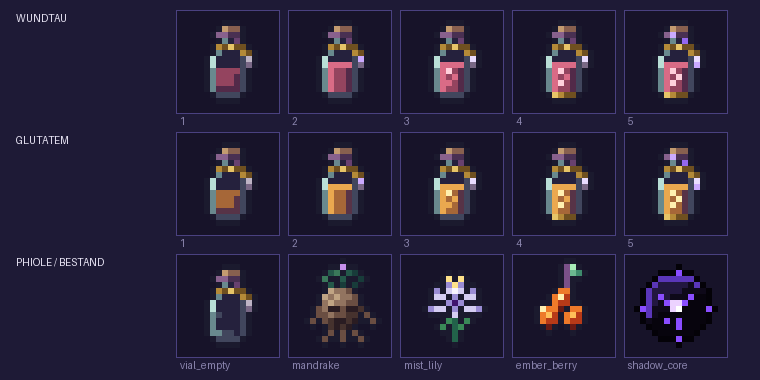

* **Kräuter & Pflanzen erhalten ihren Zweck:** Wundblätter, Alraunen, Glutbeeren, Geisterfarne und Mondglocken werden zu mächtigen Essenzen verarbeitet.
* **Zwei Tranklinien in 5 Leuchtstufen (I Trüb bis V Meistersud):**
  * **Heiltrank („Wundtau“):** Sofortige prozentuale Heilung der Maximalgesundheit (20 % bis 70 %) mit verlässlichem Mindestwert. Ab Stufe IV wird der Effekt *Verbrennen* sofort gelöscht; Stufe V wandelt Heilüberschüsse in schützende Überheilung um (10 s Wundpause zwischen Einnahmen).
  * **Ausdauertrank („Glutatem“):** Schenkt 30 Sekunden lang jede Sekunde frische Ausdauer (3 bis 12 Ausdauer/s) – und wirkt **auch während der Ausdauer-Regenerationspause**, beim Sprinten und im Angriff! Stufe IV/V verkürzen die Nachladepause drastisch; Stufe V senkt die Ausdauerkosten beim Sprinten um 15 %.
* **Viszerales Trinken:** Eigene Trink-Animation im Laufen und Kampf mit Soundkulisse (Korkenploppen, Gluckern, Heilen).
* **Brau-Enthüllung:** Animiertes Kesselfenster (`BrewReveal`) beim Entdecken und Brauen neuer Rezepturen.

---

#### 3. 🌫️ Giftgrüner Nebel, der Effekt HALLUZINIERT & die Phantom-Spinne
Der Hexenwald ist kein Ort, den man mit roher Waffengewalt bezwingt – er ist ein Ort, dem man nicht trauen kann.
* **Fortschreitender Trug (0..1):** Je länger man im Nebel verweilt, desto tiefer sinkt man in den Wahn:
  * **Stufe 1 (Flüstern):** Hexengrüne Augen glimmen im Dickicht, Schritte hallen hinter Ellie wider, Ulmen-Gesichter beobachten jede Bewegung.
  * **Stufe 2 (Trug):** Falsche Glitzer-Items lösen sich beim Aufheben in Rauch auf, falsche Silhouetten täuschen Wanderer, die Minimap-Aufdeckung wird blockiert, und das HUD zuckt mit Schein-Schaden.
  * **Stufe 3 (Wahn – Die Phantom-Spinne):** Täuschend echte Schattenspinnen brechen aus dem Boden hervor, pirschen heran und setzen zum Biss mit rotem Warnbereich an – **zerfallen aber im Moment des Einschlags spurlos zu Rauch!** Doch Vorsicht: Im Dauerdämmer pirschen vereinzelt auch echte Schattenwesen...
* **Schutz-Talisman – Klarglas-Ohrringe:** Trägerinnen erhalten den Perk *Klarer Blick* (`clear_sight`), der vor dem Effekt schützt und den Nebel um Ellie lichtet.

---

#### 4. 🏰 Der Hexenturm, Esma & der Krähenbaum
* **Der Hexenturm:** Ein monumentales Gebäude am Ende des Pfades mit Portal, Hof und animiertem Erkerfenster.
* **Esma, die Nebelhexe:** Vollständig animierte Bewohnerin mit eigener Kleidung, Gesten, Tag-Nacht-Rhythmus und Hexenkessel.

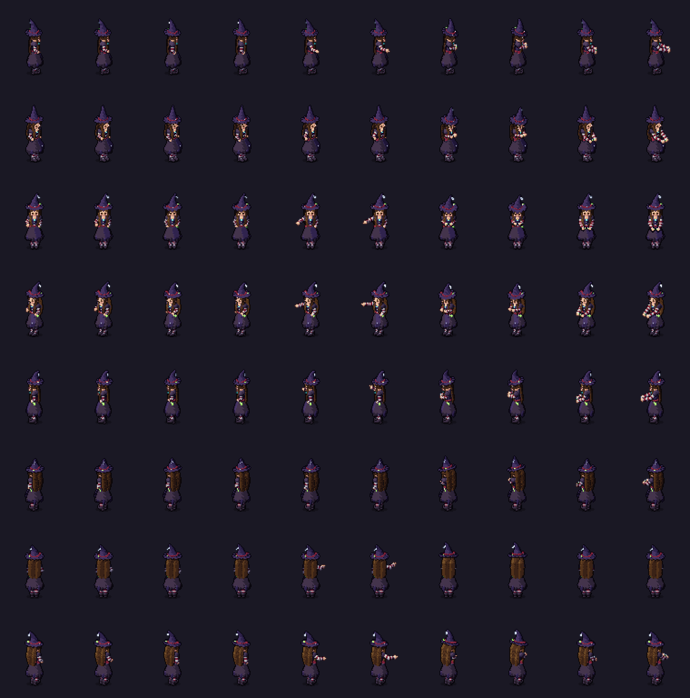

* **Der monumentale Krähenbaum:** Ein gigantischer Nistbaum im Wald (`crow_tree`), der als Zuflucht und Futterplatz für befreundete Krähen und Raben dient.

---

#### 5. 🧗‍♀️ Kletterranken & Schieferwände (Wall Climb)
* Steile Felswände sind kein Hindernis mehr: An rankenden Kletterpflanzen kann Ellie nun Felsstufen und Schieferklippen geschmeidig empor- und hinabklettern.
* Vollständiges Kletter-Animationsset (8 Richtungen, Hände am Fels, Verwundbarkeitsmasken).

---

#### 6. 🌿 Flora des Hexenwalds & Fluchsilber

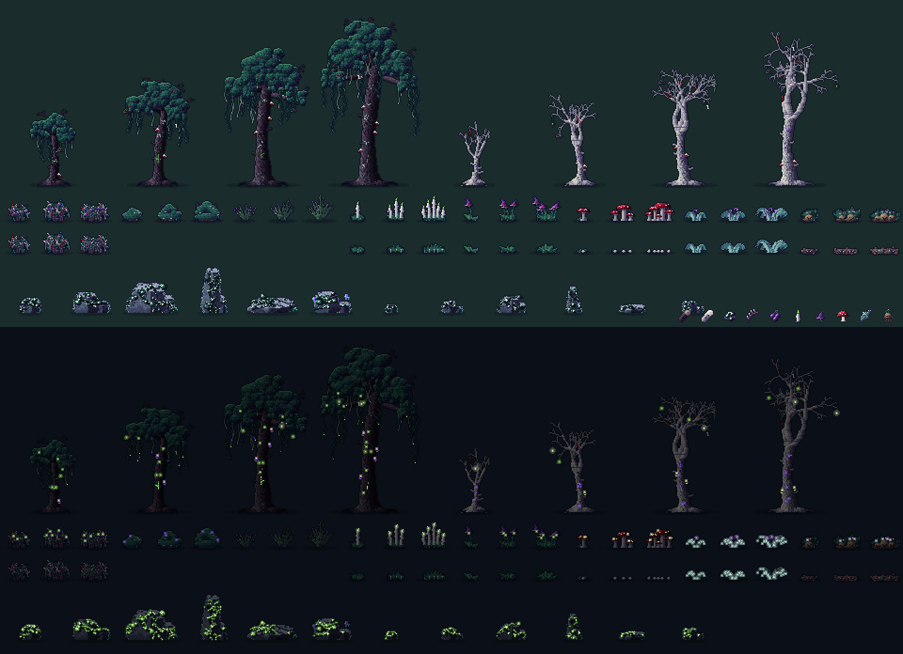

* **Neue Bäume:** Knorrige Hexenulmen (`hag_tree`) und geisterhafte Bleichbäume (`bone_tree`).
* **Neue Pflanzenwelt:** Dornenhecken, Geisterfarne, Totenkerzen, Krötenkappen, Hexenhut-Pilze und ziehbare Alraunen-Wurzeln.
* **Neues Erz:** Fluchsilber-Felsen (`curse_rock`) mit grün glimmenden Erzadern und seltenem Fluchsilber-Erz.

---

### ⚖️ Balance & Spielwerte auf einen Blick

| Status | Bereich / Parameter | Vorher | Jetzt (V0.6.1) | Auswirkung im Spiel |
|---|---|---|---|---|
| 🟣 `NEU` | **Biom: Hexenwald** | Nicht vorhanden | **38.158 Tiles (Region 31)** | Neues zusammenhängendes Landgebiet mit Schieferklippen |
| 🟣 `NEU` | **Alchemie statt Kochen** | Altes Kochsystem | **Vollständiges Trankbrauen** | Nutzt Wundblätter, Alraunen & Beeren für Tränke I bis V |
| 🟣 `NEU` | **Heiltrank (Wundtau I–V)** | – | **20 % bis 70 % Max-HP** | Sofortheilung, Verbrennen-Löschung & Überheilung |
| 🟣 `NEU` | **Ausdauertrank (Glutatem I–V)**| – | **+3 bis +12 Stamina/s** | Regeneriert auch beim Sprinten; Stufe V senkt Sprintkosten um 15 % |
| 🟣 `NEU` | **Nebel & Halluzination** | – | **Statuseffekt `hallucinated`** | Progressive Trugbilder, Schein-Items & Phantom-Spinnen |
| 🟣 `NEU` | **Klettersystem (Wall Climb)** | Nur Rampen | **Kletterranken an Klippen** | Erklimmen von Felswänden via Ranken |
| 🟣 `NEU` | **Schutz-Talisman: Klarglas-Ohrringe** | – | **Perk `clear_sight`** | Immunität gegen Halluzinationen & lichtet den Nebel |
| 🟣 `NEU` | **Esma & Hexenturm** | – | **Voll begehbares Turminneres** | Neue Residentin mit Kessel, Möbeln und Alchemie-Brauen |
| 🟣 `NEU` | **Krähenbaum** | – | **Großer Raben- & Krähenhort** | Zentraler Anlaufpunkt für gefiederte Gefährten |
| 🟢 `FIX` | **Sprint-Skalierung (6.0.1)** | Statische Kosten | **Glutatem V: 0.85x Sprintkosten** | Saubere StaminaComponent-Skalierung bei aktivem Glutatem |

---

### 🔮 Sneak Peek: Was brodelt in V0.7?
*„Mit dem klaren Blick der Klarglas-Ohrringe und den Essenzen aus Esmas Kessel weichen die Lügen des Nebels – doch in den Tiefen unter dem Schiefergestein hallen alte Echos wider. Verlorene Minengänge, uralte Verliese und vergessene Ruinen warten darauf, wiederentdeckt zu werden...“*

---

## [V0.5.0 Beta] – 2026-11-10
### 🦅 Schwingen & Tiefen: Oberflächenschwimmen, der Lichtfischer, Gefiederte Begleiter & die Himmelsriss-Klinge

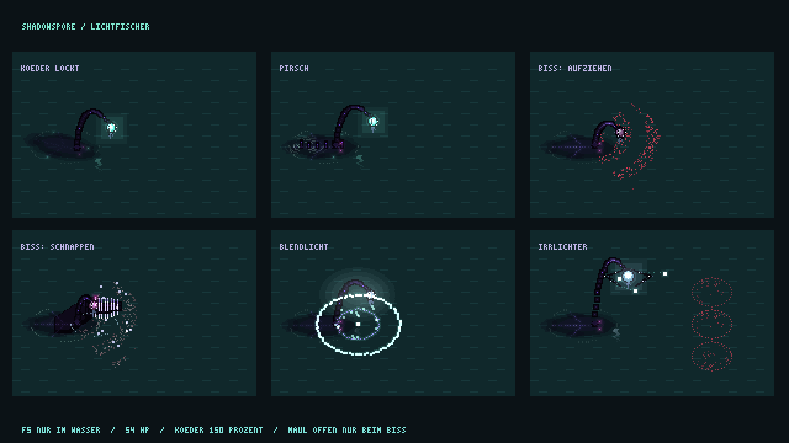

*„Die Schatten vor den Toren des Dorfes werden dichter, Wanderer. Während Torben die Klingen im Schmiedefeuer härtet und die Krähen über den Dächern kreisen, regt sich tief unter der Wasseroberfläche etwas Uraltes – angelockt vom kalten Glanz einer trügerischen Laterne...“*

---

### 🌟 Die Großen Highlights

#### 1. 🏊‍♀️ Flüsse & Seen bezwingen: Das neue Schwimmsystem
Tiefes Wasser ist ab sofort keine unüberwindbare Barriere mehr! Ellie kann sich nun frei über die Flüsse und Bergseen der Welt bewegen.

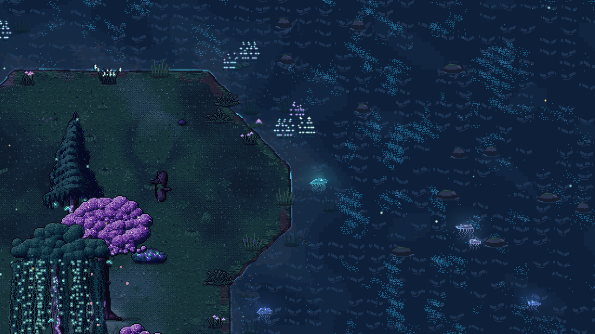

* **Ruhiges Brustschwimmen (Standard):** Gleichmäßiger, energiesparender Schwimmstil (34 px/s), um neue Ufer und geheime Buchten abseits der bekannten Furten zu erreichen.
* **Dynamisches Kraulen (Sprint-Schwimmen):** Verbraucht Ausdauer, treibt Ellie dafür aber mit kraftvollen Armzügen (58 px/s) zügig durch starke Wasserströmungen.
* **Kopfsprung & Eintauchen:** Wer im vollen Sprint auf eine tiefe Wasserstelle zurennt, springt mit einem eleganten Kopfsprung direkt kopfüber in die Fluten.
* **Wasser als Zuflucht:** Landgestützte Schattenkreaturen wie Spinnen und Brecher können nicht schwimmen – das tiefe Wasser dient nun als lebensrettender Rückzugsort vor Nahkämpfern.
* 💭 **Developer Insight:** *„Bisher war tiefes Wasser eine unsichtbare Mauer in der Landschaft. Wir wollten, dass die Gewässer lebendig werden und Erkundung belohnen, ohne dass man die ständige Angst vor dem Ertrinken im Nacken hat. Wasser bestraft Unachtsamkeit nicht mit sofortigem Tod, sondern mit taktischer Langsamkeit.“*
* 🔊 **Game Feel:** Speziell abgemischte Audiokulisse mit Eintauch-Plätschern, rhythmischen Schwimmzügen, Auftauchen und dem Abschütteln von Wassertropfen am Ufer.

---

#### 2. 🏮 Schrecken aus der Tiefe: Der Lichtfischer
Nachts ist das Wasser nicht mehr einsam. Mit dem **Lichtfischer** betritt die erste aquatische Schattenkreatur die Welt von Shadowspore.

* **Trügerisches Locklicht:** Im tiefen Wasser treibt nachts eine sanft schaukelnde, bläulich-türkise Laterne an einem langen Stängel. Sie wirkt wie eine harmlose Dorflaterne oder eine leuchtende Wasserpflanze – doch wer neugierig herantritt, weckt das Monster darunter.
* **Tödliche Angriffsmuster:**
  * **Schnapp-Angriff:** Mit weit aufgerissenem Doppelkiefer aus Nadelglas bricht der Fischer hervor, rammt seine Beute und zerrt sie gnadenlos ins kalte Wasser.
  * **Blendlicht:** Die Laterne schwillt an und detoniert in einem blendenden Lichtring, der den Bildschirm in schneeweißes Flackern und falsche Trugbilder hüllt.
  * **Irrlichter:** Entsendet drei zielsuchende Leuchtsporen, die nach einer Flugbahn um das Ziel herum explodieren.
* **Gezielte Schwachstellen:** Die empfindliche Laterne nimmt 1,5x Schaden und bricht vorbereitete Angriffe sofort ab. Nach dem Zuschnappen verharrt das weit geöffnete Maul für einen Gegenangriff (1,6x Bonusschaden).

---

#### 3. 🦅 Gefiederte Gefährten: Das Raben- & Krähen-Bindungssystem
Wilde Krähen und Raben bevölkern nicht länger nur dekorativ die Wiesen und Zäune – ihr könnt nun eine echte persönliche Bindung zu einzelnen Vögeln aufbauen!

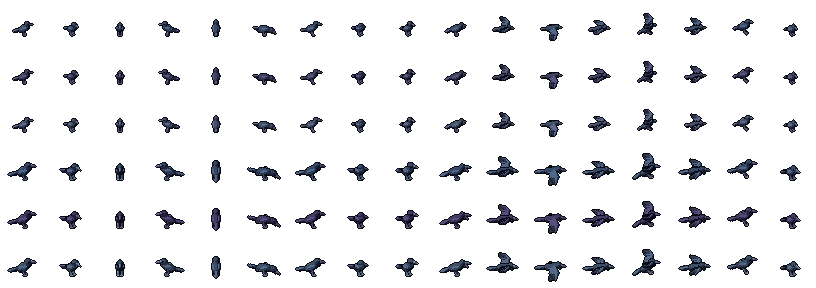

* **Geduld & Fütterung:** Nähert euch im Schleichen mit passendem Futter in der Hand (Dunkelbeeren, Glutbeeren, Pflanzensamen, Insekten oder gefangenen kleinen Fischen) und bietet es geduldig an.
* **Vom Wildtier zum treuen Gefährten (6 Bindungsstufen):**
  * `Fremd ➔ Beäugt ➔ Bekannt ➔ Vertraut ➔ Freund ➔ Gefährte`
* **Einzigartige Persönlichkeiten:** Jeder Vogel besitzt eigene Charaktereigenschaften (z. B. *Neugierig*, *Scheu*, *Mutig*, *Glitzerliebhaber*, *Nachtschwärmer*), eine individuelle Stimmhöhe und einen eigenen farbigen Fußring.
* **Wertvoller Begleiter:** Ein befreundeter Vogel lässt sich benennen, wird auf der Weltkarte markiert, begleitet euch auf Pfiff, sitzt auf eurer Schulter und bringt glitzernde Geschenke mit. Bei Nacht warnt er euch vor herannahenden Schattenwesen!

---

#### 4. 🗡️ Legendäre Reliktwaffe: Der Himmelsriss (Rissklinge)
Aus einer bezwungenen Boss-Feder von Mornath und reinem Eisen härtet Schmied Torben eine Klinge von unvergleichlicher Zerstörungskraft.

* **Rechtsklick-Doppelhieb (Rissschnitt & Himmelskreuz):** Kein langes Aufladen nötig! Ein schneller Klick entfesselt einen diagonalen Abwärtshieb mit 150 % Schaden und 5 fliegenden Rissfedern. Ein zweiter Klick innerhalb von 0,6 s setzt den Gegenhieb an: 200 % Schaden und ein Fächer aus 7 glühenden Rissfedern (zusammen ein verheerendes X am Ziel).
* **Spitzenriss-Kombo:** Der 3. Stoß der normalen Schwertkombo reißt eine 72 Pixel lange Leerenbahn durch die Luft, die allen Gegnern in der Schneise schweren Flächenschaden zufügt.

---

#### 5. 🪶 Legendärer Talisman: Die Rissfeder
Ein uraltes Relikt des Himmelsspalters Mornath – mit 100 % garantierter persönlicher Beute beim ersten Sieg für jede siegreiche Spielerin im Koop!

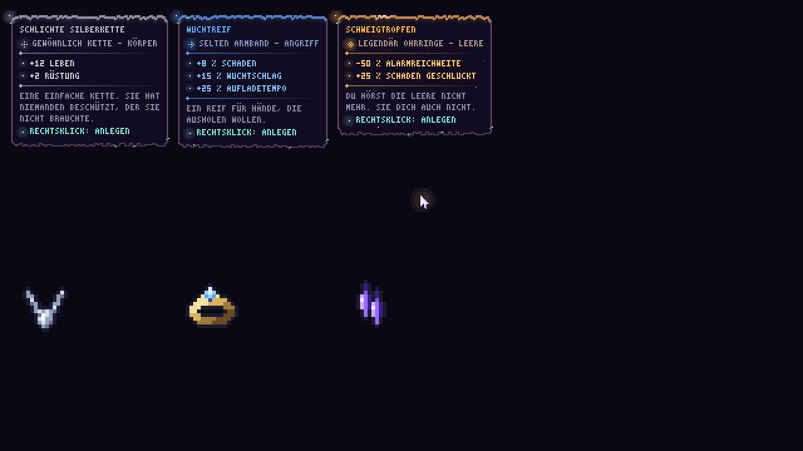

* **Mächtige Passivwerte:** +20 Max-Gesundheit, +3 Rüstung, 30 % schnellere Blinzel-Abklingzeit und 70 % weniger Scheu bei wilden Krähen.
* **Perk: Letzter Flügelschlag:** Schützt vor dem sicheren Tod! Ein tödlicher Treffer wird abgefangen – Ellie verbleibt mit 30 % Gesundheit, erhält 2,5 Sekunden Unverwundbarkeit und schleudert Feinde in einer gewaltigen Federn-Druckwelle zurück (240 s Abklingzeit).
* **Perk: Sturzflug:** Nach jedem Schattensprung trifft der nächste Waffenschlag innerhalb von 3 Sekunden mit gewaltigen **+40 % Bonusschaden**.
* **Federbund-Synergie:** Tragt ihr Klinge und Feder zusammen, verkürzt jeder Treffer des Himmelskreuzes die Abklingzeit des Letzten Flügelschlags um bis zu 32 Sekunden!

---

### ⚖️ Balance & Spielwerte auf einen Blick

| Status | Bereich / Parameter | Vorher | Jetzt (V0.5.0) | Auswirkung im Spiel |
|---|---|---|---|---|
| 🟣 `NEU` | **Wasser-Passierbarkeit** | Unpassierbare Wand | **Voll durchschwimmbar** | Flüsse und Bergseen öffnen neue Erkundungswege |
| 🟣 `NEU` | **Schwimmtempo (Brust / Kraul)** | – | **34 px/s / 58 px/s** | Ausdauerbestimmtes Fortbewegen im Wasser |
| 🟣 `NEU` | **Kopfsprung ins Wasser** | – | **Aktiv aus dem Sprint** | Flüssiger, schneller Übergang von Land in Fluten |
| 🟣 `NEU` | **Nachtmonster: Lichtfischer** | – | **Aktiv in tiefen Gewässern** | Neue Bedrohung bei Nacht mit Schnapp- & Blendangriffen |
| 🟣 `NEU` | **Vogel-Bindungssystem** | Nur scheue Wildvögel | **6 Bindungsstufen (bis Gefährte)** | Zähmen, Füttern, Rufen & Geschenke sammeln |
| 🟣 `NEU` | **Mornath Bossbeute (1. Sieg)** | Regulärer Drop | **100 % persönliche Rissfeder** | Jede Mitspielerin erhält garantiert ihr Bossrelikt |
| 🟢 `BUFF` | **Schattensprung-Cooldown** | Standard | **-30 % Zeit (mit Rissfeder)** | Häufigeres Blinzeln im Gefecht |
| 🟢 `BUFF` | **Angriff nach Blinzeln** | Standard-Schaden | **+40 % Schaden (Sturzflug)** | Belohnt aggressives Vorstoßen aus dem Schatten |
| 🟢 `BUFF` | **Krähen-Vertrauen** | 100 % Fluchtradius | **30 % Fluchtradius (-70 % Scheu)** | Erleichtert Füttern und Zähmen enorm |
| 🟣 `NEU` | **Himmelsriss Grundschaden** | 30 (Leerenklinge) | **40 (Legendäre Himmelsklinge)** | Höchster Grundschaden aller einhändigen Klingen |
| 🟣 `NEU` | **Himmelsriss Doppel-Hieb** | Wuchtschlag | **150 % + 200 % + 12 Projektil-Federn** | Schnelle Schrot-Hiebe für enorme Nahkampfkontrolle |

---

### 🔮 Sneak Peek: Was brodelt in V0.6?
*„Während die Dämmerung über den Flüssen aufzieht, dringt ein herber, süßlicher Geruch aus den Hütten des Dorfes. Kräuter werden gebündelt, alte Tiegel gereinigt und fremdartige Essenzen über offenem Feuer erhitzt... In **V0.6** erwarten euch Alchemie, geheimnisvolle Kessel und seltsame Gebräue der Nacht. Haltet eure Phiolen bereit!“*

---

## [V0.4.0 Beta] – 2026-11-09
### 🌟 Das Große Meilenstein-Update: Lebendiges Hauptmenü, 5-Stufen-Schwertkombo, Schleiergeflecht-Fähigkeiten, Talisman-System mit sichtbarem Schmuck & Kistentruhen

### 🌟 Neuerungen & Verbesserungen

#### 1. Atmosphärisches Hauptmenü & Spiel-Launcher (`src/ui/main_menu*.gd`, `src/world/game_launcher.gd`, `assets/shaders/menu_dark.gdshader`)
* **Lebendiges Hauptmenü:** Ersetzt den bisherigen Direktstart durch ein voll ausgebautes, stimmungsvolles Hauptmenü.
* **Prozedurale Live-Kulisse (`src/ui/menu_world.gd`):** Im Hintergrund läuft eine lebendige Spielwelt mit dynamischem Tag-Nacht-Licht, schwebenden Leere-Sporen und sanft im Wind wiegenden Bäumen.
* **Vollständige Menüführung:**
  * **Neues Spiel:** Startet eine neue Welt mit dem lokalen Helden.
  * **Weiter:** Reibungsloses Fortsetzen vorhandener Spielstände (wird dynamisch ausgeblendet, falls noch kein Spielstand existiert).
  * **Mehrspieler-Lobby:** Hosten eigener Sessions oder Beitreten via IP und Port (`IP:Port`-Eingabefeld mit direkter Tastatureingabe).
  * **Einstellungen:** Konfiguration von Audio-Lautstärken, Tastenbelegung und Anzeigemodi.
  * **Mitwirkende & Beenden.**
* **Modularer GameLauncher (`src/world/game_launcher.gd`):** Saubere Trennung von Argument-Parsing (`--new`, `--join`, `--host`), Szenenwechseln und Netzwerk-Peer-Initialisierung.

#### 2. Kampffähigkeiten, 5-Stufen-Schwertkombo & Finisher (`docs/faehigkeiten_kampf_konzept.md`, `src/components/skill_tree_component.gd`, `data/weapon_classes.json`)
* **Erweiterte Schwertkombo (bis zu 5 Schläge):**
  * **Schlag 1 (Vorhand):** 1,0x Schaden, 120° Bogen, schneller Auftakthieb.
  * **Schlag 2 (Rückhand):** 1,0x Schaden, 120° Bogen.
  * **Schlag 3 (Stoß):** 1,6x Schaden, 40° Bogen, 2,0x Knockback.
  * **Schlag 4 – Aufwärtshieb (`combo_four`):** Freischaltbar ab Stufe 5 im Fähigkeitenbaum. Steiler Hieb von unten nach oben mit 1,25x Schaden, 150° Trefferwinkel und 1,3x Knockback.
  * **Schlag 5 – Wirbelklinge (`combo_five`):** Freischaltbar ab Stufe 15. Verheerender Rundumschlag mit 1,8x Schaden, 330° Trefferbogen, 2,2x Knockback und kraftvollem Bildschirmschütteln.
* **Neue Charakter-Sprites & Bluteffekte:**
  * Spezielles Komboblatt `assets/characters/player_combo.png` (8 Richtungen für alle Kombo-Schritte).
  * Dynamische Blutmaske `assets/characters/player_combo_blood.png` für viszerales Treffer-Feedback.

#### 3. Rework Schleiergeflecht & Fähigkeitenbaum (`src/ui/skill_tree_window.gd`, `src/ui/skill_icons.gd`, `data/skills.json`)
* **Vollbild-Fähigkeitenbaum (Taste K):** Organisch rankendes Astgeflecht für die Disziplinen **KAMPF**, **BEWEGUNG** und **SCHATTEN**.
* **Eigene Pixel-Art-Icons (`tools/art_skill_icons.py`, `docs/img/skill_icons.png`):**
  * Dedizierte 16x16 / 32x32 handgepixelte Glyphen und Icons mit Kantenbloom und Zweigfarben (`#e6c468` Kampf-Gold, `#78f4e6` Bewegungs-Cyan, `#b06bff` Schatten-Violett).
* **Neue Bewegungsskillung „Schleichen“ (`sneak`):**
  * Ermöglicht leises Pirschen; reduziert den Sicht- und Hörradius der Schattenkreaturen drastisch.
* **Skillpunkte-Berechnung:** Exakt `Fähigkeitspunkte = Spielerstufe - 1 - ausgegebene Punkte`.
* **Audio-Feedback:** Neuer atmosphärischer Lernsound beim Aktivieren von Fähigkeiten (`assets/audio/skills/learn.wav`).

#### 4. Talisman-System & Amorphe Schmuckstücke (`docs/talisman_konzept.md`, `src/components/talisman_component.gd`, `src/systems/talisman_rules.gd`, `data/talismans.json`)
* **3 Schmuckgattungen & Domänen:**
  * **Kette (`necklace` / Domäne KÖRPER):** z. B. `silver_chain` (+12 Max-HP, +2 Rüstung).
  * **Armband (`bracelet` / Domäne ANGRIFF):** z. B. `wuchtreif` (+8 % Gesamtschaden, +15 % Wuchtschlag-Schaden, +25 % Lade-Tempo).
  * **Ohrringe (`earrings` / Domäne LEERE):** z. B. `schweigtropfen` (-50 % Alarmradius für Monster, schluckt 25 % allen Schadens).
* **Plätze nach Stufen-Fortschritt:**
  * Vor Stufe 5 versiegelt.
  * Slot 1 ab Stufe 5 freigeschaltet.
  * Slot 2 ab Stufe 15 freigeschaltet.
  * Slot 3 ab Stufe 25 freigeschaltet.
* **Regeln & Begrenzungen:** Maximal ein Schmuckstück jeder Gattung anlegbar; intelligentes Tauschen per Rechtsklick oder Drag & Drop; sofortige Werteverrechnung ohne illegale Selbstheilungs-Exploits.

#### 5. Sichtbarer Schmuck auf dem Heldenkörper (`src/fx/talisman_art.gd`, `src/fx/talisman_layer.gd`, `tools/art_hero_jewelry.py`)
* **Visuelle Schmuckdarstellung:** Angelegte Talismane werden pixelgenau und richtungsabhängig auf dem Sprite des Spielers gerendert (Silberkette um den Hals, Goldreif am Schwertarm, schwebende Leeretropfen an den Ohren).
* **Reaktive Effekte:** Geschluckter Schaden bringt die Ohrringe durch Lichtimpulse zum Leuchten (`absorb`).
* **Sound-Design (`assets/audio/talisman/`):** Eigene Sounds für das Anlegen von Gold-, Silber- und Leerenstahl-Schmuck (`equip_gold.wav`, `equip_silver.wav`, `equip_voidsteel.wav`, `absorb.wav`, `off.wav`).

#### 6. Kisten-, Truhen- & Lagersystem (`src/systems/item_box.gd`, `src/ui/box_window.gd`, `src/town/town_manager.gd`)
* **Modulares Lagerbox-System (`ItemBox`):** Platzierbare Truhen in der Welt und im Dorf mit frei konfigurierbarer Slotgröße.
* **Truhen-UI (`BoxWindow`):**
  * Schneller Itemtransfer per Shift-Klick zwischen Rucksack und Truhe.
  * Sortierfunktion und Schnell-Stapeln (`Quick Stack`) gleicher Gegenstände.
  * Volle Synchronisation im Host-Authoritativen Mehrspielermodus.

---

### ⚖️ Veränderungen & Parameter (Vorher &rarr; Nachher)

| Bereich / Parameter | Vorher (`V0.3.2`) | Jetzt (`V0.4.0`) | Bedeutung |
|---|---|---|---|
| **Schwertkombo-Schlagzahl** | 3 Schläge (fest) | **Bis zu 5 Schläge** | Durch Upgrades Aufwärtshieb (`combo_four`) und Wirbelklinge (`combo_five`) |
| **Maximaler Kombo-Einzelschaden** | 1,6x (3. Schlag / Stoß) | **1,8x (5. Schlag / Wirbelklinge)** | Enormer Finisher-Schaden gegen Horden |
| **Kombo-Trefferwinkel Finisher** | 40° (Stoß) | **330° (Wirbelklinge)** | Trifft nahezu die gesamte Umgebung im Nahkampf |
| **Wuchtschlag-Aufladezeit (mit Wuchtreif)** | 1,00 s (Standard) | **0,80 s (-20 % Zeit / +25 % Tempo)** | Deutlich schnellere Einsatzbereitschaft des Wuchtschlags |
| **Wuchtschlag-Schaden (mit Wuchtreif)** | 3,40x Basis | **3,91x (3,40 * 1,15)** | +15 % Bonus-Schaden auf voll geladene Wuchtschläge |
| **Allgemeiner Waffenschaden (mit Wuchtreif)** | 1,00x | **1,08x (+8 %)** | Dauerhafter Bonus auf alle regulären Angriffe |
| **Max-HP Bonus (mit Silberkette)** | 0 | **+12 Max-Gesundheit** | Höherer Lebenspool (ohne Gratis-Heilung beim Anlegen) |
| **Rüstungs-Bonus (mit Silberkette)** | 0 | **+2 Rüstung** | Reduziert erlittenen physischen Schaden |
| **Erlittener Schaden (mit Schweigtropfen)** | 100 % (Standard) | **75 % (25 % geschluckt)** | Schützt auch vor Schaden über Zeit (DoT) |
| **Monster-Wahrnehmung (mit Schweigtropfen)** | 100 % Radius | **50 % Radius (-50 % Alarm)** | Schattenspinnen, Lauscher & Brecher bemerken den Helden erst auf halbe Distanz |
| **Talisman-Plätze Stufe 1–4** | Keine | **0 (versiegelt)** | Plätze müssen durch Stufenaufstiege verdient werden |
| **Talisman-Plätze Stufe 5 / 15 / 25** | Keine | **1 / 2 / 3 Plätze** | Erweitert die tragbaren Schmuckstücke mit dem Spielfortschritt |
| **Spielstart** | Direktstart in die Welt | **Hauptmenü mit Live-Hintergrundwelt** | Volle Menünavigation für Solo, Host, Join & Optionen |
| **Truhen & Kisten** | Nur statisches Dorflager | **Modulare Truhen mit Shift-Klick & Sortierung** | Bequemes Einlagern und Sortieren von Beute |

---

## [V0.3.2 Beta] – 2026-11-09
### 🗺️ Boss-Kartenmarker, Mornath-Replay-Fix & Menü-Polishing

### 🌟 Neuerungen & Verbesserungen

#### 1. Mornath-Hologramm Boss-Kartenmarker (`data/map_markers.json`, `src/ui/map_window.gd`)
* **Neuer Weltkarten-Marker für den Bosskampf:** Sobald das Hologramm nach dem ersten Sieg aktiv ist, erscheint ein markantes Symbol auf der Weltkarte (`kind: "boss"`, Farbe `#6fe8ff`).
* **Visuelle Karteneffekte:** Glitch-Ring, pulsierendes Emblem und informativer Tooltip (`MORNATH - DER HIMMELSSPALTER`, Entfernungsanzeige und Status `ERNEUTER KAMPF BEREIT`).
* **Saubere Einblendung:** Der Marker wird nur angezeigt, wenn das Hologramm vollständig sichtbar ist (`_appear == 1.0`), um Ghosting während Phasenübergängen zu vermeiden.

#### 2. Boss-Replay & Arena-Instandsetzung (`src/entities/enemies/sky_cleaver.gd`, `src/world/world_level.gd`)
* **Sauberer Replay-Start:** Nach Besiegen des Bosses wird das `defeated`-Signal gesendet, wodurch die gespeicherte Checkpoint-Phase in `WorldLevel._arena_phase` gelöscht wird. Ein erneutes Rufen startet nun garantiert bei **Phase 1 mit 100 % HP**.
* **Arena-Reparatur:** Beim Start eines erneuten Kampfes werden alle Arenasäulen automatisch regeneriert (zerstörte Säulen wieder aufgebaut, Flammen gelöscht: `broken = false`, `fury = 0.0`).

#### 3. Menü- & UI-Polishing (`src/ui/pause_menu.gd`)
* Aufgeräumte und harmonisierte Entwickler-Menüführung für Story-Sprünge, Boss-Teleports und Replay-Tests.

---

### ⚖️ Veränderungen & Bugfixes (Vorher &rarr; Nachher)

| Bereich / Parameter | Vorher (`V0.3.1`) | Jetzt (`V0.3.2`) | Bedeutung |
|---|---|---|---|
| **Mornath Replay-Startphase** | Checkpoint blieb erhalten (z. B. Start in P2/P3) | **Immer Phase 1 (Startphase 0, 100 % HP)** | Bosskampf ist nach Sieg voll replaybar |
| **Arena-Säulen im Replay** | Blieben zerstört oder brennend | **Vollständig regeneriert und erloschen** | Saubere Kampfarena bei jedem neuen Start |
| **Mornath-Hologramm auf Weltkarte** | Kein Marker vorhanden | **Cyan/Magenta Boss-Marker (`kind: "boss"`)** | Spieler finden die Replay-Arena sofort |
| **Marker-Sichtbarkeit** | Sofortige Einblendung | **Erst bei voller Deckkraft (`_appear == 1.0`)** | Kein Flackern während Übergängen |

---

## [V0.3.1 Beta] – 2026-11-09
### 🗡️ Schwerer Angriff (Wuchtschlag), Level-Fortschrittsfenster & Nacht-Director Rework

### 🌟 Neuerungen

#### 1. Schwerer Angriff: Wuchtschlag (`docs/heavy_attack.md`, `src/systems/heavy_rules.gd`)
* **Sekundärangriff (Rechtsklick / L2):** Aufladbarer, wuchtiger Schlag für Einhandschwerter.
  * **Stufe 1 (ab 0,35 s):** Breiter Weithieb (150° Bogen, 2,2x Schaden, 2,0x Knockback, 230 px Vorwärtsdrang).
  * **Stufe 2 (Voll aufgeladen nach 1,0 s):** Maximaler Schmetterhieb (3,4x Schaden, 3,0x Knockback, 300 px Vorwärtsdrang, Erschütterungs-Screenshake).
* **Visuelle Effekte & Klingenbänder:** Leuchtende Klingenstreifen (`_draw_heavy_ribbon`), Funkenfokus an der Klingenspitze (`_charge_glint`) und Staubexplosion beim Bodenaufprall (`_impact_dust`).
* **Neue Charakter-Assets (`assets/characters/`):** Eigenes Animationssheet `player_heavy.png` (8 Himmelsrichtungen, Ausholen, Zittern bei voller Ladung, Niederschlag) sowie Blutspritzer-Maske `player_heavy_blood.png`.
* **Sound-Design (`assets/audio/heavy/`):** 7 neue Sounds für Klingenheben (`draw`), Loslassen (`swing`), Treffer (`hit`), Bodenaufschlag (`thud`), Abbrechen (`drop`), Ladebereitschaft (`ready`) und volle Aufladung (`full`).

#### 2. Level-Fortschrittsfenster & Belohnungen (`docs/level_fortschritt_konzept.md`, `src/ui/progress_window.gd`)
* **Neues Vollbild-Fortschritts-UI (Taste P / Pausemenü „FORTSCHRITT“):**
  * Eigene Fortschrittsrebe über 4 Epochen: Dämmerung (1–5), Erstes Licht (6–10), Blüte (11–20) und Tiefe (21–30).
  * Blütenknoten (`BloomOrb`): Pixel-Blüten mit Blütenblättern und Staubfäden, die sich beim Halten von E oder Mausklick (`hold to claim`) langsam entfalten.
  * Belohnungen je Level: Erhöhung von Max-Gesundheit und Stamina.
  * Meilensteine alle 5 Stufen: Rüstungspunkte (+1/+2), Überheilung und Freischaltung zusätzlicher Talisman-Plätze im Inventar.
* **Audio-Feedback (`assets/audio/progress/`):** Sounds für Abholen (`claim`), Fokus (`focus`), Meilenstein (`milestone`), Öffnen (`open`) und Bereitschaft (`ready`).

#### 3. Nacht-Director Rework & Monster-Verhalten (`docs/nacht_monster_konzept.md`, `src/world/night_director.gd`)
* **Dynamische Nachtphasen & Beats (`data/night.json`):** 6 taktische Phasen (Kundschafter `scouts` → Aufbaustufe `build` → Atempause `lull` → Sammelruf `call` → Höhepunkt `peak` → Letzter Ansturm `last_rush`).
* **4 Nachtstufen:**
  * `tasten` (ab Tag 0): Einzelne Schattenspinnen.
  * `lauschen` (ab Tag 3): Spinnen + Lauscher, koordinierte Überfälle.
  * `druck` (ab Tag 7): Alle Monsterarten inkl. Brecher, Gedächtnissystem aktiv.
  * `flut` (ab Tag 12): Große Horden, Elite-Monster möglich.
* **Mondphasen-Einfluss:** Neumond erhöht Spawn-Budget um +30 % und dichtet Nebel an; Vollmond senkt Spawns um 15 %.
* **Geräusche & Spuren (`evidence`):** Laufen, Schwertschläge und Bauen erzeugen Lautstärke, die Monster anlockt.
* **Letzter Ansturm (`last_rush`):** Bei 80 % Nachtverlauf fordert das Spiel zum Durchhalten bis zum Sonnenaufgang auf („HALTE BIS ZUR DÄMMERUNG“).

#### 4. Mornath-Arena-Story & Hologramm (`docs/boss_arena.md`, `src/world/arena_story.gd`)
* Neuer Vorbereitungsbereich vor der Boss-Arena mit gefallenen Rittern (`arena_knight.gd`).
* Interaktive Inspektions- und Hologramm-Szenen (`mornath_hologram.gd`, Shader `mornath_hologram.gdshader`) zur atmosphärischen Einstimmung auf den Kampf.

---

### ⚖️ Veränderungen & Vorher-Nachher-Werte

| Parameter / Bereich | Vorher (`V0.3.0`) | Jetzt (`V0.3.1`) | Bedeutung |
|---|---|---|---|
| **Level-XP Basiswert (`levels.base`)** | 30 | **22** | Frühere Level erfordern weniger XP (schnellere Belohnung) |
| **Level-XP Exponent (`levels.exponent`)** | 1,70 | **1,45** | Flachere XP-Kurve für flüssigeren Stufenaufstieg |
| **Schwerer Angriff Schaden** | – | **2,2x (min) bis 3,4x (voll)** | Enorme Durchschlagskraft bei voller Aufladung |
| **Schwerer Angriff Reichweite** | 1,0x (Basis) | **1,25x (+25 %)** | Größere Trefferfläche |
| **Schwerer Angriff Schwungwinkel** | ~100° | **150°** | Breiter Rundumschlag |
| **Schwerer Angriff Vorstoß (`lunge`)** | 0 | **230 bis 300 px** | Spieler gleitet im Hieb dynamisch nach vorn |
| **Nacht-Wellen-Struktur** | 3 starre Wellen | **5 Phasenfreigaben + 6 Nacht-Beats** | Lebendigerer, dynamischer Nachtablauf |
| **Nacht-Spawns Neumond** | 1,0 (Standard) | **1,30 (+30 % Spawns)** | Deutlich gefährlichere Nächte bei Neumond |
| **Nacht-Spawns Vollmond** | 1,0 (Standard) | **0,85 (-15 % Spawns)** | Ruhigere Nächte bei hellem Mondlicht |
| **Monster-Elite HP** | Standard | **1,45x (+45 % Leben)** | Robuste Mini-Bosse in späteren Nächten |

---

## [V0.3.0 Beta] – 2026-11-09
### 🔨 Der Schmied Torben, die Schmiede, Eisenerz & Waffen-Verfeinerung

### 🌟 Neuerungen

#### 1. Der Schmied Torben & die Dorfschmiede
* **Neuer NPC Torben (`docs/torben_konzept.md`, `data/torben_rig.json`):**
  * Schweigsamer Schmied mit eigener Persönlichkeit („HM.“, „HÄLT.“, „RISKANT.“, „SCHROTT.“).
  * Vollständiges Charakter-Spritesheet (`assets/characters/torben.png`) mit Hammer-, Esse- und Amboss-Animationen sowie Glow-Layer für glühendes Eisen (`torben_glow.png`).
* **Neues Dorfgebäude „Schmiede“ (`data/town.json`, `tools/art_smithy.py`):**
  * Maße: 152 × 140 px Frame, 112 × 38 px Kollisionsbasis.
  * Baukosten: 16 Holz, 30 Stein, 6 Bretter, 8 Eisenerz (Bauzeit: 40 s, Siedlungswert: 18).
  * Animierte Esse mit Partikeln (Rauch am Schornstein, Funkenflug am Amboss `#ffb25a`), dynamisches Feuerlicht (Radius 78, Energie 1.15, Flimmern 0.4).
  * Windbewegte Deko: Laternen (links/rechts mit Glow), Schmiedeschild und Wimpel.
  * 6 Abnutzungs- und Alterungsstufen (Wear A/B/C, Moos A/B, Vernachlässigung).
  * Schmiede-Shop (`data/shops.json`): Tabs für Fertigen, Bestellen, Kaufen, Verkaufen und Verfeinern.

#### 2. Eisenerz & Metallurgie
* **Eisenerzfelsen in der Spielwelt (`data/plants.json`, `assets/props/iron_rock*`):**
  * 6 visuelle Varianten blauvioletten Gesteins mit rotbraunen Erzadern und subtilem Glow.
  * Abbau per Spitzhacke: 3 bis 6 Schläge; droppt Eisenerz (`iron_ore`) und Stein (Regenerationszeit: 3 Tage).
* **Neue Materialien (`data/items.json`):**
  * `iron_ore` (Eisenerz): Rohes Erzgestein für die Esse.
  * `iron_ingot` (Eisenbarren): Aus Erz geschmolzen und in Form gegossen.
  * `iron_plate` (Eisenplatte): Flach geschlagene, genietete Platten für Riegel und Beschläge.
* **Neue Schmiede-Rezepte (`data/recipes.json`):**
  * Eisenbarren: 2 Eisenerz + 1 Holz (Schmelzen an der Esse).
  * Eisenplatten: 3 Eisenbarren → 2 Platten (Torben fertigt sie als Auftrag in 60 s).

#### 3. Waffen-Verfeinerungssystem (`RefineRules`, `data/refine.json`)
* **Stufen +1 bis +15:**
  * **Stufe 1 (Anschmieden, +1 bis +5):** 100 % Erfolgsgarantie. Kostet Eisenbarren & Kupfer.
  * **Stufe 2 (Härten, +6 bis +10):** Freigeschaltet ab 20 Vertrauen. Erfolgschance sinkt von 85 % auf 50,8 %. Pity-System (+3 % pro Fehlschlag, max. 15 %) und 50 % Material-Erstattung bei Fehlschlag.
  * **Stufe 3 (Leerenschmieden, +11 bis +15):** Freigeschaltet ab 50 Vertrauen. Chance sinkt von 42,2 % auf 8 % bei +15. Benötigt Leersplitter, Schattenkerne und Leerenschlacke.
* **Waffen-Meilensteine:**
  * **+5 („Gehärtet“):** +1 Waffenreichweite.
  * **+10 („Leerenfest“):** +1 Reichweite, gelegentliche Lichtfunken entlang der Klinge (`_edge_glints`).
  * **+15 („Vollendet“):** +1 Reichweite, +5 % Angriffsgeschwindigkeit, durchgehender goldener Klingenpuls (`_draw_edge_glow`).
* **Interaktive Veredelungs-UI (`refine_reveal.gd`):**
  * Enthüllungs-Animation mit Sound-Feedback (`ember.wav`, `success.wav`, `perfect.wav`, `fail.wav`).

#### 4. Blattkriecher-Ökosystem (`LeafCritters`, `data/leaf_critters.json`)
* Kleintiersimulation auf Büschen, Gräsern und Uferpflanzen.
* 3 Arten mit individuellem Verhalten:
  * **Käfer (`beetle`):** 26 s Rast, 3,2 s Krabbeln (4 px Schritt), nur tagsüber aktiv.
  * **Raupe (`caterpillar`):** 31 s Rast, 4,8 s Krabbeln (3 px Schritt).
  * **Schnecke (`snail`):** 34 s Rast, 9,0 s Kriechen (3 px Schritt), auch nachts aktiv (Nachtlimit 0,75, Feuchtgebiets-Fokus 58 %).
* Fluchtverhalten bei Berührung oder Fällen der Pflanze (`departure_seconds: 1.4 s`).

---

### ⚖️ Veränderungen & Vorher-Nachher-Werte

| Parameter / Bereich | Vorher (`V0.2.4`) | Jetzt (`V0.3.0`) | Bedeutung |
|---|---|---|---|
| **Schmiede-Station für `sword_iron`** | Werkstatt (Gustav) | **Schmiede (Torben)** | Gustav fertigt Holz, Torben Metall |
| **Materialien `sword_iron`** | 1 Schwert, 2 Bretter, 4 Steine, 2 Splitter | **1 Schwert, 2 Eisenplatten, 2 Barren, 1 Splitter** | Echte Eisenverarbeitung |
| **Arbeitsaufwand `sword_iron`** | 100,0 s | **120,0 s** | Anspruchsvollerer Schmiedeprozess |
| **Schmiede-Station für `sword_basic`** | – | **Schmiede (2 Barren + 1 Brett)** | Grundschwert direkt in Schmiede herstellbar |
| **Critter-Spawn Busch (`bush`)** | 0,20 (20 %) | **0,12 (12 %)** | Weniger überfüllte Sträucher |
| **Critter-Spawn Beerenbusch** | 0,20 (20 %) | **0,12 (12 %)** | Ausgewogenere Fauna |
| **Critter-Spawn Gras (`grass`)** | 0,20 (20 %) | **0,10 (10 %)** | Reduzierte Insektendichte auf Wiesen |
| **Critter-Spawn Uferblume** | 0,20 (20 %) | **0,12 (Snail-Bias 1,35)** | Schnecken bevorzugen Feuchtpflanzen |
| **Critter-Spawn Rohrkolben** | 0,20 (20 %) | **0,14 (Snail-Bias 1,40)** | Höchste Schneckenpräferenz am Wasser |
| **Waffen-Skalierung (`attack_component`)** | Feste Basiswerte | **`Items.stat(stack, ...)`** | +5 % Schaden pro Veredelungsstufe |

---

## [V0.2.4 Beta] – 2026-11-09
### ☀️ Tageslicht-Art-Pass, Schloss-Flur & Saal, Intro-Sequenz

### 🌟 Neuerungen
* **Tageslicht-Beleuchtungsfeld (`DaylightField`, `daylight.gdshaderinc`):** 128×96 R8-Baumkronenmaske synchronisiert Licht & Schatten über Boden, Flora, Wasser und Figuren. Weltverankerte Wolkenschatten und 4 stimmungsvolle Lichtschäfte (`day_shafts.gdshader`).
* **Schloss-Erweiterung (`data/interiors.json`):** Großer Flur (`flur_lang`, 1856 px), Verbindungsgang (`flur_gang`), Eingangshalle (`flur_saal`, 704 × 776 px) und 6 Dienerzimmer. Interaktive Ruhebänke (`HallSeat`).
* **Raum-Schleier (`room_veil.gdshader`):** Unbetretene Räume sind in Nebel gehüllt, der sich beim Eintreten hebt.
* **Intro-Sequenz (`room_intro.gd`):** Erwachen im Kleiderschrank mit Audio-Cues und animierter Intro-Krähe am Fenster.

### ⚖️ Veränderungen
* **Personalraum-Größe:** Von 304 × 252 px verkleinert auf `256 × 212 px` (kompakter, stimmiger).
* **Türmechanik Personalraum:** `door_locked: true` → `needs: broom_taken` (Besen muss genommen werden).
* **Pollenpartikel (`DayMotes`):** Von 70 Partikeln (2×2 px) auf 38 dezent beleuchtete 1-px-Pollen reduziert.
* **Goldstunden-Stärke:** Von 0 auf `0.85` korrigiert (Mittagsschwelle schneidet Goldlicht nicht mehr ab).

---

## [V0.2.3 Beta] – 2026-11-09
### 🔥 Bosskampf Phase 3 („Der Himmel brennt“), Gustav-Questline, Status-Effekte

### 🌟 Neuerungen
* **Mornath Boss Phase 3:** Verwandlung bei 10 % HP, pinkes Höllenfeuer (`fire_arena.gd`), Sturzflug-Angriff (`dive`, 36 Dmg, 400 px/s), Glutbälle und Brandmale.
* **Gustav-Questline:** 8-teilige Rettungskette (`gustav_rescue`) mit Schattenspinnen-Kampf, Wagen-Befreiung und Dämmerungs-Eskorte.
* **Status-Effekt-System (`StatusEffects`):** Modulares Brennen (`burn`, 2 % Max-HP DoT), Status-Tags über Einheiten und schadensspezifische DoT-Zahlen ohne Flinch-Unterbrechung.
* **Health-Erweiterungen:** `take_survivable()` (Story-Treffer lassen min. 1 HP übrig), `god_mode` Dev-Cheat.

### ⚖️ Veränderungen
* **Boss-Phasen:** 2 Phasen → **3 Phasen (P3 startet bei <= 0.1 HP)**.
* **Angriffspause P3 (`gap`):** 0,55 s – 0,95 s (starker Angriffsdruck, P2 war 0,9 – 1,5 s).
* **Boss-Regenwellen P3:** 3 Wellen → **7 Wellen** (Schaden von 24 auf 28 erhöht).
* **Urteil-Säulen-HP P3:** 240 HP → **420 HP** (Zeitlimit von 28 s auf 22 s verkürzt).
* **Gustav-Ankunft:** `needs: workshop` → **`needs: gustav_joined`** (erst nach aktiver Rettung).

---

## [V0.2.2 Beta] – 2026-11-09
### 🏛️ Boss Arena Overhaul, Personalraum-Interior, Kampf-Balancing

### 🌟 Neuerungen
* **Personalraum:** Erstes vollständiges Zimmer-Interior mit Bett, Nachttisch, Besen, Schrank und Innenraum-Krähe.
* **Arena-Grafik:** Bodenmasken, Glow-Decals und 26+ dekorative Props (Feuerschalen, Kristalle, Banner, Schutt).
* **Profiling-Tools:** `profile_chunks` und `profile_gen` zur Messung der Generierungszeiten.

### ⚖️ Veränderungen
* **Boss-Angriffsfenster P1 (`gap`):** Von [0.5, 1.0] s auf **[1.3, 2.1] s** vergrößert für bessere Lesbarkeit.
* **Boss-Angriffsschaden:** Shot (18 → 27), Rain (16 → 24), Line (17 → 26), Chase (22 → 32).
* **Telegraph-Warnungen:** Rain-Warnzeit von 0,95 s auf **1,2 s**, Chase-Warnung von 0,7 s auf **0,95 s** verlängert.
