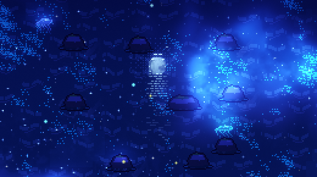
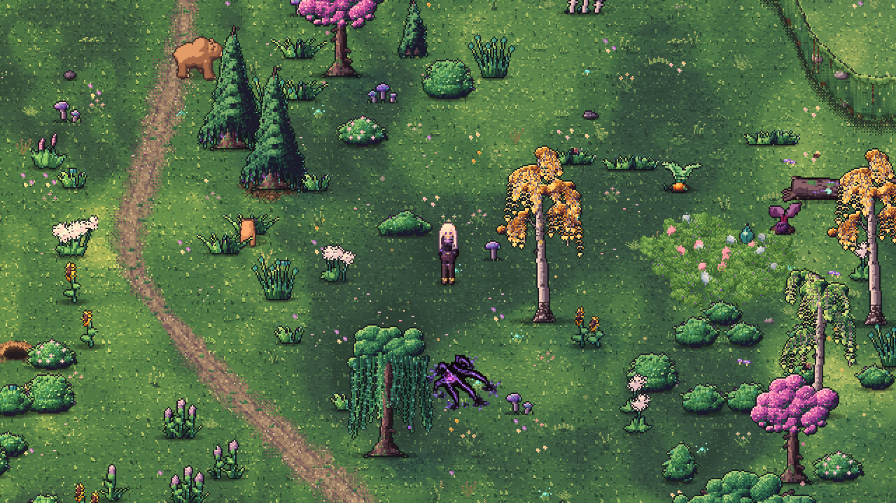
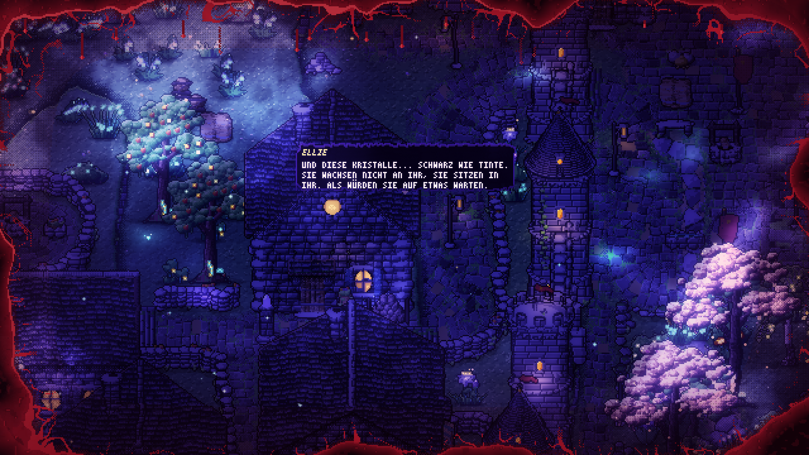

# Shadowspore

**Shadowspore** ist ein atmosphärisches 2D-Pixel-Art Top-Down (3/4) Action-RPG, entwickelt in **Godot 4.7 (GDScript)**.
Es kombiniert Erkundung einer handgefertigten Zonenwelt, taktilen Nahkampf & Magie, Nacht-Survival, Dorfaufbau, Landwirtschaft, Alchemie, Rätsel und instanziierte Dungeons für **1–4 Spieler** (host-authoritativ, LAN & Online-Relay).

> Vollständige Versionshistorie, Studio-Log und Detailwerte: siehe **[`CHANGELOG.md`](CHANGELOG.md)**.

---

## 🚀 Shadowspore 2.0 — Zonenwelt ALTMARK, Atlas, Lebendige Natur & Wasser 2.0

### Zentrale Neuerungen in V0.10.2 Beta (`0.10.2`) — Shadowspore 2.0
- 🗺️ **Zonenwelt-Architektur & Kontinent ALTMARK:** Vollständiger Umbau auf die mehrzonige Kontinentalwelt (`ZoneWorld`, `ZoneDirector`, `PocketSpace`, `SaveGame v2`) mit 11 geplanten Zonen in 5 Regionen — beginnend an der voll ausgebauten Küsten-Startzone **Windkap** samt nahtlosem, schnellem Übergang ins **Südkap**.
- 📖 **Feldcodex — Das vereinte Ingame-Menü:** Neues, animiertes Steinsetzer-Menü (`Atlas`, `Aufgaben`, `Stufen & Fortschrittspfad`, `Schattenfrüchte`, `Welt` mit `Chronik`, `Stadt`, `Vögel` & `Flussbuch`, `System`), während das Inventar schlank und direkt auf `I` bleibt.
- 🌊 **Windkap-Küsten- & Natur-Feinschliff:** Realistische Fluss-Meer-Mündung (Erlenbach ↔ Silberbucht) & Erlenweiher, fleckenfreier goldener Strand mit echter `WorldWind`-Treibsandbewegung, Dünenrippeln & auswaschbaren 3D-Sandfußspuren sowie dicht belebte Felsplateaus mit `LivingRock` und Steingrund-Details.
- 📜 **4-Ebenen-Atlas & Schattenfrüchte:** Interaktive Karte über 4 Zoomstufen (`Zone → Region → Kontinent → Welt`) mit Steinsetzer-Relief, Fernblick-Horizont (`far.png`), Wegsteinen, Aussichtspunkten und prozeduralen, lebendigen **Schattenfrüchten** (`ShadowFruitArt`).
- 🧭 **HUD v2 & Ingame-Chat:** Dynamische Profil-Regie (`HudDirector`), kollabierbare Hotbar, Weg- & Begleiter-Ranken, gestaffelte Benachrichtigungen, Zonen-Ankunftstitel und integrierter Koop-Chat.
- 🏃 **Movement 2.0 & 3D-Griff-System:** Taktiler Sprint-Antritt, Corner-Smoothing, 180°-Pivot, Hang-/Straßen-Physik, ausdauerschonender **Reisetritt**, **Vault**, **Ledge Hop**, Klettern, **LivingCamera 2.0** sowie echte 3D-Waffenführung mit 2-Knochen-Pixel-Arm.
- ⚔️ **Schattenspinne 2.0 & Finisher „Abgrund-Pfähler“:** Überarbeitete Spinnen-KI mit Sichtkegel, Erschütterungs-Sinnen, Haltungs-System & `3` Varianten, 3-stufige Schwert-Finisher (`FinisherComponent`), persistente Schnittspuren (`SlashWorldFx`) und vorbereitete Dungeon-Kampfmechaniken (Klangkonter & Taumel-Prüfung).
- 🌳 **Lebendige Natur 2.0 & Wasser 2.0:** **Taleeiche**, **Silberbirke** & **Wildapfel** (Stockausschlag, Sitzwurzeln, Schüttel-Ernte), mehrstufige **lebende Felsen**, reaktives **lebendes Gras**, Küstenschelf mit Brandung, Strandpfützen, Gezeitentümpeln, Nacht-Biolumineszenz und Echtzeit-Wasserspiegelungen.
- 🌌 **Göttin Caelia, Sternensaal & Zero-G:** Rettung vor dem ersten tödlichen Treffer, **`LICHTSCHRITT`**, schwerelose kosmische Bewegung im Sternensaal, Sternerz-Meilensteine & Sternengaben.
- 🏛️ **Dungeon-System & Steinsetzer-Prüfungstafel:** Instanziierte, handgebaute Dungeons (`PocketSpace.Lane.DUNGEON`), 4 Archetypen, tägliche Schleierresonanz mit Ruhebonus und 3 Gruppen-Schleierfunken.

---

## 🌙 Impressionen

---

## 🗺️ Weitere Kern-Features
- **Host-Authoritativer Multiplayer (1–4 Spieler):** LAN & Online-Koop-Relay ohne Port-Forwarding, Relay-Paket-Chunking, Cloud-Konten & Cloud-Save-Härtung.
- **Magie, Alchemie & Waffen-Veredelung:** 5 Elementarschulen mit Sockel-Kristallen, Trankbrauen (`AlchemyRules`), Talismans, Skillbaum und Schmiede-Veredelung (`+1` bis `+15`).
- **Dynamische Beleuchtung, Schatten & Wetter:** 40-Minuten-Tag-Nacht-Zyklus, Baumkronen-Deckungsmaske (`DaylightField`), Echtzeit-Sonnenschatten (`SunShadows`) und 10 Wetterfronten.
- **Rätsel, Beutetruhen, Angeln, Mine & Dorfaufbau:** Prüfungen der Wächterin (*Wurzelgeflecht*, *Sternenspiegel*, *Irrlichtspur*, *Hortkrähe*), 3 Truhenklassen (*Wurzelkiste*, *Mondsiegeltruhe*, *Glutreliquiar*), 15-Ebenen-Mine, Haustiere sowie die für kommende ALTMARK-Zonen vorbereiteten Stadt-, Farm-, Karawanen- und Boss-Module (*Glimmrast*, *Hallgrat*, *Mornath*, *Morwenna*, *Aurelith*).

---

## 🛠️ Entwicklung & Tech-Stack
- **Engine:** Godot 4.7 (GDScript, strikte statische Typisierung `untyped_declaration=2`)
- **Welt- & Asset-Pipelines:** Deterministische Python-Generatoren (`tools/build_altmark_world.py`, `tools/paint_zone_map.py`, `tools/art_*.py`, `tools/audio_*.py`)
- **Datengetrieben:** Sämtliche Spieldaten und Zonen liegen als JSON unter `data/` bzw. `data/world/`
- **Entwickler-Dokumentation:** Siehe [`CLAUDE.md`](CLAUDE.md), [`GEMINI.md`](GEMINI.md) und [`docs/v2_zonenwelt_atlas_konzept.md`](docs/v2_zonenwelt_atlas_konzept.md)

---

## 📦 Releases & Changelog
- Alle Releases und Patchnotes: **[GitHub Releases](https://github.com/acuteflower/shadowspore/releases)**
- Vollständige Entwicklungs-Historie (V0.1 – V2.0): **[`CHANGELOG.md`](CHANGELOG.md)**
