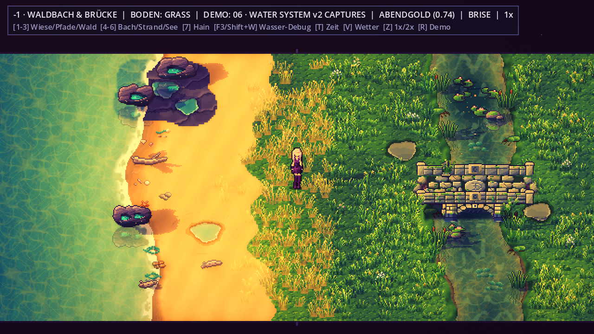
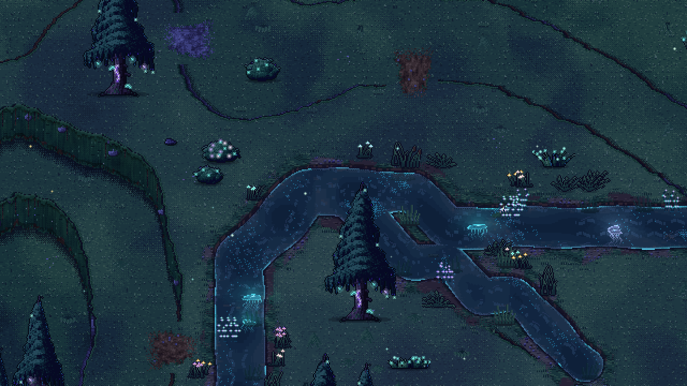
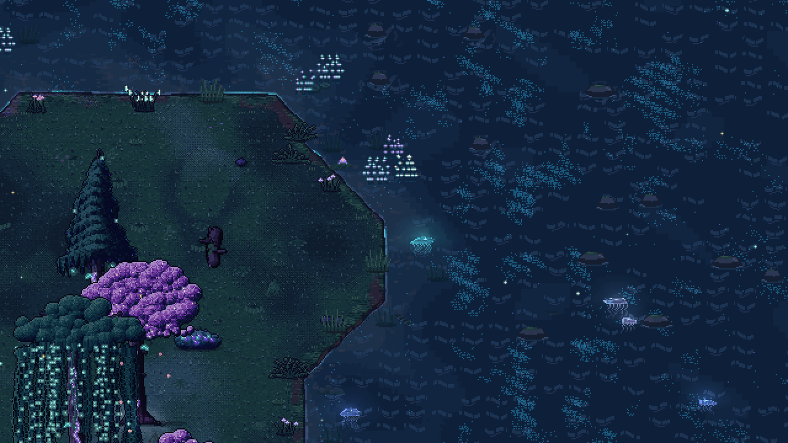

# Shadowspore

**Shadowspore** ist ein atmosphärisches 2D-Pixel-Art Top-Down (3/4) Action-RPG, entwickelt in Godot 4.7 (GDScript).
Es kombiniert Base-Building, Dorfaufbau, Landwirtschaft, Survival bei Nacht und dynamische Bosskämpfe mit anspruchsvollem Kampf- und Veredelungssystem (1–4 Spieler, host-authoritativ).

---

## 🚀 Aktuelle Version: V0.10-1 Beta – „Shadowspore 2.0: Movement 2.0, Lebendige Natur, Wasser 2.0 & Abgrund-Finisher“

> Vollständige Versionshistorie, Studio-Log und alle Detailwerte: siehe **[`CHANGELOG.md`](CHANGELOG.md)**.

### Highlights von V0.10-1 Beta:
- 🏃 **Movement 2.0:** Taktiler Sprint-Antritt, Corner-Smoothing, 180°-Pivot, Hang- & Straßen-Physik, ausdauerschonender **Reisetritt** (`0` Ausdauer auf Straßen), **Vault** über Stämme/Zäune, **Ledge Hop**, Kampf-Fußarbeit, **LivingCamera 2.0** & 20-Hz-Koop-Glättung.
- 🕷️ **Schattenspinne 2.0 & Finisher „Abgrund-Pfähler“:** Überarbeitete Spinnen-KI mit Sichtkegel, Erschütterungs-Sinnen, Haltungs-System, Backstep, Gift-Sprungangriff & `3` Varianten plus der erste 3-stufige Schwert-Finisher.
- 🌳 **Lebendige Natur 2.0:** **Taleeiche**, **Silberbirke** & **Wildapfel** (Stockausschlag, Wurzel-Sitzplätze, Schüttel-Ernte), mehrstufige **lebende Felsen**, reaktives **lebendes Gras** sowie **Sanktuar-Flora** mit über `30` neuen Zutaten & Rezepten.
- 🌊 **Wasser 2.0:** Küstenschelf mit Brandung, Strandpfützen, Gezeitentümpel, Schilf-Bachufer, Sturm-Schaumkronen, Nacht-Biolumineszenz & Wasserbrücken.

---

## 🚀 Vorherige Version: V0.9.5 Beta – „Nahtloser Koop-Beitritt, Relay-Chunking & Versionsschutz“

> Vollständige Versionshistorie, Studio-Log und alle Detailwerte: siehe **[`CHANGELOG.md`](CHANGELOG.md)**.

### Highlights von V0.9.5 Beta:
- 🌐 **Relay-Paket-Chunking für große Welten:** Auch große Welt-Snapshots (über `150 KB`) werden im Online-Relay automatisch aufgeteilt und verlustfrei beim Empfänger zusammengesetzt.
- 🤝 **Vollständige Gast-Synchronisation:** Nachrückende Mitspieler erhalten sauber den aktuellen Stand von Stadtbau, Schatztruhen, Wegsteinen, Weltkarte, Haustieren, Sternensaal und Boss-Arenen.
- 🛡️ **Versionsschutz & klare Lobby-Meldungen:** Laufende Sessions erkennen veraltete Spielversionen sofort, und Kicks oder Lobby-Schließungen führen mit klarer Begründung sauber zurück ins Hauptmenü.
- 🛠️ **Mehrspieler-Feinschliff:** Verbesserte Synchronisation und Stabilität für Charakter-Komponenten, Innenräume, Flussfauna und Quest-Anzeige.

---

## 🚀 Vorherige Version: V0.9.4 Beta – „Cloud-Save-Härtung & Relay-Stabilität“

> Vollständige Versionshistorie, Studio-Log und alle Detailwerte: siehe **[`CHANGELOG.md`](CHANGELOG.md)**.

### Highlights von V0.9.4 Beta:
- 🛡️ **Cloud-Save-Härtung:** Saubere Typ-Wiederherstellung beim Laden von Cloud-Spielständen über alle Welt-, Stadt-, Inventar-, Quest-, Haustier- und Fortschrittssysteme hinweg sowie sicherer Schutz gegen beschädigte Speicherpakete.
- 🌐 **Online-Relay-Stabilität:** Geschützte Netzwerk-Synchronisation während des Verbindungsaufbaus und kontrollierte Host-Erholung bei unerwarteten Relay-Abbrüchen.
- 🦋 **Wildtier- & Navigations-Politur:** Kleinere Stabilitätsfixes bei Wildtieren und Gegner-Navigation sowie aktualisierte Update- und Website-Daten.

---

## 🚀 Vorherige Version: V0.9.3 Beta – „Freundes-Sidebar im Pausenmenü & Nachtlichtung-Look“

> Vollständige Versionshistorie, Studio-Log und alle Detailwerte: siehe **[`CHANGELOG.md`](CHANGELOG.md)**.

### Highlights von V0.9.3 Beta:
- 🤝 **Freundes- & Profil-Sidebar im Pausenmenü:** Einklappbare Seitenleiste (`TAB` / Klick) im ruhigen *Nachtlichtung*-Design zum Verwalten von Freunden, Annehmen aktiver Lobbys und Starten von Online-Relay-Sitzungen direkt aus dem Spiel.
- 🖼️ **Profil-Avatare & Lobby-Sync:** Deine gewählten Avatare (**Lichtung** & **Leere**) sowie dein aktiver Lobby-Status werden nun direkt ins Spiel synchronisiert.
- ✍️ **Erweiterte Pixel-Schriftzeichen & UI-Politur:** Neue Zeichen (`#`, `(`, `)`, `<`, `=`, `·`, `„`, `“`) für die Spiel-UI sowie Styling- und Karten-Updates im Launcher und auf der Website.

---

## 🚀 Vorherige Version: V0.9.2 Beta – „Online-Relay, Launcher-Updater & Autosave-Schutz“

> Vollständige Versionshistorie, Studio-Log und alle Detailwerte: siehe **[`CHANGELOG.md`](CHANGELOG.md)**.

### Highlights von V0.9.2 Beta:
- 🌐 **Online-Koop-Relay ohne Port-Forwarding:** Hoste und betritt Koop-Welten jetzt direkt über das Online-Relay samt geprüfter Spieler-Identität und wählbarem Freundes-Beitrittsmodus.
- 🛡️ **Autosave & Zugangs-Schutz:** Automatische Zwischenspeicherung für deinen Spielfortschritt sowie ein neues Sicherheits-Gate für Kontozugang und Spielintegrität.
- 🚀 **Launcher-Auto-Updater & Profil-Avatare:** Automatische Update-Prüfung direkt im Shadowspore-Launcher, neue Avatare (**Lichtung** & **Leere**), frisches App-Icon und interaktive Weltkarte auf der Website.
- ⚔️ **Sternenklinge & Welt-Politur:** Fix für **STERNENSTICH** (Astralsichel + fallende Sterne treffen nun zuverlässig) sowie zahlreiche Verbesserungen an Welt-Props, Wildtieren, Gegnern und Grafik-Presets.

---

## 🚀 Vorherige Version: V0.9.1 Beta – „Sternengaben, Himmelsfall & Shadowspore Launcher“

> Vollständige Versionshistorie, Studio-Log und alle Detailwerte: siehe **[`CHANGELOG.md`](CHANGELOG.md)**.

### Highlights von V0.9.1 Beta:
- 🌟 **Caelias Sternenaltar & Quest „Gefallene Sterne“:** Sammle nachts **Sternerz** aus Kratern, bringe es in den Sternensaal und schalte im Reiter **`SAMMLUNG`** Meilensteine frei oder tausche es im Reiter **`STERNENGABEN`** ein.
- ⚔️ **Legendäre Sternenklinge & Himmelsgaben:** Entfessle mit der **Sternenklinge** die Doppeltechnik **STERNENSTICH** (Astralsichel + 3 Sternschnuppen) & **HIMMELSFALL** (5 heilende Lichtlanzen) und rüste **Sternenstaub-Elixier**, **Astrale Sternfrucht**, **Morgenstern-Kette**, **Mondsichel-Gehänge** sowie das **Siegel der Ersten Wächterin** (Perk **`STERNENFUNKE`**) aus.
- 🚀 **Shadowspore Desktop-Launcher & Cloud-Konto:** Neuer Desktop-Launcher mit Szenen-Galerie, Changelog-Leser, Freundesliste und Spielstart samt Cloud-Profil- & Cloud-Save-Integration.
- ✨ **Welt- & Shader-Politur:** Verfeinerte Licht-, Nebel-, Wind- & Spiegelungs-Shader sowie Feinschliff an Gegner-Navigation, Wildtieren, Sonnenschatten und freier Kamera.

---

## 🚀 Vorherige Version: V0.9 Beta – „Erwachen der Wächterin & Herz des Sonnenquarzes“

> Vollständige Versionshistorie, Studio-Log und alle Detailwerte: siehe **[`CHANGELOG.md`](CHANGELOG.md)**.

### Highlights von V0.9 Beta:
- 🌌 **Die Göttin Caelia, Sternensaal & `LICHTSCHRITT`:** Die Wächterin rettet dich vor deinem ersten tödlichen Treffer in ihren kosmischen **Sternensaal**, läutert deinen Schritt zum strahlenden **`LICHTSCHRITT`** (`ALT`) und öffnet an jeder erwachten Statue das goldene **`STERNENSAAL`**-Reisesiegel.
- ☀️ **Wüsten-Endgame-Boss „Aurelith, Herz des Sonnenquarzes“:** Im Hohen Norden der Singenden Quarzfelder warten `6` Quarzwächter, `3` monumentale Kampfphasen mit `Sand ↔ Quarz`-Bodenmagie, zurückschlagbaren Resonanz-Kernen, Sandzyklon, Armillar-Gericht & **`ZENIT-NOVA`** – samt legendärem Relikt **`Fessel des Ersten Schmelzers`**.
- 🏘️ **Belebtes Hallgrat:** `6` ausgearbeitete Hauptfiguren (Brann, Ilvane, Odrik, Tamsa, Pim mit seiner abendlichen Lichtrunde, Hedda), bis zu `24` Stadtleute in `7` Rollen, die Kinder Moos, Fink & Lia sowie Katze **Schiefer**.
- 💧 **Wasserspiegelungen & ☀️ Echtzeit-Sonnenschatten:** Flüsse, Seen, Regenpfützen und klare Nächte spiegeln Welt, Figuren & Sternenhimmel; dynamische Sonnen- und Mondschatten wandern über den Boden.
- 💇 **Salon-Ausbau & Grafikstufen:** `5` neue Frisuren, das legendäre Blüten-Qipao **`Perlenblüte`**, Joruns Dialog-Portrait sowie `4` Grafik-Presets (`NIEDRIG` bis `ULTRA`) samt Performance-Schub.

---

## 🚀 Vorherige Version: V0.8.6 Beta – „Zinnen von Hallgrat, Sternenfall & Ruf der Tiefe“

> Vollständige Versionshistorie, Studio-Log und alle Detailwerte: siehe **[`CHANGELOG.md`](CHANGELOG.md)**.

### Highlights von V0.8.6 Beta:
- 🏰 **Hallgrat vollendet (Stufen 3d & 3e):** Ringförmige Stadtmauer mit Rundtürmen & Zinnen (auch auf der Karte), durchgehende Garten-/Feld-/Ruinenmauern mit Kollision, geordnete Häuserreihen sowie über 60 neue Straßenszenen samt leuchtenden Nachtlaternen.
- 🌠 **Wiesenbiom-Ausbau (Stufe 6):** Nächtliche **Sternschnuppen-Krater**, der friedliche **Weiße Kronenhirsch** (durch Anschleichen erlebbar) & **36 platzierte Entdecker-Truhen** mit neuen Talismanen.
- 🌙 **Tag-Nacht- & Schlafrhythmus:** 40-Minuten-Zyklus (`21:00–04:12` Nacht), dynamische Schlafschwelle (`10 %–70 %`), `AUSGERUHT` (`+12 %` Ausdauer-Regeneration) & `ÜBERMÜDET`-Effekte sowie Koop-Bettwarte-Banner.
- 🎪 **Glimmrast-Erweiterung:** **Markttage** & **Vorbestellungen** bei Jorun, **Brunnenplatz Stufe 2 & 3**, 3 neue Feldfrüchte (**Mondlauch**, **Quellmelone**, **Bernsteinkorn**), Gießkannen-Limit (`12` Güsse), **Vogelscheuche** & voller **Freiluftsalon** mit Live-Vorschau und `8` Outfit-Farben.
- 🤝 **Koop-Welten & Boss-Fokus-HUD:** Persistente Koop-Welten mit 6-stelligem Beitrittscode, Live-Spielerliste im HUD & automatisches Ausblenden von Neben-HUDs während Bosskämpfen.
- 🏜️ **Ausblick – Aurelith (Paket 1):** Boss-Dossier & 3-stufiges Titan-Modell von *Aurelith, Herz des Sonnenquarzes* fertiggestellt (der Kampf folgt in den nächsten Paketen).

---

## 🚀 Vorherige Version: V0.8.5 Beta – „Steine von Hallgrat & Wunder der Wiese“

> Vollständige Versionshistorie, Studio-Log und alle Detailwerte: siehe **[`CHANGELOG.md`](CHANGELOG.md)**.

### Highlights von V0.8.5 Beta:
* **Hallgrat im neuen Steinmetz-Look:** Alle Häuser, Hallen, Torhäuser, Stallungen und Marktstände stehen nun im passenden Maßstab – inklusive **diagonaler `48°`-Gebäude** an schrägen Gassen, Vordächern, Honiglicht-Fenstern und gepflasterten Plätzen.
* **Die drei Weltwunder & Nacht-Wunder:** Entdeckt den **Glockenteich**, den **Kreis der Schlafenden Wächter** und das **Blumen-Amphitheater**, schleicht euch nachts an den **Weißen Kronenhirsch** heran, bergt **Sternerz** aus **Sternschnuppen-Kratern** und erkundet **Alte Wassermühlen**, **gebrochene Steinbrücken** sowie **Fischerstege**.
* **Vier neue Schätze & Relikte:** *Sternerz*, *Kronenhirsch-Reif*, *Glockenteich-Gehänge* und das *Ordenssiegel der Wacht*.
* **Freiluftsalon „Spiegelplatz“ & Mod-Menü:** Ein neuer, luftiger Dorfplatz mit flackerndem Abendhimmel-Spiegel und gemütlicher Sitz-Kamerafahrt sowie ein übersichtliches Mod-/Test-Menü im Pausenbildschirm.

---

### Vorherige Highlights (V0.8.4 Beta – „Horizonte im Aufbruch (V0.9-Vorbote)“):
* **Quarzwüste Stufen 3–7a:** **Sonnenhitze** (`ERHITZT`/`ERFRISCHT`), **Singender Resonanzwind & Arkane Quarzgewitter** ohne Regen, **6 neue Wüstentiere** (*Kronen-Oryx*, *Dünen-Fennek*, *Springmaus*, *Agame*, *Sonnenfalke*, *Gold-Skarabäus*), aktive Quarzruinen & Prisma-Adern, der erste **Quarzwächter** sowie die monumentale **Zenitwarte** im Norden.
* **Die Karawane (Jorun):** Nach dem Bau des Brunnenplatzes besucht Händler **Jorun** mit Planwagen und Moosbüffel alle `2–5 Tage` euer Dorf, klappt seine Theke auf und handelt mit Raritäten & „Gesuchtem“.
* **Hallgrat & der Westweg:** Der **790 Tiles lange Westweg** mit **15 Meilensteinen** führt zum steinernen Grundriss von **Hallgrat** auf dem Glaskamm (inkl. 6 Bezirken & Mauerwerk im Relief).
* **„Die Lebendige Wiese“ & Outfit-Layer:** Makro-Landschaften (*Tiefer Urforst*, *Windwiesen*, *Weiden*), **Aussichtspunkte** mit weitem Zoom, Spuren des **Roten Ordens** sowie Ellies neues **Outfit- & Haar-Layer-System**.

---

### Vorherige Highlights (V0.8.3 Beta – „Die Singenden Dünen & das Herz der Stadt“):
* **Neues Biom – Die Quarzwüste („Sonnenquarz-Öde“):** Über `165.000` Tiles im Norden mit `96`-Tile-Klimaübergang, flirrenden Golddünen, schnellen Sinterquarz-Adern (`1,04×` Tempo), geschichteten Sandstein-Klippen, **4 variablen Quarzoasen**, **13 neuen Pflanzen/Felsen** und **11 frischen Items**.
* **Brunnenplatz & Stadtbau 2.0:** Erst der **Brunnenplatz** gründet die Stadt; das neue **Bauplan-Menü**, Grundsteinsetzung, mitwachsendes Gerüst, aktives **`E` Anpacken (`3×` Bautempo)**, eine erntende **Druckwelle** bei Fertigstellung sowie **8 Stadtfarben & 12 Wappen** machen jedes Bauwerk zum Ereignis.
* **Zwei neue Prüfungen der Wächterin:** **Wurzelgeflecht** (kippende Runen-, Keim-, Dorn- & Einwegwürfel) und **Sternenspiegel** (Mondsteine frei tragen & Sternbilder am Teich spiegeln) stehen in je 3 Stufen in der Rätselwelt bereit.
* **Ladescreen-Pilgerzug & pixelgenaue Arm-Verdeckung:** Ellie, Begleiter, Rabe und Irrlicht schreiten nun zur erwachenden **Wegstein-Wächterin**, und Ellies 3D-Schwertarm verschwindet pixelgenau hinter Haar, Gesicht und Mantel.

---

### Vorherige Highlights (V0.8.2 Beta – „Klingen, Krähen & wilde Pfade“):
* **3D-Griff-System & echte Waffenphysik:** Ellies rechte Hand und alle Waffen/Werkzeuge bewegen sich jetzt im echten 3D-Raum – mit 2-Knochen-Arm im Pixel-Art-Stil, spürbarer Feder-Trägheit, eigenen Trage-/Bereit-/Sprint-Haltungen (Spitzhacke & Hacke über der Schulter) und X-förmigen Schwungbögen.
* **Die ersten Welt-Rätsel:** Entdeckt die scheue **Irrlichtspur** nördlich der Hütte, folgt der beringten **Hortkrähe** östlich vom Fluss zu ihrem Erdversteck und tauscht mit dem alten **Raben am Westhang** Glänzendes gegen seine vergrabene Mondsiegeltruhe.
* **Schmied Torben & Questtafel-Fortschritt:** Nach dem Bau der **Questtafel** ruft euch eine neue Story-Quest in den Norden, wo ihr **Torben** gegen die Schatten helft, die **Schmiede** errichtet und ihn samt neuer Tagesaufträge ins Dorf holt.
* **Lianen-Inventar, Silhouetten-Ladescreen & „Licht gegen Leere“:** Ein organisches Zweig- und Lianen-Inventar mit Ritualkreis-Ellie, schwebende In-World-Sprechblasen, ein animierter Silhouetten-Ladescreen mit der Void-Spinne sowie ein dynamisches Hauptmenü voller Schockwellen und Funken.
* **Lebendiger Hexenwald & Flussufer:** Neue Wildtiere (**Wildschwein**, **Luchs**, **Eichhörnchen**, **Hexenziege**, **Hexenkröte**, **Specht**, **Eichelhäher**, **Rotkehlchen** & **Otter**) bereichern Wälder und Gewässer.

---

### Vorherige Highlights (V0.8.1 Beta – „Schätze aus dem Licht“):
* **Drei neue Beutetruhen-Klassen:** **Wurzelkiste** (Gewöhnlich, Schloss öffnen), **Mondsiegeltruhe** (Selten, `0,9 s` Siegel brechen) und **Glutreliquiar** (Legendär, `1,6 s` Leere-Ketten sprengen) – je mit eigenen Pixel-Art-Animationen, gestaffeltem Schatzregen (*das Beste zuletzt!*) und garantiertem Kristall-/Trank-Fund.
* **Spektakulärer Boss-Himmelssturz:** **Mornath** und **Morwenna** lassen `2,8 s` nach ihrem Tod ein legendäres **Glutreliquiar** in einer gigantischen Lichtsäule niederstürzen – inklusive ihrer kompletten Beute, Reliquien (*Rissfeder*, *Moras Spiegelscherbe*) und Bonus-Ziehungen (auch bei Rückkämpfen via Hologramm!).
* **Faire Koop-Beute & lange Liegezeit:** Truhen skalieren um **`+1` Extra-Ziehung** je nahem Mitspieler (`200 px` Radius), teilen Kupfer/XP gerecht unter allen Siegerinnen auf und lassen gedroppten Loot volle **`300 s` (5 Minuten)** liegen. Ungeöffnete Bosstruhen werden im Spielstand gesichert.
* **Vorbereiteter Ausblick:** Erste Art-Assets für kommende Welt-Rätsel (*Prüfungen der Wächterin*: Sonnenuhren, Runenstelen, Hortkrähen & Schreine) bereiten den Boden für künftige Erkundungs-Updates.

---

## 🗺️ Kern-Features
* **Host-Authoritatives Multiplayer-System:** Nahtloses Zusammenspiel von bis zu 4 Spielern (ENet / Godot Multiplayer) mit eigenem Koop-Spielstand und dauerhaften Gast-Identitäten.
* **Magie-System & Kristallhandwerk:** 5 Elementarschulen, `50` Sockel-Kristalle in 5 Seltenheiten, Einzel- und Doppelzinken-Stäbe bei Seehexe Ilva.
* **Dorfaufbau („Licht ist Land“):** Gebäude wachsen Pixel für Pixel (`build_pixels.gdshader`), getrampelte Pfade entstehen organisch zwischen Türen.
* **Lebendige Dorfbewohner, Tagebuch & Schwarzes Brett:** Echte Tagesabläufe für Valdric, Gustav, Torben, Esma und Ilva sowie Quest-Tagebuch (`J`), Kopfgelder und Ehrentafel.
* **Ackerbau & Selbstversorgung:** Felder bestellen, Saatgut züchten, Feuchtigkeitszyklen pflegen und Wundkräuter ernten.
* **Waffen-Veredelung (+1 bis +15):** Bei Torben dem Schmied mit Anschmieden, Härten und Leerenschmieden.
* **Dynamisches Beleuchtungs- und Wettersystem:** Globale Baumkronen-Deckungsmaske (`DaylightField`), Bannsteinring, 10 Wetterfronten, Wolken, Gewitterblitze und ständiges Wetter-HUD.
* **Mehrphasige Bosskämpfe & Beutetruhen:** Mornath (Sky Cleaver) und Morwenna (Spiegelhexe) mit herausfordernden Phasen, Nebeltarnungs-Reaktion, Glitch-Mechanik und legendären Boss-Reliquiaren aus dem Licht.

---

## 🛠️ Entwicklung & Tech-Stack
* **Engine:** Godot 4.7 (GDScript, strikte statische Typisierung)
* **Assets & Pipelines:** Deterministische Python-Art-Pipelines (`tools/`) für Pixel-Art, Shader und Normal-Maps
* **Datengetrieben:** Sämtliche Items, Gegner, Quests, Dialoge und Veredelungsregeln liegen in JSON (`data/`)

---

## 📦 Releases & Changelog
* Alle Releases und Patchnotes findest du unter **[GitHub Releases](https://github.com/acuteflower/shadowspore/releases)**.
* Der chronologische Update-Bericht liegt in **[`CHANGELOG.md`](CHANGELOG.md)**.
