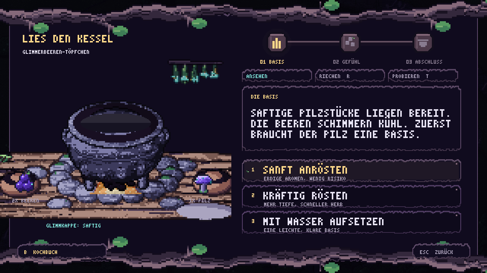
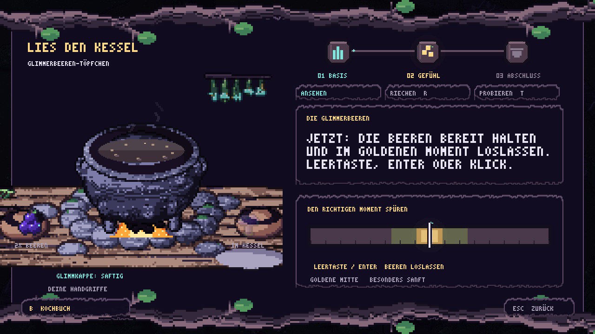
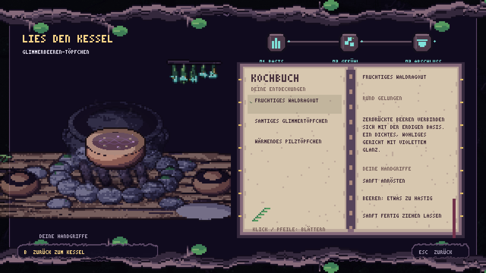
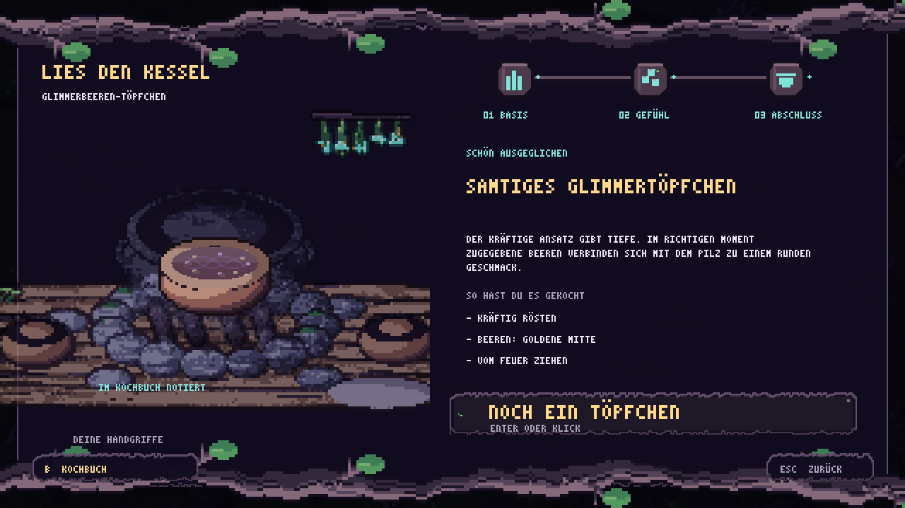

# Lies den Kessel – Probierküche, zweite Fassung

Erste spielbare Version, ausschließlich über Einstellungen → ENTWICKLER → KOCHPLATZ → LIES DEN KESSEL. Solo; der Button startet keinen Weltbau und keine Weltinteraktion. Eine laufende Intro-/Storysequenz oder ein toter Spieler kann den Kochplatz nicht öffnen.

## Ablauf

Ein Rezept: **Glimmerbeeren-Töpfchen**, mit zwei Glimmerbeeren und einer Glimmkappe. Die Probierküche stellt diese Zutaten bereit. Die Beeren verwenden die vorhandene Dämmerbeeren-Optik (`dusk_berry`), der Pilz ist die vorhandene Glimmkappe (`glow_cap`). Globale Itemnamen wurden dafür nicht umbenannt.

Nach Entzünden der Glut folgen drei Kochmomente:

1. Die Pilzbasis sanft rösten, kräftig rösten oder mit Wasser aufsetzen.
2. Geschicklichkeit: Beereneinwurf selbst starten, dann den pendelnden Marker möglichst in der goldenen Mitte stoppen. Perfekt mildert den Ansatz, gut lässt die Beeren ganz, ein ungenauer Treffer zerdrückt sie und bringt eine herbe Note.
3. Vom Feuer ziehen, sanft fertigziehen oder kräftig einkochen.

Ansehen, Riechen und Probieren geben zum tatsächlichen Zustand passende Hinweise. Vor dem Garen empfiehlt Ellie erst zu garen. Hinweise verbrauchen keine Handgriffe. Beim ersten und dritten Schritt verändert sich das Gericht während des Überlegens nicht. Der zweite Schritt beginnt erst nach ausdrücklichem Start und pendelt ohne Frist. Das Kochbuch hält den Marker an. Kurze Aktionsanimationen sperren nur doppelte Eingaben.

Saftige und abgetrocknete Pilze wechseln sich bei neu angesetzten Töpfchen ab. Der Zustand steht sichtbar am Kochplatz und beeinflusst das starke Rösten. Alle Entscheidungen bleiben danach deterministisch; es gibt keinen unsichtbaren Erfolgswurf. Ein dunkler Ansatz kann durch perfekt getimte Beeren und einen sanften Abschluss ausgeglichen werden.

Ein Rezept ergibt sechs Charaktere: frisch, samtig ausgeglichen, fruchtig, leicht, wärmend oder rauchig/herb. Das fertige Gericht zeigt seine Beschreibung und die drei tatsächlich gewählten Handgriffe. Die Varianten werden automatisch im eigenen Kochbuch unter `user://cooking_book.json` gespeichert. Dieselbe Variante erzeugt keinen zweiten Eintrag, ihre zuletzt gekochte Methode wird aktualisiert. Das Kochbuch ist vom Charakterspielstand getrennt und wird über eine temporäre Datei atomar ersetzt.

**Bewusster Umfang:** Zutaten und Ergebnis sind derzeit Teil der Probierküche. Sie verbraucht keine Inventarstapel, erzeugt keine Inventargerichte und vergibt keine Heilung oder Buffs. Anbindung an Weltkochstellen, Inventar, Essenswirkungen und weitere Rezepte ist noch offen.

## Gestaltung und Animation

Die Station wurde in `tools/art_cooking.py` mit dem vorhandenen Hütten-/Charakterrenderer erstellt. Eisen, Stein, Holz, Ton und Moos stammen aus `hut_lib`. Echte Pixelassets unter `assets/ui/cooking/`: getrennte Herd-/Brettbasis, Eisenkessel, vollständige Referenzstation und Tonschale. Die Ebenen halten die Flammen physisch hinter dem Kessel. Feuer und hängende Kräuter verwenden direkt die vorhandenen Hüttentexturen.

`CookingWindow` nutzt `VineStyle` und `PixelText` für Ranken, Blätter, ausgefranste Papierkanten, drei hölzerne Kochmoment-Medaillons und warme Akzente. Das Interface ist auf die 640×360-Spielansicht ausgelegt und wird bei breiteren Ansichten zentriert. Kräftige, knorrige Pixeläste mit Blattbüscheln rahmen das Fenster. Der Kessel trägt gehämmertes Eisen, eine genietete Bindung und Ruß; Stein und Holz haben die vorhandene Materialkörnung. Das Kochbuch zeigt zwei warme, gebundene Pergamentseiten, auswählbare Varianten, Beschreibung und alle Handgriffe. Kein neuer Systemfont oder geglättetes UI-Set.

Animationen: sechs vorhandene Feuerframes, feine pixelige Dampffäden, kleine Blasen, schwimmende Zutaten, violette Saftfäden, kleine Glimmstellen, Rühren mit Holzlöffel, Eingießen, Beerengabe, Glutimpulse und eine angerichtete Schale. Feuer, Dampf und Aktionsanimationen sind kosmetisch. Nur der bewusst gestartete Marker im zweiten Schritt beeinflusst das Ergebnis. `tools/audio_cooking.py` erzeugt leises Köcheln, Zischen, Eingießen, einen Löffelton und eine kurze Abschlussfolge in `assets/audio/cooking/`.

## Steuerung

- Maus: Sinnesreiter, drei Handgriffe, Kochbuch, Zurück und neues Töpfchen anklicken.
- Tastatur: Enter startet die Geschicklichkeit, Leertaste/Enter lässt die Beeren los. 1–3 entscheiden in Schritt eins und drei; Pfeile und Enter wählen ebenfalls. R riechen, T probieren, Q/E Sinne wechseln, B Kochbuch, Escape zurück.
- Controller: Steuerkreuz wählt Handgriffe, Bestätigen führt aus, Schultertasten wechseln die Sinne, Bestätigen startet/stoppt den zweiten Schritt, Y öffnet das Kochbuch, Abbrechen geht zurück.

Während die Küche offen ist, pausiert die Solo-Welt und das normale HUD wird verborgen. Die Küche animiert weiter. Schließen oder Entfernen des Fensters stellt den vorherigen Pausen-, Eingabe- und HUD-Zustand wieder her. Escape aus dem Kochbuch führt zunächst zum Kessel zurück.

## Aufbau und Prüfung

- `data/cooking.json`: Rezept, Zutaten, drei Kochmomente, je drei Aktionen, Effekte und Rückmeldungen.
- `CookingTiming`: bildratenunabhängiger Pendelmarker, drei symmetrische Trefferzonen, eindeutige Einmal-Auswertung.
- `CookingSession`: isolierte Zustands-/Entscheidungslogik, kontextabhängige Sinne und Ergebnischarakter. Die erste Geschmacksregel und die Beobachtungstexte sind auf das Glimmerbeeren-Rezept abgestimmt; weitere Rezepte benötigen passende Regeln/Texte.
- `CookingBook`: getrennte, validierte Rezeptnotizen mit atomarem Schreiben.
- `CookingWindow`: Modalität, Bedienung, Rendering und Aktionsanimationen. Keine Abhängigkeit von der konkreten Player-Skriptklasse, damit die HUD-Vorladestruktur stabil bleibt.

`Godot --path . tools/test_cooking.tscn`: alle 27 Kombinationen aus Basis, Trefferzone und Abschluss mit beiden Ernten, sechs unterschiedliche Ergebnisse, Rettung und herber Ausgang, Textgrenzen aller Beobachtungen, Speichern/erneutes Lesen ohne Duplikate, echter Entwicklermenü-Einstieg, freie Sinnesabfragen, kein Zeitdruck, Sperre während Aktionen, neues Töpfchen, unverändertes Inventar sowie Aufräumen bei normalem Schließen und unerwartetem Entfernen. Der Test nutzt ausschließlich `user://cooking_test_only.json` und entfernt diese Datei anschließend. Zusätzlich: Timing bei unterschiedlichen Bildraten, drei Trefferzonen, kein doppelter Treffer, Stillstand beim Buchlesen und Kochbuchauswahl per Maus/Tastatur. Stand: 54 Wege, 1618 Checks ohne Fehler. Screenshots unter `/tmp/cooking-*.png`.
