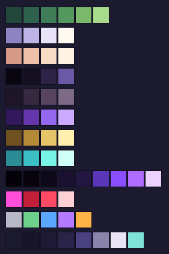
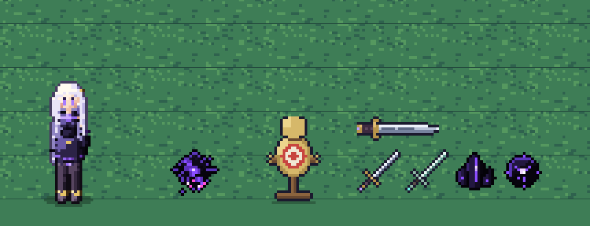
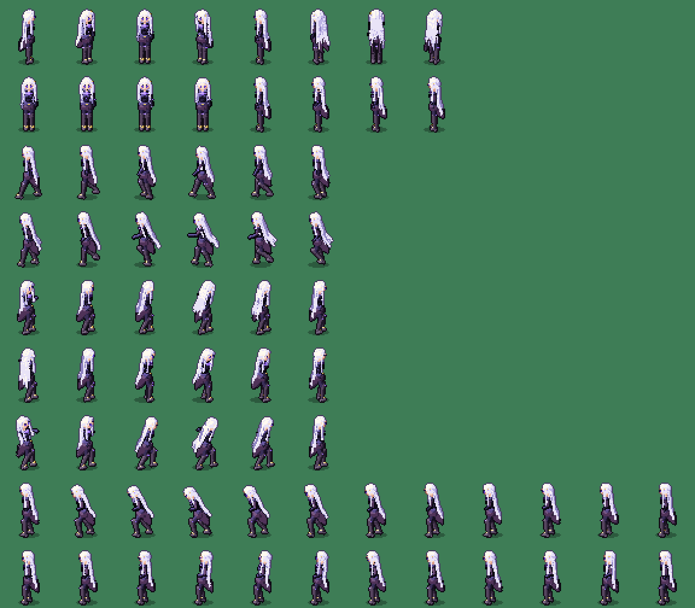
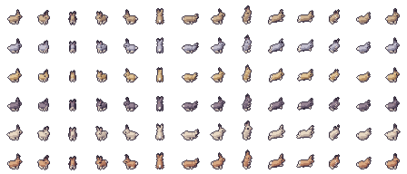
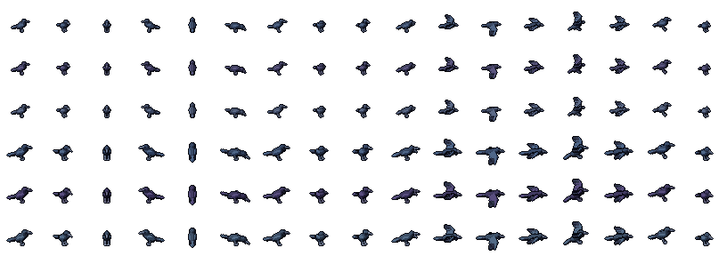
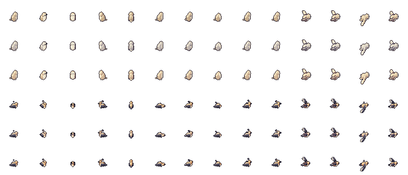
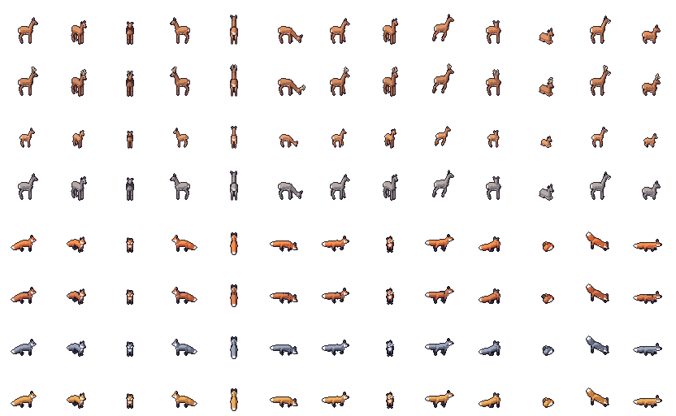
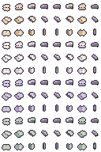
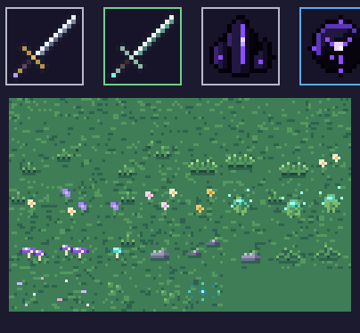
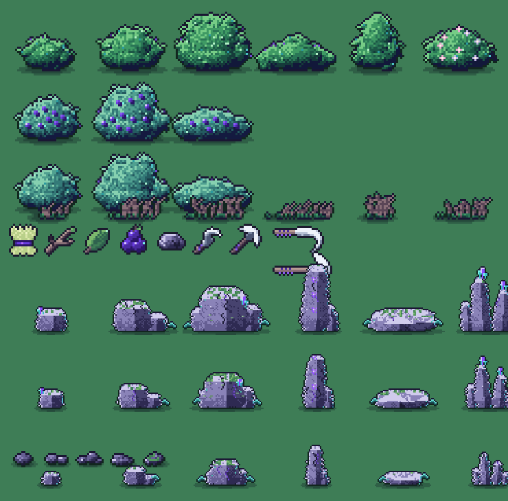

# Shadowspore – Gestaltungs-Grundlagen

Diese Anleitung sagt, wie Charaktere, Items und Map-Objekte aussehen sollen, wie sie funktionieren und
wie sie eingesammelt werden – damit alles Neue zum Bestehenden passt. Was hier steht, ist **im Spiel
umgesetzt**; was nur ein Vorschlag ist, steht im Abschnitt „Noch offen" oder ist als *Vorschlag* markiert.

Die Bilder stammen aus den echten Assets (`python3 tools/gen_doc_images.py` erzeugt sie neu).

---

## 0. Die Kurzfassung

**Dialog-Charakterbilder:** Verbindliche Größen-, Ansichts- und Ausschnittregeln stehen in [dialogue_art.md](dialogue_art.md). Ellie ist die Maßreferenz; Pose und Ausdruck bleiben frei.

1. **Stimmung:** mystisch, ruhig, harmonisch. Schwarz-Violett ist die Grundfarbe der Welt, Türkis und Gold sind die Akzente, die Wiese ist ein kühles, leicht blaugrünes Grün.
2. **Pixelart, 16-px-Raster, 640×360 Bildschirm**, scharfe Pixel (kein Weichzeichnen, kein Drehen von Pixelart außer Waffen und Effekten).
3. **Licht kommt von links oben.** Jedes Material hat 3–4 Töne (dunkel → hell), dazu ein 1-px-Rand in einer dunkel getönten Farbe, nie hart Schwarz.
4. **Maßstab:** Spielerin ≈ 42 px hoch (2,6 Tiles). Alles andere wird dagegen gemessen (Abschnitt 2).
5. **Füße sind der Anker.** Jedes Ding steht mit dem unteren Rand auf dem Boden, Y-Sortierung läuft über die Füße, die Schattenellipse liegt dort.
6. **Violett = Leere/Magie, Türkis = Leben/Glühen, Gold = Metall/Wert, Magenta und Rot = Gefahr.**
7. **Ein Wiedererkennungsmerkmal pro Figur** (Haar, Umhang, Accessoire), nicht mehr – sonst wird die Silhouette unruhig.
8. **Was man sieht, trifft.** Warnflächen und Reichweiten müssen mit den echten Treffern übereinstimmen.
9. **Alles datengetrieben:** Werte stehen in `data/*.json`, nicht im Code.
10. **Kein Rauch, kein Hellgrau-Nebel bei Schattenwesen.** Sie sind fast schwarz, organisch, mit violetten Adern.

---

## 1. Farben



Die Zeilen des Bildes von oben nach unten:

| Zeile | Familie | Farben (dunkel → hell) |
|---|---|---|
| 1 | **Wiese** (6 Töne) | `22483c` `2f624e` `3e7d56` (Basis) `55985f` `7cb96d` `a8dc8c` |
| 2 | Haar (kühles Weiß, warmes Licht) | `8f84c2` `bdb3e4` `e9e3f7` `fffaf0` |
| 3 | Haut | `d79a88` `efc0a8` `f9dcc6` `fff1e4` |
| 4 | Schwarzes Leder | `09060f` `150f22` `2c2347` `6a5aa6` |
| 5 | Stiefel (staubiges Pflaume) | `1e1626` `372a40` `574560` `7d6a86` |
| 6 | Violette Zierde | `34185e` `6636ad` `9468ee` `cbaaff` |
| 7 | Gold | `6f5020` `b48a38` `e6c468` `fff0b0` |
| 8 | Türkis-Glühen | `2a8c94` `3cc0c6` `78f4e6` `d0fff8` |
| 9 | **Schattenwesen** | Rand `040208`, `07040d` `0e0919` `1a1030` `221740`, Rim `5a36b8`, Ader `8a4dff`, Glühen `b06bff`, Kern `ecd2ff` |
| 10 | Gefahr | Augen/Warnung `ff4fd8`, Warnfläche `c21f3b` → `ff4a63` → Blitz `ffd0d6` |
| 11 | **Seltenheiten** | gewöhnlich `b8b8c8`, ungewöhnlich `6fd08c`, selten `5aa8ff`, episch `b47aff`, legendär `ffb347` |
| 12 | **Oberfläche (UI)** | Rand `1b1a2e`, Slot `171329`, Panel dunkel `1e1a36`, Panel `2a2548`, Rim `4a4180`, Text gedimmt `8a84ad`, Text `e8e4f4`, Akzent `7fe3da` |

Regeln:

- **Neue Farben aus bestehenden Familien ableiten** (dunkler/heller, nie komplett neu). Neue Familie nur, wenn es einen Grund gibt, und dann mit 4 Tönen.
- **Sättigung gering halten**, Kontrast über Helligkeit erzeugen. Grelle Farben sind für Warnungen reserviert (Magenta/Rot) und für Seltenheiten.
- **Glühende Dinge** (Kristalle, Leuchtblüten, Augen, Adern) bekommen einen hellen Kern und werden nicht schattiert.
- **Schatten leicht kühl-violett färben**, nicht grau. Der Boden-Shader tut das mit der Wiese bereits.

---

## 2. Maßstab und Pixelregeln



| Ding | Größe | Anmerkung |
|---|---|---|
| Tile | 16×16 | Bildschirm = 40×22,5 Tiles |
| **Spielerin** | Frame 48×56, ca. **42 px** hoch | Füße bei (24, 51), Kopf ≈ 9–10 px (ca. 4,5 Köpfe hoch: großer Kopf, schlanker Körper) |
| Schattenspinne (Körper) | 32×26 Frame | Beine werden im Code gezeichnet, reichen weiter |
| Übungspuppe | 24×32 | |
| Item-Icon | 16×16 | |
| Waffe in der Hand | 30×9 (Basis) / 32×9 (Eisen) | Griffpunkt bei (4, 4) |
| Schadenszahl/Text | eigene 3×5-Pixelschrift (`PixelText`), nur Großbuchstaben | |

**Richtwerte für Neues** (damit es zur Spielerin passt):

| Art | Höhe | Hinweis |
|---|---|---|
| Menschliche NPCs | 36–44 px | gleiche Proportionen wie die Spielerin, leichte Abweichung erlaubt |
| Kleine Wesen / Tiere | 12–24 px | |
| Normale Gegner | 24–40 px (Körper) | Beine/Fortsätze dürfen darüber hinausgehen |
| Große Gegner / Bosse | 64–96 px | brauchen eigene Kamera-/Platzüberlegung |
| Bäume, Felsen, Gebäude | 2–5 Tiles | Fuß-Fläche klein halten, Krone darf überlappen |

**Pixelregeln**

- **Nearest-Filter, Pixel-Snapping.** Keine Halbpixel-Positionen für Sprites; Effekte runden Positionen.
- **Y-Sortierung:** Pivot unten Mitte (Füße), `y_sort_enabled = true`. Alles, was vor/hinter einem Körper sein kann (Waffe, Arm), hängt an einem Knoten, der seine Y-Position verschiebt (siehe `Hand`-Knoten).
- **Bodenschatten:** dunkle Ellipse (ca. 17×5 px, 27 % Schwarz) unter den Füßen, im Sprite gebacken oder als Knoten.
- **Rand:** 1 px, in einer **dunkel getönten Version der Nachbarfarbe** (Haar violett-grau, Haut rotbraun, Leder fast schwarz, Gold dunkelgold, Türkis dunkeltürkis). Schattenwesen haben den Rand `040208`.
- **Material-Töne:** 4 Stufen aus Licht von links oben; Kanten oben/links heller, unten/rechts dunkler. Innenlinien nur, wo ein Teil klar vor einem anderen liegt.
- **Ordnung statt Rauschen:** Flächen mit kurzen, gerichteten Strichen und kleinen Clustern füllen, nie mit Pixelrauschen (das hat sich beim Gras als „zu punktig" herausgestellt).
- **Rotation nur bei Waffen und Effekten.** Figuren werden pro Blickrichtung neu gezeichnet bzw. gerendert.

---

## 3. Charaktere

### 3.1 Die Spielerin (Referenz für alles Menschliche)

**Erkennungsmerkmale:** silberweißes Haar mit Lavendelschatten und Mittelscheitel, kleine goldene Haarnadel, schlanke Proportionen, dunkler hoher Kragen und taillierte schwarz-violette Jacke mit langen Ärmeln, geteilte pflaumenviolette Mantelschöße, dunkle Hose und hohe Stiefel. Die [freigegebene Bildvorlage](img/ellie_design_reference.png) und der [Figurenleitfaden](characters_guide.md) definieren den neuen festen Standard.

**Wirkung:** ruhig, wach, ein bisschen unnahbar – abenteuerlich, aber nicht modern (kein Streetwear, keine Neonfarben). Bewegung ist weich: Haar und Mantelschöße schwingen weich mit.

### 3.2 So werden Figuren gebaut

Die Spielerin wird **nicht von Hand gepixelt, sondern aus einem kleinen 3D-Modell gerendert** (`tools/art_hero3d.py`, braucht `pip3 install --user numpy`). So gibt es alle Blickrichtungen, Laufzyklen und Posen aus einem Modell – und neue Posen kosten nur Zahlen, nicht Pixel.



Von oben nach unten: acht Blickrichtungen, Idle (Süd, West), Gehen (West), Joggen bei Sprint-Eingabe (West), Vorhand, Rückhand, Stoß (Ost, Stand).

- **Blickrichtungen („Sektoren“):** E, SE, S, SW, W, NW, N, NE – in dieser Reihenfolge ist es auch die Zeilenreihenfolge der Sheets. **Kein Spiegeln**, jede Richtung ist echt gerendert (so bleibt die Schwerthand immer rechts).
- **Hauptsheet** `assets/characters/player.png`: 16 Spalten × 16 Zeilen à 48×56. Zeilen 0–7 stehend, 8–15 geduckt (Schleichen). Spalten: 0–5 Gehen, 6–11 Joggen bei Sprint-Eingabe, 12–15 Idle. Bewegungs- und Rig-Details stehen in [characters_guide.md](characters_guide.md).
- **Standgesten:** Nach zufälliger Wartezeit streckt sich Ellie, richtet ihr Haar oder schaut sich um. Das separate `player_standby.png` enthält die drei Animationen in acht Richtungen; Bewegung, Kampf und andere Aktionen unterbrechen sie.
- **Angriffssheet** `player_attack.png`: pro Blickrichtung 3 Angriffe × 7 Bein-Varianten × 6 Keyframes. Variante 0 steht fest, 1–6 laufen im Gehzyklus weiter.
- **Pflicht-Animationen für jede Figur mit Körper:** Idle (4+ Frames, lebendig: Atmen, Haar), Gehen (6 Frames, Fußkontakt bei Frame 0 und 3 für die Schritt-Effekte), bei Kämpfern Sprint und Angriffe.
- **Waffenhand:** Der rechte Arm steckt nicht im Sheet. `data/hero_rig.json` liefert pro Frame Schulter und Hand; das Spiel zeichnet den Arm bis zum Griff. Dadurch „schwebt“ eine Waffe nie.
- **Trefferzone:** klein und in Körpermitte (8×8 px auf Höhe −12), nicht so hoch wie der Sprite – sonst trifft ein Gegner, obwohl seine Warnfläche am Boden nicht berührt wird.
- **Höhenabhängige Konstanten** (Zielpunkt der Waffe, Kamera, Zahlen über dem Kopf) stehen in `CLAUDE.md`; sie ändern sich mit der Figurgröße.

### 3.3 NPCs *(Leitlinien, noch keine umgesetzt)*

- **Gleiche Pipeline und Proportionen** wie die Spielerin; ein neues Modell ist eine Variante von `build()` mit anderem Haar, Outfit und anderen Farben aus den Familien in Abschnitt 1.
- **Ein Erkennungsmerkmal** (z. B. Kapuze, Zopf, Schürze, großer Hut), ein Akzent (violett, türkis oder gold), alles andere gedämpft.
- **Mindestens:** Idle-Loop in 4 Richtungen (S, W, N, O) reicht für stehende NPCs; wandernde NPCs brauchen Gehen in 8 Richtungen.
- **Namen und Texte** in Großbuchstaben mit `PixelText`; Dialoge liegen später in `data/dialogue.json` (noch leer).
- **Hände und Gesicht** immer klar lesbar: Gesicht 5–6 px hoch, Augen 1 px breit mit hellem Punkt, Mund 2 px.

### 3.4 Gegner

**Schattenwesen** (alle dunklen Gegner) folgen diesen Regeln:

- **Fast schwarz** (`07040d`–`221740`), violetter Rim und Adern, **magentafarbene Augen**. Nie hell, nie bunt.
- **Organisch, nicht insektenhaft:** weiche Körper, dünne gebogene Beine/Tentakel, zufällig wirkende Bewegung (Zucken, ungleiche Schritte, Wiegen).
- **Leuchtkraft ist Standard für jedes Schattenwesen:** magentafarbene Augen mit hellem Kern, violette Adern und Kerne mit langsamem Pulsieren. Diese Pixel bleiben auch nachts hell und bekommen dezente Pixel-Halos; beim Aufziehen eines Angriffs steigt die Leuchtkraft sichtbar an. Schwarzes Gewebe und Umrisse bleiben dunkel und werden normal von der Welt beleuchtet. Leuchtteile folgen Körperverformung und Blickrichtung und verblassen beim Tod mit. Technisch: `ShadowEmission.attach(body)` für die exakte Leuchtmaske, eigene ungetönte Aderlinien für prozedurale Gliedmaßen, kleiner `NightLight` für den Boden.
- **Kein Rauch.** Stattdessen: **Schattenbefall** am Boden (`ShadowTrailComponent`): kleine, schnell vergehende Flecken bei jedem Schritt (ca. 3 s + 2,5 s Auflösung) und beim Tod ein großer Befall mit Tentakeln, der länger bleibt (ca. 10 s + 6 s). Jedes neue Schattenwesen verwendet dieselbe Komponente.
- **Tod:** Void-Splitter-Partikel, Befall, Beute.
- **Angriffe zeigen sich vorher:** eine **rote Pixel-Fläche am Boden**, in die rote Pixel „fließen“. Die Richtung rastet im Windup ein (ausweichbar), kurz vor dem Treffer flackert die Fläche, beim Treffer blitzt sie hell. Die Fläche folgt den echten Werten (`reach`, `arc`, `radius`) und wurde gemessen: Treffer und Anzeige weichen um höchstens etwa 1 px ab.
- **Spezialfähigkeiten** (Beispiel: Greifhaken der Spinne) haben ebenfalls eine Warnfläche und einen kurzen Zeitraum, in dem man ausweichen kann.

**Daten** (`data/enemies.json`): Name, Leben, Tempo (`chase_speed`, `wander_speed`, `turn_speed`), Wahrnehmung (`sight_range`, `lose_range`; beim Schleichen halbiert), Angriff (`attack_range`, `windup`, `strike`, `recover`, `damage`, `reach`, `arc`, `knockback`, `hurt_stun`), Beute (`loot`) und optional Fähigkeiten (z. B. `grapple`).

**Schattenspinne – umgesetzt:** beobachtet kurz, schleicht seitlich an und zieht sich in kurzen Vorstößen vorwärts. Weiche Gliedmaßen verankern sich am Boden, ziehen sich dünn ein und formen sich neu; keine festen Knie. Beim **Sichelschlag** stemmt sie sich hinten ab und verdickt abwechselnd ein Vorderglied, das durch den angekündigten Sektor schneidet. Beim **Verankerungszug** sinkt sie ab, spannt beide Vorderglieder, hakt am angekündigten Punkt ein und zieht den Körper nach. Zielrichtung und Anker rasten 0,3 s vor dem Auslösen ein. Treffer folgen der sichtbaren Sichelbewegung bzw. nur dem Landekreis des Zugs; die dünne Verbindungslinie verursacht keinen Schaden. Leichte Treffer verformen sie, schwere Komboabschlüsse unterbrechen die Vorbereitung. Nach einem Zug bleibt ein deutliches Gegenangriffsfenster. Ausgangswerte: 48 Leben, 14/17 Schaden, Erholung 0,72/0,82 s (Sichel/Zug).

**Verfolgen über Höhen:** Gegner suchen körperbreite Wege durch die geladenen Flächen und um Hindernisse herum, einschließlich seitlich gelegener Treppen und Rampen. Die Spinne kann zusätzlich **eine Höhenstufe erklettern oder kontrolliert absteigen**: kurz ducken, Vorderglieder an der oberen Kante verankern, den Körper unter Spannung nachziehen und mit versetzten Wandkontakten nachgreifen. Augen und Adern pulsieren dabei violett; dies ist eine Bewegungsfähigkeit ohne Angriffsschaden. Danach 0,52 s Erholung, bevor sie wieder angreift. Die Vorbereitung dauert 0,52 s und lässt sich mit einem schweren Treffer unterbrechen; während des Kletterns bleibt sie verwundbar. Wird der Landeplatz besetzt, zieht sie sich auf sicheren Boden zurück. Nur echte Felskanten sind kletterbar, keine Bäume, Gegenstände oder Leere; keine Mehrfach-Höhenstufen in einem Zug. Treffer setzen eine passende Höhe und freien Weg voraus.

**Leerenhorcher – umgesetzt:** ein normaler Distanzjäger mit 38 Leben. Eine schmale, vornübergebeugte Masse auf zwei tragenden Gliedern und zwei langen, tastenden Vordergliedern; der dreilappige Kopfspalt öffnet sich körperlich, leuchtende Adern fließen zum Kern. Magentafarbene Augen, schwarzes Gewebe und violette Nähte folgen dem gemeinsamen Schattenstandard. Vier Weltkontakte verankern die Bewegung; keine starren Gelenke. Die Schattenspuren und der Tod verwenden denselben Befall wie die Spinne.

- **Lebendigkeit und Licht:** auch in Ruhe lesbare violette Gliedmaßenadern, leuchtende Rippennähte und kleine Brust-/Beckenkerne im Stil der Spinne. Ruhiger gemeinsamer Aderpuls, sichtbares Atmen des Brustkorbs, leicht verzögertes Mitschwingen des Kopfes und weiches Fließen der Tastglieder; die Fußkontakte bleiben verankert. Schwarzes Gewebe bleibt weltbeleuchtet, die schlanke Silhouette erhalten.
- **Wahrnehmung und Abstand:** Schritte, Sprinten und Waffenschwünge sind hörbar; Schleichen ist deutlich leiser, Deckung dämpft Geräusche. Er kann nach vorn sehen und merkt sich die zuletzt wahrgenommene Stelle acht Sekunden lang. Verdeckte Spielerpositionen werden nicht laufend ausgelesen. Er sucht freie Schusswinkel und ungefähr 95–133 px Abstand, läuft über echte Wege und untersucht verlorene Spuren. Für diesen Typ keine Kletterfähigkeit.
- **Spaltprojektil:** 0,8 s sichtbares Aufladen, Richtung in den letzten 0,25 s fest. Ein weiß glühender Kern tritt exakt aus dem animierten Kopfspalt aus. Er zieht ein dunkles, violett geädertes Void-Band hinter sich her; Gewebe und Weiß lösen sich während des Flugs zunehmend in Splitter auf. Die visuelle Bahn beginnt auf Mundhöhe und sinkt zur Körperebene des Ziels. Die rote Bodenbahn zeigt die tatsächliche Flug-/Trefferzone. Reichweite 152 px, Tempo 210 px/s, Schaden 14, danach 0,85 s Erholung. Deckung und Höhenwechsel stoppen den Schuss; jeder Spieler wird höchstens einmal pro Projektil getroffen.
- **Abwehrschockwelle:** 0,6 s tiefes Zusammenziehen und Verankern. Dann reißen die Kopfloben weit auf, der Körper schnellt hoch und die Tastglieder spreizen sich. Eine breite weiße Druckkante läuft in 0,13 s durch einen vorderen 115°-Fächer bis 46 px, gefolgt von violetten Nachringen, kurzer Pixel-Verzerrung des Hintergrunds und aufgerissenen Schattenspuren. Dezente nahe Kamerawucht respektiert die Schüttel-Einstellung. Die Treffer wachsen mit der sichtbaren Druckfront; hinter dem Horcher bleibt Raum. Schaden 9, deutlicher Rückstoß, danach 1,05 s Erholung.
- **Fairness:** schwere Treffer unterbrechen beide Vorbereitungen. Lichtes Zucken verformt den Körper, ohne den angekündigten Angriff beliebig abzubrechen. Beide Angriffe haben klare Warnfelder und können keine Deckung oder andere Höhenstufen durchschlagen. Der bereits abgeschossene Kern lebt nach dem Tod seines Schützen weiter.
- **Pipeline:** komplett prozeduraler `ListenerRig`, eigener Controller `VoidListener`, eigenständig replizierte `ResonanceWave`. Keine gedrehten Rasterfiguren. `tools/audio_listener.py` erzeugt vier austauschbare synthetische Kreaturenlaute. `F2` spawnt den Horcher an der Maus, `F1` weiterhin die Spinne; `F3` den Leerenbrecher (prozeduraler `CrusherRig`, siehe CLAUDE.md); Zeitsprung auf `F4`.

**Hurtbox von Gegnern:** ein Kreis/Rechteck auf Körpermitte, etwa so groß wie der Körper ohne Beine.

---

### 3.5 Wildtiere – Wildkaninchen

Kleine, natürliche Bewohner der Lichtung: rundlicher Hinterkörper, schmale Vorderpfoten, heller Bauch, heller Puschelschwanz und bewegliche Ohren. **Sechs gedeckte Fellvarianten:** Wildbraun, Aschgrau, Honig, Dunkelbraun, Sand und Rotbraun; leichte Unterschiede in Körpergröße, Ohrlänge und Ohrhaltung. Augen dunkel mit winzigem Lichtreflex, **keine Leuchtkraft**. Körper etwa 12–18 px, aufgerichtet mit Ohren bis etwa 24 px; die Spielerin bleibt deutlich größer.



- **Ruhig:** schnuppern, atmen, blinzeln, grasen, sich mit den Vorderpfoten putzen. Kleine Hüpfer mit Pausen statt dauerhaftem Laufen. Ohren und Körper bereiten den Sprung vor, strecken sich in der Luft und federn bei der Landung ein.
- **Aufmerksam:** bei Annäherung erstarren, Kopf heben, Ohren aufstellen und zur Gefahr blicken. Wer schleicht, kommt näher heran; Sprinten und Waffenschwünge erschrecken früher. Ein flüchtendes Kaninchen macht nahe Artgenossen aufmerksam.
- **Ängstlich:** mehrere schnelle Sprünge weg von der Gefahr, mit Abstand zu anderen Tieren und geprüften Wegen um Hindernisse. Keine Richtungswechsel mitten in der Luft, keine Sprünge durch Bäume, Wände oder die Leere. Erst nach ausreichend sicherem Abstand und einer Ruhephase wieder grasen.
- **Welt:** kleine lockere Gruppen auf grünen, ebenen Wiesen, nicht überall gleich dicht. Keine Kollision mit der Spielerin, keine Kampfwerte, Beute oder Sammelinteraktion. Gewöhnliche Tiere bleiben Teil der natürlichen Beleuchtung.
- **Pipeline:** `tools/art_rabbit.py` nutzt denselben kleinen 3D-Pixelrenderer wie die Spielerin; acht echte Blickrichtungen. Sheet `assets/wildlife/rabbit.png`, Frames 32×32, Fußpunkt (16,25). Bodenschatten separat, damit er beim Hüpfen auf dem Boden bleibt. Verhaltens- und Verteilungswerte in `data/wildlife.json`.

---

### 3.6 Raben und Krähen

**Natürliche schwarze Vögel, keine Schattenwesen.** Kohleschwarzes Gefieder mit gedämpftem blauviolettem Schimmer, dunkle Augen mit kleinem Lichtreflex, keine leuchtenden Adern. Raben sind größer und kräftiger, mit schwererem Schnabel, struppigem Hals und längerem keilförmigem Schwanz. Krähen sind schlanker und haben einen eher fächerförmigen Schwanz. Je Art drei dezente Gefiedervarianten, acht echte Blickrichtungen, dieselbe 3D-Pixelpipeline wie die Spielerin und Kaninchen.



- **Zusammenleben:** Krähen in lockeren Trupps von 2–3, Raben einzeln oder paarweise. Nahrungssuche und Picken, Gehen mit Kopfbewegung, Gefiederpflege, gegenseitiges Zuwenden und wechselnde Wachposten. Persönlicher Abstand; kleinere Vögel weichen größeren aus. Dezente räumliche Rufvarianten mit gelegentlichen Antworten, keine dauernde Geräuschkulisse. Die Rufdateien sind vorläufig synthetisiert und können später durch natürliche Aufnahmen ersetzt werden.
- **Gefahr:** erst aufmerksam schauen, bei weiterer Annäherung auffliegen. Schleichen erlaubt nähere Beobachtung, Sprinten und Waffenschwünge erschrecken früher. Ein Alarm löst zeitlich leicht versetztes Auffliegen aus; Artgenossen orientieren sich an einem gemeinsamen neuen Bereich.
- **Flug:** vorwärts gerichteter Absprung mit Beschleunigung, durchgehender Steigbogen, Kurven und kurze Gleitphasen. Lange, flache Anflüge mit Abbremsen, geöffneten Flügeln und ausgestreckten Füßen. Kein senkrechtes Hochfahren und Heruntersetzen. Routen weichen Baumkronen möglichst aus. Ist das Ziel inzwischen besetzt, wird ein neuer Anflug geflogen.
- **Sitzen:** echte reservierte Plätze in geladenen Tannen; wer auf einem Ast sitzt, steht sichtbar vor der eigenen Krone. Beim Fällen fliegt der Vogel ab. Nachts bevorzugen sie ruhige Baumsitzplätze. Bodenvögel bleiben anhand ihrer Füße gemeinsam mit Props und Spielerin Y-sortiert; nur fliegende Sprites liegen oberhalb der Kronen.
- **Verteilung:** bewusst sparsam, maximal acht Vögel gleichzeitig im geladenen Umfeld. Neue Trupps erscheinen nicht direkt neben der Spielerin, Landungen nur auf sicheren Flächen oder gültigen Ästen. Verhalten und Dichte stehen in `data/wildlife.json`; Art-Pipeline `tools/art_corvid.py`, Rufe `tools/audio_corvid.py`.

---

### 3.7 Schleiereule und Wiedehopf

Zwei seltene natürliche Begegnungen. Beide nutzen echte Baumplätze, die geprüften gekrümmten Flugrouten und die gemeinsame Begrenzung auf acht Vögel. Zusätzlich höchstens eine Eule und zwei Wiedehopfe im geladenen Umfeld. Kein Leuchten, keine Kampf- oder Beutemechanik.



- **Schleiereule:** herzförmige helle Gesichtsmaske, cremefarbene Brust, goldbraunes oder kühleres Rückengefieder, breite gerundete Flügel. Drei dezente Varianten. Tagsüber schlafend auf einem Ast, Augen geschlossen, ruhiges Atmen. Bei Warnung erst beobachten. Zur Dämmerung wach; nachts Kopfneigen und Lauschen, Gefiederpflege, niedrige ruhige Flüge und lange Gleitphasen. Keine Gras-Pickanimation für die Eule. Ruf vorläufig als leise synthetische raue Atemlaute; Schlafphasen bleiben ruhig.
- **Wiedehopf:** Zimt-/Sandtöne, schwarz-cremefarbene Flügel und Schwanz, langer abwärts gebogener Schnabel, schwarz gesäumte Federhaube. Drei Varianten. Sucht am Boden, stochert mit dem Schnabel, läuft einige Schritte, schaut und putzt sich. Beim Aufmerken öffnet sich die Haube kurz und legt sich wieder teilweise an. Leichter wellenförmiger Flug mit zügigen Flügelschlägen, kurze Gleitphasen, kein senkrechtes Schweben. Ein zurückhaltender synthetischer dreiteiliger Ruf. Nachts ruhend, Haube angelegt.
- **Pipeline:** `tools/art_meadow_birds.py`, gleiches kleines 3D-Modellverfahren wie die übrigen Tiere; acht echte Blickrichtungen. Eigenes Sheet `assets/wildlife/meadow_birds.png`, Layout wie Raben/Krähen. Werte in `data/wildlife.json`; `tools/audio_meadow_birds.py` erzeugt die austauschbaren Ruf-Platzhalter. Tagesrhythmen und Eigenheiten steuert `WildMeadowBird` über die gemeinsame Vogelbewegung.

---

### 3.8 Rehe, Dachse, Füchse und Igel

Natürliche Waldbewohner für Wiese und Nebelwald, gemeinsam höchstens acht geladene Tiere. Keine Leuchtkraft, Kampfwerte oder Beute. Acht echte Blickrichtungen, drei Körper-/Fellvarianten pro Art. Füße bleiben auf dem gemeinsamen Y-Sortierboden unter Bäumen.



- **Rehe:** weiche Körper- und Halskontur, schlanke, durchgehend lesbare Beine mit dunklen Hufen; Ricke, Bock mit kleinem Gehörn und kleineres geflecktes Kitz. Beim Äsen senken und heben sie den Kopf allmählich; beim Gehen und Fliehen bewegen sich die Beine versetzt. Sie sichern, putzen sich und ziehen einige Schritte weiter. Das Kitz folgt der Ricke. Bei Gefahr erst beobachten, dann fliehen; die Familie reagiert leicht versetzt und hält Anschluss.
- **Dachse:** schwere Hinterhand, niedrige Schultern, kurze kräftige dunkle Beine, silbriger Rücken, helle Gesichtsmitte mit breiten dunklen Augenbändern und kleinen hell gesäumten Ohren. Tagsüber im echten Bau, abends sichtbar herauskommen; schnuppern, wühlen, graben und sich putzen. Morgens auf dem Boden zum Bau zurücklaufen. Beim Graben arbeiten die Vorderpfoten mit kleinen hellen Krallen.
- **Füchse:** spitze Ohren mit dunkler Rückseite, helle Wangen und Brustkrause, dunkle Unterschenkel und eine eigenständige buschige Rute mit breiter heller Spitze. Die Rute schwingt mit Verzögerung nach und liegt beim Schlafen seitlich um den Körper. Dämmerungs-/nachtaktiv: lauschen, sich orientieren, streifen, kurzer bogenförmiger Mäuselsprung und anschließendes Beschnuppern. Kaninchen und Bodenvögel reagieren auf die Nähe; keine Tötungsmechanik.
- **Igel:** kleiner dunkler gewölbter Stachelmantel, geordnete rückwärts gerichtete Stachelbüschel mit helleren Spitzen, warme Schnauze, kleine runde Ohren, dunkle Augen und kurze Pfötchen. Nachts langsame Nahrungssuche und Schnuppern. Bei naher Gefahr einrollen, ausreichend lange geschlossen warten und sich vorsichtig wieder öffnen; tagsüber zusammengerollt schlafen.
- **Gang:** Vier-Takt-Schritt mit längerer Standphase und sichtbarer Fußhebung, schnellerer Fluchtgang; Gangphase folgt der zurückgelegten Strecke und bleibt über Routen erhalten. Längere Gehstrecken mit weichem Beschleunigen/Abbremsen. Flucht und Heimweg schließen ohne erzwungene Zwischenpause aneinander an. Hindernisse werden vorab geprüft und Bewegung bleibt kollidierend; kürzere Ausweichstrecken helfen im dichten Wald.
- **Pipeline:** `tools/art_woodland.py`, Sheets `assets/wildlife/{deer,badger,fox,hedgehog}.png`, 64×64 pro Frame, Fußpunkt (32,52), 44 Spalten × 24 Zeilen. Dünne Glieder müssen beim Herunterskalieren zusammenhängend bleiben; keine voneinander getrennten Pixelpunkte als Beine. Verhalten/Verteilung in `data/wildlife.json`, `WoodlandMammal` und `WoodlandPopulation`.

### 3.9 Schmetterlinge



Vier gedeckte Farbvarianten: Bernstein, Elfenbein, Flieder und Salbeigrün. Klar getrennte größere Vorder- und rundere Hinterflügel mit dunklem Saum, kleinen Augenflecken, schlankem Körper und Fühlern. Die Flächen klappen beim Flügelschlag um den Körper nach oben; zusammengefaltet ruhen sie tatsächlich aufrecht. Keine Leuchtkraft.

Schmetterlinge besuchen echte gemalte Blüten-/Kleeplätze der Wiese. Kleine Blütengruppen mit höchstens zehn Tieren insgesamt; gekrümmte kurze Flüge, leichtes seitliches Flattern und langsames Öffnen der Flügel beim Sitzen. Bei Annäherung zu einer weiter entfernten Blüte ausweichen, nachts mit gefalteten Flügeln ruhen. Host entscheidet Ziel und Route; alle Peers spielen denselben Flug ab. `tools/art_butterfly.py`: 16×16, Fußpunkt (8,11), acht Spalten (sieben Flugposen plus Faltpose), 32 Zeilen (vier Farben × acht Richtungen). Steuerung durch `MeadowButterfly` und `ButterflyPopulation`.

---

### 3.10 Kleine Wiesenbewohner und Dachsbau

- **Bienen:** unscheinbare goldbraun-dunkel gestreifte Körper von etwa 4 px, winzige helle Flügel beim Fliegen. Drei gedeckte Farbtöne. Besuchen echte Blüten-/Kleeplätze, bleiben zum Sammeln sitzen und fliegen in kleinen Kurven weiter. Bei naher Störung ausweichen, nachts ruhen. Höchstens 24 im geladenen Umfeld; kein Schwarm um die Spielerin, keine Kampfmechanik und kein Leuchten.
- **Schnecken:** kleine Spiralhäuser in Braun, Grau und Sand, tastende Fühler und sehr langsames Kriechen mit Ruhephasen. Ziehen sich bei Nähe ein und warten, bis es wieder ruhig ist. Höchstens 18 Tiere, Wiese und Nebelwald. Einige kriechen seitlich an freien Stammabschnitten; ihre Zeichnung hängt am echten Stamm unter der Krone. Beim Fällen oder Entladen bleibt keine schwebende Schnecke zurück.
- **Marienkäfer:** etwa 4 px kleine, gedeckt rote oder orangebraune Flügeldecken mit dunkler Mittelnaht und Punkten. Krabbeln an Blüten und Pflanzen, ruhen und wechseln gelegentlich mit einem kurzen Flug den Platz. Höchstens zwölf im geladenen Umfeld; nachts ruhig.
- **Nachtfalter:** ausschließlich nachts sichtbar und vorhanden. Kleine creme-/graubraune, gemusterte Flügel, unruhigerer Flügelschlag und sanft flatternde Kurven. Besuchen bevorzugt echte Leuchtpflanzen, setzen sich zwischendurch hin und weichen nahen Störungen aus. Kein eigenes Leuchten. Höchstens 14; erscheinen auch bei Nachtbeginn in bereits geladenen Gebieten, verschwinden morgens und können in der nächsten Nacht wiederkehren.
- **Dachsbau:** niedriger unregelmäßiger Erdwall mit heller gefassten Wurzeln, tiefer dunkler Öffnung, kleinen Steinen und Grasbüscheln an den Seiten. Gedämpfte Erdfarben im Licht der Welt; gleiche bestehende Größe und Austrittsstelle für die Dachse. Generator `tools/art_badger_den.py`.

---

### 3.11 Braunbären

Wuchtige, gedeckt braune Waldbewohner mit breitem Schulterbuckel, kurzen runden Ohren, heller Schnauze und großen dunklen Tatzen mit kleinen Krallen. Zwei erwachsene Fellvarianten und deutlich kleinere Junge, acht echte Blickrichtungen. Aufgerichtet überragen sie die Spielerin. Ruhige Atem-, Schnupper-, Pflege- und Schlafposen, schwerer Gang, schneller Fluchtlauf und eigener Pfotenhieb. Junge rollen und spielen, suchen Kontakt zu Geschwistern und halten Anschluss an ihr Muttertier.

Seltene Einzeltiere oder Familien aus einem Erwachsenen und ein bis zwei Jungen in Wiese/Nebelwald, insgesamt höchstens sechs. Bären sind zunächst scheu und weichen aus. Anhaltendes Nachstellen baut pro Spieler Druck auf; an Jungen reagieren Erwachsene empfindlicher. Deutliches Aufrichten warnt zwei Sekunden vor der Abwehr. Wer sich zurückzieht, kann deeskalieren. Danach geht der Bär auf alle Viere und verteidigt sich kurz mit einem gerichteten, vorbereiteten Tatzenhieb. Keine endlose Verfolgung; Deckung und Höhen schützen. Junge greifen niemals an. Erwachsene suchen überwiegend Nahrung und jagen gelegentlich echte Kaninchen für kurze Zeit; nur tatsächlicher Kontakt fängt Beute.

Art: `tools/art_bear.py`, drei Sheets `assets/wildlife/bear{,_attack,_play}.png`, Frames80×80, Füße(40,68),24 Zeilen;44/8/6 Spalten. Keine Leuchtkraft. Grafikarbeiten laut Nutzerwunsch ausschließlich durch einen **GPT-6.1-Terra-Subagenten**; Integration und Verhalten durch den Hauptagenten.

---

## 4. Items

### 4.1 Aussehen

- **Icon 16×16**, ein Gegenstand, mittig, 3–4 Töne + Rand `1b1a2e`. Keine Textur-Details unter 1 px.
- **Waffen im Icon:** diagonal, Griff unten links, Spitze oben rechts. **Materialien:** kompakt und zentriert, mit einem Akzent aus der Leerenfarbe (Violett oder Türkis).
- **Haltung in der Hand** (nur Waffen): eigenes Bild, Spitze nach rechts, Griffpunkt bei (4, 4). **Länge ≈ Reichweite** (Basisschwert 30 px Bild / Reichweite 28), damit die Klinge dort endet, wo Treffer enden. Schlank, mit Hohlkehle und Edelstein im Knauf – klobige Klingen wirken veraltet.
- **Edelsteine/Akzente** in den Familien Violett, Türkis, Gold. Das Eisenschwert hat zum Beispiel einen türkisen Stein, das Basisschwert einen violetten.



### 4.2 Seltenheiten

| Stufe | Farbe | Auf dem Boden |
|---|---|---|
| gewöhnlich | `b8b8c8` | Aura, Name nur in der Nähe |
| ungewöhnlich | `6fd08c` | Aura, Name nur in der Nähe |
| **selten** | `5aa8ff` | zusätzlich **Lichtstrahl** (2 px) und Funken, Name immer sichtbar |
| **episch** | `b47aff` | Strahl (4 px) |
| **legendär** | `ffb347` | Strahl (4 px) |

Items besitzen außerdem **offene Verzauberungsplätze** (`enchant_slots`), die später genutzt werden.

### 4.3 Daten (`data/items.json`)

```json
"sword_iron": {
  "name": "Geschmiedetes Schwert",
  "kind": "weapon",            // weapon | material (weitere folgen: Rüstung, Werkzeug, Talisman)
  "slot": "main_hand",         // Ausrüstungsplatz
  "weapon_class": "sword_1h",  // bestimmt die Angriffskombo (data/weapon_classes.json)
  "rarity": "uncommon",
  "enchant_slots": 1,
  "max_stack": 1,
  "hotbar": false,             // nur Werkzeuge dürfen in die Schnellleiste
  "icon": "res://assets/items/sword_iron.png",
  "held": "res://assets/items/sword_iron_held.png",
  "stats": { "damage": 8, "speed": 1.0, "reach": 30, "knockback": 50 },
  "description": "…"
}
```

- **Ausrüstungsplätze** (`data/equipment_slots.json`): Waffe, Kopf, Brust, Beine, Füße, 3× Talisman.
- **Schnellleiste (8 Plätze):** nur Werkzeuge. Waffen und Rüstung werden ausgerüstet, nie in die Leiste gelegt.
- **Währung:** Kupfer/Silber/Gold, 100 Kupfer = 1 Silber, 100 Silber = 1 Gold. Geld und XP gehen automatisch an den, der den letzten Treffer gesetzt hat (bei Bossen an alle).

### 4.4 Wie Items eingesammelt werden

1. **Der Gegner stirbt**, `loot` wird auf dem Host gewürfelt (Wahrscheinlichkeiten, Mengen pro Eintrag).
2. **Das Item springt im Bogen heraus**, hüpft einmal, leuchtet in der Seltenheitsfarbe und schwebt leicht. Nach 0,6 s ist es einsammelbar, nach 60 s verschwindet es (die letzten 6 s blinkt es).
3. **Gleiche Items nahe beieinander werden zu einem Stapel** (bis zum Stapelmaximum, Radius 44 px).
4. **Magnet:** Kommt eine Spielerin mit Platz im Beutel bis auf 24 px heran, gleitet das Item langsam los, wird schneller, steigt auf Brusthöhe und wird bei 5 px aufgenommen. Es kann immer nur eine Person ein Item bekommen (die erste in Reichweite). Voller Beutel = Item bleibt liegen.
5. **Beim Aufnehmen** steigt ein farbiger Text „+2 Leerensplitter“ über der Spielerin auf.

### 4.5 Checkliste: neues Item

1. Icon (und bei Waffen das Haltebild) zeichnen; `tools/gen_art.py` ist der Ort für Item-Bilder.
2. Eintrag in `data/items.json` (Pflichtfelder wie oben, Name und Beschreibung auf Deutsch).
3. Seltenheit sinnvoll wählen (Startgegenstände gewöhnlich, Eisen ungewöhnlich, seltene Materialien selten).
4. Waffe: `weapon_class`, `stats.reach` ≈ Bildlänge, `speed` skaliert die Zeiten der Kombo.
5. Als Beute eintragen (`loot.items` des Gegners) oder in `data/loadout.json` als Startausrüstung.

---

## 5. Map-Objekte

### 5.1 Boden und Wiese

Die Wiese ist **kein Raster aus gleichen Kacheln**, sondern aus drei Schichten aufgebaut:

1. **Kacheln (16×16):** Basis aus der Mitte der Wiesenfarben, gefüllt mit kurzen Strichen (dunkler/heller) statt Rauschen, plus **Dekoration in Kategorien**: `plain`, `tuft` (Büschel), `clump` (hohes Gras), `flower` (Mondblumen, Sternblüten, Goldblumen), `bloom` (leuchtende Türkisblüten mit Glühhof), `mushroom` (violette und türkise Pilze), `stone` (bemooste Steine), `fern`, `petal` (Blütenblätter), `clover`, `glyph` (sehr selten: ein Ring aus Lichtpunkten).
2. **Zonen:** Das Level legt die Dekoration nach Rauschen an: **Blumenwiesen** in hellen Bereichen, **Farne, Pilze, Steine und hohes Gras** in schattigen, dazwischen schlichte Wiese. Dekoration ist sparsam: nie mehr als ca. jede vierte Kachel.
3. **Boden-Shader** (`ground_tone.gdshader`): leuchtet große Bereiche heller/dunkler (gedithert), lässt sehr langsam Nebelschatten ziehen. Schatten bekommen einen kühlen Violettstich.

**Regel für neue Kacheln:** Nur die sechs Wiesengrüne für die Fläche verwenden (der Shader erkennt sie), Dekorationsfarben außerhalb davon (die bleiben unverändert). Neue Kacheln in `tools/art_grass.py` eintragen und `python3 tools/art_grass.py` ausführen; es erzeugt Atlas, `tileset.tres` und `data/grass_tiles.json`.

### 5.2 Untergründe (`data/terrain.json`)

Jeder Untergrund hat eine `surface`-Bezeichnung (Tile-Datenfeld), ein **Tempo** (Wege schneller, Matsch/Wasser/Beet langsamer), einen **Schritt-Effekt** (Staub, Platsch), optional Fußspuren, Wellen, Eintauchtiefe, und Sperren (`allow_sprint`, `allow_blink`). Neue Untergründe: Eintrag in der JSON, Kachel mit `surface` im Tileset markieren.

### 5.2a Weltrand: die Leere frisst das Land

Wo die Welt endet, hat **die Leere** das Land schon verschlungen. Der Rand ist kein Loch und keine Wand, sondern ein Ort mit Stimmung (`void_edge.gdshader`, ein Viereck, das der Kamera folgt):

- **Auf dem Land (bis etwa 5 Tiles tief):** verbrannter, gedietherter Boden, **leuchtende Risse**, die zur Kante hin pulsieren (Zellmuster), flackernde kleine Leerenblüten und selten eine große **Leerenblüte**. Direkt an der Kante ein **heller, gestrichelter Rand**, und der Boden zerbröckelt dort pixelweise. Wie tief die Leere frisst, wechselt über die Strecke (mal nur ein Rand, mal ein breites Risse-Geflecht).
- **In der Leere:** violetter Dunst, der an der Kante am hellsten ist und im Dunkeln verläuft, langsam wirbelnde Schwaden, **Lichtbänder**, Sterne (Parallaxe) und aufsteigende Funken.
- **Tag und Nacht** (`night` → `dark`, weich über die Dämmerung): **Tag = friedlich.** Der Rand leuchtet gedämpft, die Risse sind blasses Lavendel und dünner, die Leere hebt sich zu einem weichen Indigo, Blüten leuchten gleichmäßig, die Funken sind helles Gold wie Pollen, alles läuft langsamer. **Nacht = schaurig.** Die Risse kriechen weiter ins Land (und ziehen sich wieder zurück), blitzen heiß magenta auf, der Rand pulsiert wie ein **Herzschlag** (lub-dub), die Leere wird tiefer schwarz, Blüten flackern, mehr Sterne und Funken, und in der Tiefe **öffnen und schließen sich Augenpaare** (Magenta wie die Augen der Schattenwesen). Die Augen sind der Ort, aus dem die Nachtgegner später kriechen sollen.
- **Farben:** nur die Leerenfamilie (`040208` bis `ecd2ff`), als Akzent das Türkis der Leuchtpflanzen (Kristalle, einzelne Sterne). Alles ungetönt, es leuchtet nachts etwas stärker (`night`).
- **Technik:** die Küste kommt aus einer gebackenen Distanztextur (`assets/world/land_sdf.png`, `tools/bake_land_sdf.gd`); nach dem Backen sind Kachelmalerei, Kollision und Shader auf dieselbe Küste abgestimmt. Die Kollision der Leere ragt 6 px ins Land, so weit frisst der Shader.
- **Neue Randdetails** (Wurzeln, Pilze der Leere, Tentakel) gehören in diesen Shader, mit denselben Regeln: nur Leerenpalette, Pixelraster, Dither statt Verläufe.

### 5.2b Büsche und Pflanzen *(Lichtung)*



Büsche sind **kleine, runde Wolken aus Laub** (Gestalt aus überlappenden Ellipsoiden, Licht von links oben, Schatten zum Boden hin und ins Violett, ein dunkler Rand aus Grünviolett, ein weicher Bodenschatten). Sie stehen in der Wiese, ohne sie zu überdecken: etwas dunkler und satter als der Boden, damit sie sich lösen.

| Art | Varianten (je 40×34, Füße bei (20, 31)) | Laub |
|---|---|---|
| **Lichtungsbusch** | klein, mittel, groß, breit und flach, hoch und schmal, **Blütenbusch** (rosa und lila Blüten) | Wiesengrün (`1d2748` … `7cb96d`) |
| **Dämmerbeerenbusch** | mittel, groß, breit; gleiche Form, aber **Dämmerlaub** (kühles Blaugrün, `1a2148` … `7cc2a8`) | trägt **Dämmerbeeren**: runde 3×3-Beeren in Indigo bis Violett mit hellem Glanzpixel, manchmal ein türkisches Glimmen |

Zustände: **normal**, **gepflückt** (Beerenbusch ohne Beeren, 2. Zeile), **zerrupft** (nur dunkle Zweige mit ein paar letzten Blättern und einem Grasbüschel), danach wächst alles nach, **in Tagen** (ein neuer Tag beginnt bei Sonnenaufgang): ein zerrupfter Busch bekommt **pro Tag einen Erntepunkt** zurück (komplett leer: 3 Tage bis er wieder voll ist), gepflückte Beeren wachsen nach **3 Tagen** nach. Büsche verschwinden nie.

**Verhalten** (`data/plants.json`, `Bush`):
- **Durchlaufbar**, aber **verlangsamt** (Faktor 0,72, nur solange man im Laub steht), der Busch **raschelt** (Schrägstellen mit Nachschwingen) und lässt auf dem Weg ein paar Blätter fallen.
- **Beeren pflücken mit E:** in Reichweite (16 px vom Rand) erscheint über dem Busch **E PFLÜCKEN**. Dann folgt die **Pflück-Animation** (genau 1 s, 12 Bilder): sie dreht sich zum Busch, geht in einen breiten Ausfallschritt, die linke Hand teilt die Blätter, die rechte greift hinein und pflückt (bei 0,34 s, **dann** poppen die Beeren heraus), zieht zurück, beide Hände halten die Ernte, sie richtet sich auf. Währenddessen steht sie still, die Waffe ist weggesteckt, ein Treffer unterbricht. Der Host verteilt 2–4 Beeren, die zur Spielerin gezogen werden wie andere Beute.
- **Zerrupfen mit der Sichel:** drei Treffer (jeder gibt mit geringer Chance eine Faser, ein Blatt oder einen Zweig), der dritte lässt die Zweige übrig und gibt mit etwas höherer Chance noch etwas dazu. Insgesamt sind es nur **etwa 3 Dinge pro Busch**, Material soll knapp sein. Jede andere Waffe lässt den Busch nur rascheln.
- Verteilung: Dickichte in den schattigen, wilden Teilen der Wiese, sonst vereinzelt; Beerenbüsche sind seltener. In der Nähe der Küste und des Startpunkts stehen keine zufälligen Büsche (am Start stehen **alle Test-Büsche** in drei Reihen).

**Dinge, die man bekommt** (alle 16×16, Rand `1b1a2e`): **Pflanzenfaser** (helle Strähnen, violett gebunden), **Zweig** (gegabelt, Gewitterholz), **Lichtungsblatt** (geädert), **Dämmerbeere** (Verbrauchsgut für die Schnellleiste: **stellt 5 Leben sofort wieder her und 5 weitere über 5 Sekunden**; essen mit **E** auf dem gewählten Platz oder durch nochmaliges Drücken seiner Zahlentaste; bei vollen Leben passiert nichts und die Beere bleibt erhalten). Beim Essen läuft eine **1-Sekunden-Animation**: sie schnippt die Beere mit der rechten Hand in die Luft, legt den Kopf zurück und fängt sie mit dem Mund (bei 0,48 s wirkt die Beere: Blitz am Mund, Saftfunken, drei Ringe aus Heilungslicht steigen um sie auf, sie leuchtet kurz auf), beißt mit einer Faust nach unten, kaut dreimal, schluckt mit leicht ausgebreiteten Armen und wirft das Haar zurück. Dabei steht sie still und die Waffe ist weggesteckt, ein Treffer vor dem ersten Biss unterbricht sie. Dazu **Stein** (grau-lila Brocken), **Einfache Sichel** (kurzer Holzgriff mit violettem Band, Klinge als helle Mondsichel) und **Einfache Spitzhacke** (Holzstiel mit violettem Band, zweizinkiger Stahlkopf).

**Overheal:** Heilung über das Maximum hinaus wird zu **Overheal** (bis zu **10 %**, bei 100 Leben also bis 110). Er fängt Schaden zuerst ab, bleibt **1 Minute** nach der letzten Aufladung und sinkt dann um 2 Punkte pro Sekunde. In der Oberfläche wächst er als **weißer Zweig aus der Spitze der roten Lebensranke** (länger bei mehr Overheal, leuchtende Knospe, weiße Sporen, Aufblitzen bei neuer Heilung, in den letzten 10 Sekunden welkt er und flackert). Zahlen beim Heilen sind grün, beim Overheal weiß. Neue Heilquellen nutzen dasselbe (`HealthComponent.heal`).

### 5.2c Steine und Felsen *(Lichtung)*

**Kiesel:** fünf kleine Steine (1–3 Stück, ein flacher, einer mit Moos), grau-lila (`4c4b68` … `c4c2da`), liegen überall und vor allem an **Ufern** (2–12 Tiles von der Küste, später an Quellen und Seen). **E** hebt einen auf (Bück-Animation wie beim Pflücken), er gibt 1 **Stein** und liegt nach 3 Tagen wieder dort.

**Felsen:** acht Varianten (siehe unten, Verteilung), 3–6 Abbauschritte. Lichtfall von links oben, harte helle Kante oben links, Moos in Flecken auf der Oberseite, einige tragen eine **Kristallader** in Türkis und Violett (wie die Leuchtpflanzen). Sie sind **fest** (man läuft um sie herum). Mit der **Spitzhacke** abbauen: ganz → angeschlagen → klein → **Geröll** (begehbar), jeder Treffer gibt mit Chance einen Stein, der letzte noch 1–2. Pro Tag wächst ein Abbauschritt zurück.

**Werkzeuge** sind normale Inventar-Gegenstände in der **Schnellleiste** (kein Ausrüstungsplatz). **Ist ein Werkzeug gewählt, ersetzt es die ausgerüstete Waffe in der Hand**: die Spielerin hält und benutzt dann das Werkzeug (Sichel, Spitzhacke), sonst die Waffe.

**Icon-Regeln (16×16):** Motiv mittig, innerhalb des Rahmens mit 1 px Rand für die Kontur, **ein zusammenhängendes Stück** (keine losen Pixel), Licht von links oben, Kontur `1b1a2e`; Werkzeuge liegen um 45° gekippt (Griff unten links), Pflanzliches steht aufrecht. `tools/art_bush.py` prüft das beim Zeichnen (`check_icon`).

### 5.2d Tannen *(Lichtung)*

Die erste Baumart: die **Tanne**, vier Größen (klein 84 px, mittel 124, groß 164, **Urtanne 192**), spitz zulaufend in **vielen Etagen aus dunklem Blaugrün** mit gefiederten, herabhängenden Säumen, dunkler Unterseite je Etage, Astfächern und tiefem Schatten am Stamm, dazu **Bartflechten** und **Zapfen** an den unteren Säumen, Licht von links oben, Schatten ins Violett, vereinzelte türkise und violette Glanzpunkte wie bei den Leuchtpflanzen, ein sturmdunkler Stamm mit senkrechten Rindenfurchen, abgebrochenen Aststummeln, Astloch, Moos am Fuß, kriechenden Stützwurzeln und weichem Bodenschatten (`1d2748`-nahe Schatten, Rand `0b1620`).

- **Man läuft unter die Krone:** Bei den großen Tannen sitzt die Krone hoch (freier Stamm 38 / 62 / 72 px, ein Mensch ist 52 px groß). Die Krone ist ein eigenes Sprite über dem Stamm und blendet auf etwa **28 %** aus, **nur solange sie jemanden wirklich verdeckt**: wenn eine Spielerin **hinter** dem Baum steht und die Krone über ihr gezeichnet wird (auf dem Bildschirm geprüft). Wer unter der Krone, neben dem Stamm oder davor steht, sieht sie nicht verschwinden. Die kleine Tanne blendet nicht aus. Der Stamm ist fest.
- **Fällen mit der Axt (Animation):** Jeder Treffer **rüttelt** den Baum (die Krone schwingt weit, der Stamm kaum, zuerst weg von der Spielerin, abklingend), **Nadeln lösen sich** und rieseln aus der Krone, am Stamm splittert Rinde. Beim letzten Treffer **knackt** der Stamm (kurzes Zittern, Rinde und Nadeln fliegen), er wird **über dem Stumpf abgehackt** (Stumpf und Schatten bleiben stehen), der Rest **kippt von der Spielerin weg und wird dabei schneller**, schlägt auf (Staub, Nadelschauer, die Kamera bebt kurz), federt einmal nach, liegt einen Moment da und blendet aus, dann bleibt der Stumpf.
- **Fällen mit der Axt:** 4 / 6 / 8 / 8 Treffer (je nach Größe) (jeder gibt mit Chance Holz oder einen Zweig), der letzte lässt den Baum kippen und ausblenden (2–3 Holz, mit Chance Baumharz) und hinterlässt einen **Stumpf** mit Jahresringen.
- **Nachwachsen:** Stumpf → Setzling → junger Baum → Tanne, alle 2 Tage eine Stufe; währenddessen kann man ihn nicht fällen.
- **Verteilung:** in lockeren Beständen, in den schattigen Teilen der Wiese deutlich dichter, mindestens 4 Kacheln Abstand, nicht an der Küste.
- **Items:** **Tannenholz** (dunkler Stamm mit hellem Schnitt), **Baumharz** (bernsteinfarben, violetter Schimmer), **Einfache Axt** (Holzstiel mit violettem Band, breites Blatt zur Schlagseite, kleiner Nacken auf der Gegenseite). Die Axt liegt als Werkzeug in der Schnellleiste und ersetzt die Waffe in der Hand.

**Verteilung:** Ein **Hintergrund** hält die ganze Wiese gleichmäßig bevölkert (pro Zelle eines versetzten Rasters höchstens ein einzelner Baum, Busch oder Kiesel, selten ein einzelner kleiner Fels), darüber liegen **Gruppen**: **Haine** mit Riesentannen in der Mitte und kleineren zum Rand hin (Büsche dazwischen), **Dickichte** aus Büschen mit Beerenbüschen in der Mitte und **Felsformationen**. Die Gruppen folgen demselben Rauschen wie der Boden: im Schatten (Farne, Pilze) stehen Wald und Felsen, auf den hellen Blumenwiesen bleibt es lichter.

**Felsformationen haben ihren eigenen Untergrund:** ein **Kiesbett** (ein unregelmäßiger, grau-violetter Fleck mit eingestreuten Steinchen, Rissen, Moos am Rand und einzelnen türkisen Glanzpunkten, dessen Rand ins Gras ausdithert) mit einem großen Fels, 2–5 kleineren und Kieseln. **Nur dort liegen Steine in Gruppen**, sonst nur einzeln und weniger.

**Alle Felsen gehören zusammen:** acht Varianten aus denselben kantigen Blöcken (helle Deckfläche, mittlere linke Fläche, dunklere rechte Fläche, abgeschlagene Ecken, Lichtkante oben links): kleiner Findling, Felsbrocken, großer Fels, Stele mit Rune, Platte, Gruppe aus Steinsäulen, bemooster Fels, Kristallfels.

**Nichts steht ineinander:** jedes Objekt hat einen Platzbedarf am Boden (Baumkronen dürfen sich nur berühren), bei Überlappung gewinnt das Größere (Baum vor Fels vor Busch vor Kiesel).

### 5.3 Props und Objekte (Beispiel: Übungspuppe)

Gilt für alles, was im Weltraum steht (Puppe, später Bäume, Truhen, Tische, Pflanzen):

- **Pivot unten Mitte**, `y_sort_enabled`, Bodenschatten.
- **Kollision klein am Fuß** (etwa die Standfläche), nicht so hoch wie das Bild – man soll hinter Bäumen herlaufen können.
- **Treffbare Objekte** bekommen eine **Hurtbox** (wie die Puppe) auf Körpermitte.
- **Töne:** Holz `8c643e`/`684830`, Stroh `d6b86a`/`b0924e`/`ecd48c`, dazu der übliche Rand `1b1a2e`. Natürliche Materialien warm und gedämpft, damit die Spielerin und leuchtende Dinge hervorstechen.
- **Leuchtende Dinge** (Kristalle, Laternen, Runen) in Türkis oder Violett mit hellem Kern.

### 5.4 Interaktive Objekte *(Vorschlag, noch nicht entschieden)*

Wenn es Objekte gibt, die man benutzt, abbaut oder erntet, bietet sich an:

- **Erkennbarkeit:** sehr schwacher türkiser Glimmer oder Umriss, wenn die Spielerin nah genug ist (wie der Item-Name, der nur in Reichweite erscheint).
- **Ernten und Abbauen** gibt Items über denselben Weg wie Beute: Sie springen heraus, werden per Magnet eingesammelt, folgen den Seltenheitsfarben.
- **Zustände** (reif/leer, intakt/zerstört) als eigene Frames, nicht als Farbfilter.
- **Werkzeuge** liegen in der Schnellleiste; sie sind die einzigen Items, die dort Platz haben.

---

### 5.2e Höhenebenen *(Welt)*
- **Feste Ebenen 0..3** über dem Boden. Kanten sind immer **glatt und rund** (weichgezeichnetes Feld, wie die Küste), nie Kachel-Treppchen; die Formen kommen aus Rauschen, also unregelmäßig und überall anders.
- **Wand = 32 px**, hängt unter jeder Kontur (Südseiten sieht die 3/4-Kamera). Oben ein Grasüberhang (zackig, 2-4 px), unten eine dunkle Kontaktlinie und ein Schatten auf dem Boden (Licht von links oben, Schatten nach unten/rechts). Die anderen Kanten: schmale Lippe (dunkle Linie, helles Gras) und ein 3 px breiter Seitenstreifen auf der tieferen Seite.
- **Stile** der Wand, je Plateau/Biome gewichtet und entlang einer Klippe wechselnd: Grasböschung (feine senkrechte Maserung, hell oben, nur unten etwas Erde, keine Flecken), Fels (wellige Schichten, Risse, Moos), Mauerwerk (Ziegelreihen, bemooste Fugen, Ruinen/Städte), Kristall (Fels mit violetten Adern, Splitter), Leere (dunkel, magentafarbene Risse).
- **Aufstiege**: Rampe (Natur: Erd-/Geröllpfad, wird zum Fuß hin breiter und verläuft in den Boden), Felsstufen (rau, 4 px Stufen, in Fels/Kristall), Treppe (Städte, Ruinen: Mauerwerk, 4 px Stufen, Brüstungen). Ebenen höher = leicht heller.
- Neue Wandstile: ein Zweig in `wall_color` (relief.gdshader) plus Eintrag in den `styles` des Biomes; nichts im Bake ändern.

### 5.5 Startpunkt und der Fußpfad

Hier beginnt die Geschichte: **flach, ohne Mauern und Hügel**. Um den Startpunkt liegt **alter Steinboden** aus gebrochenen Platten, verwachsen und zufällig (Flecken mit Gras dazwischen, ausgefranste Ränder, Moos in den Fugen; Bäume und Büsche stehen auch darauf), dazu ein **alter Gullideckel** aus rostigem Gusseisen, ein Stück zur Seite geschoben, in einem Kranz aus Steinen (violetter Riss, Blüte auf dem Deckel, kaltes Türkis aus dem Schacht, nachts leuchtend). Von Süden kommt der **Fußpfad**.

**Der Start (Intro):** Ellie liegt im Kanal, klopft von unten gegen den Deckel, schiebt ihn ruckweise zur Seite und **kriecht verletzt heraus** (Seitenansicht nach Osten: Hände am Rand, Kopf und Schultern, Brust auf die Steine, Beine nach, liegt keuchend, hustet, kommt auf Hände und Knie und steht). Der Bildschirm ist erst schwarz und blendet auf, Staub rieselt aus der Fuge, der Deckel kratzt über den Stein. Währenddessen kann man sich nicht bewegen.

**Der Fußpfad ist der Standard-Weg der ganzen Welt:** schmal (24–30 px), hell, festgetretene trockene Erde, unregelmäßig breit, zwei schwache Gehspuren, ein paar Kiesel, Grasbüschel darin und stellenweise durchwachsen, ausgefranste Ränder, die ins Gras übergehen, am Nordwestrand leicht schattig und am Südostrand mit hellem Saum (er liegt ein wenig eingesenkt). Er ist schneller zu gehen als Wiese. Neue Wege werden nicht gezeichnet, sondern in `data/ground.json` als Punktliste eingetragen und mit `tools/bake_ground.py` gebacken; Props bleiben von ihm fern. Wege nur über ebenes Land (Ebene 0). **Ein Weg entsteht nicht auf Stein:** wo Steinboden liegt, ist der Weg darunter verschwunden und kommt am Rand des Steins wieder hervor.

---

### 5.6 Gewässer – isoliertes Design, Schritt 1

Der Wasser-Designabschnitt ist als eigene Vorschau umgesetzt; Weltgenerierung und Tieranbindung folgen in Schritt 2/3. Gedecktes Petrol, kiesige flache Bereiche, ruhige gerichtete Reflexe, unregelmäßig nasse Erd-/Grasufer und ein kleiner moosiger Wasserfall. Wasser bleibt vollständig im Weltlicht. Schilf, Wurzeln, Kiesbank und niedrige Wassersteine brechen Uferlinien auf. Details, Assetverträge und Tests: [water_design.md](water_design.md). Textur-/Shader-Art ausschließlich durch den GPT-6.1-Terra-Subagenten.

## 6. Tag und Nacht (Licht)

Ein Tag dauert **12 Minuten**: **8 Minuten Tag** (mit je einer Minute Morgen- und Abenddämmerung) und **4 Minuten Nacht**. Die Nacht ist **dunkel, aber lesbar**: tiefes Blauviolett, man erkennt alles, Lichtquellen setzen die Akzente.

| Zeit (0–1, 0,5 = Mittag) | Phase | Stimmung |
|---|---|---|
| 0,17 – 0,20 | Nacht → Morgengrauen | violett |
| 0,20 – 0,28 | Sonnenaufgang | warmes Rosa, dann Gold |
| 0,28 – 0,72 | Tag | fast neutral (Mittag minimal warm, `1,0 / 0,99 / 0,95`); das Leuchten kommt aus `ground_tone`-Sonnenflecken und `SunGlow`, nicht aus dem Tint |
| 0,72 – 0,795 | Abend | Goldstunde, dann Rosa-Violett |
| 0,83 – 0,17 | **Nacht** (4 min) | `0,38 / 0,41 / 0,68` über die ganze Welt |

Die Farbstufen stehen in `TimeManager.KEY_COLORS`. Die Welt wird mit **einer Tönung** überzogen (`DayNight`, ein `CanvasModulate`); die Oberfläche (HUD) bleibt unberührt.

**Was nachts leuchtet** (und warum es zur Stimmung passt):

| Quelle | Farbe | Wie |
|---|---|---|
| Leuchtblüten und Glyphen der Wiese | Türkis | die Pflanze strahlt selbst (eigene Pixel auf der Leuchtebene), darunter ein flacher Lichtfleck, Radius ca. 28 px |
| Pilze | Violett (ein Pilz türkis) | genauso, Radius ca. 24 px |
| Augen und Adern der Schattenwesen | Violett/Magenta | Leuchtteile bleiben hell, dazu ein kleiner Lichtfleck am Boden |
| Befall am Boden | Violett | leuchtet über den Shader (nicht getönt) |
| **Glühwürmchen** | Türkis, Weiß, ein wenig Gold | blinkende Pixel mit kleinem Lichtkreuz, schweben vor allem um die Leuchtpflanzen, nur im Bildausschnitt, ungetönt (`Fireflies`) |

Die **Spielerin trägt kein Licht**; sie wird nur von den Quellen um sie herum angeleuchtet.

**Was tagsüber leuchtet** (Gegenstück, Konzept: [tag_nacht_konzept.md](tag_nacht_konzept.md)): alles hängt an `TimeManager.sun_amount()`, `golden_amount()`, `dew_amount()` (wie die Nacht an `night_amount()`). `DayNight` setzt sie als Shader-Parameter (`sun`/`golden` an `ground_tone` und `sun_glow`, globale `g_sun`/`g_dew`/`g_night` für Wasser, Relief, Weltrand, Leuchtebene). In Innenräumen und der Mine sind sie 0.

| Quelle | Wie |
|---|---|
| Sonnenflecken, Wolkenschatten, Lichtkringel im Schatten | `ground_tone.gdshader`, gedithert, wandern langsam |
| Sonnenglanz und Lichtstrahlen | `SunGlow` (`sun_glow.gdshader`): additiver, gedithert gestufter Quad unter dem HUD, Goldstunden-Strahlen |
| Lichtstaub | `DayMotes` (40 Pixel, nur im Bild, wie `Fireflies`) |
| Morgentau | blinkende Halmspitzen bis ca. 08:30 |
| Wasserglitzern, Kaustik in Furten | `river_water.gdshader` |
| Sonnenfunken auf Kristalladern, an der Leere-Kante, auf den Leuchtknospen | `relief`, `void_edge`, `glow_layer` |
| Mondlicht, Bodennebel, Mondglitzern | `ground_tone` / `river_water` mit `g_night` |
| Ton | `DayAmbience` (Tag- und Nachtbett, `tools/audio_daynight.py`) |

**Regeln für Neues**

- **Das Leuchten gehört zur Quelle:** Ein leuchtendes Ding strahlt zuerst **selbst** (seine hellen Pixel bleiben ungetönt), erst dann wirft es Licht. Nie nur eine Scheibe über den Boden legen.
- **Lichtflecken sind flache Ellipsen** (Boden in der 3/4-Ansicht), mit hellem Kern, **leicht unregelmäßigem Rand** (drei Varianten), gestuft und gedithert (`LightTexture`), und sie **atmen langsam**, jedes im eigenen Takt. Nie weiche Verläufe oder perfekte Kreise.
- **Eine Lichtquelle = ein `NightLight`** (Radius in px, Stärke, Farbe aus den Familien Türkis/Violett/Gold, `squash` für die Flachheit). Es scheint nur nachts; `DayNight` regelt die Stärke in der Dämmerung.
- **Leuchtende Kacheln der Wiese:** `tools/art_grass.py` schreibt zu jeder Leuchtkachel (Blüte, Pilz, Glyphe) eine zweite Kachel mit **nur den leuchtenden Pixeln** (`grass_glow.png`); das Level legt sie auf eine ungetönte Ebene (`Glow`) über den Boden.
- **Was hell bleiben muss, bekommt `Unlit.material()`** (oder `render_mode unshaded`): Texte, Schadenszahlen, Leisten, Warnflächen, Beute, Münzen, Leuchtteile. Alles andere wird mitgetönt.
- **Warnungen müssen nachts genauso gut lesbar sein wie am Tag** (rote Flächen sind deshalb ungetönt).
- **Neue Leuchtteile** (Kristalle, Laternen, Runen): Leuchtanteile ungetönt zeichnen (`Unlit`, Leuchtebene), dazu ein `NightLight`.
- **Gameplay:** `TimeManager.is_night()` für Nachtlogik (spätere Wellen), `night_amount()` (0 Tag … 1 Nacht) für Licht und Effekte.
- **Mehrspieler:** der Host führt die Uhr und sendet sie alle 2 s, die Clients zählen dazwischen selbst weiter.
- **Zum Testen:** `F4` springt eine Stunde weiter (nur Host); `F2` spawnt einen Leerenhorcher, `F3` einen Leerenbrecher.

---

## 7. Oberfläche und Effekte

- **Karte und Fähigkeiten:** ganzseitige, frei verschiebbare und zoombare Ansichten mit demselben
  schwarzvioletten Schattenschleier (`map_veil.gdshaderinc`). Beschriftungen, Auswahl und Aktionen
  schweben transparent an lebenden VineStyle-Ästen; keine festen Kopf-/Fußflächen oder gefüllten
  Detailpanels. Der Kartenstil ist die gestalterische Referenz für diese beiden Ansichten.
- **Panels:** dunkelviolette Rahmen (Rand `1b1a2e`, Rim `4a4180`, Fläche `2a2548`), eine helle Linie oben, Türkis `7fe3da` als Akzent. Alle Texte in Großbuchstaben mit `PixelText`.
- **Schadenszahlen:** springen aus der Trefferstelle zufällig seitlich weg, nicht mittig. Rot (`ff5a6a`) für Schaden an der Spielerin; bei Gegnern cremeweiß (`fff1c9`), bei starken Treffern orange (`ffb347`), bei schweren rot (`ff6a5a`).
- **Treffer:** kurzer weißer Blitz auf dem Sprite, Funken fliegen zum Angreifer zurück.
- **Leere-Effekte:** violett (Blinzeln, Splitter, Befall). Nie Rauch.
- **Warnungen:** Magenta/Rot, am Boden, als fließende Pixel.
- **Filter über dem Bild** (Schleichen: leicht graue Vignette; Schaden: rote Vignette) bleiben dezent.

---

## 8. Werkzeuge und Dateien

| Was | Ort / Befehl |
|---|---|
| Spielerin (Sheets, Rig) | `python3 tools/art_hero3d.py` → `assets/characters/player*.png`, `data/hero_rig.json`; `… attack out.png <0-7>` zeigt die Angriffs-Keyframes |
| Wiese (Atlas, Tileset, Tabelle) | `python3 tools/art_grass.py` |
| Items, Spinne, Puppe, Effekte | `python3 tools/gen_art.py` |
| Büsche, Pflanzen-Items | `python3 tools/art_bush.py` |
| Schwerter, Axt, Spitzhacke, Sichel (Icon, Haltebild, vorgedrehte Frames) | `python3 tools/art_weapons.py` (Vorschau: `… preview out.png`) |
| Stein, Kiesel, Felsen | `python3 tools/art_stone.py` |
| Tanne, Stumpf, Holz, Harz | `python3 tools/art_tree.py` |
| Bilder dieser Anleitung | `python3 tools/gen_doc_images.py` |
| Gegner, Items, Untergründe, Kombos, Pflanzen | `data/enemies.json`, `items.json`, `terrain.json`, `weapon_classes.json`, `plants.json` |
| Projektregeln für den Code | `CLAUDE.md` |

---

## 9. Checklisten

**Neuer NPC:** Modell in `art_hero3d.py` ableiten (Haar, Outfit, Farben aus den Familien) → Idle (und Gehen, falls er läuft) rendern → Frames an die Sektorenreihenfolge halten → Füße bei (24, 51) → Dialog später.

**Neuer Gegner:** Familie festlegen (Schattenwesen: Abschnitt 3.4) → Körper zeichnen/rendern, Beine/Fortsätze im Code → Eintrag in `enemies.json` mit Beute → Warnfläche aus `reach`/`arc` → `ShadowTrailComponent` für Spuren und Tod → Treffer und Anzeige messen.

**Neues Item:** Abschnitt 4.5.

**Neues Map-Objekt:** Größe in Tiles festlegen → Pivot unten Mitte, kleine Fußkollision, Schatten → Farben aus den Familien → bei Treffbarkeit Hurtbox → bei Wiesendekoration Kategorie in `art_grass.py`.

---

## 10. Noch offen

Diese Punkte sind im Spiel noch nicht entworfen; bitte vor dem Bauen abstimmen:

- Nachtwellen von Schattenwesen und wie sie das Licht nutzen (die Uhr und `is_night()` sind vorbereitet).
- Laterne/Fackel als Werkzeug mit größerem Lichtradius (gewünscht, aber bewusst noch nicht gebaut).
- Bauen, Farmen, Ernten und Abbauen (Aussehen der Objekte, Zustände, Werkzeuge).
- NPCs, Dialoge, Quests (`dialogue.json` und `quests.json` sind leer).
- Rüstung und Talismane im Aussehen der Spielerin (soll Ausrüstung sichtbar sein?).
- Zweite Gegnerart, Bosse (Größe, „Seelen“-Übernahme der Fähigkeiten, z. B. Blinzeln als Boss-Fähigkeit).
- Handel/Verkauf und Herstellung von Items (`recipes.json` ist leer).
- iOS: Größe der Bedienelemente und Lesbarkeit der 3×5-Schrift.

### Gewässer in der Welt – Schritt 2

Das freigegebene Wassermaterial wird jetzt durch ein fest gespeichertes Netz aus Quellen, zusammenlaufenden Bächen, breiteren Läufen, flachen Furten und Sammelbecken verwendet. Landobjekte und deren Standflächen bleiben mit Abstand außerhalb der Ufer. Grafik, Tiefenkollision und Platzierungsabfrage kommen aus derselben Geometrie. Höhenstufenwechsel durch automatisch erzeugte Wasserfälle sind noch nicht enthalten; die Läufe bleiben auf geeigneten Höhenflächen. Flussleben, Flusspflanzen, bewusst platzierte Flusssteine und nächtliches Leuchten folgen in Schritt3. Technik, Generierungsregeln und Prüfungen: [rivers_world.md](rivers_world.md).
