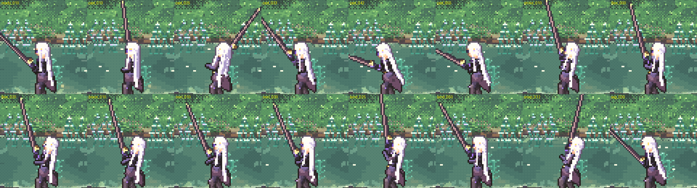
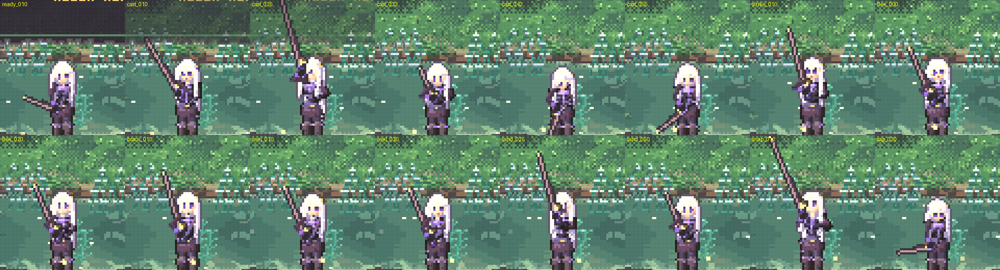
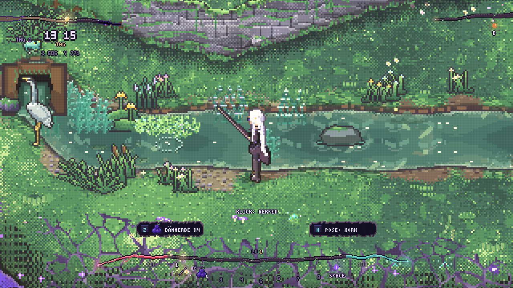
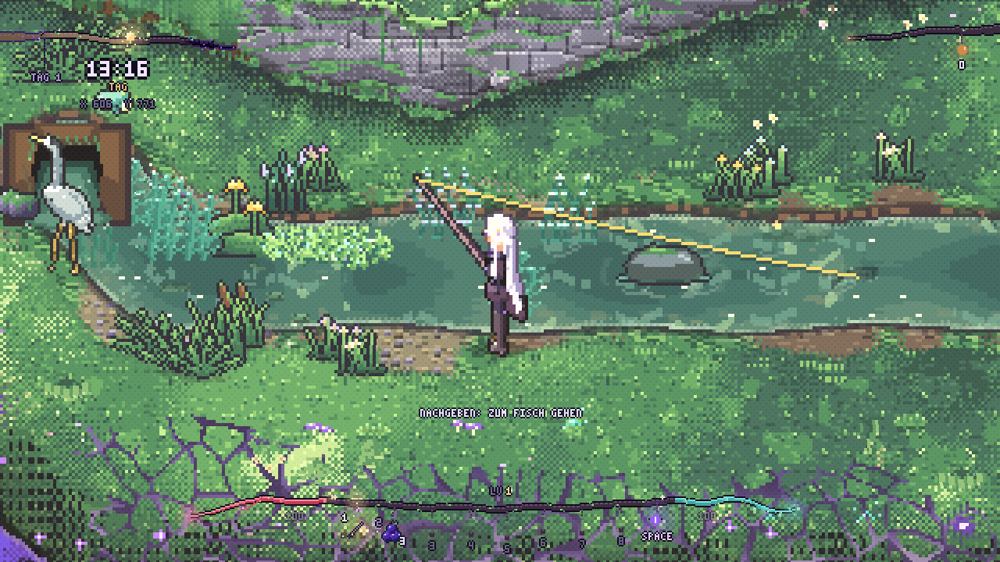
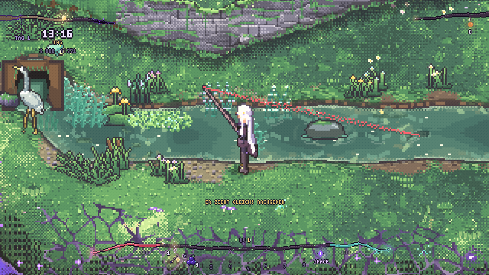
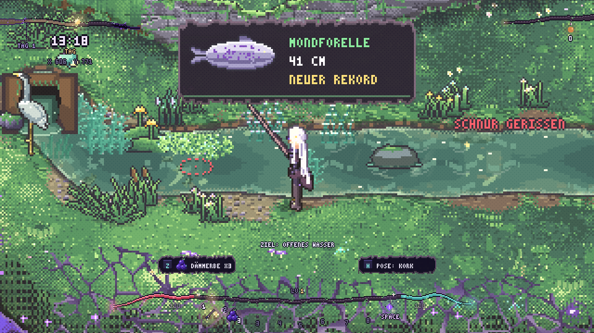
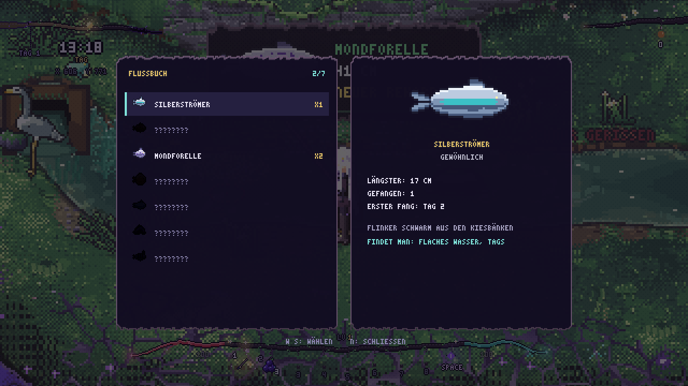
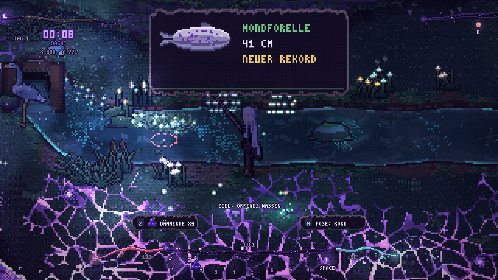

# Angeln – „Atem des Stroms“ (gebaute Fassung)

Basis ist [fishing_master_concept.md](fishing_master_concept.md). Dieses Dokument sagt, was **wirklich gebaut** ist (Stand: Schritte 1–7 des Plans), wo es vom Konzept abweicht und was noch fehlt. Alle Zahlen stehen in `data/fishing.json`.

## Entscheidungen

- **Die Rute ist ein Werkzeug** (`rod_basic`, `kind: "tool"`, `tool: "rod"`, Hotbar-Slot). Gewählt ersetzt sie die Waffe in der Hand; Schwingen ist gesperrt (`AttackComponent.always_drawn`, `can_attack`), sie wird nie weggesteckt. Haltebild aus `tools/art_weapons.py` (`_held_rot`), die Schnur setzt an der Spitze an (`AttackComponent.tip_position`). Herstellen: Gustavs Werkbank, Rezept `rod_basic` (2 Holz, 4 Pflanzenfasern).
- **Spannung nur über die Schnurfarbe** (Entscheidung des Nutzers): Petrol (locker) → Gold (gut) → Rot mit Zittern (Gefahr). Als zweite Hinweise, damit Farbe nicht der einzige Weg ist: Zittern der Linie vor einer Flucht und bei Gefahr, ein knarrendes Linien-Geräusch, das mit der Spannung höher und lauter wird. Keine Spannungsranke, kein Balken.
- **Fische sind Rollen aus einer Tabelle** (`species`), keine Dauertiere. Der Host würfelt nach Ort (`field_at`: x Abstand zum Ufer, y Tiefe), Strömung, Tageszeit, Köder, Pose und Licht, und lässt einen Schatten zur Pose schwimmen. Die vorhandenen `RiverFauna`-Fische werden nicht verbraucht; ein landender Wurf und ein Drill scheuchen sie aber (`scare_fish`).
- **Köder sind vorhandene Items:** Dämmerbeere, Glutbeere, Bachminze, Sumpfdotter, Glimmkappe und gefangene Glimmer-Schmerle. Ein Wurf verbraucht einen Köder.
- **Posen:** Kork (immer), Glimm (braucht eine Glimmkappe im Beutel, scheucht Tiefenwesen, lockt die Glimmer-Schmerle), Obsidian (braucht einen Leerensplitter im Beutel, schwach sichtbar, lockt Tiefenwesen). Das Material wird nicht verbraucht.
- **Standplatz** `field.x` von −6 bis 16 (Ufer oder Watwasser); Ziel nur im Wasser (`field.x ≤ −4`), 28–130 px weit.
- **Host rechnet alles** (`FishingComponent`, Kind jedes Spielers). Clients senden Absichten (`cast`, `strike`, `twitch`, `give`, `reel`, Drill-Eingabe), alle Peers spielen Zustandspakete (`_rpc_state`), Positions-/Spannungs-Updates (10/15 Hz, `_rpc_sync`) und Effekte (`_rpc_fx`) ab.
- **Das Flussbuch** speichert pro Spieler lokal in `user://fish_book.json` (atomar, wie das Kochbuch).
- **Licht:** Linie, Pose, Ziel-Ring, Texte und Fangkarte sind ungetönt (`Unlit`), damit die Anzeige nachts lesbar bleibt; der Fischschatten ist weltbeleuchtet.

## Ablauf und Steuerung

| Phase | Was passiert | Eingabe |
|---|---|---|
| Zielen | heller Ring am Cursor (rot: Land) | Maus |
| Wurf | 0,45 s Flug, Platsch, Ring | Linksklick |
| Drift | Pose treibt mit `RiverFauna.flow_at` | Linksklick halten = Schnur geben, antippen = Zupfen, Rechtsklick = einholen |
| Anschwimmen | Schatten steigt aus der Tiefe, kommt im Bogen, zögert, stellt sich unterhalb der Pose gegen die Strömung; kann verschmähen | Zupfen reizt Räuber, scheucht scheue Arten |
| Knabbern | Pose zuckt 1–4 Mal, der Schatten stößt jedes Mal vor; kann loslassen | Klick jetzt = zu früh |
| Biss | Pose weg, „!“, Schaumring, Fisch dreht mit dem Köder ab, Fenster je Art 0,4–0,95 s | Linksklick = Anschlag |
| Drill | Flucht: nachgeben (Bewegungsrichtung zum Fisch). Ermüdung: einholen | WASD zum Fisch, Linksklick halten |
| Kescher | ein Freund presst E am Fisch (nahe Ufer) | E (andere Spielerin) |
| Landung | Fisch ≤ 18 px | – |

Köder wechseln: **Z**, Pose: **H**, Flussbuch: **N** (W/S wählen, Esc/N schließen). Keine Gamepad-Belegung bisher.

Verloren geht der Fang bei: zu früh/zu spät, Schnur reißt, Fisch entwischt, Treffer, Rutenwechsel, zu weit weg (190 px), vollem Beutel (Fisch wird freigelassen). Der Beutel wird beim Anschlag geprüft.

## Wann und wo Fische kommen (Überarbeitung 2026-11-06)

Vorher: Die tiefe Flussmitte war tagsüber leer (harte Habitat-Grenzen, dort lebte keine Tagesart), nahe Würfe bissen nach 2–5 s, und `flow_at` liefert nur eine Richtung (Betrag überall ≈ 1), sodass der Karpfen (`calm`) nie vorkam. Jetzt:

- **Weiche Lebensräume** (`FishingRules.fit`, `settings.soft`): Tiefe, Uferabstand, Tageszeit und Strömung fallen am Rand weich ab statt hart abzubrechen. Jede Art von Wasser hat bei Tag und Nacht etwas; tief und weit draußen stehen Forelle und Gründling, flach am Ufer Silberströmer, im Stillwasser der Karpfen.
- **Echte Strömungsstärke** (`FishingComponent.current_at`, `FishingRules.current_strength`, `settings.current`): Richtung aus dem Flussfeld, Stärke aus dem Uferabstand (Uferstreifen 0,25, Rinne 1,0), Seen 0,08, Sammelbecken 0,15. Die Pose treibt in der Rinne schneller; Arten haben optional `flow` [von, bis] (Forelle: Strömung, Karpfen: Stillwasser).
- **Aktivität** (`FishingRules.activity`, `settings.activity`): Morgen-/Abenddämmerung +50 %, Mittagssonne treibt Fische aus dem Flachwasser (bis −30 %), **Wachsamkeit**: Fische direkt vor ihren Füßen (unter 20 px) sind nur zu 40 % so aktiv, ab 64 px normal, und ein **Angeldruck** pro Stelle (siehe unten) senkt sie bis −85 %.
- **Biss als Zufallsprozess** (`FishingRules.bite_delay`): erst 2,5–4,5 s Beruhigung nach dem Platsch, dann eine exponentielle Wartezeit mit Mittel `bite.mean / (Interesse · Aktivität)` (7 s bei Interesse 1), höchstens 100 s. Kein Wurf fühlt sich gleich an, nah ist nicht mehr „sofort“, weit ist nicht mehr „nie“. Der Schatten kommt aus 34–46 px, bevorzugt aus der Tiefe stromab, und braucht 2,2–3,4 s.
- **Verschmähen** (`FishingRules.refuse_chance`, `settings.refuse`): Am Köder angekommen dreht ein Fisch mit `caution · (1 − Vorliebe für den Köder) · 0,8 + Druck · 0,4` ab (Karpfen am blanken Haken ~48 %, mit Sumpfdotter 0 %). Ein Zupfen während des Anschwimmens halbiert das bei Räubern (`_lured`). Beim Knabbern kann er wieder loslassen. Wer verschmäht hat, bleibt 10 s weg; man sieht ihn davonschwimmen („VERSCHMÄHT“, gedimmt).
- **Angeldruck** (`FishingComponent.add_pressure / pressure_at`, Host, gemeinsam für alle Angler): jeder Wurf +0,04, ein verpatzter Anschlag oder verscheuchter Fisch +0,2, ein verschmähter Köder +0,08, ein Fang +0,3, ein im Drill verlorener Fisch +0,45, im Umkreis von 56 px, klingt mit τ = 180 s ab. Eine abgefischte Stelle wird still, ein paar Meter weiter ist es frisch.
- **Größe**: Die Länge wird beim Anhieb gewürfelt, tiefes Wasser hält die großen (`roll_length(..., depth)`). Größere Fische ziehen stärker (±15 %) und halten länger durch (+45 %); die Fangkarte zeigt genau diesen Fisch.

## Drill-Modell (`FishingRules.drill_step`)

Der Fisch hat einen Kraftvorrat (`stamina` 1 → 0, Art-`endurance` in Sekunden straffer Schnur). **Straffe Schnur (Gold) ermüdet ihn**, jede Flucht kostet zusätzlich, lockere Schnur lässt ihn verschnaufen. Mit der Kraft sinken Zug (`vigor` 0,4–1) und Fluchttempo; ein erschöpfter Fisch flieht nicht mehr. Die Spannung folgt einem Ziel mit Zeitkonstante `1/k`:

- **Flucht:** Ziel `pull · (0,55 + 0,45 · vigor) · (1,15 − 0,95 · give) / flex` plus Kopfstöße (`shake`). **Kurbeln gegen eine Flucht** legt `0,6 · (0,5 + pull) · surge` drauf und die blockierte Rolle nimmt die Last 2,5× schneller (`lock_k`): wer am Anfang einer Flucht weiterkurbelt, reißt.
- **Ermüdung:** Kurbeln: Ziel `0,28 + 0,42 · pull · vigor`, Einholtempo `reel · (1 − 0,45 · pull) · (0,55 … 1)` (müde Fische kommen leichter). Nur halten: Ziel `0,14 + 0,2 · pull · vigor`, der Fisch erholt sich (+0,04/s) und zieht langsam davon. Nachgeben ohne Zug: Schnur wird schlaff.
- **Vorwarnung** (Zittern) je Art und Flucht zufällig: Forelle 0,18–0,42 s, Zander 0,2–0,4 s, Gründling 0,4–0,6 s.
- **Letzte Flucht:** Forelle, Karpfen, Zander (`last_run`) machen beim ersten Uferkontakt (< 42 px) noch einmal einen kurzen Ausbruch, wenn sie nicht erschöpft sind.
- **Ende:** Spannung ≥ 1 für 0,3 s: Schnur reißt. Kleine weiche Mäuler (`mouth` 0,8–0,85: Silberströmer, Glimmer-Schmerle) **schlitzen** schon früher aus („AUSGESCHLITZT“). Spannung < 0,1 länger als die Art-`hold` (0,75–1,6 s): **abgeschüttelt**. Distanz > Schnur · 1,25: entwischt. Distanz ≤ 18: gelandet.
- **Kescher:** Ein anderer lebender Spieler innerhalb von 40 px am Fisch, Distanz ≤ 46: der Fisch wird mit 60 px/s eingezogen, Spannung auf 0,8 gedeckelt, weder Reißen noch Abschütteln, der Fang ist ein **Prachtexemplar** (zwei Fische). `FishNetSpot` ist der E-Punkt unter dem Fisch (nur für andere).
- Kurbel 52 px/s (vorher 80).

Abgeglichen mit Bots, die nur sehen, was das Spiel zeigt (Farbe, Zittern, Flucht ja/nein) und verzögert reagieren (`tools/test_fishing.gd` `reader`): 0,2 s und 0,3 s Reaktionszeit landen alles, 0,42 s verliert ~30 % der Forellen und ~50 % der Zander, **Dauer-Einholen landet fast nie** (vorher 4 von 7 Arten zu 100 %), immer Nachgeben oder Nichtstun nie. Kämpfe dauern 4–5 s (kleine) bis 12–14 s (Aal, Zander). **Wie sich das mit echten Händen anfühlt, ist nicht erprobt.**

## Ökologie (Tabelle `species`)

| Art | Wasser | Zeit | Köder | Besonderheit |
|---|---|---|---|---|
| Silberströmer | flach, mit Strömung | Tag | Dämmerbeere | scheu (zu viel Zupfen scheucht ihn), weiches Maul |
| Kupferkies-Gründling | mittel bis ganz tief | immer | Glimmkappe | stur, zäh, wenig vorsichtig |
| Mondforelle | tief, Strömung | Tag | Bachminze | schnell, kurze Vorwarnung, letzte Flucht |
| Goldbauch-Karpfen | Stillwasser (Uferstreifen, Seen, Becken) | Tag | Bachminze, Sumpfdotter | sehr vorsichtig, schwer |
| Glimmer-Schmerle | flach | Nacht | Glimmkappe | Glimm-Pose lockt sie |
| Schleier-Aal | tief | Nacht | Glimmkappe | beißt nur im Dunkeln |
| Abyssischer Zander | sehr tief | Nacht | Glimmkappe, Glimmer-Schmerle | beißt nur im Dunkeln, sehr stark |

## Nacht und Wasserunruhe

Nachtarten haben ein `night`-Fenster. Scheue Arten (`shy`) beißen nur, wenn `TownManager.light_depth < −32` (mehr als 32 px außerhalb jedes Lichts) und die Pose nicht leuchtet. Dauert ein Drill länger als 10 s, ruft `FishingComponent` `NightDirector.stir(turmoil·3·Δt)` auf (hebt `lure`, wie Lärm in der Basis). Die Wirkung ist die des vorhandenen Locksystems (Warnung/Vorstoß in der Basis); gezielt Krabbler ans Ufer holen ist **nicht** gebaut.

## Körper-Animationen (`tools/art_hero_fish.py`, `player_fish.png`)

Neun Clips in 8 Ansichten, im Stil der anderen Aktions-Sheets (Rute und rechter Arm kommen aus dem Spiel, `hero_rig.json` `fish` liefert pro Frame Schulter, Hand und die Rutenhaltung `rod` = vorn/Seite/Höhe): `ready` (Warten, Atmen), `cast` (Ausholen, Peitschen, Nachschwingen; der Wurf startet nach `settings.cast.windup` = Freigabe-Frame, 0,35 s), `strike` (Anschlag), `flee` (Fisch flieht: sie wird zurückgerissen), `brace` (Ankündigung), `reel` (Kurbeln, die linke Hand dreht am Rad), `land` (hochziehen), `snap` (Schnur reißt, sie taumelt), `sag` (zu früh/spät/entwischt: Schultern sinken). Die Clips folgen dem replizierten Zustand (`FishingComponent.anim`), alle Peers sehen dasselbe. Wurf, Drill, Anschlag und Landung halten sie an Ort und Stelle; beim Warten kann sie gehen (dann die normalen Sheets, die Rute bleibt in der Hand). Die Rutenspitze (Schnuranker) hängt bei Spannung leicht zum Fisch durch.

## Kampf

Der Fisch ist ein Punkt **im Wasser** (nicht mehr ein Strahl um Ellie): `FishingComponent._swim` beschleunigt und bremst weich (`SPEED_UP`/`SLOW_DOWN`), dreht höchstens `MAX_TURN` rad/s, prüft mit Fühlern (`_swim_dir`) das Wasser voraus und gleitet an Ufern entlang, nie darauf (`field_at(...).x <= -1`). Ein Stoß (`_flee_dir`) führt den Fluss hinauf oder hinunter (Richtung `_run_sign`, weg von ihr), mit lässigen Bögen und Rückkehr zur Flussmitte, wenn das Ufer nah ist. Geschwindigkeit: Art-`speed` x Schub (1,6 → 0,6) x (0,45 + 0,55 x Nachgeben), also ca. 15-70 px/s. Beim Einholen folgt der Fisch einer Flutfüllung (`_build_pull_map`: Schwimmweg zum Landepunkt `_shore`, dem Wasserpunkt nächst ihren Füßen), so zieht die Kurbel ihn um Biegungen und aus Taschen. `dist` ist die echte Schnurlänge (Fisch - Füße - Uferstreifen). Gischt alle 0,4 s, Kamerawackeln bei starken Fischen, Sprünge (Forelle, Zander, Silberströmer) höchstens zweimal pro Kampf und nur über tiefem Wasser. Kurbel 80 px/s, Schnur 190 px. `FishingRules.drill_step(..., integrate=false)` liefert nur Spannung/Phase/`run`/`pull_in`; mit `integrate=true` rechnen die Bots (`test_fishing`) weiter radial. `test_fishing_flow` spielt 21 Kämpfe in den echten Flüssen: nie an Land, keine Sprünge, keine Knicke.

## Fischschatten

Der Schatten taucht mit der Zeit aus der Tiefe auf (blass und durchsichtig → dunkel und deutlich). Er kommt aus 34–46 px aus der Richtung mit dem tiefsten Wasser, bevorzugt stromab (`_deep_offset`), schwimmt einen Bogen mit einem Zögern auf halbem Weg, dreht sich am Ende gegen die Strömung und wartet knapp unterhalb der Pose. Beim Knabbern stößt er zu jedem Zucken vor, beim Biss dreht er mit dem Köder ab. Wer verschmäht, verscheucht wird oder sich losreißt, **schwimmt sichtbar davon** (beschleunigt, im Bogen, sinkt weg; `FishingView._leaving`), statt auf der Stelle zu verblassen.

## Bilder (Look-Studie, `tools/preview_fishing.tscn`, Kamera 2x)

## Prüfungen

| Was | Befehl |
|---|---|
| Regeln, Daten, Bots, Buch | `Godot --headless --path . tools/test_fishing.tscn` |
| Ablauf auf echten Flussdaten (inkl. Wartezeit nah/weit/Dämmerung, Angeldruck, Verschmähen) | `Godot --headless --path . tools/test_fishing_flow.tscn` |
| Netzwerk, zwei Prozesse, Port 17898 | `tools/test_fishing_network.tscn -- --server`, danach ohne Argument |
| Look-Studie mit echtem Spieler | `Godot --rendering-driver opengl3 --path . tools/preview_fishing.tscn -- --dir=/abs [--night]` |
| Kunst / Ton | `python3 tools/art_fishing.py`, `python3 tools/art_weapons.py`, `python3 tools/audio_fishing.py`, danach `Godot --headless --import` |

Der Netzwerktest deckt ab: ein Beobachter-Client sieht Wurf, Drift, Biss, Drill, Spannung und Effekte des Host-Spielers; der Client-Spieler wirft, schlägt an und kämpft über RPC (Fisch landet im Beutel des Clients, Karte und Buch beim Besitzer); der Client hält als Helfer das Netz (RPC), der Fang zählt doppelt.

## Nicht gebaut (bewusst)

- Kein „Gemeinsamer Fang“-Buff (es gibt kein Buff-System). Der gefangene Fisch hängt nicht sichtbar in ihrer Hand (die Karte zeigt ihn).
- Kein Steg, keine Maren (Siedler `enabled: false`, Kunst ist integriert), keine Reuse/Räucherkammer/Hälterung (Schritt 8). Keine Rezepte im Kessel, keine Mine-Anbindung, keine Skill-Perks (Schritt 9; Kochen kennt noch kein Inventar).
- Keine Hindernisse im Drill (Federkraut, Felsen), keine versunkene Schatulle, kein Schatten-Polyp.
- Keine Libelle/Larve/Gespinst als Köder (keine Quelle), keine Hinweise durch Reiher/Eisvogel/Enten.
- Keine Gamepad-Belegung (Zielen, Köder, Pose, Buch), keine Rutenstufen (`rod_hardened`, `rod_maren` fehlen).
- Alle Töne sind synthetische Platzhalter; sie wurden erzeugt und geladen, aber nicht im laufenden Spiel angehört.
