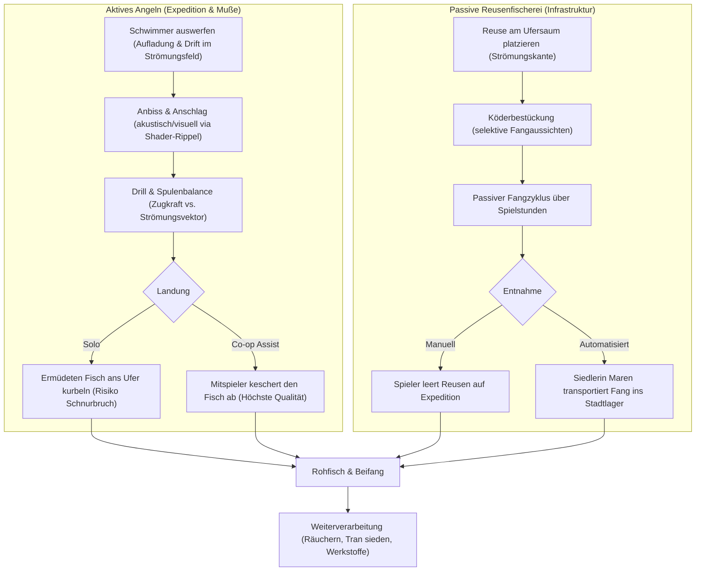
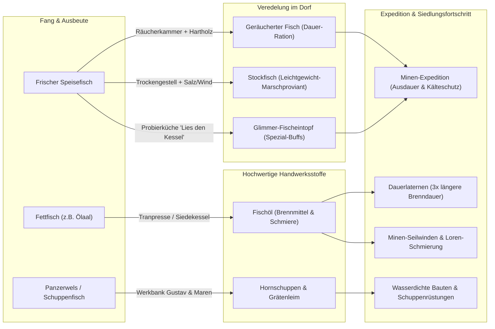

# Siedlungs- & Expeditions-Fischerei: „Strömung & Vorrat“
## Systemkonzept für Infrastruktur, Siedler, Handwerk & Langzeit-Progression in Voidbloom

---

### 1. Kernvision & Philosophie

In *Voidbloom* ist die Welt in ein dämmriges, kühles Petrol getaucht. Licht ist nicht bloß Zierde, sondern die Grundbedingung für Leben, Sicherheit und Expansion (**„Licht ist Land“**). Bisher endet die Siedlung an der Uferkante der reißenden Flussläufe: Wasser galt als Hindernis, unpassierbar in den Tiefen, gefährlich in der Nacht.

Das System **„Strömung & Vorrat“** schlägt die Brücke vom trockenen Land hinein in das dynamische Adernetz der Welt:
1. **Das Wasser zähmen, ohne es zu zerstören:** Mit dem Bau von Stegen, Reusen und Räuchereien wächst die Siedlung organisch ins Wasser hinein. Wo die Laterne auf die Wellen scheint, wird der Fluss vom unberechenbaren Grenzstreifen zur Lebensader der Dorfgemeinschaft.
2. **Der Puls der Strömung statt stumpfem Tastendrücken:** Das aktive Angeln ist kein isoliertes Reflex-Minispiel mit wandernden Balken. Es basiert direkt auf dem physikalischen Flussfeld des Spiels (`flow_at`, Wirbel, Wassertiefe) und belohnt das Lesen des Wassers, das Verständnis für Fischbiologie und koordinierte Zusammenarbeit im Co-op.
3. **Die Lebenslinie für tiefe Expeditionen:** Das Siedlungshandwerk der Fischerei schließt die kritische Versorgungslücke zwischen Oberwelt und Minenschächten. Frischer Fisch verdirbt rasch; erst das Veredeln durch Räuchern, Salzen und Kochen schafft nahrhaften Expeditions-Proviant, während Tran und Fischöl langlebige Laternenbrennstoffe liefern, mit denen die Gruppe tiefer in die Minen (`docs/mine.md`) vordringen kann.
4. **Gemeinsamkeit vor Einzelkämpfertum:** Während ein Spieler am Ufer drillt, greift der zweite zum Kescher, um den Fang sicher an Land zu bringen. Maren, die neue Siedlerin, leert im Morgengrauen die Reusen und füllt das gemeinsame Stadtlager (`TownStockpile`), während die Abenteurer noch schlafen.

---

### 2. Fang- & Erntemechanik

Das Angelsystem teilt sich in zwei komplementäre Säulen: **Aktives Sport- & Beutefischen** (Fokus, Geschick, Gruppenmoment) und **Passive Reusenfischerei** (kontinuierliche Siedlungsversorgung, Platzierungsstrategie).



#### 2.1. Aktives Fischen (Handangel & Wurfangel)
- **Wurfmechanik (`Cast`)**: 
  - Der Spieler hält die Aktionstaste (`InputManager`), woraufhin ein sanfter Zielbogen mit Entfernungsanzeige auf die Wasseroberfläche projiziert wird. 
  - Die Pose landet im Wasser und wird **vom echten vektoriellen Strömungsfeld** (`WorldRivers.field_at` / `RiverFauna.flow_at`) erfasst. Die Pose driftet mit der Strömung flussabwärts, tänzelt in Kehrwassern hinter Felsen oder kreist in tiefen Gumpen.
- **Biologisches Anbiss-Verhalten**:
  - Im Wasser vorhandene Fische (`RiverAnimal` der Typen `shoal`, `brook` oder seltene Großfische) besitzen einen Geruchs- und Sichtradius.
  - Befindet sich ein passender Köder in ihrer Driftlinie, schwimmt der Fisch neugierig heran. Das Wasser kräuselt sich (`disturbances[8]` im Wassershader), Luftblasen steigen auf.
  - Zupft der Fisch an, zuckt die Pose kurz. Zieht er sie ruckartig unter die Wasseroberfläche (begleitet von einem satten Wasserplop), muss im Zeitfenster von ca. 0,4 bis 0,8 Sekunden der **Anschlag** gesetzt werden.
- **Drill & physikalischer Spulenwiderstand**:
  - Kein abstraktes Mini-UI! Der Kampf findet direkt in der Spielwelt statt.
  - Der gehakte Fisch kämpft gegen die Schnur und nutzt die Strömung aus. Flieht er mit der Strömung, verdoppelt sich sein Zug; zieht man ihn quer zur Strömung, ermüdet er schneller.
  - **Drei taktile Zustände der Angelschnur**:
    1. *Weiß/Locker*: Zu wenig Zug – der Fisch kann ausschlitzen. Kurbeln erforderlich!
    2. *Türkis/Gespannt*: Perfekter Arbeitsbereich. Die Rute biegt sich, der Fisch wird herangezogen und verliert Ausdauer.
    3. *Pulsierendes Orangerot*: Überlastung der Schnur. Gibt der Spieler nicht sofort Schnur nach (Bremse lockern / Kurbeln stoppen), reißt die Schnur mit einem peitschenden Laut.
- **Kooperatives Keschern (Co-op Moment)**:
  - Kämpft ein Spieler mit einem kapitalen Fisch (z.B. einem *Schattenkarpfen* oder *Glimmerstör*), ist das Herausheben am steilen Ufer oder Pier extrem heikel (hohe Abrissgefahr im letzten Meter).
  - Ein Mitspieler kann sich mit einem **Handkescher** an die Wasserkante stellen. Drückt der Helfer im richtigen Moment die Interaktionstaste, schöpft er den Fisch aus dem Wasser!
  - **Belohnung**: 
    - Garantierter Erfolg ohne Bruchgefahr.
    - Fischhaut und Schuppen bleiben unversehrt (**Prachtexemplar** -> +50 % Ertrag an Schuppen/Fischleim).
    - Beide Spieler erhalten den Gruppen-Buff *„Gemeinsamer Fang“* (+10 % Arbeitsgeschwindigkeit für 5 Minuten).

#### 2.2. Passive Reusen & Uferfallen
- **Platzierung**: Reusen werden am Ufer- und Schilfrand platziert (`surface: "shore"`). Sie benötigen eine Mindestwassertiefe von 8 px und spürbare Strömung.
- **Köder & Selektion**:
  - *Unbeködert*: Fängt alle 4 Spielstunden kleine Beifische, Flusskrebse, Schnecken und Wasserlinsen.
  - *Köder: Glimmkappen*: Lockt nachtaktive Leuchtsalmler an.
  - *Köder: Teig aus Sonnenmehl*: Selektiert fette Schuppenkarpfen (hoher Fischöl-Ertrag).
  - *Köder: Wurzelfasern / Insekten*: Hohe Chance auf Zitterbarben.
- **Kapazität & Verschleiß**: Eine einfache Reuse fasst bis zu 5 Fänge. Treibgut und Reißströmungen beschädigen Reusen über 3 Spieltage langsam; Siedlerin Maren oder die Spieler reparieren sie mit 1x Pflanzenfaser (`plant_fiber`).

---

### 3. Siedlungs-Integration & Wasser-Infrastruktur

Das fundamentale Siedlungsgesetz lautet: **„Licht ist Land“**. Gebäude können nur im Lichtkegel der Stadt errichtet werden. Die Fischerei führt dieses Prinzip logisch fort: **„Licht an den Strom“**.

```
    LAND (Siedlungsgebiet)                 UFERKANTE (Saum)           WASSER (Flusslauf)
┌─────────────────────────────────┐       ┌─────────────────┐       ┌─────────────────────┐
│  [Hütte]       [Vorratslager]   │       │                 │       │   (Freie Strömung)  │
│      \              /           │       │  [Holzsteg-     │       │                     │
│       [Trampelweg]              │──────>│   Verankerung]  │══════>│   [Steg-Kopf]       │
│             │                   │       │        │        │       │    (Laterne,        │
│   [Räucherei / Fischbecken]     │       │  [Fischreuse]   │       │     Angelplatz)     │
│             │                   │       │                 │       │                     │
│      [Lichtpfosten] ────────────┼───────┴─────────────────┼───────> [Licht auf Wasser:  │
│   (Trägt Lichtkreis ans Ufer)   │                         │          lockt Fische an]   │
└─────────────────────────────────┘                         └─────────────────────────────┘
```

#### 3.1. Neue Bauteile im `TownManager` (`data/town.json`)
Die neue Kategorie `water` („WASSER & HAFEN“) erweitert das Baumenü (Taste B) um 5 spezialisierte Strukturen:

| Bauteil | Kategorie | Fußfläche (px) | Platzierungs-Regel | Kosten | Funktion & Licht |
|---|---|---|---|---|---|
| **Lichtpfosten am Pier** (`pier_lamp`) | `water` | 12×8 | Auf Steg / Uferkante | 4 Holz, 2 Glimmkappen, 1 Seil | Lichtradius 8 Tiles. Wirft Lichtkegel auf den Fluss. Beruhigt das Wasser, lockt phototaktische Fische an. |
| **Holzsteg-Segment** (`pier_wood`) | `water` | 16×32 | `surface: "pier"` (Brücke von Ufer in tiefes Wasser) | 4 Bretter (`plank`), 2 Steine | Schafft begehbare Plattform über `deep_water`. Beseitigt Tiefen-Kollisionssperre. Verbindet Stadt-Trampelwege mit dem Fluss. |
| **Fischreuse** (`fish_trap`) | `water` | 24×16 | `surface: "shore"` (Flachwasser / Strömung) | 6 Fasern, 3 Holz | Passiver Fangkorb. Fasst 5 Fische. Im Lichtkreis leert Maren die Reuse täglich ins Stadtlager. |
| **Räucherkammer** (`smokehouse`) | `craft` | 48×36 | Festes Land, Türzone frei, `paths: true` | 16 Holz, 12 Stein, 2 Lehm | Verarbeitet Rohfisch zu Räucherfisch und Fischöl. Erzeugt aromatischen Schornsteinrauch, der mit `WorldWind` weht. |
| **Hälterungsbecken** (`fish_pond`) | `craft` | 48×48 | Flaches Land im Lichtkreis | 20 Stein, 8 Holz, 4 Eimer Wasser | Lebendhälterung: Fische verderben darin nicht. Ermöglicht Nachzucht von seltenen Glimmquallen und Bergkarpfen. |

#### 3.2. Neuer Siedler: Maren, die Stromhüterin
- **Figur & Herkunft**: Maren (Mitte 30), wettergegerbte Haut, trägt einen gewachsten Leinenkittel, geflochtene Binsenmanschetten und eine Knochenahle im Gürtel. Sie stammt aus den überschwemmten Marschen der Flussmündung und versteht den Willen des Wassers besser als den der Menschen.
- **Einzugsbedingung**:
  1. Stadtstufe erreicht: **Weiler** (`hamlet`, Wert ≥ 25).
  2. Mindestens ein **Holzsteg** (`pier_wood`) und ein **Lichtpfosten** am Wasser sind fertiggestellt.
  3. Maren trifft mit einem schmalen Einbaum-Kanu am Steg ein, sobald Licht die Wasseroberfläche berührt.
- **Tagesroutine (`schedule`)**:
  - `05:00 – 07:30 [reusen]`: Läuft die Stege und Ufer ab, leert alle Reusen im Siedlungsgebiet und deponiert die Fänge im `TownStockpile`.
  - `07:30 – 12:00 [raeuchern]`: Befeuert die Räucherkammer (`smokehouse`), hängt Filets auf und kocht Fischleim in einer Kupferschale.
  - `12:00 – 13:30 [pause]`: Sitzt mit Gustav am Lagerfeuer der Hütte, tauscht Geschichten aus.
  - `13:30 – 17:30 [netzflicken]`: Sitzt am Kopf des Holzstegs, repariert Netze und schnitzt Haken aus Knochen (Hammer-/Web-Audio).
  - `17:30 – 21:00 [abendfischen]`: Steht mit ihrer langen Bambusrute am Steg und angelt; Spieler können sich dazustellen und erhalten ihren Auren-Buff.
  - `21:00 – 05:00 [schlaf]`: Schläft in der Steghütte oder der renovierten Hütte.
- **Siedler-Produktion (`produces`)**:
  - Verbraucht täglich: 2x Rohfisch + 1x Holz aus dem Stadtlager.
  - Liefert ins Stadtlager: 2x Geräucherten Fisch + 1x Fläschchen Fischöl.
- **Werkstatt & Handelsangebot (`maren_dock` in `data/shops.json`)**:
  - *Herstellen (selbst)*: Einfache Schnüre, Schilfposen, Teigköder.
  - *Auftragsarbeit (`order`)*: 
    - **Gewachste Seidenschnur** (höhere Zugfestigkeit, reißt 40 % seltener).
    - **Glimmweiden-Rute** (Rute aus feinstem Weidenholz, leuchtet leicht im Dunkeln, erhöht Wurfweite um 30 %).
    - **Reusen-Verstärkung** (Erhöht Reusenkapazität auf 8 Fänge).
  - *Kauf/Verkauf*: Kauft alle Arten von Wasserpflanzen, Kiesel und Fischknochen; verkauft seltene Köder, Schilfkörbe und Wathosen.

---

### 4. Wirtschaft, Handwerk & Haltbarmachung

Ein zentrales Problem in vielen RPGs ist die Entwertung von Nahrungsmitteln im Mid- und Endgame. In *Voidbloom* ist Fischerei eng mit der Überlebensökonomie der Mine und der Siedlungserweiterung verzahnt.



#### 4.1. Das Verderb- & Konservierungssystem
- **Frischegrad**: Frischer Fisch besitzt eine Frische-Dauer von 2 Ingame-Tagen. Danach verdirbt er zu *Tranigem Fischabfall* (nur noch als Dünger für Beete oder Kompost nutzbar).
- **Veredelungsstufen**:
  1. **Geräucherter Fisch (`smoked_fish`)**: Unbegrenzt haltbar. Stellt 25 Lebenspunkte wieder her und verleiht den Buff *„Satte Wärme“* (Verlangsamt den Kälte- und Erschöpfungsaufbau in den Tiefen der Mine um 30 % für 8 Minuten).
  2. **Stockfisch (`dried_fish`)**: Extrem leicht, stapelbar bis 50 Stück pro Inventarplatz. Perfektes Notfallbrot für lange Gänge.
  3. **Gourmet-Kesselgerichte („Lies den Kessel“, `docs/cooking.md`)**:
     - *Flussbarsch in Kräuterkruste*: Erhöht die Ausdauer-Regeneration beim Holzhacken und Erzabbau.
     - *Glimmerstör-Sud*: Bringt die Spielfigur für 10 Minuten zum sanften Eigenleuchten (erhellt dunkle Minenschächte ohne Fackel).

#### 4.2. Tierische Nebenprodukte & Industrie-Rohstoffe
Die Fischerei liefert Rohstoffe, die nirgendwo sonst auf der Welt gewonnen werden können:
1. **Fischöl / Knorpeltran (`fish_oil`)**:
   - *Laternen-Upgrade*: Lichtpfosten und Minenlaternen können mit Fischöl statt Rohholz betrieben werden. Dies steigert ihren Lichtradius um +25 % und schlägt feindliche Schattenkreaturen zuverlässig zurück.
   - *Mechanik-Schmiermittel*: Unverzichtbar für die Seilwinden der Minen-Aufzüge (`docs/mine.md`), um tiefere Ebenen schneller zu erreichen.
2. **Fischleim (`fish_glue`)**:
   - Aus getrockneten Schwimmblasen und Knorpel gekocht.
   - Bildet das Bindemittel für fortgeschrittenes Zimmermannshandwerk: Ermöglicht Gustav den Bau von *Großen Lagerkisten* (doppelte Lagerkapazität) und *wetterfesten Schindeldächern*.
3. **Panzerschuppen & Hornstacheln (`dusk_scales`, `spine_needle`)**:
   - Vom *Dämmerungshecht* und gepanzerten Flusswelsen.
   - Werden zu wasserabweisenden Rüstungsverstärkungen, präzisen Knochenpfeilen für Fernkämpfer und Schnitzmessern verarbeitet.

---

### 5. Expeditionen & Gewässer-Erkundung

Gewässer sind nicht nur Dekoration in der Siedlung, sondern durchziehen die gesamte Landschaft als logistisches und geographisches Band (`docs/rivers_world.md`).

```
  [Bergquelle / Ursprung]  --> Extrem klares Wasser, scheue Bergforellen (hohe Alchemie-Reinheit)
            │
            ▼
   [Mittellauf / Furt]     --> Schilfgürtel, Reusenplätze, Reiherjagden, Hechte
            │
            ▼
    [Siedlungs-Becken]     --> Stege, Stadtbeleuchtung, Zuchtteiche, Maren
            │
            ▼
   [Nebelwald & Höhlensee] --> Phosphoreszierende Void-Aale, Schattenkrebse, giftige Qualmfische
```

#### 5.1. Expeditions-Ausrüstung für Gewässer
- **Wathosen (`river_waders`)**:
  - Im Shop von Maren aus gewachster Leinwand und Fischleder gefertigt.
  - Erlauben dem Spieler, sich in seichten Furten (`shallow_water`) mit normaler Laufgeschwindigkeit zu bewegen, anstatt um 40 % verlangsamt zu werden. Verhindert Nässe-Erfrierungen bei Nacht.
- **Faltbares Binsenfloß (`reed_raft`)**:
  - Ein 1-Tile-Leichtfloß, das im Inventar getragen und an Ufern zu Wasser gelassen werden kann.
  - Ermöglicht das Queren tiefer Flussabschnitte (`deep_water`) zu einsamen Kiesinseln, auf denen uralte Schatztruhen oder seltene Kräuter (wie die *Mondiris*) wachsen.
- **Treibholz-Kescher & Schilf-Feldkiste**:
  - Ermöglichen das Einrichten mobiler Angellager bei Übernachtungen am Lagerfeuer (`docs/campfire_rest.md`).

#### 5.2. Flussbiotope & Endemische Fischarten
Jeder Gewässerabschnitt besitzt sein eigenes ökologisches Profil:

| Biotop | Leitart | Köderpräferenz | Tageszeit | Besonderheit / Nutzen |
|---|---|---|---|---|
| **Klare Bergquelle** | *Kristallsaibling* | Insektenlarve | Tag | Reinstes Fleisch; Knochen liefern weiße Nadeln für Wundnähte. |
| **Siedlungsfluss (Mittellauf)** | *Glimmerbarsch* | Glimmkappe | Dämmerung / Nacht | Leuchtet im Dunkeln; Fleisch regeneriert Licht-Resonanz. |
| **Schilfreiche Altwasser** | *Mooskarpfen* | Wasserlinse / Teig | Tag | Sehr fettreich; liefert 3x Fischöl in der Räucherei. |
| **Reißende Stromschnellen** | *Silberlachs* | Schnurfliege | Vormittag | Extrem kampfstark; gibt zähes Fischleder für Wathosen. |
| **Unterirdische Minenteiche** (Zone 3, `docs/mine.md`) | *Blinder Void-Aal* | Leuchtpulver | Immer dunkel | Gibt kein Fleisch, aber hochkonzentrierte Void-Essenz für Alchemie. |

---

### 6. Mehrwert & Spielerlebnis

Warum bereichert dieses System die Spielerfahrung von *Voidbloom* nachhaltig?

1. **Perfekte Ergänzung der Spielphasen (Pacing & Downtime)**:
   - Nach nervenaufreibenden Kämpfen in den Minen oder gefährlichen Nächten im Wald bietet der Steg einen meditativen, atmosphärischen Rückzugsort. Das sanfte Plätschern des Wassers, das Schaukeln der Laterne im Wind (`WorldWind`) und die Reflexe des Petrol-Wassers erzeugen intensive Immersion.
2. **Katalysator für kooperatives Rollen-Gameplay**:
   - Die Gruppe kann sich natürlich aufteilen: Ein Spieler liebt das Erkunden und Kämpfen in der Mine, der zweite baut die Siedlung aus, der dritte kümmert sich um die Wasser-Infrastruktur, kocht Rationen und versorgt das Lager mit Öl und Seilen. Alle profitieren voneinander über das gemeinsame Stadtlager.
3. **Befriedigende Automatisierung & Progression**:
   - Man startet mit einer einfachen Schnur an einem Weidenast und kämpft um jeden kleinen Barsch.
   - Später besitzt die Stadt ausgebaute Piers mit Zuchtbecken, automatisierte Reusenstrecken, die von Maren betreut werden, und eine rauchende Fischräucherei, die ganze Expeditionskisten mit energiereichem Reiseproviant füllt.
4. **Stimmige Ästhetik im Voidbloom-Stil**:
   - Die optische Verflechtung von mystischem Türkis-Glühen auf dunklem Wasser, Holzpfählen mit Moosbewuchs und aufsteigenden Rauchfahnen der Räucherei fügt sich nahtlos in die handgezeichnete Ästhetik des Spiels ein.

---

### 7. Technische Umsetzung & Godot-Architektur

Die Implementierung fügt sich exakt in die bestehenden Konventionen des Projekts ein: Strict Static Typing, Host-Authoritative Logik, Entkopplung von Daten (`res://data/*.json`) und Renderer, deterministisches Berechnen ohne Netzwerkmüll.

#### 7.1. Erweiterung der Platzierungsregeln in `TownManager` & `TownRules`
Bislang verbot `town_probe` in `world_level.gd` das Bauen auf oder nahe Wasser (`ZU NAH AM WASSER`). Für Wasser-Infrastruktur wird die Platzierungsprüfung erweitert:

```gdscript
# src/town/town_rules.gd (Auszug Erweiterung)
class_name TownRules

## Prüft Platzierungsbedingungen inklusive spezieller Wasser-/Uferstrukturen
static func check_water_placement(piece_data: Dictionary, world_probe: Dictionary) -> String:
	var surface_req: String = piece_data.get("surface", "land")
	match surface_req:
		"pier":
			# Stege müssen an mindestens einer Kante an Land grenzen und ins Wasser ragen
			if not world_probe.has_shore_anchor:
				return "BENÖTIGT FESTEN UFERANSCHLUSS"
			if world_probe.water_depth < 4.0:
				return "WASSER ZU SEICHT"
		"shore":
			# Reusen dürfen nur im Flachwasserbereich stehen
			if world_probe.water_dist > 16.0 or world_probe.water_dist < -8.0:
				return "NUR AM UFERSAUM PLATZIERBAR"
		"land":
			if world_probe.in_water:
				return "ZU NAH AM WASSER"
	return ""
```

In `data/town.json` wird die Kategorie `water` ergänzt:
```json
{
  "categories": [
    {"id": "light", "name": "LICHT"},
    {"id": "craft", "name": "HANDWERK"},
    {"id": "living", "name": "WOHNEN"},
    {"id": "ground", "name": "WEGE"},
    {"id": "water", "name": "WASSERBAU"}
  ],
  "pieces": {
    "pier_wood": {
      "name": "HOLZSTEG",
      "category": "water",
      "texture": "res://assets/town/pier_wood.png",
      "frame": [16, 32],
      "foot": [16, 32],
      "snap": 8,
      "surface": "pier",
      "walk": true,
      "cost": {"plank": 4, "stone": 2},
      "build_seconds": 6.0,
      "reach": 0.0,
      "worth": 4,
      "level": 1,
      "info": "BEGEHBARER STEG ÜBER TIEFEM WASSER"
    },
    "fish_trap": {
      "name": "FISCHREUSE",
      "category": "water",
      "texture": "res://assets/town/fish_trap.png",
      "frame": [24, 16],
      "foot": [24, 16],
      "snap": 8,
      "surface": "shore",
      "cost": {"plant_fiber": 6, "wood": 3},
      "build_seconds": 4.0,
      "reach": 0.0,
      "worth": 3,
      "level": 1,
      "role": "trap",
      "info": "FÄNGT PASSIV FISCHE AM STRÖMUNGSRAND"
    },
    "smokehouse": {
      "name": "RÄUCHERKAMMER",
      "category": "craft",
      "texture": "res://assets/town/smokehouse.png",
      "frame": [48, 40],
      "foot": [48, 32],
      "front": [24, 16],
      "snap": 8,
      "cost": {"wood": 16, "stone": 12, "plant_fiber": 4},
      "build_seconds": 12.0,
      "reach": 48.0,
      "worth": 15,
      "level": 2,
      "role": "smokehouse",
      "paths": true,
      "smoke": {"at": [36, 6]},
      "info": "KONSERVIERT FISCH & GEWINNT FISCHÖL"
    }
  }
}
```

#### 7.2. Datenintegration des Siedlers Maren (`data/settlers.json`)
```json
{
  "maren": {
    "name": "MAREN",
    "title": "STROMHÜTERIN",
    "art": "maren",
    "role": "fisher",
    "home": "pier_wood",
    "arrive": {
      "needs": "pier_wood",
      "delay": 10.0,
      "angle": 180.0,
      "distance": 300.0
    },
    "spots": {
      "dock": {
        "of": "pier_wood",
        "at": [0, 8],
        "face": [0, 1],
        "clip": "work"
      },
      "smoke": {
        "of": "smokehouse",
        "at": [0, 12],
        "face": [0, -1],
        "clip": "work",
        "fallback": "dock"
      },
      "fire": {
        "of": "center",
        "at": [-12, 80],
        "face": [1, 0],
        "clip": "sit"
      },
      "rest": {
        "of": "home",
        "at": [0, 0]
      }
    },
    "schedule": [
      [0.21, 0.32, "dock"],
      [0.32, 0.55, "smoke"],
      [0.55, 0.62, "fire"],
      [0.62, 0.82, "dock"],
      [0.82, 0.88, "fire"],
      [0.88, 0.21, "rest"]
    ],
    "produces": {
      "in": {"raw_fish": 2, "wood": 1},
      "out": {"smoked_fish": 2, "fish_oil": 1}
    },
    "shop": "maren_dock",
    "talk": [
      {"trust": 0, "dialogue": "maren_intro"},
      {"trust": 30, "dialogue": "maren_currents"},
      {"trust": 60, "dialogue": "maren_deep_waters"}
    ],
    "barks": [
      "Das Wasser schläft nie. Höre genau hin.",
      "Ein feuchtes Seil hält doppelt so gut, wenn man es richtig schlägt.",
      "Die Strömung bringt heute kühles Bergwasser.",
      "Lass die Schnur locker, wenn der Hecht springt!"
    ]
  }
}
```

#### 7.3. Klassenstruktur & Host-Authoritative Synchronisation
Um Bandbreite zu sparen und Desynchronisationen zu verhindern, folgt die Fischerei dem bewährten Netzwerkmodell von Voidbloom:

```
[Client (Angler)]               [Server / Host]                 [Client 2 (Co-op Helfer)]
       │                               │                                    │
       ├─── request_cast(pos, pow) ───>│                                    │
       │                               ├─── _rpc_cast_bobber(id, pos) ─────>│ (Zeigt Pose)
       │                               │    (Berechnet Drift via flow_at)   │
       │                               │    (Triggert Fisch-Anbiss)         │
       │<── _rpc_fish_bite(fish_id) ───┤                                    │ (Schwimmer taucht)
       ├─── request_hook() ───────────>│                                    │
       │                               ├─── _rpc_drill_start(f_id, fish) ──>│ (Drill-Phase)
       │                               │                                    │
       │                               │<── request_net_assist(target_id) ──┤ (Kescher-Einsatz)
       │                               │    (Prüft Distanz & Timing)        │
       │<── _rpc_catch_success(loot) ──┴─── _rpc_catch_success(loot) ──────>│
```

- **`FishingController` (am Spieler-Knoten)**:
  - Verwaltet Input (`InputManager`), Rutenanimation und Schnur-Rendering (mittels `Line2D` mit parabolischer Hängung).
  - Fragt beim Auswerfen keine globalen Physikzustände ab, sondern sendet den Wunschwurf an den Host.
- **`RiverFauna` / Fischschwarm-Integration**:
  - Nutzt bestehende Methoden: `scare_fish` bei zu unvorsichtigem Auftreten, `nearest_fish` zur Anbissermittlung.
  - Befindet sich ein gehafter Fisch im Drill, wird ein temporärer virtueller Strömungs-Agent an seine Position gebunden, der Kräfte gegen die Schnur ausübt.
- **`FishTrapNode` (Passive Reuse)**:
  - Läuft rein auf dem Host.
  - Prüft periodisch `rivers.flow_at(global_position)` und die Wassertiefe.
  - Schreibt bei Fangerfolg ein Item in das Reuseninventar.
  - Ist Maren aktiv und steht im Zeitfenster `dock`, leert sie die Reuse automatisch und ruft `TownManager.stock_add(item, count)` auf.

---

### 8. Fazit

Das Konzept **„Strömung & Vorrat“** erweitert *Voidbloom* um ein tiefgreifendes, mechanisch geerdetes System, das weit über ein herkömmliches Angel-Minispiel hinausgeht. Es verwandelt die Gewässer von reinen Barrieren in lebendige Versorgungsadern, bettet sich organisch in das Siedlungs- und Licht-Konstruktionssystem ein, schenkt der Dorfgemeinschaft eine charismatische neue Bewohnerin und stattet Expeditionsteams mit unverzichtbaren Proviant- und Lichtressourcen für die Tiefen der Welt aus.
