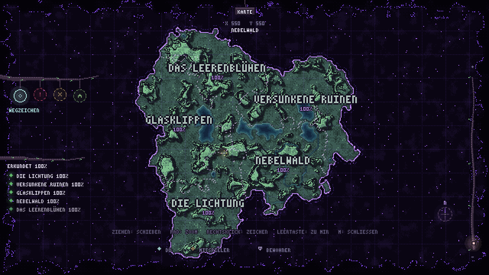
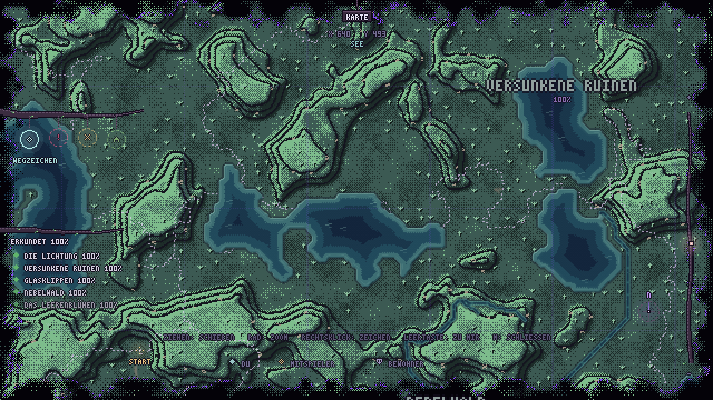
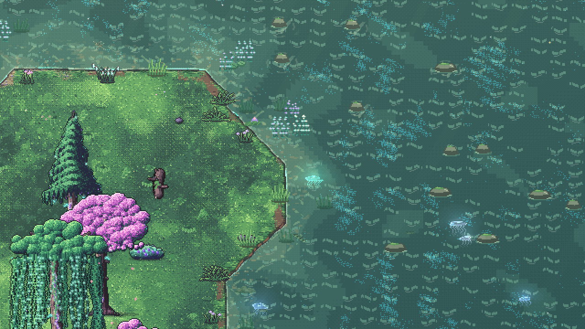
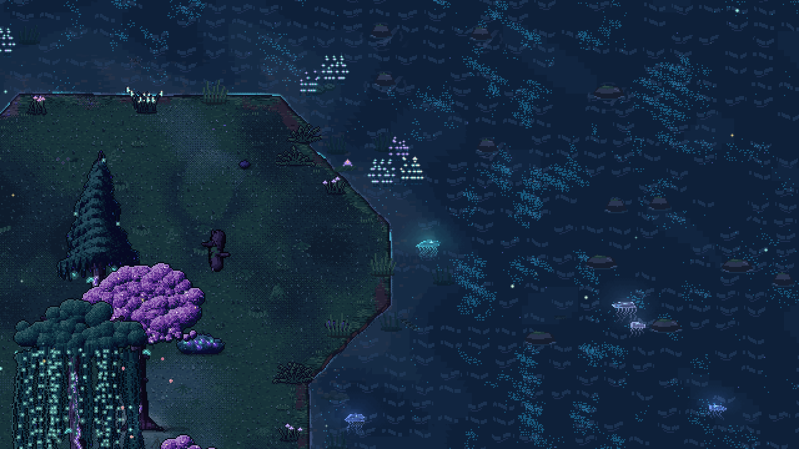
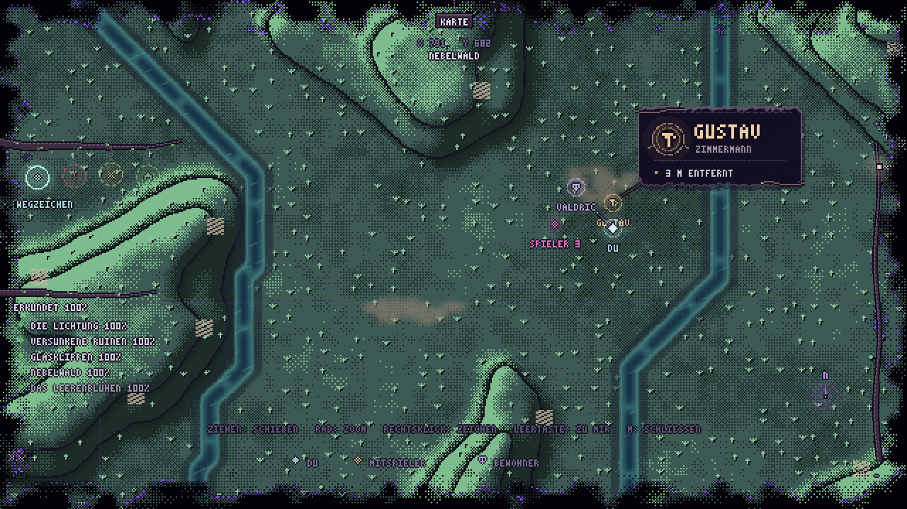
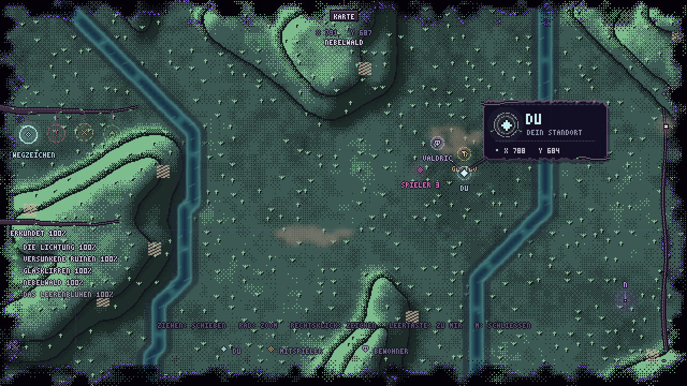

# Karte, Seen und Live-Marker

Die acht vollständig eingeschlossenen Leerstellen der eingefrorenen Welt sind Seen. Die Außenkante bleibt die Leere. `world_map.json`, Regionsnummern, Storyorte und Relief werden dabei nicht neu erzeugt.

## Ein Biom, fünf benannte Gebiete

Die ganze bestehende Welt verwendet jetzt das ausgearbeitete Wiesenbiom (`world_map.json`: `biome: "meadow"`). Die fünf bisherigen Überregionen behalten ihre IDs, Grenzverläufe, Nachbarn und Namen; der Name steht unabhängig vom Biom in `supers[].name`. Die Lichtung, Nebelwald, Glasklippen, Versunkene Ruinen und Das Leerenblühen können später ohne Auswirkungen auf Biom oder Gelände umbenannt werden.

`RegionMap.biome_at` und `active_biome` liefern das gemeinsame Biom auch für ältere Editor-Biomangaben. Boden, Bewuchs, Winddetails und Tier-Lebensräume folgen den bestehenden Wiesenregeln. `Relief` passt die alten Biom- und Materialkennungen nur im Arbeitsspeicher an: natürliche Gras-/Erd- und Felswände statt der früheren gebietsspezifischen Kristall-, Void- oder Mauerwerk-Stile. Höhen, Rampen, Treppen, Geometrie und Kollision werden dabei exakt beibehalten. Im Editor stehen für diese Welt das gemeinsame Biom und seine natürlichen Wandmaterialien zur Wahl.

Die Karte erzeugt aus dem unveränderten Regionsraster eine eigene Gebietstextur. Dadurch bleiben Grenzen, Beschriftungen, Ortsanzeige und die einzelnen Erkundungsfortschritte erhalten, während sämtliche Gebiete dieselbe Wiesenpalette und dieselben Landschaftssymbole verwenden. Die übrigen Biomvorlagen in `biomes.json` bleiben für spätere Arbeiten verfügbar. `tools/assign_biomes.gd` weist das gemeinsame Biom zu und erhält vorhandene Gebietsnamen.

Editor-Platzierungen werden über einen Fingerabdruck des eigentlichen Kartenlayouts zugeordnet. Änderungen an Namen oder Biomen machen sie nicht mehr ungültig. Der bisherige Dateifingerabdruck wird über `editor_compatible_maps` weiterhin akzeptiert, solange sein hinterlegtes Layout zur aktuellen Welt passt. Vorhandene Editor-Dateien werden dafür nicht umgeschrieben.

## Wasser in der Welt

`tools/bake_lakes.py` erkennt eingeschlossene Komponenten anhand von `land_sdf.png` und erzeugt `lakes_sdf.png` (Wasserbecken), `outer_sdf.png` (nur die äußere Leere), `data/lakes_baked.json` sowie die Felder unter `assets/water/lakes/`. Die ursprünglichen Flussmasken bleiben bestehen. Wo beide Wasserarten einen Chunk berühren, werden Fläche, Tiefe, Ufer und konservative Abfragen offline zusammengeführt; Flusswasser wird dabei nicht entfernt.

`WorldRivers` verwendet diese Felder mit dem vorhandenen Streaming, Wassershader, Tiefenkollision, Waten, Uferpflanzen, Fischen und Nachtglühen. `bank.B` kennzeichnet ruhiges Seewasser: langsamere Reflexe und Planktondrift, größere Farbflächen und etwas dunklere Tiefen. Die Strömungsvektoren sind schwach, deshalb bewegen sich Wasserpflanzen und Quallen zurückhaltender. Schmale flache Ufer sind betretbar; die tiefe Mitte bleibt wie beim Fluss gesperrt. Es gibt weiterhin kein Schwimmen.

Die alten Leere-Rechtecke und violetten Leere-Lichter entfallen an Seen. Für die äußere Küste bleiben sie erhalten. Ein Seegrund wird nicht als Bau- oder Landtierfläche behandelt; Gegnernavigation darf flache, geladene Ufer nutzen und lehnt Tiefwasser ab.

## Weltkarte

`tools/bake_map_water.py` mittelt die echten gemeinsamen Wasserfelder auf ein Pixel pro Tile. `map_water.png` speichert Flächenanteil (R), echte Wassertiefe (G) und die Kartenschattierung der Seen (B: 0 außerhalb, 0,12 am Ufer, 1 am tiefsten Punkt jedes Beckens). Die Kartenschattierung folgt der gesamten Seeform mit vier abgestuften Türkis-/Blautönen. Sie verändert die physische Tiefe nicht. Eine feine, von links oben beleuchtete Uferkante, eine gebrochene innere Kontur und wenige ortsfeste, ruhig schimmernde Wellenzeichen ergänzen die Seen. Mipmaps halten kleine Zuflüsse in der Übersicht sichtbar. Derselbe Atlas zeigt Seen, Flüsse und Furten unter dem vorhandenen Entdeckungsnebel. Die äußere Küstenlinie kommt aus `outer_sdf.png`, sodass Seen keinen Leere-Rand mehr tragen. Der Ortsleser unterscheidet SEE und FLUSS.

## Personen

Die Karte liest vorhandene replizierte `Player`-Positionen und die `map_marker()`-Auskunft von Questakteuren in jedem sichtbaren Frame. Valdric wird über den ursprünglichen Steinbruch-Akteur verfolgt, auch nachdem die Geschichte ihn umgehängt hat. Sein Schild und Name erscheinen nach `knows_adventurer`; Gustav erhält einen Hammer, sobald er angekommen ist. Schlafende Bewohner zeigen ihre Heimat mit einem ruhigen Z-Marker. Weitere Siedler verwenden automatisch einen allgemeinen Bewohner-Marker; eigene Formen und Farben werden in `data/map_markers.json` ergänzt.

Mitspieler erhalten farbige offene Rauten und eine Spielernummer; die eigene Position trägt die volle leuchtende Raute. Die Farbplätze bestehender Spieler bleiben beim Austritt anderer Spieler stabil. Innenräume und Minen werden auf ihren äußeren Eingang abgebildet. Außerhalb der Ansicht zeigen Spieler-Richtungspfeile zum Ziel. Eng stehende Marker fächern sich mit einer feinen Verbindung zum tatsächlichen Standort auf; Namen erscheinen bei näherem Zoom, Details beim Darüberfahren. NPCs respektieren den Entdeckungsnebel. Es gibt keine zusätzlichen Positions-RPCs.

Die Hover-Hinweise sind kleine Rinden-Schilder mit dem gezackten Papier der übrigen Oberfläche, Blätterranken, einem persönlichen Siegel und einer großen Namenszeile. Hammer, Schild und Spieler-Raute greifen die jeweilige Markerfarbe auf. Darunter stehen Beruf bzw. Spielerrolle und eine eigene Statuszeile: Entfernung, Ruhezeit, Aufenthalt im Gebäude oder die eigenen Kartenkoordinaten. Die Schilder blenden über 0,18 Sekunden ein und über 0,12 Sekunden aus; eine feine Verbindung zeigt zum zugehörigen Marker. Ihre Platzierung weicht den Kartenrändern und der unteren Bedienzeile aus. Beim Schließen der Karte wird der Hover-Zustand zurückgesetzt.

## Neu backen und prüfen

Nach bewussten Änderungen an Küste oder Flüssen:

1. Gegebenenfalls die ursprünglichen Küsten-/Fluss-Bakes ausführen.
2. `python3 tools/bake_lakes.py` – erzeugt auch den gemeinsamen Kartenatlas.
3. `Godot --headless --path . --editor --import --quit`.

`python3 tools/bake_map_water.py` genügt für eine reine Atlas-Aktualisierung. `python3 tools/test_lakes_bake.py` erkennt auch veraltete Eingabedaten.

Prüfungen:

- `tools/test_shared_biome.tscn`: alle 31 Regionen mit gemeinsamem Biom, fünf eigenständige Namen, unveränderte Gelände- und Kollisionsdaten, vollständiger Wiesenboden in jedem Gebiet, eigenständige Kartengrenzen und Erkundungsstände sowie Übernahme älterer Editor-Platzierungen.
- `tools/test_lakes_bake.py`: Topologie, unveränderte Außenküste, Wasservereinigung, Abfragen und Kollisionsrechtecke.
- `tools/test_map_water.py`: alle gemeinsamen Chunk-Flächen gegen den Kartenatlas.
- `tools/test_lakes.tscn`: alle acht Seen in der echten Welt, Uferzutritt mit Physik, Tiefensperren, Navigation, Waten, Streaming und Freigabe.
- `tools/test_map_presence.tscn`: Bewegung, Bekanntheit, Ankunft, Schlaf, Nebel, Innenräume, Farbkonstanz und Austritt.
- `tools/test_map_network.tscn`, Host `-- --server`, Client ohne Flag: Loopback17898 mit echten replizierten Spielern.
- `tools/test_rivers_network.tscn`: Loopback17895, identische Fluss- und Seeabfragen auf beiden Peers.
- Bestehende `test_world_rivers`, `test_river_life` und `test_streaming_performance` bleiben Regressionen.

Vorschau: `tools/preview_map.tscn -- --capture=/abs/map.png [--at=640,493 --zoom=1.1] [--night]`; `tools/preview_world_rivers.tscn -- --lake=1 --capture=/abs/shore.png [--night]`. Die Marker-Vorschau verwendet `tools/test_map_presence.tscn -- --capture=/abs/markers.png [--overview] [--hover=gustav|self|valdric|30] [--night]`. Native Aufnahmen können lokal mit `--rendering-method gl_compatibility` erfolgen; die Projekteinstellung wird nicht geändert.

Verifiziert: 322 Bake-Prüfungen, 125 Atlas-/Kartenschattierungsprüfungen, 94 echte See-/Physikprüfungen, 19 Marker-Prüfungen, 1439 Fluss-Weltprüfungen und 3219 Ufer-/Wasserleben-Prüfungen bestanden. Streaming-Regression sowie beide ENet-Tests bestanden. Die Kartenpolitur wurde in Übersicht, Nahansicht und bei Nacht nativ mit OpenGL geprüft; Flächenanteile und physische Wassertiefe bleiben bytegenau gleich. Seeufer bei Tag/Nacht wurden ebenfalls nativ geprüft. Headless-Läufe können die bereits vorhandene macOS-Tastatur-/Zertifikatswarnung ausgeben.
