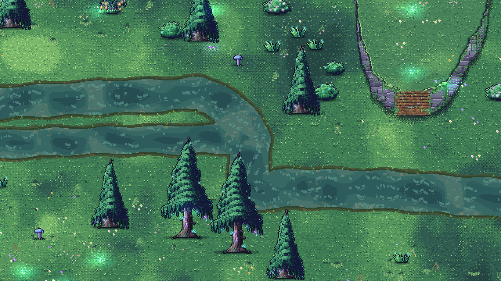

# Flüsse – Schritt 2

## Umfang

Das gespeicherte Gewässernetz liegt auf der bestehenden Welt, ohne Regionen neu zu nummerieren oder Relief/Storydaten zu überschreiben. Die freigegebene Wasseroberfläche wird in den normalen Geländeabschnitten geladen. Schritt 3 bleibt für Leben im Wasser, Flusspflanzen, gezielte Flusssteine, nächtliche Leuchtakzente sowie Strömungs-/Bewegungsverhalten reserviert. Die jetzige Untergrundabfrage, Tiefenkollision und Landtier-Spawnvermeidung sind notwendige Integrationsgrundlagen.

## Erzeugung

`data/rivers.json` konfiguriert `tools/bake_rivers.py`. Der Bake verwendet Küstenabstand, feste Höhen und Biome der eingefrorenen Karte. Storyorte, Gebäude, Wege und gemalte Bodenbereiche erhalten Schutzabstände. Nur großzügig freie, zusammenhängende Plateauböden in Wiese/Nebelwald werden verwendet. Flüsse bleiben auf ihrer Höhenfläche; unpassende Klippen werden umgangen. Automatische Wasserfälle zwischen verschiedenen Höhenflächen sind hier noch nicht erzeugt.

Jedes Einzugsgebiet erhält ein inneres Sammelbecken. Ein deterministischer, gewichteter Entwässerungsbaum führt Quellen zu diesem Becken; die abnehmende hydraulische Wegpotenzialfunktion modelliert ein sanftes Gefälle innerhalb der grob gestuften Spielhöhe. Es handelt sich nicht um eine physikalische Wassersimulation und nicht um ein kontinuierliches Geländehöhenmodell. Zuflüsse vereinigen sich. Abfluss wird an Zusammenflüssen addiert und bestimmt über eine Wurzelfunktion die Breite; zufällige Aufspaltungen gegen die Fließrichtung entstehen nicht. Quellen werden auf Mindestlauf und Abstand geprüft. Ein gemeinsames räumliches Verzerren und kubische Kurven brechen das Routingraster auf und halten Anschlussstellen exakt zusammen.

Regelmäßige quer liegende flache Furten öffnen die Tiefenkollision. Endbecken liegen im Land, nicht in der Leere. Ein neuer Bake verändert ausdrücklich nur `data/rivers_baked.json` und die generierten Masken unter `assets/water/world/`. Nach Änderungen an Relief oder Weltlayout muss neu gebacken werden; nachträgliches Gelände-Authoring innerhalb der Gewässer erfordert ebenfalls Abstimmung/Neubake.

## Gemeinsames Feld und Platzierung

Ein Wasserfeld pro betroffenen512px-Chunk speichert Fläche, Tiefe und Fließrichtung pro Weltpixel. Ein Uferfeld enthält Abstände. Die Kollisionsrechtecke werden ebenfalls offline vorberechnet. Eine kleine4px-Abfragekarte speichert konservative Mindestabstände und maximale Wassertiefe für Kollision/Platzierung. Alle Dateien entstehen aus derselben Geometrie; Laden in anderer Reihenfolge erzeugt keine neuen Flüsse.

`WorldRivers.clear_for_prop` berücksichtigt den Platzbedarf einschließlich zusätzlichem Abstand. Generierte Objekte werden vor der finalen Ausgabe gefiltert. Die Vorbereitung prüft zusätzlich tatsächliche Position und Skalierung von Editorobjekten. Steinbetten und liegende Stämme werden als ganze Flächen geprüft. Gras-/Blüten-/Leuchtboden im Wasser wird unterdrückt. Kronen dürfen vom trockenen Ufer aus natürlich über Wasser hängen; Stämme und Standflächen bleiben außerhalb. Verdrängte Editor- und Erntedaten werden nicht gelöscht.

## Laufzeit

`WorldRivers` streamt fertige Texturen und offline zusammengefasste Tiefenkollisionen beim atomaren Chunk-Commit, mit Freigabe beim Entladen. Während der Vorbereitung gelangen weder Flussdarstellung noch Kollision in die aktive Welt. Masken werden im Spiel nicht pro Pixel neu berechnet. Alle geladenen Flussteile verwenden einen gemeinsamen pausierbaren Animationszeitwert. Wasser bleibt im Weltlicht.

`Terrain` erhält `shallow_water`/`deep_water`; vorhandene Schritt-/Eintauchwerte werden wiederverwendet. Die tiefe Mitte ist zunächst blockiert, Furten und flache Ufer sind betretbar. Gegnernavigation lehnt tiefe Flächen ab. Detaillierte Fortbewegung, Strömung und Tierinteraktionen folgen in Schritt3.

## Prüfungen und Vorschau

- `python3 tools/test_rivers_bake.py`: abnehmendes Potenzial, azyklische Wege, Abflussbilanz, Breiten, Quellen/Sammelbecken, gerasterte Flächen außerhalb von Klippen und Leere.
- `python3 tools/test_river_access.py`: vergleicht bedeutende begehbare Landkomponenten vor/nach Tiefensperren.
- `Godot --headless --path . tools/test_world_rivers.tscn`: alle Wasserchunks, Landobjekt-Fußabdrücke, verschobener/vergrößerter Editorbaum, Tiefen/Furt, Wiederladen und Aufräumen.
- `tools/test_rivers_network.tscn`, Host `-- --server`, Client ohne Flag: Loopback17895, identischer Bake und Abfrageergebnisse auf beiden Peers.
- Bestehender `tools/test_streaming_performance.tscn`: atomarer Aufbau, Abbruch, Teleport, Editor-Invalidierung und Gleichheit synchroner/inkrementeller Ergebnisse.
- `tools/preview_world_rivers.tscn -- --capture=/absolute/path.png`: echte Weltansicht am startnächsten Zusammenfluss, ohne Spieler, Savezugriff oder Spielport. Bei lokalem Metal-Treiberfehler kann für die Aufnahme `--rendering-method gl_compatibility` verwendet werden; die Projekteinstellung wird dadurch nicht verändert.

## Ergebnis des aktuellen Bakes

Vier Einzugsgebiete, elf Quellen, sieben Zusammenflüsse,136 flache Querungsbänder und48 betroffene Chunks.1.138 Bake-/Raster-/Kollisionsprüfungen bestanden;2.066 Weltprüfungen einschließlich1.912 Landobjekten, vollständiger Furtquerung, tiefer Physikkollision und Aufräumen bestanden. Keine zusätzlichen bedeutenden, abgeschnittenen Landflächen im Erreichbarkeitstest. Loopback- und Streaming-Regression bestanden. Native Bildprüfung über OpenGL; Metal scheiterte lokal schon beim Rendererstart, auch in der unveränderten Designszene. Projekteinstellungen unverändert.

## Ufer- und Kurvenpolitur

Die Teilkurven verwenden jetzt eine gemeinsame, abflussgewichtete Tangente an jedem Anschluss. Der zuvor sichtbare Richtungsbruch zwischen unabhängig berechneten Segmentenden entfällt. Die sanftere räumliche Verformung der früheren Variante ist wiederhergestellt. Erdige, kiesige und moosige Ufer wechseln in ortsfesten zusammenhängenden Abschnitten; Saumbreite2–10px, unregelmäßiger Grasauslauf. Die freigegebene Wasseroberfläche ist unverändert. Bank-Art: Terra-Subagent.

Aktueller Bake:4 Einzugsgebiete,12 Quellen,8 Zusammenflüsse,139 Furten,50 Chunks.3.712 Bake-/Kurvenprüfungen und2.108 Weltprüfungen (1.948 Landobjekte) bestanden, Erreichbarkeit und Host/Client-Abgleich ebenfalls. Native Weltansicht geprüft;40-Frame-/Nachtprüfung der Ufer bestanden. `docs/img/rivers_world_banks.png` zeigt die überarbeitete Ansicht.

## Schritt 3, Teil 1–2: Pflanzen, Steine und Waten

`RiverDetails` platziert pro geladenem Wasserchunk deterministisch höchstens18 Details: verankert bewegte Unterwassergräser, Schilf/Seggen, Kies, bemooste Steine und Schwimmblätter ausschließlich in Sammelbecken. Unterwasserpflanzen sind zurückhaltend getönt und durchscheinend; Strömungsrichtung wird aus dem echten Flussfeld gelesen. Pflanzen reagieren visuell auf nahe Spieler, ohne Kollision. Große Steine stehen nur in bereits gesperrten tiefen Bereichen und mindestens42px von Furten entfernt; sie erzeugen örtliche Wellen/Schaumspuren im bestehenden Wassershader. Ufersortierung und Chunk-Aufräumen bleiben erhalten.

`WorldRivers.wade_data` leitet Eintauchen1–6px und Tempo0.94–0.66 aus der tatsächlichen Tiefe ab. Spieler nutzen bestehende Fußkontaktframes: abwechselnde Kontaktpunkte für Spritzer und Wellen, stärkere Spritzer bei höherem Tempo, kleine Wellen bei vorsichtigem Waten. Wellen sind begrenzt, laufen aus und werden auf Wasser abgeschnitten. Wasserfarbe am unteren Körper und gebrochene Wellenlinien verwenden die Flusspalette; die Überlagerung verschwindet beim Verlassen zuverlässig. Tiefe Bereiche bleiben gesperrt; kein Schwimmen oder Strömungsschieben in dieser Teilumsetzung.

Art durch Terra: `tools/art_river_details.py`, `assets/water/river_details.png` (32×40,8 Spalten×6 Zeilen,Fuß16/34), `river_flora.gdshader`, Wellen-/Wasserliniengestaltung. Werte `data/river_life.json`. Integration/Verhalten durch Hauptagent. Tiere, Nachtleuchten und Fluss-Audio sind weiterhin spätere Teilaufgaben.

Prüfung: `tools/test_river_life.tscn`2674 Checks ohne Fehler, bestehende Welt-/Furtprüfung2108 Checks ohne Fehler. Native Weltaufnahme mit echtem Player: `tools/preview_world_rivers.tscn -- --wade --capture=/absolute/path.png`, Bild `docs/img/river_life_wading.png`. Headless-Weltfixture kann weiterhin vorhandene Dummy-Audio-Aufräumwarnungen der Hütten ausgeben.

## Ufer v2: zufällig, breiter, im Spielstil

- **Bake:** `bank_width` 20 px (vorher 12). `bank_*.png` ist jetzt RGB: R = Abstand zum Wasser an Land, G = Tiefe unter der Oberfläche (0–8 px). Flüsse, Furten und Kollision bleiben identisch (nur 4 Chunks mehr durch das breitere Band). Uniform `bank_inner` (nur Welt-Bake) schaltet die Uferschattierung im Wasser ein; die Designszene bleibt unverändert.
- **Shader (`river_water.gdshader`):** Breite (5,5–16 px) und Material des Ufers kommen aus kohärentem Weltrauschen, sodass es Streifen und Abschnitte statt Pixelrauschen gibt: Schlammflächen (violett-braun, nass glänzend), bemooste Ufer (Gras-Palette, winzige Blüten) und Kiesbänke (warmer Schlick, Kiesel mit Licht von links oben wie die Weltfelsen). Zur Wasserlinie hin dunkler nasser Saum; das Nordufer (Fernseite im 3/4-Blick) zeigt eine schattige Erdwand mit Wurzeln, das Südufer einen hellen Rand. Außen dithert das Ufer in die Wiese aus, dahinter folgen ein feuchter, dunkler Halo und Büschel höherer Grashalme. Im Wasser: sandiger Flachwasserrand, Schatten unter dem Nordufer, atmende Schaumlinie.
- **Props (`RiverDetails._bank_props`, `tools/art_bank_details.py` → `assets/water/bank_details{,_glow}.png`, 6 Zeilen × 6 Varianten):** Schilf mit Rohrkolben, bemooste Steine, Treibholz, Blütenbüschel, Farn, schaumumspülte Wasserlinien-Steine. Pro Chunk höchstens `bank_max_chunk` (40), Dichte per Rauschen (kahle und dichte Abschnitte), Gruppen von 1–3, Art nach Abstand zum Wasser; Pflanzen schwanken wie die übrigen Flusspflanzen. Die Blüten haben ein Leuchtblatt, das nachts heller wird (`night_lights`). Deterministisch je Chunk, nur kosmetisch.
- `tools/preview_world_rivers.tscn -- --spot=N [--night]` zeigt andere Flussabschnitte; Bild `docs/img/river_banks_v2.png`. Tests: `test_river_life.gd` prüft die Ufer-Props (Dichte, trocken, alle 6 Arten); `test_rivers_bake.py`, `test_world_rivers`, `test_water_design`, Streaming-Regression bestanden.

## Nachtglühen der Flüsse

- **Glühpass (`river_glow.gdshader`, Kind `RiverGlow` je Wasserchunk):** unshaded, additiv, gleiche Feldtextur wie das Wasser, Stärke `night` (über die Gruppe `night_lights` von `RiverDetails.set_night`; am Tag aus). Planktonpunkte treiben mit der Strömung (einige mit kurzem Schweif), langsam atmende Leuchtflecken im tieferen Wasser, ein gebrochener, pulsierender Türkis-Saum entlang des Ufers und vereinzelt leuchtende Pilz-/Moosfunken am Ufer. Gemeinsame Rauschfunktionen in `river_noise.gdshaderinc`.
- **Leuchtquallen (`RiverDetails._spawn_jellies`, `tools/art_river_jelly.py` → `assets/water/river_jelly.png`, 8 Pulsframes × 6 Reihen = 3 Farben türkis/violett/rosa × 2 Größen):** höchstens `jelly_max` (7) je Chunk in tieferem Wasser, nur nachts sichtbar, treiben mit der Strömung und schieben im Pulsrhythmus; bleiben im Wasser (`_jelly_ok`). Additiv/unlit, je ein kleines `NightLight` beleuchtet Wasser und Ufer.
- **Leuchtpflanzen (`bank_details.png` Reihen 6–8 + `_glow`-Blatt mit Lichthof):** Leuchtschilf mit Samenkapseln am Ufer, Seerosen mit Blüte und Leuchttang im Flachwasser (höchstens `water_glow_max` 12 je Chunk, Tang biegt sich mit der Strömung); die Ufer-Blüten haben jetzt ebenfalls einen Lichthof. Alles rein kosmetisch und je Chunk deterministisch.
- Bild: `docs/img/river_night_glow.png` (`tools/preview_world_rivers.tscn -- --night`). Tests: `test_river_life.gd` (Quellen, Quallen im tiefen Wasser, Pflanzen im Wasser bzw. an Land), World-/Design-/Streaming-Tests bestanden.

Quallen unter der Oberfläche: `river_jelly.gdshader` verschiebt die Zeilen mit den Wellen um ganze Pixel, wäscht ab und zu eine Zeile aus, dimmt und färbt zum Wasser-Türkis; die Sprites sitzen 5 px tiefer und bleiben mindestens 7 px vom Ufer (samt Tentakeln) entfernt. `hash21` nutzt jetzt den Sinus-Hash (der alte zeigte Gitter-Muster auf ganzzahligen Pixeln).
