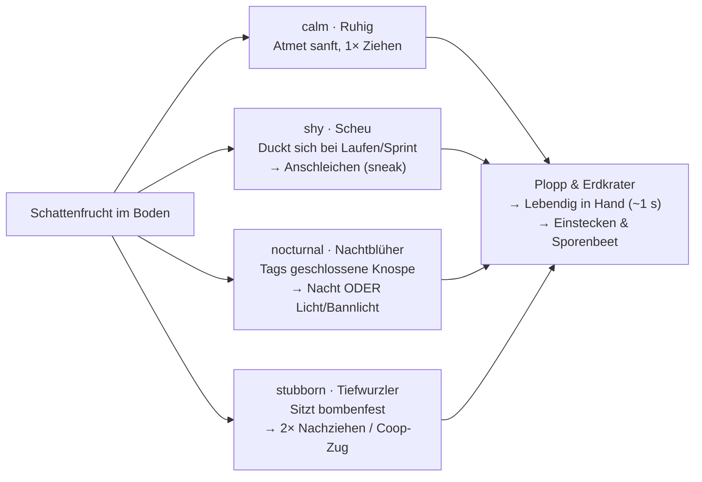
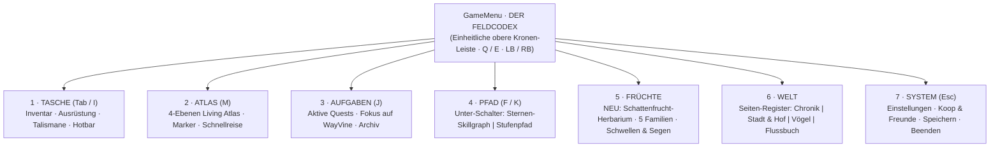

# Schattenfrüchte 2.0 & Einheitliches Ingame-Menü („Der Feldcodex“) — Masterkonzept

> **Status:** Konzeptentwurf (bereit zur Umsetzung in Phasen)  
> **Ziel:** Zwei zentrale Säulen aus einem Guss:  
> 1. **Schattenfrüchte 2.0** — vom simplen Sammelobjekt zu einem lebendigen, spürbar wichtigen Spielsystem (Verhaltens-Varianten, akustische Fährten, skalierbare Progression bis 500+ Stück, Zonen-Segen und ein lebendiges Sporenbeet im Lager/Dorf).  
> 2. **Einheitliches Ingame-Menü („Der Feldcodex“)** — ein zusammenhängendes, texturiertes, organisch animiertes Vollbild-Menü im modernen Shadowspore-Stil (`640×360` Pixel-Art), das alle bisherigen Einzelfenster plus die neue Schattenfrüchte-Seite harmonisch vereint und das Hotkey-Chaos beendet.

---

## Inhaltsverzeichnis

1. [Teil 1 — Schattenfrüchte 2.0](#teil-1--schattenfrüchte-20)
   - [1.1 Identität, Nummerierung & 5 Farbfamilien](#11-identität-nummerierung--5-farbfamilien)
   - [1.2 Entdeckung & Lebendige Verhaltens-Archetypen (Idee 1)](#12-entdeckung--lebendige-verhaltens-archetypen-idee-1)
   - [1.3 Spürbare Spielrelevanz & Skalierbare Progression 1 → 500 (Idee 2)](#13-spürbare-spielrelevanz--skalierbare-progression-1--500-idee-2)
   - [1.4 Das Lebendige Sporenbeet im Lager & Dorf (Idee 3)](#14-das-lebendige-sporenbeet-im-lager--dorf-idee-3)
   - [1.5 Datenmodell, Coop & Save-Kompatibilität](#15-datenmodell-coop--save-kompatibilität)
2. [Teil 2 — Einheitliches Ingame-Menü („Der Feldcodex“)](#teil-2--einheitliches-ingame-menü-der-feldcodex)
   - [2.1 Warum ein gemeinsames Menü? (Ist-Analyse)](#21-warum-ein-gemeinsames-menü-ist-analyse)
   - [2.2 Informationsarchitektur & 7 Haupt-Reiter](#22-informationsarchitektur--7-haupt-reiter)
   - [2.3 Steuerung, Hotkeys & Gamepad-Fluss](#23-steuerung-hotkeys--gamepad-fluss)
   - [2.4 Visuelle Identität: Materialität, Texturen & Shader](#24-visuelle-identität-materialität-texturen--shader)
   - [2.5 Animationen, Übergänge & Audio-Feedback](#25-animationen-übergänge--audio-feedback)
   - [2.6 Detail-Layout der neuen Seite: „FRÜCHTE“ (Sporen-Herbarium)](#26-detail-layout-der-neuen-seite-früchte-sporen-herbarium)
   - [2.7 Technische Architektur & Migration bestehender Fenster](#27-technische-architektur--migration-bestehender-fenster)
3. [Teil 3 — Umsetzungs-Roadmap in 5 sauberen Meilensteinen](#teil-3--umsetzungs-roadmap-in-5-sauberen-meilensteinen)

---

## Teil 1 — Schattenfrüchte 2.0

### 1.1 Identität, Nummerierung & 5 Farbfamilien

Schattenfrüchte sind ein wiederkehrendes, unverwechselbares Naturphänomen in ganz *Altmark* (skaliert problemlos von **8** in *Windkap* auf **300–500+** über den gesamten Kontinent):

- **Ein einziger, klarer Name:** **`SCHATTENFRUCHT`** / **`SCHATTENFRÜCHTE`** (keine unzählbaren Zufallsnamen).
- **Saubere Nummerierung:** Pro Zone **`01` .. `NN`** + Zonen-Zähler (`5 / 8`) und globaler Gesamt-Zähler (`42 / 320`).
- **Prozedurale Vielfalt innerhalb einer Art (`ShadowFruitArt`):**
  - Jede Frucht entsteht deterministisch aus ihrer ID: 4 Silhouetten (*Tropfen, Laterne, Herz, Doppel-Beere*), 3–5 Kronenblätter, 3 Leuchtmuster, 2–4 Wurzelranken, lebendige blinzelnde Sporen-Äuglein und eine von 8 pentatonischen Klangstufen.
  - **5 echte biologische Farbfamilien** (synchron zu `docs/design_guide.md`, biom-gewichtet je Region):

| Familie | Leucht-Farbe | Typische Regionen | Atmosphärische Signatur |
|---|---|---|---|
| **Schleier-Türkis** | `#78f4e6` | Küsten, Buchten, Flussufer (*Windkap*) | Helles Meersalz-Glimmen, klare hohe Glocke |
| **Mond-Mint** | `#82f0be` | Wiesen, Haine, Apfeltriften (*Windkap, Lichtung*) | Frischer Moos-Hauch, weicher Holzklick |
| **Dämmer-Violett** | `#b98cff` | Nebelwälder, Ruinen, Klippenpfade | Sanftes Abendlicht, warmer Alt-Ton |
| **Sporen-Magenta** | `#ff80e4` | Hexenwald, Leeren-Nähe, dunkle Dickichte | Pulsierendes Kern-Glühen, tiefer Nachklang |
| **Stern-Indigo** | `#9ec0ff` | Hochland, Glasklippen, Sternenorte | Kühler Sternenstaub, kristallines Flirren |

---

### 1.2 Entdeckung & Lebendige Verhaltens-Archetypen (Idee 1)

Statt reiner Karten-Pins findet man Schattenfrüchte organisch durch **Hören, Sehen und kleine Spielsituationen**.

#### A. Akustische & visuelle „Wärmer-Kälter“-Fährte (ohne HUD-Überladung)
- **Ab `11` Tiles Entfernung:** Alle `3.5–5.0 s` ein sehr leises, räumlich positioniertes (`AudioStreamPlayer2D`) **Wurzel-Rascheln + zarter pentatonischer Sporen-Ton** (wird ab `5` Tiles alle `1.8 s` etwas deutlicher).
- **Ab `9` Tiles Entfernung:** Alle `2.0–3.2 s` lösen sich **1–2 Leuchtsporen** in der Farbfamilie der Frucht und treiben mit dem aktuellen `WorldWind` davon — wie eine feine Spur im Wind, der man instinktiv folgt.
- **Nachts:** Stärkere Biolumineszenz (`NightLight` + unlit `_glow`), sodass verborgene Früchte im Gebüsch geheimnisvoll aufblitzen.

#### B. Vier lebendige Verhaltens-Archetypen (`trait` pro Fundort)



| Archetyp (`trait`) | Visueller Zustand im Boden | Verhalten & Lösung | Belohnungs-Twist |
|---|---|---|---|
| **`calm`** *(~50 %)* | Offene Blattkrone, ruhiges Atmen | Standard: `E` → `Player.begin_pull` → Plopp → zappelt in der Hand → Tasche. | Basis-XP (`15 XP`), regulärer Karten-Aufdeckkreis (`12` Tiles). |
| **`shy`** *(~20 %)* | Etwas unruhige, lauschende Krone; kleine neugierige Äuglein blinzeln schon am Erdrand | Sobald ein Spieler innerhalb `5.5` Tiles **rennt, sprintet oder schlägt**, flutscht sie mit Raschel-„Fump!“ tief in die Erde (kleine Staubwolke, nur noch zitternde Blattspitze sichtbar, Prompt weg). **Lösung:** Anschleichen (`sneak`) oder `1.4 s` stillstehen → sie linst wieder raus und lässt sich greifen! | Extra-freches Zappeln in der Hand + `20 XP`. |
| **`nocturnal`** *(~15 %)* | Tagsüber eng geschlossene, dunkelviolette Knospen-Hülle (kaum Leuchten; Prompt: *„SCHLÄFT IM TAGLICHT“*) | Öffnet sich bei **Dämmerung/Nacht** (`TimeManager.night_amount() >= 0.35`) **oder** sobald eine mobile Lichtquelle / `Bannlicht`-Zauber / Lagerfeuer innerhalb `4.5` Tiles aktiv ist! | Nacht-Risiko-Bonus: **`25 XP`** + kurzes helles Aufleuchten, das nahe Schattenwesen kurz stutzen lässt. |
| **`stubborn`** *(~15 %)* | Kräftigerer Erdhügel, größere Krone, 2 sichtbare Oberflächen-Wurzeln | Beim **1. Ziehen** wackelt die Erde heftig, eine erste Sporen- & Erd-Salve spritzt auf, die Frucht hebt sich halb aus dem Boden und krallt sich fest (`_pull_stage = 1`, Prompt: *„NOCHMAL ZIEHEN!“*, 6 s Fenster). Beim **2. Ziehen** (oder im Coop direkt, wenn 2 Spieler nahe dran sind!) schießt sie mit doppeltem Plopp, stärkerem Shake & Funkenfontäne heraus! | **`25 XP`** + kleiner Bonus-Glimmersplitter aus der tiefen Wurzelgrube. |

*(In `Windkap` z. B.: 4× `calm`, 2× `shy`, 1× `nocturnal`, 1× `stubborn` — so erlebt der Spieler alle 4 Archetypen schon in der Startzone organisch, ohne Tutorial-Wall!)*

---

### 1.3 Spürbare Spielrelevanz & Skalierbare Progression 1 → 500 (Idee 2)

Jede gepflückte Schattenfrucht zahlt gleichzeitig auf **zwei langfristig motivierende Systeme** ein — so bleibt Frucht #3 genauso aufregend wie Frucht #180.

#### A. Globale Sporen-Schwellen (dauerhafte Upgrades — im Menü *oder* am Sporenbeet einlösbar)
Die Meilensteine starten dicht im Early Game und strecken sich elegant für spätere Kontinent-Zonen (`data/shadow_fruits.json`):

| Schwelle | Name | Dauerhafter Gameplay-Effekt |
|---:|---|---|
| **3** | **Taschen-Geflecht I** | **+4 Rucksack-Plätze** (sofort spürbarer Komfortgewinn!) |
| **6** | **Wurzelatem I** | **+15 Max-Ausdauer** & +8 % Ausdauer-Regeneration |
| **10** | **Sporenlaterne** | **+22 % passiver Nacht-Lichtradius** um Ellie (und schwaches Leuchten im Dunkeln) |
| **15** | **Taschen-Geflecht II** | **+4 Rucksack-Plätze** |
| **22** | **Moosgang** | **Scheue Früchte & Wildtiere** erschrecken 30 % später; Schleichen +10 % schneller |
| **30** | **Erntesegen I** | **+15 % Chance** auf doppelte Ausbeute bei Wildflora, Hof-Ernte & Beeren |
| **42** | **Schattenschritt-Echo** | **-12 % Abklingzeit** auf den Schattenschritt |
| **56** | **Taschen-Geflecht III** | **+8 Rucksack-Plätze** (eine ganze neue Reihe im Inventar!) |
| **75** | **Wurzelatem II** | **+20 Max-Ausdauer** + leicht höherer Karten-Aufdeckradius (`+15 %`) |
| **100** | **Hüterin der Sporen** | **Kosmetische Sporen-Spur** beim Sprinten + doppelte Tagesgabe am Sporenbeet |
| **alle +25 danach** | **Sporen-Gabe (endlos)** | Skalierender Sporen-Segen (Glimmer, seltene Saat, Veredelungs-Material) — lohnt sich bis **500+**! |

> **Wichtig für Coop:** Gesammelte Schattenfrüchte sind weiterhin **gruppenweit geteilt** (`VeilThreads`), und freigeschaltete Schwellen gelten für alle Mitspieler in der Welt — kein Wegschnappen, echtes gemeinsames Erkunden!

#### B. Zonen-Heilung & Zonen-Segen (pro Zone: 50 % & 100 %)
Jede ausgerissene Schattenfrucht „lüftet“ den Boden ihrer Zone:
- **Ab 50 % der Zone** *(z. B. 4/8 in Windkap)* — **„Erwachter Boden“:** +15 % Chance auf seltene Wildflora / gute Fänge in dieser Zone; Nacht-Stimmung im Atlas leicht geklärt.
- **Bei 100 % der Zone** *(z. B. 8/8 in Windkap)* — **Dauerhafter Zonen-Segen** (individuell pro Zone in `data/shadow_fruits.json`):
  - *Windkap (8/8):* **„Segen der Silberbucht“** — +8 % Lauftempo auf Küsten- & Wiesenpfaden und +15 % Angelglück.
  - *Der Klippenstieg:* **„Trittsicherheit“** — weniger Ausdauerverlust beim Sprinten & Klettern.
  - *Erlenfurt:* **„Fruchtbare Aue“** — +10 % schnellere Saat-/Feldernte.
  - Optisch: Die Zone erhält eine feine **türkis-goldene Sporenkrone** im Atlas und auf der Früchte-Seite.

---

### 1.4 Das Lebendige Sporenbeet im Lager & Dorf (Idee 3)

Gesammelte Schattenfrüchte verschwinden nicht als kalte Statistik — **sie ziehen bei dir ein!**

- **Standort & Ausbaustufen:**
  - **Stufe 1 — Moosmulde am Windkap-Rastplatz (sofort ab Tag 1 sichtbar!):** Ein runder, von moosigen Steinen & Wurzeln eingefasster Erdkreis nahe dem Lagerfeuer (`windkap_props.gd` / `SporeBed`), anfangs leer mit einem zarten Hinweisschild (*„LEERES MOOSBEET — HIER WURZELN GEHÜTETE SCHATTENFRÜCHTE“*).
  - **Stufe 2 — Sporengarten / Glashaus-Beet im Dorf:** Sobald das Dorf entsteht, wächst dort ein größeres, mehrstufiges Terrassen-Beet (automatisch synchronisiert mit demselben `VeilThreads`-Bestand!).
- **Lebendige Bewohner (`src/entities/props/spore_bed.gd`):**
  - Jede gesammelte Frucht erscheint mit ihrem **exakten prozeduralen Pixel-Art-Look** (`ShadowFruitArt.build(id)`) halb im weichen Moos eingebettet.
  - **Performance bei 50–500 Stück:** Das Beet zeigt bis zu **24 physisch lebende Bewohner** gleichzeitig (die neuesten + eine deterministische Tages-Auswahl aus allen 5 Farbfamilien; bei höheren Gesamt-Zahlen wachsen die Moos-Terrassen mit zusätzlichen leuchtenden Sporenkissen & Glühpilzen drumherum).
  - **Reaktion auf Spieler:**
    - Läufst du vorbei, drehen nahe Früchte ihre winzigen Leucht-Äuglein zu dir und wackeln kurz mit der Blattkrone.
    - **Interaktion `E` („SPORENBEET BEGRÜSSEN“):** Eine **musikalische Welle** läuft von links nach rechts durch alle Früchte — jede hüpft elastisch hoch, blinzelt vergnügt und spielt ihren pentatonischen Ton wie ein lebendiges kleines Xylophon!
    - **Zweite Aktion (wenn Belohnung bereit oder Tagesgabe reif):** „SPOREN-TAU ERNTEN“ (ab `5` Früchten wächst jeden Morgen ein leuchtender Tautropfen im Beet → schenkt Glimmer/Saat/Heil-Tau; ab `30`/`100` reichhaltiger) oder direkter Sprung in die **Früchte-Seite des Menüs**!
  - **Nachts:** Das Sporenbeet verwandelt sich in einen warm-magischen, mehrfarbigen **Biolumineszenz-Teppich** (`NightLight` + sanfte aufsteigende Sporen), der das Lager in der Nacht unverwechselbar gemütlich macht.

---

### 1.5 Datenmodell, Coop & Save-Kompatibilität

- **100 % abwärtskompatibel:** Bestehende Schlüssel (`"veil_threads"` in `zone.json` & `SaveGame`, Node-Gruppe `"veil_threads"`) bleiben erhalten!
- **Erweiterung in `data/world/zones/<zone>/zone.json` (optionales `trait`-Feld, Default `"calm"`):**
  ```json
  {
    "id": "windkap_thread_2",
    "tile": [30.3, 133.4],
    "place": "silberbucht",
    "trait": "shy",
    "hint": "Zwischen Treibholz am Westrand der Silberbucht"
  }
  ```
- **Neue zentrale Konfigurationsdatei `data/shadow_fruits.json`:**
  - `behaviors`: Radien & Timings für `shy`, `nocturnal`, `stubborn`, `ambient_ping`.
  - `milestones`: Array der globalen Sporen-Schwellen (`count`, `id`, `title`, `desc`, `effect`, `icon`).
  - `zone_blessings`: Pro `zone_id` die 50%- & 100%-Effekte.
  - `spore_bed`: Max-Bewohner, Ausbaustufen, Tagesgaben-Tabelle.
- **Coop-Sync (`VeilThreads`):**
  - Host verwaltet `_collected`, `_claimed_milestones` und `_bed_gift_day` (`export_state` v2, kompatibel mit v1-Saves).
  - `stubborn`-Zwischenzug (`stage 1`) und `shy`-Ducken laufen sauber lokal + über leichtgewichtige Host-Bestätigung.

---

## Teil 2 — Einheitliches Ingame-Menü („Der Feldcodex“)

### 2.1 Warum ein gemeinsames Menü? (Ist-Analyse)

Aktuell besitzt Shadowspore **8 getrennte Vollbild-Overlays** mit verteilten Tasten und 4 verschiedenen Optik-Sprachen:
- `Tab / I` → `InventoryWindow` (lebendige Ranken)
- `M` → `MapWindow` / `AtlasView` (Schiefer-Atlas) + `B` → `AtlasBook` (Chronik)
- `J` → `QuestJournal` (gebundenes Pergament-Buch)
- `F` → `SkillTreeWindow` (Sternen-Graph)
- `P / K` → `ProgressWindow` (Stufenpfad)
- `N` → `RiverBook` (Rindenpapier-Fischbuch)
- `Esc` → `PauseMenu` (oberer Rankenzweig mit `EINSTELLUNGEN`, versiegelter `KARTE`, `STADT`, `VÖGEL`, `KOOP`)
- *(+ jetzt neu: Schattenfrüchte-Herbarium & Sporen-Schwellen)*

**Problem:** Zu viele Tasten zum Merken, harter Stilbruch zwischen den Fenstern, doppelte Konzepte (`PauseMenu`-Karte ist versiegelt während `M` den echten Atlas öffnet; `SkillTree` & `Progress` liegen getrennt; Chronik, Vögel & Flussbuch sind verstreut).

**Lösung:** **EIN einziges, harmonisches, super modernes Ingame-Menü (`GameMenu`)**, das sich wie ein handgefertigtes lebendiges Relikt aus *Shadowspore* anfühlt — schnell, reaktionsfreudig, klar strukturiert und durchgehend texturiert & animiert.

---

### 2.2 Informationsarchitektur & 7 Haupt-Reiter



#### Warum genau diese 7 Reiter perfekt sitzen
1. **TASCHE** — das Herzstück im Alltag; behält Ellies geliebten Ritualkreis, die hängenden Talismane und die Ranken-Rucksack-Äste, jetzt sauber gerahmt unter der neuen Kronen-Leiste.
2. **ATLAS** — der komplette 4-Ebenen-Atlas (`ORT / ZONE / KONTINENT / WELT`). Der alte versiegelte „KARTE“-Tab im Pausemenü verschwindet endgültig! Beim Öffnen über `M` spielt weiterhin der nahtlose **16 px/tile Live-Match-Cut**, während die Kronen-Leiste elegant oben einblendet.
3. **AUFGABEN** — das hochwertige `QuestJournal` (aktive Quests, Verfolgen, „Auf Atlas zeigen“-Sprung wechselt direkt geschmeidig auf Reiter 2 *ATLAS* und zentriert das Ziel!).
4. **PFAD** — vereint **Fähigkeiten (`SkillTreeWindow`)** und **Stufenpfad (`ProgressWindow`)** über zwei elegante Kristall-Umschalter oben links (`TALENTE` | `STUFEN`). Ein gemeinsamer Puls-Badge zeigt offene Skillpunkte oder einsammelbare Level-Belohnungen an!
5. **FRÜCHTE** *(NEU)* — die dedizierte Heimat für die **Schattenfrüchte** (Details in [§ 2.6](#26-detail-layout-der-neuen-seite-früchte-sporen-herbarium)).
6. **WELT** — bündelt alle Heimat- & Sammel-Bücher ordentlich hinter 4 schmalen **Buch-Lesezeichen am rechten Rand** (kein eigenes Hotkey-Chaos mehr für `B` und `N`!):
   - **Chronik** (`AtlasBook` — Zonen-Erschließung & 30/60/100 %-Meilensteine)
   - **Stadt & Hof** *(bisher im Pausemenü)*
   - **Vögel** *(bisher im Pausemenü — Krähen & Raben)*
   - **Flussbuch** *(bisher `N` — alle gefangenen Fischarten & Rekorde)*
7. **SYSTEM** — das saubere Zuhause für **Einstellungen**, **Koop-Sitzung & Freunde-Sidebar**, **Speichern**, **Hauptmenü** und **Spiel beenden**.

---

### 2.3 Steuerung, Hotkeys & Gamepad-Fluss

Ein goldenes Gesetz: **Niemand muss mehr als 2 Tasten lernen (`Tab` & `Esc`), aber Power-User behalten alle Direkt-Sprünge!**

| Eingabe | Kontext: Welt (Menü zu) | Kontext: Menü offen |
|---|---|---|
| **`Tab`** | Öffnet das Menü auf dem **zuletzt genutzten Spiel-Reiter** (Standard: `TASCHE`) | Schließt das Menü *(außer im Atlas-Tab, wo `Tab` optional Zoom-Ebene wechselt — oder einheitlich: `Tab` schließt immer, Atlas-Ebenen über Mausrad / `1–4`)* |
| **`Esc`** | Öffnet direkt Reiter **7 · SYSTEM** (pausiert im Solo) | Schließt das Menü sofort (bzw. 1× zurück aus Unter-Dialog) |
| **`Q` / `E`** *(Gamepad `LB` / `RB`)* | *(Welt-Aktionen normal)* | **Blättert blitzschnell** zum vorherigen / nächsten Haupt-Reiter *(gesperrt, solange ein Textfeld editiert wird; in `TASCHE` bleibt Item-Werfen auf Rechtsklick-Außerhalb / `X` oder `Shift+Q`, damit `Q/E` überall konsistent blättern!)* |
| **Direkt-Hotkeys** (`I`, `M`, `J`, `F`) | Springt direkt in `TASCHE` / `ATLAS` / `AUFGABEN` / `PFAD` | Drücken derselben Direkt-Taste **schließt** das Menü; Drücken einer anderen Direkt-Taste **wechselt** direkt auf diesen Reiter! |
| **Klick auf Reiter** | — | Wechselt sofort mit Richtungs-Gleitanimation |
| **Tasten `1–7` (optional mit `Alt` oder Fokus auf Leiste)** | Hotbar-Slots `1–8` bleiben in der Welt unberührt | In `TASCHE` weiterhin schnelles Tauschen mit der Hotbar |

> **Hinweis zu `Q` in der Tasche:** Aktuell wirft `Q` in `InventoryWindow` ein Item weg. Wenn `Q`/`E` global Reiter blättern (wie in *Stardew*, *Skyrim*, *Hades*, *Sea of Stars* — und sogar schon im bestehenden `PauseMenu`!), legen wir „Item wegwerfen“ sauber auf **`X`** (oder Klick außerhalb des Rucksacks, was bereits existiert). Das wird im Fußbalken klar angezeigt.

---

### 2.4 Visuelle Identität: Materialität, Texturen & Shader

Das Menü muss sich anfühlen wie ein **modernes 2026er Prestige-Indie-UI**, das zu 100 % aus *Shadowspores* `640×360`-Pixelwelt geboren ist — **kein generisches flaches Dark-UI, kein klobiges RPG-Maker-Kästchen**.

#### A. Die 4 Tiefenschichten (`640×360` Gesamtkomposition)

```
┌─────────────────────────────────────────────────────────────────────────┐ 0 px
│  [Kronen-Leiste · 34 px · Rindenholz + geätzter Schiefer + Messing]     │
│  ‹Q  [Tasche] [Atlas] [Aufgaben] [Pfad•] [Früchte•] [Welt] [System]  E› │
│  ═══════════════● (leuchtender Gold-/Türkis-Blüten-Slider) ════════════ │ 34 px
├─────────────────────────────────────────────────────────────────────────┤
│                                                                         │
│                  AKTIVE INHALTS-BÜHNE (608 × 292 px)                    │
│       Texturierte 9-Slice Schiefer- & Pergament-Karten,                 │
│       lebendige Rand-Ranken, subtile Sporen im Backdrop                 │
│                                                                         │ 336 px
├─────────────────────────────────────────────────────────────────────────┤
│  [Fuß-Steuerungsleiste · 20 px · dezente Schiefer-Schiene]              │
│  Q/E REITER  ·  KLICK WÄHLEN  ·  [Kontext-Hinweis]     TAG 3 · 142 K    │ 360 px
└─────────────────────────────────────────────────────────────────────────┘
```

#### B. Eigener Textur-Atlas (`tools/art_menu_chrome.py` → `assets/ui/menu_chrome.png`)
Alle UI-Flächen werden **handwerklich als pixel-scharfe 9-Slice-Texturen & Ornamente** generiert (`filter_nearest`, 1px getönter `#0d0918`-Rand, Licht von oben links):
1. **Dunkler Schiefer (`slate_card`, `slate_inset`):** Tiefes Nacht-Indigo (`#171329` / `#201a38`) mit feiner horizontaler Schiefer-Maserung, geprägter 1px-Oberkante (`#4a4180`) und subtilen abgeschrägten Steinecken.
2. **Rinden-Pergament (`parchment_card`):** Warmes gedämpftes Rauch-Pergament (`#2b2338` / `#382e46` für dunkle Buchseiten, `#e6d8bd` für handgeschriebene Briefe/Notizen) mit dezenter Faserstruktur.
3. **Messing- & Gold-Beschläge (`gold_frame`, `corner_filigree`):** Gedämpftes antikes Messing (`#6f5020 → #b48a38 → #e6c468`) für aktive Reiter, Einlöse-Karten und Meilenstein-Siegel.
4. **7 eigene 12×12-Reiter-Icons:** Beutel, Kompass-Rose, Wachssiegel, Sternen-Kristall, Schattenfrucht, Aufgeschlagenes Buch, Ranken-Zahnrad (jeweils in *Ruhe*- und *Leucht*-Variante!).
5. **Trenner, Fortschritts-Röhren & Puls-Badges:** Handgepixelte Messing-Trennlinien mit zentraler Raute, gläserne Sporen-Balken mit wanderndem Glanzpunkt, leuchtende Notification-Knospen.

#### C. Hintergrund-Shader (`assets/shaders/menu_backdrop.gdshader`)
- **Lebender Welt-Hintergrund:** Die Spielwelt bleibt weich abgedunkelt hinter dem Menü spürbar (leichter 2px-Pixel-Softener + tiefviolette Radial-Vignette, nie einfach schwarzer Bildschirm!).
- **Tageszeit- & Zonen-Reaktion:**
  - Nutzt `ZoneMood.now` (subtile Farb-Nuance der aktuellen Zone, z. B. kühles Meer-Türkis in *Windkap*, warmes Gold-Ocker in der *Sonnenquarz-Öde*, tiefes Violett im *Hexenwald*).
  - Nachts kriechen feine violette `VineStyle`-Ranken und glimmende Sporen langsam an den 4 Bildschirmecken entlang.
- **Schwebender Sporenstaub:** 14–18 winzige, langsam nach oben treibende Pixel-Sporen hinter den Karten (tiefengestaffelt, kaum spürbar, aber gibt sofort magische Lebendigkeit!).

---

### 2.5 Animationen, Übergänge & Audio-Feedback

Modernes UI fühlt sich **knackig, elastisch und direkt** an — nie zäh, nie statisch:

| Moment | Dauer | Visuelle Choreografie | Audio |
|---|---:|---|---|
| **Menü öffnen** | `0.22 s` | Backdrop fadet rein (`0.16 s`); Kronen-Leiste gleitet `-10 px → 0` mit sanftem Out-Cubic; Inhalts-Bühne startet `+8 px` tiefer mit schnellem diagonalem Bayer-Dissolve (`0.18 s`); Rand-Ranken wachsen in `0.35 s` nach (blockieren aber NICHT den Input!). | Warmes Holz-/Blatt-Aufschlagen (`rustle_a.wav`, sanft tief) |
| **Menü schließen** | `0.14 s` | Sofortige Input-Freigabe; Kronen-Leiste & Bühne ziehen sich knackig um `6 px` zurück und faden sauber aus. | `rustle_b.wav` (knapp, leise) |
| **Reiter-Wechsel (`Q`/`E` / Klick)** | `0.17 s` | Alte Seite gleitet `∓18 px` raus & fadet; neue Seite gleitet aus `±18 px` federnd rein; **Blüten-Slider** in der Kronen-Leiste rastet mit elastischem Overshoot unter dem neuen Reiter ein & lässt 2 winzige Pixel-Blättchen aufblühen. | `flip.wav` (Pitch leicht gestaffelt nach Reiter `0.94..1.10`) |
| **Hover über Karte / Button** | `0.10 s` | Karte hebt sich um `1–2 px`, ein feiner **1px-Lichtschimmer** läuft diagonal über die obere Kante, Rahmen wechselt auf warmes Messing/Türkis. | Ultraleises Holz-Ticken (`-16 dB`) |
| **Belohnung einlösen (Schattenfrucht-Schwelle / Meilenstein)** | `0.45 s` | Leuchtsporen fliegen vom Zähler in die Karte, goldener Pixel-Pulsring (`ShockRing`), Haken prägt sich mit kleinem Stamp-Bounce ein. | `chime_b.wav` + `item_pickup.wav` |
| **Atlas-Match-Cut (`M`)** | `0.40 s` | Bestehender 16 px/tile Live-Match-Cut bleibt 100 % erhalten; Kronen-Leiste gleitet erst am Ende des Zooms sanft oben ein. | Bestehender Atlas-Sound |

---

### 2.6 Detail-Layout der neuen Seite: „FRÜCHTE“ (Sporen-Herbarium)

Die Schattenfrüchte bekommen eine **unvergessliche, interaktive Lieblingsseite** im neuen Menü (`608 × 292 px` Bühne in 3 ausgewogenen Spalten):

```
┌──────────────────┬──────────────────────────────┬────────────────────────┐
│ ZONEN (148 px)   │ HERBARIUM & TERRARIUM (258px)│ SPOREN-SEGEN (186 px)  │
├──────────────────┼──────────────────────────────┼────────────────────────┤
│ GESAMT: 12 / 320 │ WINDKAP · 5 / 8              │ NÄCHSTE SCHWELLE       │
│ ▓▓▓▓░░░░░        │ ┌──────────────────────────┐ │ ┌────────────────────┐ │
│                  │ │  [01]  [02]  [03]  [04]  │ │ │ ★ 15 FRÜCHTE       │ │
│ ▸ WINDKAP   5/8  │ │  [05]  [??]  [??]  [??]  │ │ │ TASCHEN-GEFLECHT II│ │
│   KLIPPEN   3/10 │ │  (echte prozedurale      │ │ │ +4 RUCKSACK-PLÄTZE │ │
│   ERLENFURT 4/8  │ │   Früchte atmen im Moos!)│ │ │ ▓▓▓▓▓▓▓▓░░ 12/15   │ │
│   SÜDKAP    0/10 │ └──────────────────────────┘ │ └────────────────────┘ │
│   [unentdeckt]   │                              │                        │
│                  │ AUSGEWÄHLT: WINDKAP · #03    │ EINLÖSBAR! [★ NEHMEN]  │
│ ──────────────── │ ┌────┐  SPOREN-MAGENTA       │ ✓ 03 · TASCHE I (+4)   │
│ 5 FARBFAMILIEN   │ │ 👾 │  Archetyp: SCHEU      │ ✓ 06 · WURZELATEM I    │
│ ● Türkis     4   │ └────┘  „Auf einer wind-     │ ✓ 10 · SPORENLATERNE   │
│ ● Mint       3   │         umtosten Geröll-     │                        │
│ ● Violett    2   │         stufe am Klippen-    │ ────────────────────── │
│ ● Magenta    2   │         pfad“                │ ZONEN-SEGEN: WINDKAP   │
│ ● Indigo     1   │  [● AUF ATLAS ZEIGEN]        │ ✓ 50% Erwachter Boden  │
│                  │                              │ ○ 100% Silberbucht     │
└──────────────────┴──────────────────────────────┴────────────────────────┘
```

**Die magischen Details dieser Seite:**
- **Echte prozedurale Mini-Früchte im Raster:** Jede gefundene Frucht zeigt ihr tatsächliches `ShadowFruitArt`-Sprite (mit `*_glow`-Layer!) in einer kleinen Moos-Nische. Ungesammelte Plätze zeigen einen dunklen Erdhügel mit leisem Fragezeichen-Sporenglimmen — beim Anklicken liest du den **Fundort-Hinweis**!
- **Lebendige Vorschau-Karte:** Wenn du eine gefundene Frucht anklickst oder darüber fährst, erscheint sie **2× vergrößert** in der Vorschau-Box, **blinzelt, zappelt kurz mit den Wurzelranken** und spielt ganz zart ihren individuellen pentatonischen Klang!
- **Direkter „Auf Atlas zeigen“-Sprung** (für gefundene Früchte oder grobe Suchregionen) wechselt butterweich in Reiter **2 · ATLAS**.
- **Sporen-Schwellen direkt einlösen:** Sobald eine Schwelle erreicht ist, pulsiert die Karte golden (und ein kleiner Punkt leuchtet oben am Reiter **`FRÜCHTE•`**). Ein Klick auf **`EINLÖSEN`** schaltet den Bonus sofort über den Host frei!

---

### 2.7 Technische Architektur & Migration bestehender Fenster

Wir bauen **evolutionär statt alles neu zu schreiben** — jeder bestehende Battle-Tested-Code (Inventar-Drag&Drop, Atlas-Shader, QuestJournal, SkillTree-Pan/Zoom, Pause-Settings & Koop-Sidebar) bleibt erhalten und wird sauber in die neue Schale eingehängt:

| Datei (Neu / Angepasst) | Verantwortung |
|---|---|
| `data/shadow_fruits.json` *(neu)* | Archetypen-Parameter, globale Sporen-Schwellen, Zonen-Segen, Sporenbeet-Regeln (`DataRegistry`). |
| `src/systems/veil_threads.gd` *(erweitert)* | Host-authoritative Verwaltung von `_collected`, `_claimed_milestones`, aktiven Zonen-Segen & Boni (`bag_bonus_slots()`, `stamina_bonus()`, `light_radius_bonus()`, `zone_blessing_active()`), RPCs & `SaveGame` v2. |
| `src/entities/props/veil_thread_pickup.gd` *(erweitert)* | Alle 4 Verhaltens-Archetypen (`calm`, `shy`, `nocturnal`, `stubborn`) + räumliches Wurzelrascheln + Wind-Sporen-Fährten. |
| `src/entities/props/spore_bed.gd` *(neu)* | Lebendiges Sporenbeet am Windkap-Rastplatz & im Dorf (bewohnt von echten `ShadowFruitArt`-Früchten, Blickverfolgung, Xylophon-Begrüßung, Nacht-Teppich, Tagesgabe). |
| `tools/art_menu_chrome.py` *(neu)* | Generiert `assets/ui/menu_chrome.png` (9-Slice Schiefer/Pergament/Messing, 7× 12×12 Reiter-Icons, Ecken, Trenner, Badges). |
| `assets/shaders/menu_backdrop.gdshader` *(neu)* | Sanft getönter, tageszeit- & zonen-reaktiver Menü-Hintergrund mit driftenden Sporen. |
| `src/ui/menu/menu_chrome.gd` *(neu)* | Wiederverwendbarer Zeichen- & Animations-Baukasten (9-Slice-Karten, Hover-Shimmer, Blüten-Slider, Fortschrittsbalken, Badges). |
| `src/ui/menu/game_menu.gd` *(neu)* | Zentraler Orchestrator (`CanvasLayer`): Kronen-Leiste, `Q`/`E`-Blättern, Direkt-Hotkeys, Singleplayer-Pause, Input-Blocking, Übergangs-Tweens, Sound. |
| `src/ui/menu/tab_fruits.gd` *(neu)* | Die interaktive **FRÜCHTE**-Seite (Zonen-Liste, lebendiges Herbarium, 5 Familien, Sporen-Schwellen & Zonen-Segen). |
| `src/ui/menu/tab_world.gd` *(neu)* | Das **WELT**-Sammelbuch mit 4 Seiten-Lesezeichen (*Chronik · Stadt & Hof · Vögel · Flussbuch*). |
| `src/ui/menu/tab_path.gd` *(neu)* | Kombiniert `SkillTreeWindow` & `ProgressWindow` unter dem Reiter **PFAD**. |
| `src/ui/inventory_window.gd`, `map_window.gd`, `quest_journal.gd`, `pause_menu.gd` *(angepasst)* | Erhalten schlanken `embedded_in_menu: bool`-Modus (rendern innerhalb der `GameMenu`-Bühne, delegieren Öffnen/Schließen/Pause an `GameMenu`). |

---

## Teil 3 — Umsetzungs-Roadmap in 5 sauberen Meilensteinen

Jeder Meilenstein ist **eigenständig spielbar, visuell verifizierbar und bricht nichts Bestehendes**:

1. **Meilenstein 1 — Schattenfrüchte-Verhalten & Fährten (`data/shadow_fruits.json`, `veil_thread_pickup.gd`, `windkap/zone.json`):**
   - Die 4 Archetypen (`calm`, `shy`, `nocturnal`, `stubborn`) inkl. Animationen & Sounds.
   - Räumliches Rascheln/Sporen-Klingen + vom `WorldWind` getragene Sporen-Fährten.
   - Windkap-Verteilung auf alle 4 Typen abstimmen.
2. **Meilenstein 2 — Sporen-Schwellen, Zonen-Segen & Lebendiges Sporenbeet (`veil_threads.gd`, `spore_bed.gd`, `windkap_props.gd`):**
   - Host-authoritative Meilenstein-Einlösung & echte Gameplay-Effekte (Rucksack-Slots, Ausdauer, Lichtradius, Zonen-Segen, Coop-Sync & Save v2).
   - Das lebendige Sporenbeet am Windkap-Rastplatz mit echten Bewohnern, Augen-Tracking, Xylophon-Begrüßung, Nachtleuchten & Tagesgabe.
3. **Meilenstein 3 — Menü-Fundament & Textur-System (`art_menu_chrome.py`, `menu_chrome.gd`, `menu_backdrop.gdshader`, `game_menu.gd`):**
   - Handgepixelter Chrome-Atlas (`menu_chrome.png`) + Backdrop-Shader + obere Kronen-Leiste mit elastischem Blüten-Slider, Badges, Fußzeile, `Q`/`E`-Blättern & allen Direkt-Hotkeys.
4. **Meilenstein 4 — Die neue „FRÜCHTE“-Seite & Einbindung aller bestehenden Fenster (`tab_fruits.gd`, `tab_path.gd`, `tab_world.gd` + Adapter):**
   - Komplette Schattenfrüchte-Herbarium-Seite mit lebender Vorschau & direktem Einlösen.
   - Sauberes Einbetten von `InventoryWindow`, `AtlasView` (inkl. Match-Cut!), `QuestJournal`, `SkillTree + Progress`, `Welt`-Register (*Chronik, Stadt, Vögel, Flussbuch*) und `System` (*Einstellungen & Koop*).
5. **Meilenstein 5 — Feinschliff, Animationen, Gamepad-Check & Voll-Verifikation:**
   - Alle Übergangs-Timings, Sounds, Tageszeit/Nacht-Ranken, HUD-Wechselwirkungen und automatisierte Tests (`test_atlas.tscn`, `test_hud_layout.tscn`, Preview-Captures jedes Reiters bei Tag & Nacht).
