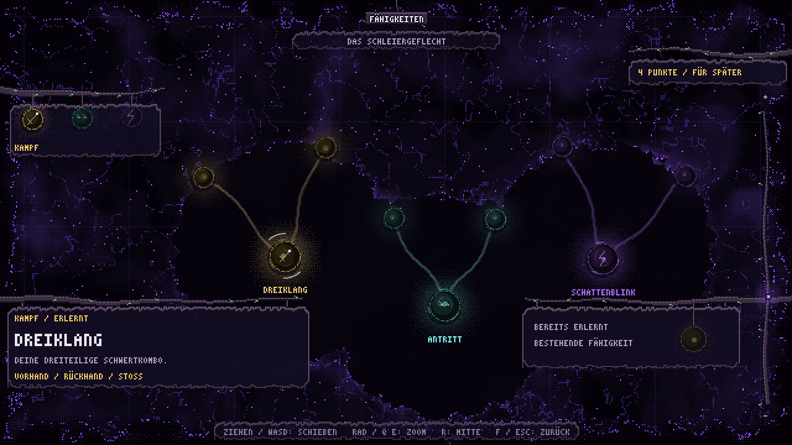

# Das Schleiergeflecht



F öffnet die Fähigkeitenansicht, F oder Escape schließt sie. Der Start-Button am Controller
öffnet dieselbe Ansicht; außerdem ist sie über FÄHIGKEITEN im Pausemenü erreichbar.
In Storysequenzen, beim Tod und während eines anderen modalen Menüs bleibt sie gesperrt.
Die Story-Welt führt sie zusammen mit dem freigeschalteten HUD ein (`hud_unlocked`).

## Bestehende Fähigkeiten und Platzhalter

Vier Start-Orbs stehen für bereits bestehende Mechaniken.

- Kampf: Dreiklang – die dreiteilige Schwertkombo.
- Bewegung: Antritt – Sprinten einschließlich des Dashs beim Loslaufen.
- Schleichen (Bewegung) – langsamer gehen und später von Gegnern entdeckt werden.
- Schatten: Schattenblink – der bestehende Blink; Reichweite und Abklingzeit werden direkt aus
  dem vorhandenen BlinkComponent angezeigt.

Die sechs **Platzhalter** lassen sich kostenlos erkunden. Daneben gibt es lernbare Fähigkeiten
und Kampf-Upgrades. Der vorhandene XP-Fortschritt vergibt einen Fähigkeitspunkt pro Stufe nach
Stufe 1. Namen, Positionen, Kosten und Verbindungen stehen in `data/skills.json`.

Nur Start-Orbs und direkte Nachbarn erkundeter Orbs sind sichtbar. Einen sichtbaren Platzhalter
oder die Schaltfläche SCHLEIER ERKUNDEN 0,7 Sekunden halten, um ihn kostenlos zu erkunden.
Enter / Leertaste / Controller A funktionieren ebenfalls. Frühes Loslassen, Wechsel der Auswahl,
Verlassen der Schaltfläche bzw. des Orbs und Fokusverlust brechen den Vorgang ab.
Die Markierung bleibt PLATZHALTER; ein erkundeter Knoten wird nie zu einer erlernten Fähigkeit.

## Klettern

Unter **Bewegung** den Knoten **Klettern** halten, um ihn für einen Fähigkeitspunkt zu lernen.
Mit Ellie an eine Felswand heranlaufen und beim Hinweis **E KLETTERN** drücken (Controller **Y**).
Ellie zieht sich eine Geländestufe nach oben, wenn sie auf dem Absatz Platz hat. Ein Treffer oder
ein Hindernis während des Aufstiegs bringt sie zum Ausgangspunkt zurück. Beim Speichern während
des Aufstiegs gilt der Ausgangspunkt als sichere Position.

`python tools/art_hero_climb.py` rendert den Aufstieg und die Verletzungsmaske in acht Richtungen.
`tools/test_wall_climb.tscn` prüft den Aufstieg an einer Felswand der Weltkarte.

## Ansicht und Animation

- Das Netz samt Schleier nutzt den gesamten Bildschirm. Titel, Auswahl, Punkte, Informationen
  und die kostenlose Erkunden-Aktion hängen frei an VineStyle-Ästen, ohne feste Kopf-/Fußflächen
  oder gefüllte Detail- und Aktionspanels. Graphmarkierungen werden unter schwebenden Texten
  dezent ausgeblendet, damit die Beschriftungen auch nach dem Verschieben lesbar bleiben.
- WASD / linker Stick oder Ziehen mit linker bzw. mittlerer Maustaste verschieben das Netz.
  Ziehen funktioniert auch in den früheren Kopf- und Fußbereichen; Loslassen lässt die Ansicht
  wie bei der Karte sanft nachlaufen.
- Mausrad zoomt zum Mauszeiger, Q/E und Controller-Schultertasten zur Bildschirmmitte.
  Die rechte Zoom-Ranke ist ziehbar, ein Doppelklick im Hintergrund zoomt hinein, R fährt sanft
  zur Gesamtansicht. Die drei Start-Anhänger am linken Ast wählen und fokussieren den Pfad.
- Pfeiltasten / Steuerkreuz wählen sichtbare Nachbarn räumlich aus.
- Der **gleiche Schleier wie auf der Weltkarte**: beide Shader nutzen
  `assets/shaders/map_veil.gdshaderinc` für Palette, Integer-Noise, vieroktaviges FBM,
  Bayer-Dithering, `fog_smoke`, ausgefranste Aufdeckkanten, Bildschirmrand und Öffnungswelle.
  In erkundeten Bereichen liegen die dunkle Kartenleere, feine Sterne und ein Punktgitter hinter
  den Orbs. Helle Kerne in Gold, Türkis und Violett, atmende Halos und kleine Lichtpartikel bleiben.
- Nach Host-Bestätigung: Lichtwelle, Funken, Energie in den Verbindungen, wachsender freier
  Bereich und zeitversetztes Erscheinen der Nachbarn. Die Kamera folgt sanft in die neue Richtung.
- Leise Öffnungs-, Auswahl- und Aufdecktöne in `assets/audio/skills/`, reproduzierbar mit
  `python3 tools/audio_skills.py`. Verwendet den bestehenden Audio-Master.

**Angleichung an die übrige UI:** Alle Textblöcke (Titel, Punkte, Auswahl, Details, Aktion, Hinweiszeile)
nutzen jetzt `VineStyle.paper`, dieselbe ausgefranste Rindenpapier-Karte wie Dialog, Tooltips und
Hinweiskarte, statt eigener harter Rechtecke. Die beiden unteren Blöcke haben dieselbe Oberkante. Halos
sind gecachte, Bayer-geditherte Texturen (`_halo`, wie der Schleier) statt gestapelter Flachscheiben.
Orbs, die drei Wurzel-Anhänger und die Erkunden-Knospe teilen eine Kugel (`_globe`). Fähigkeiten tragen
ihren eigenen Namen (DREIKLANG, ANTRITT, SCHATTENBLINK), Platzhalter nur beim Auswählen "PLATZHALTER".
Orbs wachsen beim Erscheinen mit Überschwinger auf; beim Halten sammelt der Schleier sich in den Orb,
die Verbindung zum Elternknoten leuchtet und die Antwort des Hosts pulsiert. `HOME` und `_fit_zoom` halten
alle Knoten frei von den Eck-Ranken (die Echo-III-Knoten liegen bei (±240, -116)).

SkillTreeWindow liegt über den HUD-Ranken und blendet Quest-/Hinweisanzeigen wie die Karte aus.
Solo pausiert die Welt bis zum Ende der Schließanimation; im Multiplayer läuft sie weiter.
Bewegung, Sprint, Blink, Schleichen, Interaktion, Angriff und Hotbar-Auswahl erreichen währenddessen
nicht die Welt. Eine Storysequenz schließt die Ansicht vor dem Suspendieren des HUD.
Unerwartetes Entfernen und Tod geben die eigenen Pause-/Eingabesperren sauber frei.

## Zustand und Netzwerk

`SkillTreeComponent` ist pro Spieler vorhanden. Der Host prüft Besitzer, bekannte IDs,
Platzhalterstatus und bereits erkundete Vorgänger. Nur er ergänzt Erkundungen; ausschließlich
der Besitzer erhält seinen Zustand und das bestätigte Aufdeckereignis. Eine erste bzw.
erneute Zustandsabfrage spielt keine Aufdeckanimation ab.

SaveGame speichert `player.skill_tree.discovered` im bestehenden Solo-Spielstand. Alte Spielstände
ohne diesen Eintrag beginnen mit den drei Start-Orbs. Import verwirft unbekannte IDs, doppelte
Einträge und nicht verbundene Nachfolger, akzeptiert aber beliebige Reihenfolge. Die gemeinsame
Kartenentdeckung und die bestehende Speicherpolitik bleiben unabhängig davon.

## Prüfen

Godot: `~/Downloads/Godot.app/Contents/MacOS/Godot`

```sh
Godot --headless --path . tools/test_skill_tree.tscn
Godot --path . tools/test_skill_tree.tscn
Godot --headless --path . tools/test_skill_tree_network.tscn -- --server --self-test
```

Der Solo-Test benutzt einen echten Player samt HUD ohne Welt und ohne Lesen des normalen Saves.
Er prüft Sichtbarkeit, Gedrückthalten/Abbruch, unveränderte Spielwerte, Speicherrundlauf mit
`user://shadowspore-skill-tree-test.json`, alte/ungültige Daten, Eingabesperre, Menüwechsel und
Aufräumen. Zusätzliche Navigationstests prüfen die volle Zeichenfläche, kontinuierlich
mausverankerten Zoom, Ziehen in den früheren Panelbereichen, Nachlauf, Zoom-Ranken-Endpunkte
und den Bewegungs-Anhänger. Gerendert entstehen Momentaufnahmen unter
`/tmp/shadowspore-skills-*.png`, einschließlich einer herangezoomten Ansicht.
Der Netzwerktest startet zwei Prozesse auf dem isolierten Loopback-Port 17913 und prüft
Besitzerisolation, Einstiegssnapshot, Host-Bestätigung und abgewiesene ungültige Anfragen.

## Upgrades (Kampfseite, docs/faehigkeiten_kampf_konzept.md)

Seit dem Kampf-Schritt hat der Graph vier Wurzeln (DREIKLANG, ANTRITT, SCHLEICHEN, SCHATTENBLINK) und
Platzhalter. **Upgrades sind keine Orbs**: `data/skills.json` Knoten mit `upgrade`, `level`, `cost`, `parent`
(Kette `combo_four` → `combo_five`) wachsen an der Blume ihrer Fähigkeit (Knospen auf dem Rand, mehr
Blütenblätter, „UPGRADE BEREIT“). Halten auf der Blume lernt das nächste bereite Upgrade
(`SkillTreeComponent.request_learn`, Host validiert Stufe/Punkte/Vorgänger, `learned`-Signal, Snapshot
`_state(discovered, learned, new_id)`). Punkte = erreichte Stufe − 1 − ausgegeben; SaveGame
`player.skill_tree` = `{discovered, learned}`, Import trimmt gegen Stufe und Punkte. Die Kombo (AttackComponent)
zählt Schritte mit `requires`; die Schläge 4/5 benutzen das Blatt `player_combo.png` (`tools/art_hero_combo.py`).
Icons: `tools/art_skill_icons.py` → `src/ui/skill_icon_art.gd`, gebacken von `SkillIcons`.
