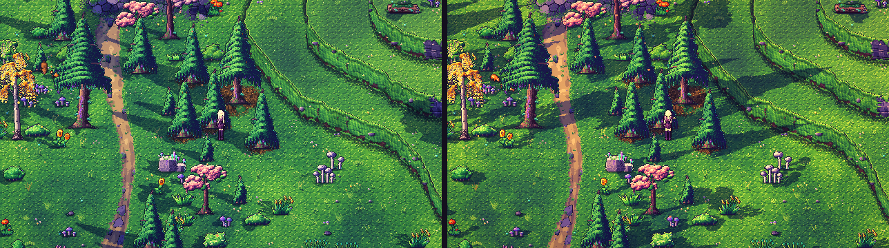

# Sonnenschatten (cast shadows of sun and moon)

Built 2026-11-15. Everything registered for the mirror images (`WaterReflections.watch`: Ellie and other players,
settlers, the knight, animals, trees, bushes, rocks, buildings, every `Interactable`) throws a real shadow that follows the
sun: long to the west in the morning, short to the north (up the screen) at noon, long to the east in the evening. At
night the moon throws faint ones the same way. Cosmetic and local on every peer.

## How it works

1. **Sun path** (`SunShadows.sun_cast(time)`, `path_cast(run)`): the sun crosses from `DAWN` 0.21 to `DUSK` 0.79, elevation
   7..56 degrees, shadow length `0.85 / tan(elevation)` clamped to 0.42..2.3 times the height, north foreshortened by
   `FORESHORTEN` 0.62 for the 3/4 view. The moon uses the same path over the night (`NightAtmosphere`'s run).
2. **Strength** (`follow`, from `DayNight` every frame): DayNight's sun (weather and Hexenwald included) x 1.4, at most
   0.86; the tone turns blue-violet in the golden hour. Moon: night x lit part of the phase x brightness x clouds, at most
   0.32. Nothing in rooms or the mine. Setting SPIEL -> SCHATTEN (`sun_shadows`); the graphics level scales the budget
   (`Quality` `shadow_items`).
3. **Choosing** (`_rebuild`, every 0.25 s): `WaterReflections.things_in(reach)` where `reach` = the view plus where shadows
   of things up to `TALL` 220 px can come from; nearest to the middle first, at most `MAX_ITEMS` 380 sprite copies. Each
   chosen thing keeps its own run of copy slots (`_alloc`, first fit) as long as it stays chosen, so only newcomers are drawn
   at once.
4. **Drawing** (`RenderingServer.frame_pre_draw`): each solid Sprite2D part (no `*glow*`, `*light*`, `*halo*`, `*shadow*`,
   ground pieces) is copied as a pooled canvas item into a SubViewport of the view's size with the shader
   `shadow_silhouette.gdshader` (alpha >= 0.55 = shadow; baked contact shadows and halos are half transparent and cast none).
   Transform `SunShadows.shear(feet, cast)`: the feet stay, a point h px above them moves by `cast * h`, and the sprite's width
   is turned to lie across the shadow (a billboard facing the light: a flat sprite lit from the side would cast a thin line).
   Walking things every frame, resting ones every `ROUND` 6 frames.
   Pixels below the caster's feet line (root flares, the lower rim of rocks and bushes) cast nothing: the shear would
   throw them forwards, in front of the caster. `_feet_color` packs the feet's y in the sprite's own space into the draw
   colour (`r = y / 1000 + 0.5`), and the silhouette shaders drop every pixel below it (`local_y > feet_y + 0.5`).
   Toppling pieces get no cut.
5. **Wind and motion**: the shadow moves with its caster.
   - Things whose parts sway by node transform (`FirTree` crowns and trunks, every `Bush`, `Flora`, and anything with a
     wind shader) are marked `_slot_sway`. Between full redraws their copies are only re-angled (`_follow_sway`, every
     second frame), and only when the sprite's `skew + rotation` changed by `SWAY_STEP` 0.004 rad (about half a pixel at
     a crown's height). Gentle wind is followed by the round robin alone; hit shakes, bush rustling and gusts by
     `_follow_sway` (`swayed_items`).
   - Shader sway is mirrored in the silhouette. Parts drawn with `flora_wind.gdshader` use
     `shadow_silhouette_flora.gdshader` (same include, same globals, uniforms copied once). Parts drawn with
     `sway_rows.gdshader` (rags, garden plants, the crow tree) use `shadow_silhouette_rows.gdshader`, whose `wind`/`time`
     are copied every frame. There is one silhouette material per caster material (`_sil_mats`), so the shadow bends in
     the same whole art pixels as the picture.
   - A falling tree (`FirTree.is_falling()`) counts as moving and re-reads its parts, so the toppling trunk and crown throw
     their shadow as they fall.
6. **Physics interpolation** (project setting on): the pooled copies are created with
   `canvas_item_set_interpolated(false)`, and the buffer's root and the ground quad have interpolation OFF. Interpolated
   copies were drawn for a frame halfway between an old and a new place whenever a slot was redrawn or reused: ghost
   shadows that flashed on and off while walking. Moving things (Ellie, animals, settlers) are drawn by Godot between
   their last two physics ticks. Their copies are moved by `WaterReflections.drawn_offset(thing)` (positions per physics
   tick, `Engine.get_physics_interpolation_fraction()`, no smear after a jump), so the shadow sticks to the picture. The
   mirror images use the same offset.
7. **Ground** (`sun_shadow.gdshader` on a quad at z -5, unshaded, `blend_mul`): above ground (-10), decals (-9), relief and
   meadow details (-8), water (-7) and the river glow (-6), below everything that stands, so a shadow never lies on its own
   caster. One buffer pixel per art pixel: hard, stepped pixel-art edges. Fades under cloud shadows (`cloud_thick`).

## Sun side on the things themselves

The art is baked lit from the upper left, which matches the evening sun but not the morning one. `day_sun_side` in
`daylight.gdshaderinc` warms the side of a thing that faces the sun and cools the far side:

- **Facing:** guessed from the silhouette. `SUN_EDGE` measures how far the transparent edge is to the left and to the
  right of a pixel (12 samples up to 36 px each way), giving `nx` from -1 at the left rim to +1 at the right rim. It is
  shaped by `pow 0.6` and cut into three bands per side, so the result stays in whole-pixel steps.
- **Light:** `nx * g_sun_side.x`. The warm side also gets a small lift on dark baked faces. The cool side uses the
  shadow tone. The amount scales with `g_day_strength`, local sunlight (`day_local`: canopy, clouds) and `SUN_SIDE` 0.65.
- **Global:** `g_sun_side` (vec2: x = where the light comes from across the screen, -1 left .. +1 right; y = strength) is
  set by `SunShadows.follow`. It is 0 at night, indoors and with SCHATTEN off; at noon x is about 0.
- **Used by:** `day_sprite.gdshader` (every `WorldProp`: trees, bushes, rocks, desert ruins, leaf critters; uniform
  `sun_side` 0 switches it off) and `flora_wind.gdshader` (small plants, searched inside their own frame).
  `SUN_EDGE` is a macro because the built-in `TEXTURE` cannot be passed to a shader function.
- **Limits:** Ellie, settlers and animals are not included (their own shaders). Sheets whose frames touch their
  neighbours could read a neighbour's pixels in `day_sprite` (no frame bounds there).

## Cost

About 0.45-0.65 ms main thread on average for 200-300 copies in a dense wood (`cost_usec`, `cost_avg`, `drawn_items`); the GPU draws one small
view-sized buffer and one quad. Off (night without moon, indoors, setting) = the buffer does not render.

## Limits

- Shadows fall on the ground, water and cliffs, not on other standing things (a flower in a tree's shadow stays lit).
- Procedurally drawn things (shadow creatures, Ellie's sword arm, the town's drawn pieces) cast none.
- A fading fall or a crown fading for a player behind it keeps a full shadow (the shadow ignores `modulate`).
- Buildings are billboards too: their shadow is their silhouette turned towards the sun, not a box.

## Checks

- Test: `Godot --headless --path . tools/test_sun_shadows.tscn` (prints `SUN SHADOWS OK`).
- Walk check: `Godot --rendering-driver opengl3 --path . tools/diag_shadow_walk.tscn -- --real --dirx=-1 [--frames=150] [--dir=/abs]`
  walks Ellie through the wood and compares the shadow buffer frame by frame in world space. It prints frames where
  many shadow pixels appear or vanish (a healthy run shows only small changes from wind and animals) and copies that
  switch off and on.
- Look: `Godot --rendering-driver opengl3 --path . tools/preview_daylight.tscn -- --dir=/abs --times=0.3,0.5,0.72 --player --phase=12 --at=470,640`
  (prints copies and cost).
