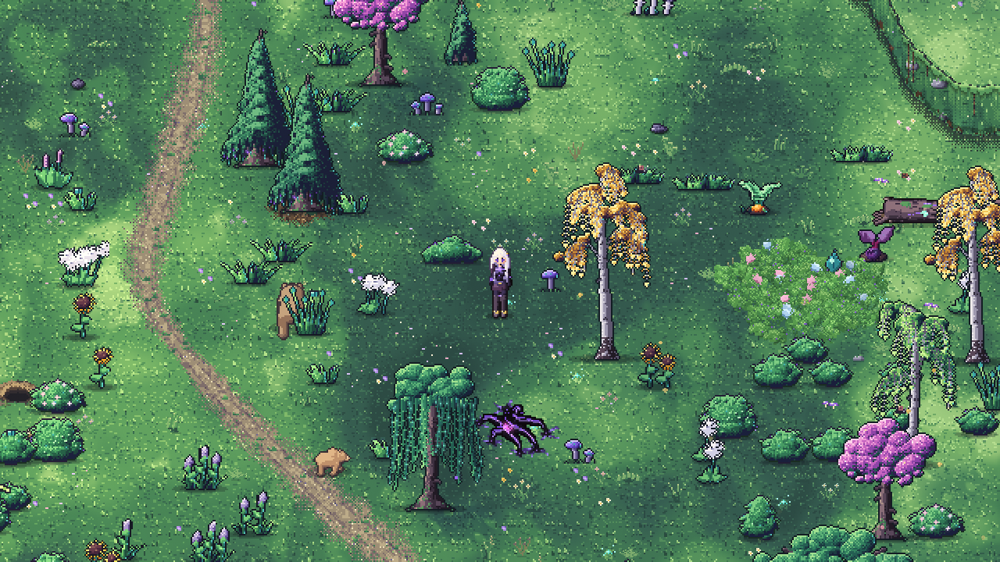
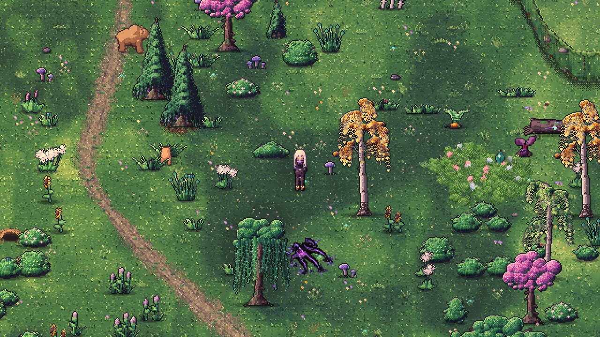

# Tageslicht: Licht, das die Welt berührt

Stand: 09.11.2026. **Umgesetzt.** Die folgende Analyse hält das Zielbild und die damaligen Befunde fest; der Umsetzungsstand steht hier direkt darunter.

## Umsetzungsstand

- `DaylightField` hält eine 128×96-R8-Deckungsmaske aus geladenen Baumkronen. Aktualisierung alle 0,33 s und bei Kamera-Teleports/Vergrößerung der Sichtfläche; keine Baumabfrage pro Bild. Fällen, Wachstum und Entladen fließen über den aktuellen Baumzustand ein. Die Sichtbarkeits-Transparenz der Kronen beeinflusst die Deckung nicht.
- `daylight.gdshaderinc` liefert weltverankerte Wolken, windbewegtes Fleckenlicht und lokale warm/kühle Beleuchtung. Boden, Felsen, Bäume, Flora, Wiesen- und Kleebüschel, Wasserpflanzen, Wasser, Relief, Figuren, Tier-Sprites, schwingende Dekoration und Bauwerke verwenden das Feld. Emissionsmaterialien und Warnflächen bleiben getrennt.
- Goldstundenlicht hat einen eigenen Anteil aus der bestehenden `golden_amount()`-Kurve; die Mittagsschwelle unterdrückt es nicht mehr. Schwächere konstante Füllung ersetzt den flächigen Helligkeitspuls. Abendtint `0.98/0.88/0.82` erhält kühlere Schatten.
- Maximal vier schwache, gebrochene Lichtschäfte an Baumstandorten liegen in Weltkoordinaten unter Figuren/Kronen (`z=-7`). Es sind stilisierte Lichtschäfte, keine geometrisch exakte volumetrische Lichtsimulation.
- Figuren und Tiere erhalten materialgebundene Akzente über ihre vorhandenen hellen Palettenpixel. Keine aufgeblähte Kontur und keine zusätzlichen Atlas-Abtastungen, die benachbarte Animationsframes einblenden könnten.
- 38 Pollen (Maximum 40), überwiegend 1 Pixel, blenden nach dem Neuplatzieren ein und reagieren auf dasselbe Lichtsignal wie die Oberflächen. Sichtfläche berücksichtigt Zoom. UI/Story, Innenraum und Mine unterdrücken Luft-Effekte.
- Wasserreflexe sind seltener, an Reflexbänder gebunden und sanft ein-/ausgeblendet. Lokale Sonne und Wolken steuern ihre Stärke.
- Tuning: `data/daylight.json`. Die neue Beleuchtungszeit pausiert mit dem Spiel. Keine Änderungen an Spielständen, Netzwerkzustand oder Treffergeometrie.

### Prüfung

`tools/test_daylight.tscn`: 15 bestandene Prüfungen in OpenGL Compatibility und Metal/Mobile: Baumdeckung, Weltverankerung, Kronen-Transparenz, Fällen/Nachwachsen/Entladen, Goldstunde, Innen-/Nachtabschaltung, UI, Zoom, Partikelbudget, Pause und CPU-/GPU-Lichtgleichheit. `tools/test_wind.tscn`: 0 Fehler, einschließlich gerenderter Wurzelverankerung und Pause. `tools/test_water_design.tscn`: 33 Prüfungen, 0 Fehler.

Echte Weltaufnahmen bei Morgen, Mittag, Goldstunde und Nacht; weiterer Ausschnitt mit Spielerin bei Tile (473, 656). Dort gemessene Maskenaktualisierung etwa 0,66–0,69 ms auf Apple M2/OpenGL, dreimal pro Sekunde. Das ist die CPU-Zeit der Maske, keine Messung der gesamten GPU-/Framekosten und keine Garantie für andere Hardware. `--phase=12` in der Preview fixiert Tageszeit und Lichtfeldphase; Tiere, andere vorhandene Effekte und Wind bleiben animiert.

### Aktuelle Ingame-Aufnahmen (Metal/Mobile)

Die folgenden Abschnitte dokumentieren Ausgangsbefund und Gestaltungsentscheidungen.

## Grundlage und Zielbild

Geprüft wurden `DayNight`, `TimeManager`, `ground_tone`, `sun_glow`, `DayMotes`, Baumaufbau, Flora-Windshader und die bestehende Tageslichtplanung. Dazu drei echte Aufnahmen mit `tools/preview_daylight.tscn`: 07:12, 12:00 und ca. 18:10 am Startpunkt (7306, 9756 Weltpixel), OpenGL Compatibility, ohne Spielerin. Die Aufnahmen belegen diesen Ausschnitt; Figuren, Wasser, dichter Wald, Bewegung und der Mobile-Renderer benötigen eine eigene Abnahme.

**Zielgefühl:** Eine kühle, verwunschene Landschaft, in die warme Sonne fällt. Unter Bäumen bleibt es satt und kühl. In einer Lichtung fangen Gräser und Haarspitzen Licht; einzelne Pollen werden beim Durchqueren eines Sonnenstrahls sichtbar. Gegen Abend bleibt der Schatten lavendelfarben, während wenige Kanten honiggolden aufleuchten.

## Was aktuell auffällt

- Mittag besitzt bereits starke, teils fast weißgrüne Sonneninseln. Sie geben Helligkeit, stehen aber sichtbar neben Bäumen und auf freier Wiese, ohne erkennbare gemeinsame Lichtgeometrie.
- Die Goldstunde färbt den Ausschnitt recht gleichmäßig oliv/ocker. Gerade dann gehen die markanten Sonnenflecken verloren: `ground_tone` aktiviert sie mit `smoothstep(0.35, 0.65, sun)`. Um 0.757 ist `sun` nur etwa 0.18, damit ist dieser Zweig aus, obwohl `golden` sein Maximum hat.
- `sun_glow` ist tatsächlich eine flache additive Aufhellung. Sie hebt auch dunkle Stellen an und pulsiert global. Der ältere Kommentar in `DayNight` und das alte Konzept beschreiben noch geformtes Licht bzw. Strahlen; der aktuelle Shader enthält diese nicht.
- Wolkenschatten und Lichtflecken entstehen im Gras-Palettenzweig von `ground_tone`. Vegetation, Felsen und Figuren erhalten dadurch nicht automatisch dieselbe örtliche Beleuchtung.
- Das vorhandene Laubfleckenmuster hängt an prozeduralem `macro`-Rauschen, nicht an tatsächlicher Baumdeckung.
- `DayMotes` hält aktuell bis zu 70 Partikel vor, davon die erste Hälfte mit 2×2-Pixel-Kernen. Position und Helligkeit berücksichtigen kein örtliches Sonnenlicht. Der ältere Text nennt noch 40.
- Morgendunst existiert schon in `NightAtmosphere` über `dew_amount()`. Dafür braucht es kein zweites unabhängiges Nebelsystem.

## Prioritäten

| Reihenfolge | Änderung | Visueller Gewinn | Aufwand |
|---|---|---|---|
| 1 | Goldstunde und globale Aufhellung abstimmen | Warme Highlights vor kühlen, satten Schatten | klein–mittel |
| 2 | Gemeinsames örtliches Sonnen-/Wolkensignal | Boden und Objekte fühlen sich wie dieselbe Welt an | mittel–hoch |
| 3 | Baumdeckung und gebrochenes Waldlicht | Wald, Waldrand und Lichtung erhalten eigene Stimmung | hoch |
| 4 | Pollen an lokale Helligkeit koppeln | Licht wird in der Luft sichtbar | mittel |
| 5 | Selektive Kantenlichter, Wasser und seltene Strahlen | Kleine magische Momente und stärkere Tiefe | mittel–hoch |

### 1. Farbe und Lichtkontrast

Die flache Sonnenaufhellung zunächst versuchsweise um etwa die Hälfte reduzieren; ihren globalen Sinuspuls entfernen. Das ist ein A/B-Startwert, kein fertig abgestimmter Wert. Den entfernten Lichtanteil gezielt in beleuchtete Flächen geben.

Goldene Beleuchtung braucht eine eigene Gewichtung innerhalb der vorhandenen zentralen Tageskurven: `sun` steuert weiterhin die Mittagssonne, `golden` die warmen, flach einfallenden Akzente. Die Sonnenflecken dürfen nicht vollständig am Mittagsschwellenwert hängen. Keine globale Änderung von `sun_amount()`, da Wasser, Flora und andere Effekte davon abhängen.

Abendwärme stärker in die Highlights verlagern und den globalen orangefarbenen Tint zurücknehmen. Schatten behalten kühl-violette Nuancen. Keine zusätzliche Vollbild-Sepiaebene. Die im Assetdesign festgelegte Lichtrichtung links oben erhalten; die Sonne nicht um die Szene rotieren lassen, solange die gemalte Beleuchtung fest ist.

### 2. Gemeinsames örtliches Licht

Ein gemeinsames, weltverankertes Lichtsignal für breite Wolkenschatten und freie Sonne entwickeln. Zunächst Boden und wenige repräsentative Objekte integrieren, dann Flora und Figuren. Wolken bewegen sich langsam über größere zusammenhängende Flächen; ihre Überquerung verändert auch Glints und Pollen.

Technischer Vorschlag: ein gemeinsames Shader-Include für das prozedurale Feld; eine kleine CPU-Abfrage oder niedrig aufgelöste Maske für Partikel und Baumdeckung. Nicht die teure Boden-FBM ungeprüft in jedes Material kopieren. CPU- und GPU-Auswertung müssen dasselbe Feld bzw. dieselbe Maske verwenden. Pausierbare Effektzeit und `WorldWind` statt voneinander unabhängiger `TIME`-Drifts.

### 3. Waldlicht mit einer sichtbaren Ursache

Aus geladenen Baumkronen eine grobe Deckungsmaske erzeugen, möglichst beim Chunk-Aufbau; bei Fällen, Wachstum und Entladen aktualisieren. Vorhandene Kronenmaße sind ein Ausgangspunkt, aber noch kein fertiges Schattenmodell. Darunter zusammenhängender kühler Schatten, darin kleine unregelmäßige Lücken aus Sonnenlicht. Die Lücken bewegen sich schwach mit dem Wind.

Kontakt-/Assetschatten behalten und zusätzliche Schatten vorsichtig dosieren, damit keine doppelten schwarzen Füße entstehen. Die Transparenz von Kronen zur Spielersicht darf die physische Deckung nicht einfach abschalten.

An ausgewählten Kronenlücken zwei bis vier schwache, unterbrochene Lichtschäfte als anfängliches Sichtbudget testen. Sie haben eine Quelle, eine gemeinsame Richtung und enden lokal. Sie bleiben an Weltpositionen, dürfen nicht als helle Tapete über Häusern oder Figuren liegen und benötigen passende Maskierung/Sortierung. Morgen und Abend betonen sie; am Mittag sind sie selten.

### 4. Lichtstaub statt überall gleich heller Funken

Partikel behalten, aber überwiegend als kleine, ruhige 1-Pixel-Körner. Größere Kerne und Kreuze seltener. Deckkraft ergibt sich aus örtlicher Sonne, Lebensphase und Tageszeit: ein Korn driftet aus dem Schatten ins Licht, leuchtet kurz auf und wird danach wieder unscheinbar. Das macht die vorhandene Bewegung erzählerisch lesbar.

Als Startwert 25–40 sichtbare Körner bei normalem Zoom testen. Weltgröße und Kamera-Zoom korrekt berücksichtigen: `_view_rect()` transformiert derzeit nur den Ursprung, nicht die Ausdehnung. Ein- und Ausblenden an den Sichtgrenzen ergänzen, statt neu positionierte Körner sofort voll sichtbar werden zu lassen. Karte, Räume, Mine sowie Story-/UI-Sperren konsistent behandeln.

### 5. Materialgebundene Höhepunkte

An Ellie zuerst Haar, Schulter und Metall auf der beleuchteten Seite testen. Wenige helle Pixel, keine vollständige goldene Umrandung. Tiere analog sparsam. Da Wind- und Animationsshader bereits UVs verändern, müssen Highlights dieselbe Verformung und Atlasgrenzen beachten; eine separate Autorierungsmaske kann sauberer sein als eine generische Konturerkennung.

Wasser hat bereits Sonnenreflexe und Kaustik. Diese an dasselbe Wolkensignal koppeln und in kleinen Reflexgruppen bündeln. Für Waldlicht, Wasser und Partikel gemeinsam eine visuelle Hierarchie festlegen: Pro Ausschnitt ein dominanter Lichtmoment, die übrigen Effekte bleiben leise.

## Erster sinnvoller Umsetzungsschritt

Ein begrenzter Look-Pass nur auf `sun_glow`, `ground_tone` und der Tageslichtsteuerung: flache Aufhellung reduzieren, Goldstunden-Flecken ermöglichen, warm/kühl trennen und Flecken weniger weiß ausbrennen lassen. Danach Vergleich am selben Ort. Erst auf dieser abgestimmten Basis Deckungsmaske, Strahlen und Figurenlicht ergänzen.

## Abnahme

- Gleiche Kamera bei Morgen, Mittag, Goldstunde und Nacht; zusätzlich Wald, Lichtung, Fluss und Hütte, jeweils mit Spielerin.
- Kurze Bewegungsaufnahme: Kameraschwenk, Zoom, Ein-/Austritt aus Baumschatten, Wind, Baumfällen und Chunkwechsel. Licht darf nicht mit der Kamera rutschen oder an Chunkgrenzen springen.
- Feste Zeit und reproduzierbare Effektphase für echte A/B-Bilder. Das aktuelle Preview wartet Frames bei laufender Uhr; für präzise Vergleiche Uhr und Effektphase explizit einfrieren.
- Prüfen, dass Warnflächen und Silhouetten dominant bleiben, Räume/Mine keine Sonne erhalten und die Nacht unverändert wirkt.
- Kosten im dichten Wald vor/nachher messen, im Zielrenderer und Compatibility. Feste Budgets, keine pro-Frame-Suche durch alle Bäume und keine Echtzeit-Schattenlampe pro Partikel.
- Erfolgskriterium: Auch ohne Pollen wirkt die Szene sonnig; auch ohne globalen Goldfilter wirkt der Abend warm. Die Effekte unterstützen eine bereits lesbare Lichtkomposition.
