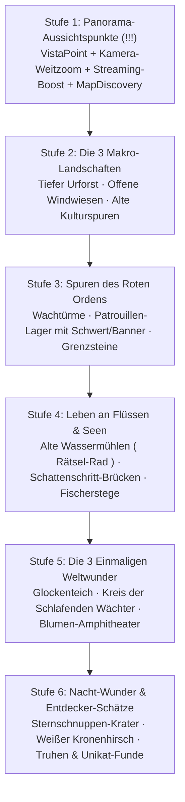

# Wiesenbiom-Ausbau – Master-Konzept („Die Lebendige Wiese“)

> **Status:** Konzeption & Stufenplan (abgestimmt am 2026-11-14, noch nichts implementiert).
> **Fokus:** Ausschließlich das gemeinsame Standard-Biom **`meadow`** (~500.736 Tiles über die fünf Überregionen *Die Lichtung*, *Nebelwald*, *Glasklippen*, *Versunkene Ruinen* und *Das Leerenblühen*). Hexenwald (`witch_forest`) und Sonnenquarz-Öde (`quartz_desert`) bleiben komplett unangetastet.
> **Grundregel (`CLAUDE.md` / `GEMINI.md`):** Gebackene Höhen, Kollisionen, Küstenlinien (`land_sdf.png`), Flüsse und Spielstände bleiben kompatibel; alle neuen Systeme sind **streng statisch getypt**, **datengetrieben (`res://data/*.json`)**, **Multiplayer-first (Host-authoritativ)** und multithreading-sicher (`Jobs`).

---

## 1. Vision & Leitgedanke

Aktuell erzeugt der `PropGenerator` durch eine kurzwellige Noise (`_zone`, Wellenlänge ~28 Tiles) auf fast jedem Chunk denselben statistischen Mix aus Tannen, Birken, Büschen und Blumen, während außerhalb des Glimmrast-Startclusters kaum handfeste Entdeckungen warten.

Ziel dieses Ausbaus ist es, das Wiesenbiom in eine **unvergessliche, erzählerische Entdecker-Welt** zu verwandeln, ohne ein neues Biom abzuspalten:
1. **Großräumige Natur-Dramaturgie (Makro-Habitate):** Wer 150 Tiles wandert, durchquert spürbar andere Landschaftsräume – vom dichten, schummrigen **Tiefen Urforst** über baumlose, summende **Offene Windwiesen & Blütenmeere** bis hin zu **Alten Kulturspuren** vergangener Siedler.
2. **Belohnte Vertikalität (`!!!!!!!!` Priorität: Panorama-Aussichtspunkte):** Hohe Klippenkanten (Ebene 2–3) sind keine Sackgassen mehr, sondern schenken ruhige Gänsehaut-Momente mit weitem Kamera-Zoom (inkl. vorab gestreamter Chunks!), sanfter Weitblick-Musik und großzügiger `MapDiscovery`-Aufdeckung.
3. **Physische Geschichte am Weg & am Wasser:** Spuren von **Valdrics Rotem Orden**, **alte Wassermühlen, gebrochene Steinbogenbrücken (Schattenschritt!) und Fischerstege** erzählen wortlos die Geschichte des Landes vor der Leere.
4. **Drei einmalige Weltwunder (Hero Landmarks):** **Der Glockenteich**, **Der Kreis der Schlafenden Wächter** und **Das Blumen-Amphitheater** – drei handplatzierte Unikate, über die man ohne Questmarker stolpern kann.
5. **Mut zur Nacht (Nacht-Wunder):** Die Nacht ist nicht mehr nur Bedrohung, sondern birgt **Sternschnuppen / Sternsplitter** und den friedlichen **Weißen Kronenhirsch**, der nur Schleichern (`sneak`) ein Relikt freischarrt.

---

## 2. Geografische Einbettung im Wiesenbiom

```text
                    [Sonnenquarz-Öde (unberührt)]
         ┌────────────────────────┴────────────────────────┐
         │  DAS LEERENBLÜHEN             VERSUNKENE RUINEN │
         │  Arena (499,258)              See (805,429)     │
         │                               ★ Glockenteich    │
  ───────┼────────────────────────┬────────────────────────┤
  Hallgrat│  GLASKLIPPEN          │  NEBELWALD             │
  (150,350)  ★ Schlafende Wächter │  Tiefer Urforst-Kern   │
         │  Aussichtsklippen      │  Glimmrast (786,676)   │
  ───────┼────────────────────────┼────────────────────────┤
         │  DIE LICHTUNG          │      [Hexenwald        │
         │  Windwiesen & Kultur   │       (unberührt)]     │
         │  ★ Blumen-Amphitheater │                        │
         └────────────────────────┴────────────────────────┘
```

**Schutzzonen (bleiben 100 % frei von Makro-Überschreibungen und Zufalls-POIs):**
- Glimmrast & Start-Story-Korridor (`manhole` -> `quarry` -> `hut` -> `cabin` -> `gustav` -> `torben`, inkl. `TownManager`-Baugebiet).
- Hallgrat (`style_rect` auf dem Glaskamm + Westweg-Trasse).
- Mornaths Boss-Arena `(499, 258)` + Schutzring.
- Alle 8 bestehenden `WaystoneStatue`-Plätze und 20 bestehenden `WorldTrial`-Rätsel.

---

## 3. Detaillierte Konzeption aller 11 Bausteine

---

### Säule A – Die 3 Makro-Landschaften (`MeadowHabitats`)

Statt `_zone` überall gleich auszuwerten, erhält das Wiesenbiom ein deterministisches, reines Funktionsmodul **`MeadowHabitats`** (`src/world/meadow_habitats.gd`, thread-sicher für `PropGenerator`-Worker!), das aus zwei niederfrequenten Domain-Warped-Noises (`freq ≈ 0.0045`, also **Zonen von ~140–240 Tiles Durchmesser**) sowie Relief-Höhe und Wasserabstand für jede Kachel Gewichte liefert:
- `normal_meadow` (~48 % der Fläche – der gewohnte Mix bleibt als Rückgrat erhalten)
- `deep_forest` (~20 % – bevorzugt in *Nebelwald* & schattigen Mulden)
- `wind_meadow` (~18 % – bevorzugt in *Die Lichtung* & auf weiten Süd-/West-Ebenen)
- `old_pasture` (~14 % – sanfte Ebene-0/1-Fluren zwischen *Lichtung*, *Nebelwald* und *Versunkene Ruinen*)

Weiche Übergangssäume (`24–32 Tiles` Smoothstep) verhindern jede harte Kante.

#### A1. Der Tiefe Urforst („Dunkeltannen-Dom“)
- **Silhouetten & Bewuchs:**
  - Neue Prop-Art **`ancient_fir` (Urtanne)** (`tools/art_ancient_fir.py`): **doppelt so breiter Stamm und ausladendes Kronendach** (`foot ≈ 26 px`, `crown ≈ 68 px`, 3 Varianten, dunkel-bläulichgrüne Nadeln mit kühlem Pflaumenschatten gemäß `docs/design_guide.md`).
  - Dichte Bestände aus Urtannen + hohen Alttannen, **fast keine Birken**, **0 Wiesenblumen**.
  - **Unterboden:** Durchgehende Teppiche aus `forestbed` + neue bodennahe **Moosteppiche (`moss_carpet`)**, dichte **Farnmeere** (`fern` Cluster x4), doppelt so häufige bemooste **Riesen-Fallstämme** (`FallenLog` Großvariante) und **Pilzringe** (`mushroom_ring`: 7–11 Glimm-/Waldpilze im natürlichen Oval).
- **Licht & Atmosphäre (Tag & Nacht):**
  - Geschlossenes Kronendach wirft breiten `g_day_cover`-Schatten (tagsüber spürbar kühler und dämmriger).
  - **Goldene Lichtschächte (`SunbeamShaft`, `src/fx/sunbeam_shaft.gd`):** Wo eine kleine Lücke im Kronendach ist, fallen tagsüber (`sun_amount > 0.25`) schräge, weich geditherte goldene Sonnenstrahlen mit langsam tanzenden Staubpartikeln auf Moos oder Waldschreine; nachts werden sie zu kühlen silbernen Mondschächten.
- **Leben & Entdeckung:**
  - Höhere Chance auf **Eulen** (`WildlifePopulation` Habitat-Bonus im Urforst, tagsüber schlafend in Urtannen, nachts rufend).
  - **Versteckte Waldschreine (`ForestShrine`):** Kleine, mit Moos und Wurzeln überwachsene Steinnischen unter Urtannen. Legt man eine Waldbeere/Pilz ab oder berührt sie (`E`), schenkt der Schrein einen ruhigen Natur-Segen (z. B. sanfte Heilung/Ausdauerruhe + kleiner Entdeckungsfund) oder öffnet eine überwucherte *Wurzelkiste*.

#### A2. Offene Windwiesen & Blütenmeere
- **Silhouetten & Bewuchs:**
  - Über **100–200 Tiles kein einziger Nadelbaum** (`fir`, `ancient_fir`, `spruce` komplett unterdrückt; auch Felsgruppen selten).
  - Endlos wirkendes, im `WorldWind` in sichtbaren **Wellenbändern** wogendes Gras (`ground_tone.gdshader` verstärkt Windwellen in `wind_meadow`).
  - **Monokultur-Leitblumenfelder:** Statt buntem Streumix wählt jede Windwiese per Seed **eine dominante Leitblume** (z. B. ein ganzer Hang nur leuchtendes *Goldauge* + *Klee*, oder ein Meer aus *Windglöckchen* + *Sonnenklee*), durchzogen von hunderten Halmen.
- **Leben:**
  - Deutlich dichtere **Bienen- und Schmetterlingsschwärme** (`ButterflyPopulation` & `TinyPopulation` lesen `wind_meadow`-Gewicht), gelegentlich wilde **Bienenstöcke** an Solitärbäumen (Honigwabe erntbar, ohne Tiere zu verletzen).
- **Herzstück auf der Kuppe – Der Solitärbaum (`SolitaryTree`):**
  - Pro großer Windwiese steht auf dem höchsten/offensten Punkt **genau ein mächtiger, knorriger Solitär-Laubbaum** (alte Eiche / Windlinde, breite Krone, bewegtes Laub im Wind).
  - Darunter hängt entweder eine **im Wind sanft pendelnde Holzschaukel** an einem starken Ast oder es steht eine **verwitterte Holzbank** (`SeatSpot`-Unterklasse: man kann sich wirklich mit `E` hinsetzen!). Oft liegt im Wurzelwerk eine alte Erinnerungsdose / *Wurzelkiste*.

#### A3. Alte Kulturspuren („Verlassenes Weideland“)
- **Wortloses Environmental Storytelling („Hier lebten vor der Leere Menschen“):**
  - **Überwachsene Trockensteinmauern (`DryStoneWall`):** Niedrige, gebrochene Feldsteinmauern (`tools/art_pasture_ruins.py`), teils im Gras versunken, mit Lücken zum Durchlaufen, Moospolstern und Sitzvögeln darauf.
  - **Verfallene Holzzäune & Weidetore:** Schief stehende Zaunpfosten, gebrochene Querriegel, ein halb offenes altes Gatter.
  - **Verwilderte Obstgärten (`OldOrchard`):** 6–12 alte, knorrige **Apfel- und Mondbirnenbäume** in noch erkennbaren ehemaligen Pflanzreihen! Unter den Kronen liegt sammelbares **Fallobst** (`meadow_apple`, `moon_pear` – essbar & als neues Kochzutat nutzbar; wächst alle paar Tage nach, Zustand in `things` gespeichert).
  - **Versinkende Pflasterwege:** Kurze Stücke alter Hof- und Feldpflasterung (`stone_cells`-artig gebacken oder als Boden-Decal), die nach 20–40 Tiles im hohen Gras auslaufen – folgt man ihrer Richtung, stößt man oft auf einen überwucherten Brunnenrand, Fundamentsteine oder eine alte Hofkiste.

---

### Säule B – Aussichten & Physische Geschichte (Micro-POIs)

#### B1. Aussichtspunkte / Panorama-Rastplätze (`VistaPoint`) — **HÖCHSTE PRIORITÄT (`!`)**
Auf den schönsten Klippenkanten der **Ebenen 2 und 3** (12–16 handverlesene Kanten mit freiem Blick über Täler, Seen, Flüsse oder Weltwunder) liegt ein **flacher, windgeschliffener Aussichtsfels** oder ein **bemooster Sitzstamm** direkt an der Abbruchkante.

- **Ablauf beim Hinsetzen (`E -> "AUSSICHT GENIESSEN"`):**
  1. `VistaPoint` erbt direkt von `SeatSpot` und nutzt euer fertiges, repliziertes `RestComponent` (Ellie läuft hin, setzt sich in Blickrichtung der Klippe, im Koop können Mitspieler daneben stehen oder auf einem zweiten Platz sitzen!).
  2. **Sanfter Kamera-Weitblick (lokal pro sitzendem Peer):**
     - Die Spieler-`Camera2D` fährt über `1.8 s` butterweich (`Tween` `TRANS_SINE`, `EASE_IN_OUT`) von `zoom = Vector2(1.0, 1.0)` auf **`zoom = Vector2(0.55, 0.55)`** heraus (fast **4-fache Weltfläche** im Bild: `~1160 × 650 px` statt `640 × 360 px`!) und verschiebt den Bildmittelpunkt um `~90 px` in Blickrichtung über das Tal.
     - **Technisch entscheidend (Chunk-Streaming-Radius!):** Da `WorldLevel.LOAD_RADIUS` normal `1` Chunk (`512 px`) beträgt, würden bei `zoom = 0.55` ungeladene Chunk-Ränder ins Bild ragen. Deshalb meldet ein aktiver `VistaPoint` dem lokalen/Host-Streamer einen temporären **`vista_focus` (`LOAD_RADIUS = 2` in Blickrichtung)** an – die Tal-Chunks werden im Hintergrund vorgeladen, sodass man **echte Bäume, Flüsse, Seen und Silhouetten ferner Ruinen/Schreine** ohne Pop-in sieht!
     - Dezente Kino-Rahmung: HUD blendet sanft auf `alpha = 0.0` aus (nur ein stiller kleiner Hinweis unten rechts `[E / Bewegung] Aufstehen`), leichter atmosphärischer Dunst am Horizont.
  3. **Musik-Moment (`MusicDirector.set_vista_mode(true)`):**
     - Solange keine Schattenkreatur in Kampfnähe ist, blendet der normale Loop weich um `-6 dB` zurück und ein weiter, luftiger **Panorama-Klangteppich** (`assets/audio/music/vista.(ogg|mp3)` + sanfter Höhenwind) öffnet sich.
  4. **`MapDiscovery`-Aufdeckung & Karten-Eintrag:**
     - Nach `2.2 s` ruhigem Sitzen ruft der Host einmalig `MapDiscovery.reveal_disc(vista_focus_tile, 22.0)` auf (**~88 Tiles Radius = fast 3× so weit wie normales Laufen**, versetzt in Tal-Blickrichtung!).
     - Auf der Karte (`M`) erscheint ein dezentes Panorama-Symbol; beim ersten Entdecken gibt es einen leisen Entdeckungs-Gong, den Ortsnamen in geschwungener Schrift (*„Kanzel über dem Nebeltal“*, *„Glaskamm-Blick“* …) und kleine Entdeckungs-XP.
  5. **Aufstehen:** Jeder Bewegungsinput oder `E`/`Esc` zoomt über `0.9 s` weich auf `Vector2.ONE` zurück und blendet das HUD wieder ein. Nimmt Ellie Schaden, bricht `RestComponent` wie gewohnt sofort sauber ab.

#### B2. Spuren des Roten Ordens (Valdrics Vergangenheit)
Verbindet die Wiese direkt mit Hallgrats *Rothalle* (`docs/stadt_westen_konzept.md`) und Valdrics Geschichte – verteilt auf **8–10 markante Stellen** (an alten Pässen, Klippen und Straßenkreuzungen):
1. **Halb eingestürzter Ordens-Wachturm (`OrderWatchtower`, 3 Standorte auf Ebene-1/2-Spornen):**
   - Rundes/eckiges Bruchstein-Gemäuer, eine Hälfte weggebrochen, hölzerne Wehrgang-Reste, verwittertes karminrotes Wappen im Stein. Im Inneren/Hof: kalte Wachfeuerstelle, Waffenständer-Trümmer, eine *Mondsiegeltruhe* oder ein Ordens-Logbuch (Lore-Tafel über den Rückzug vor den Schatten).
2. **Überwucherter Patrouillen-Rastplatz (`OrderPatrolCamp`, 3–4 Standorte):**
   - Erloschene Feuerstelle zwischen Felsen, ein **tief in den Boden gerammtes, verrostetes Ordensschwert** (umrankt von Efeu/Klee), eine zerfetzte **rote Stoffstandarte**, die im `WorldWind` weht (`sway_rows`), und ein lesbarer Marschbefehl / Schildrest. *(Optional: Ist Valdric bereits in Glimmrast, schaltet das Untersuchen eines bestimmten Schwerts eine optionale Gesprächszeile bei ihm frei!)*
3. **Alte Ordens-Grenzsteine (`OrderBoundaryStone`, 4–5 Standorte an Regionsübergängen):**
   - Schief gesunkene Steinstelen mit dem eingemeißelten roten Mantelsiegel und verwitterten Inschriften (*„Bis hierher bürgt die Dritte Wacht“*), die Reisenden Orientierung und Welttiefe geben.

#### B3. Alte Wassermühlen, Gebrochene Steinbogenbrücken & Fischerstege
Macht eure gebackenen Flüsse und die 8 Wiesenseen zu lebendigen Schauplätzen (**10–14 Wasser-POIs**):
1. **Alte Wassermühle (`OldWatermill`, 2–3 Standorte an kräftigen Flussläufen):**
   - Halb überwuchertes Steinhaus direkt am Flussufer mit einem großen **hölzernen Wasserrad**, das im Flusswasser steht.
   - **Kleine Umwelt-Interaktion:** Bei einer Mühle klemmt Treibholz/Wurzelwerk im Rad – das Rad ruckt und ächzt. Zerschlägt man das Treibholz mit Axt/Schwert oder zieht den Keil (`E`), beginnt sich das **Mühlrad knarzend zu drehen** (echte Sprite-Rotation + Wasser-Splash-Partikel!), die hölzerne Welle im Inneren entriegelt die **Mühlenkammer** (`Interiors`-Raum) mit Kornsäcken, altem Mahlwerk, Kochrezept und *Wurzelkiste*! Zustand wird in `SaveGame` gespeichert.
2. **Gebrochene Steinbogenbrücken (`BrokenStoneBridge`, 3–4 Standorte über tiefe Flussläufe):**
   - Alte, bemooste Steinwiderlager an beiden Flussufern mit abgebrochenem Mittelbogen über dem tiefen, nicht watbaren Flusskern (`RiverDepth`).
   - **Gameplay-Clou:** Zu Fuß ist die Brücke eingestürzt – aber die Lücke (`~48–64 px`) ist exakt so bemessen, dass man mit **Schattenschritt (`Alt`)** spektakulär von Bogenstumpf zu Bogenstumpf über den Fluss setzen kann! (Auf einem isolierten Mittelpfeiler einer großen Brücke kann sogar eine Kiste warten.)
3. **Verlassene Fischerstege & Ruderboote (`FisherPier`, 5–6 Standorte an Seen & stillen Flussbuchten):**
   - Verwitterte Holzstege, die ins Flach-/Tiefwasser ragen (begehbar!), mit alter Reuse, aufgehängtem Netz, Angelhocker (`SeatSpot` – man kann vom Stegende aus angeln, mit kleinem Ruhe-/Beiß-Bonus für `FishingComponent`!) und einem halb im Schilf liegenden, bemoosten **Ruderboot-Wrack**, in dem Köder, Angelschnur oder eine Flaschenpost liegen.

---

### Säule C – Die 3 Einmaligen Weltwunder (Hero Landmarks)

Jedes dieser drei Bauwerke existiert **exakt einmal** in der gesamten Welt (`src/world/meadow_wonders.gd` + `data/meadow_wonders.json`). Alle sind komplett host-authoritativ synchronisiert (`SaveGame`-Key `"meadow_wonders"`), tauchen nach Entdeckung mit eigenem Gold-Icon auf der Karte auf und belohnen mit einzigartigen Fundstücken.

#### C1. Der Glockenteich (*Versunkene Ruinen*, z. B. im Waldsee `lake_768_376` oder eigener stiller Kesselsee)
- **Tagsüber:** Ein stiller, von Trauerweiden und Nebel gesäumter Waldsee. Mitten aus dem tiefen Wasser ragt die schräge, bemooste **Steinspitze eines versunkenen Glockenturms** mit einer alten Bronzeglocke im Gestühl. Tagsüber sitzen **Eisvögel** (`river_fauna` / eigener Perch-Punkt) auf dem Dachfirst und tauchen ins Wasser; vom Ufer aus sieht man unter der Wasseroberfläche nur schemenhaft alte Mauerbögen schimmern.
- **Das Mitternachts-Wunder (nur in klaren Nächten um Mitternacht, `time_of_day` `0.95 .. 0.06` & Wetter nicht `rain`/`storm`):**
  1. Punkt Mitternacht schlägt die Glocke **einmal tief, warm und dumpf** (räumlicher Glockenklang über den ganzen See, konzentrische gold-türkise Wellenringe über das Wasser via `WaterRipples`).
  2. Vom Südufer bis zur Turmspitze tauchen **9 versunkene Runen-Trittsteine** knapp bis zur Wasseroberfläche auf und leuchten sanft bläulich-golden im `Unlit`-Pass (`StaticBody2D`-Brücke bzw. begehbarer Furt-Korridor bis ~01:30 Uhr Spielzeit!).
  3. Läuft man über die leuchtenden Steine zur Turmspitze hinaus, kann man im Glockenstuhl ein **uraltes Relikt / Glutreliquiar** bergen (und danach die Glocke auch selbst einmal anschlagen). Wer vor Sonnenaufgang noch draußen steht, wird sanft zurück ans Ufer getragen oder schwimmt heim (`SwimComponent`).

#### C2. Der Kreis der Schlafenden Wächter (*Glasklippen* / neblige Hochebene auf Ebene 2/3)
- **Das Bild:** Auf einem weiten, leicht nebligen Hochplateau stehen im großen Kreis **sieben haushohe (`~96 px` hohe), uralte bemooste Steinstatuen** mit gesenkten Häuptern und steinernen Feuerschalen vor der Brust. Sechs stehen aufrecht in stiller Ruhe – **der siebte Wächter ist geborsten**, sein bemooster **Kopfstein** liegt ein Stück abseits im Heidekraut/Geröll.
- **Das zweistufige Rätsel (kombinierbar im Koop!):**
  1. **Stufe 1 – Den Siebten ehren:** Ellie hebt den verlorenen steinernen Wächterkopf / das Stirnsiegel auf (**nutzt euer vorhandenes `CARRY_STONE_SHEET` aus `StarMirror`!** – langsames Tragen ohne Sprint) und setzt ihn auf den Sockel des zerbrochenen siebten Wächters (`E -> "EINSETZEN"`). Ein tiefer Steinklang geht durch den Plateau-Boden.
  2. **Stufe 2 – Die Schalen der Dämmerung:** Jeder Wächter trägt an seinem Sockel eine verwitterte Kerben-Zahl (1–7 Striche / Mondphasen, teils unter Moos oder im Schatten versteckt, sodass man genau hinschauen muss). Entzündet man die sieben Steinschalen in der richtigen Reihenfolge (`E`), läuft eine türkis-goldene Lichtwelle von Statue zu Statue.
- **Belohnung:** Die Augenkerben aller sieben Wächter glimmen warm auf (bleiben dauerhaft ein sicherer Lichtkreis auf dem Plateau!), in der Kreismitte hebt sich ein Steinaltar mit **einmaligem Wächter-Segens-Echo** (dauerhafter kleiner Charakter-Segen oder einzigartiger *Talisman der Steinwacht* + *Mondsiegeltruhe*).

#### C3. Das Blumen-Amphitheater („Die Stille Bühne“, *Die Lichtung*)
- **Das Bild:** Ein geschützter, natürlicher Talkessel (sanfte Ebene-1-Ränge rings um eine runde Ebene-0-Senke), komplett ausgekleidet mit **hunderten leuchtenden Mondblumen** (`moon_flower`), gesäumt von überwucherten steinernen Sitzstufen. Im Zentrum liegt ein kreisrundes, gerissenes **altes Steinpodium** mit eingravierten Klangringen.
- **Das Erlebnis:**
  - **Tagsüber:** Ein friedlicher Ort voller Schmetterlinge; auf den Steinstufen kann man sitzen (`SeatSpot`).
  - **Nachts (`TimeManager.is_night()`):** Alle Mondblumen an den Hängen öffnen ihre Kelche und glühen blau-silbern. Betritt Ellie das Steinpodium und interagiert mit dem Resonanzstein in der Mitte (`E -> "ANKLINGEN LASSEN"`), erheben sich aus den Blumenhängen **30–50 gold-türkise Irrlichter**, die in einer choreografierten Spirale um die Bühne tanzen, während eine zarte, ätherische Melodie erklingt.
  - **Spielerische Pointe:** Bleibt man während des Irrlicht-Tanzes kurz ruhig im Kreis (oder folgt den drei Leit-Irrlichtern auf den Klangringen im Takt), kondensiert das Licht in der Mitte zu einer einmaligen Belohnung (einzigartiger Bauplan für Glimmrast: *Mondblumen-Laterne / Klangschale* + seltene *Mondblumen-Samen* für die eigene Farm!). Auch nach dem Lösen tanzen die Irrlichter dort jede Nacht weiter – ein magischer Treffpunkt für Koop-Abende.

---

### Säule D – Nacht-exklusive Wunder (`NightWonders`)

Ein eigener, leichtgewichtiger Host-Regisseur **`NightWonders`** (`src/world/night_wonders.gd`, Kind von `WorldLevel`, pausierbar, unabhängig vom Kampf-Budget des `NightDirector`), der die Nacht im Wiesenbiom mit **Staunen statt nur Angst** auflädt:

#### D1. Sternschnuppen & Sternsplitter (`StarfallEvent`)
- **Auslösung:** Ab Nacht 2 prüft der Host pro klarer/leicht bewölkter Nacht (`clear`, `fair`, `broken`) mit einer Chance von **~28 % pro Nacht** (höher um Neumond, wenn der Himmel besonders dunkel ist) einen Zeitpunkt zwischen `21:30` und `02:30` Uhr.
- **Das Himmels-Schauspiel (auf allen Peers sichtbar via kompaktem RPC `_rpc_starfall(origin_world, target_world, seed)`):**
  1. Hoch über dem Bildschirm zieht ein **heller, weiß-goldener Lichtschweif** schräg über das Nachtbild (`CanvasLayer` / Welt-VFX mit Funkenspur + fernes kristallines Singen und ein sanftes, dumpfes Rollen 1,5 Sekunden später).
  2. Die Richtung des Schweifs verrät ehrlich die **Himmelsrichtung des Einschlags**! Der Zielpunkt wird vom Host in **55–130 Tiles Entfernung** auf freiem Wiesenboden (außerhalb von Stadt, Wasser und Sperrzonen) gewählt.
- **Der Einschlagkrater bis zum Morgengrauen:**
  - Am Zielpunkt liegt ein kleiner, rauchender **Sternenkrater** (aufgeworfene dunkle Erde, warm glühende gold-violette Risse, sanftes `NightLight`, das sogar Schattenkreaturen im kleinen 3-Tile-Radius auf Abstand hält!).
  - Mit der Spitzhacke oder per `E` birgt man **2–4 warme `star_shard` (Sternsplitter / Sternerz)** – ein besonderes Material für Schmuck/Talismane, Stab-Veredelung bei Ilva/Torben oder eine ewige Sternlaterne in Glimmrast.
  - **Vergänglichkeit:** Wird der Krater bis Sonnenaufgang (`06:00` Uhr) nicht geborgen, kühlt er aus und zerfällt zu normalem Gestein – es lohnt sich also wirklich, nachts dem Schweif am Himmel nachzujagen!

#### D2. Der Weiße Kronenhirsch (`SpiritStag`)
- **Philosophie:** 100 % im Einklang mit eurer friedlichen Wildtier-Regel (**kann nicht angegriffen oder verletzt werden**, keine Hurtbox!). Er ist kein Beutetier, sondern ein scheues, fast heiliges Waldwesen.
- **Auslösung & Ort:** In ruhigen Nächten (bevorzugt bei **Halb- bis Vollmond** oder leichtem Nebel) kann auf einer stillen Waldlichtung / am Rand des *Tiefen Urforsts* (`45–90 Tiles` vor einer Spielerin, wenn keine Schattenkreatur im 15-Tile-Umkreis tobt) **ein einzelner Weißer Kronenhirsch** erscheinen:
  - Elfenbeinweißes Fell mit feinem silber-türkisem Schimmer im Geweih (`Unlit`-Geweihspitzen + zarter Lichtschein am Boden, leise glimmende Hufabdrücke im Moos).
- **Die Schleich-Begegnung (`sneak` als Schlüssel!):**
  - **Wer rennt, sprintet oder das Schwert schwingt:** Ab `180 px` hebt der Hirsch wachsam den Kopf (Ohren spielen, Geweih glimmt heller = klares visuelles Signal!). Läuft man ungeduckt weiter näher als `135 px`, setzt er in zwei weiten, lautlosen Sprüngen davon und löst sich im Silbernebel zwischen den Bäumen auf. Kein Frust, aber die Chance für diese Nacht ist vorbei.
  - **Wer schleicht (`InputManager` `sneak` / geduckter Gang):** Der Hirsch beobachtet Ellie ruhig, senkt vertrauensvoll den Kopf, **scharrt dreimal mit dem Vorderhuf im Moos**, verneigt sich leicht und schreitet langsam in den Nebel davon.
  - **Der Fund:** An der gescharrten Stelle leuchtet im Moos ein **ausgegrabenes Wald-Relikt** (`ItemDrop` / Moos-Kästchen: z. B. *Kronenharz*, *Geweih-Talisman der leisen Sohle*, seltener Samen oder altes Schmuckstück).

---

## 4. Gebündelter Umsetzungs-Fahrplan (6 logische Stufen)

Damit jedes Paket für sich sofort im Spiel spürbar, testbar und sauber abnehmbar ist (genau wie bei Sonnenquarz-Öde und Hexenwald), bündeln wir die Umsetzung in **6 aufeinander aufbauende Stufen**:



---

### Stufe 1: Panorama-Aussichtspunkte (`VistaPoint`) — *Sofortiger „Wow“-Moment (Priorität 1!)*
> **Warum zuerst?** Du hast diesen Punkt als `!!!!!!!!!!!!!! wichtig` markiert, er greift nicht in die Prop-Verteilung ein, nutzt euer fertiges `SeatSpot`/`RestComponent` und verwandelt eure bestehenden Ebene-3-Plateaus sofort in lohnende Ziele.

- **Daten & Standorte:** `data/vistas.json` – Scan aller schönsten Ebene-2/3-Klippenkanten im Wiesenbiom (14 handgeprüfte Punkte mit Blick über Seen, Flusstäler, Glimmrast-Tal, Glasklippen und Ruinenland).
- **Technik:**
  - `src/entities/props/vista_point.gd` (`extends SeatSpot`): Hinsetzen (`E`), sanfter Kamera-Tween (`zoom -> 0.55`, Blick-Offset ins Tal), weiches HUD-Ausblenden.
  - `WorldLevel`-Streaming-Erweiterung: temporärer `vista_focus` lädt den `2`-Chunk-Fächer in Blickrichtung vor, damit beim Herauszoomen keine leeren Ränder sichtbar sind.
  - `MusicDirector`: sanfter Panorama-Crossfade / Weitblick-Mix während des Sitzens.
  - `MapDiscovery`: einmaliges `reveal_disc(..., 22.0)` + Speicherung besuchter Aussichtspunkte in `SaveGame` (`"vistas"`) + Karten-Icon in `map_markers.json` + Ortsbanner.
- **Art:** `tools/art_vista_spot.py` (windgeschliffener Aussichtsfels + bemooster Klippen-Sitzstamm + kleines Steinmännchen).
- **Tests & Preview:** `tools/test_vistas.tscn` (Sitzen, Zoom, Chunk-Vorladen, `MapDiscovery`-Aufdeckung, Aufstehen bei Bewegung/Schaden, Koop-Sync) + `tools/preview_vista.tscn`.

---

### Stufe 2: Die 3 Makro-Landschaften (`MeadowHabitats`) — *Ende des „Tapeten-Effekts“*
> **Ziel:** Jede Himmelsrichtung fühlt sich landschaftlich eigenständig an, während alle bestehenden Story-Orte, Wege und Spielstände unangetastet bleiben.

- **Technik:**
  - `src/world/meadow_habitats.gd` + `data/meadow_habitats.json`: Deterministische, thread-sichere Habitat-Gewichte (`deep_forest`, `wind_meadow`, `old_pasture`, `normal_meadow`) mit Schutzzonen um Startcluster, Hallgrat, Arena und Seen.
  - Integration in `PropGenerator`:
    - *Tiefer Urforst:* `ancient_fir`, geschlossener `forestbed`-/Moosteppich, Farnmeere, Pilzringe, `SunbeamShaft`-Lichtschächte, Eulen-Habitatbonus, `ForestShrine`.
    - *Offene Windwiesen:* 0 Nadelbäume, großflächige Leitblumen-Drifts (*Goldauge*/*Klee* etc.), verstärkte Gras-Windwellen, Bienen-/Schmetterlingsdichte, 1 `SolitaryTree` mit Bank/Schaukel pro Kuppe.
    - *Alte Kulturspuren:* Modulare `DryStoneWall`-Segmente, morsche Holzzäune, `OldOrchard` (Reihen alter Apfel-/Mondbirnenbäume mit nachwachsendem Fallobst `meadow_apple` / `moon_pear`), versinkende Pflasterspuren.
- **Art:** `tools/art_ancient_fir.py`, `tools/art_solitary_tree.py`, `tools/art_pasture_ruins.py` (Trockenmauern, Zäune, Obstbäume, Waldschrein).
- **Tests & Preview:** `tools/test_meadow_habitats.tscn` (Determinismus, 0 Nadelbäume in Kern-Windwiesen, Urforst-Dichte, Schutzzonen-Integrität, Streaming-Budget-Check <= 2 ms) + `tools/preview_meadow_habitats.tscn`.

---

### Stufe 3: Spuren des Roten Ordens — *Valdrics Geschichte in der Landschaft*
> **Ziel:** Physisches Worldbuilding entlang alter Pässe, Klippen und Kreuzungen.

- **Daten & Standorte:** `data/meadow_pois.json` (Sektion `red_order`: 3 Wachturm-Ruinen, 4 überwucherte Patrouillen-Lager, 5 Grenzsteine – geprüft auf ebenem Boden außerhalb von Flüssen/Story).
- **Technik:**
  - `src/world/meadow_pois.gd` + `OrderWatchtower`, `OrderPatrolCamp`, `OrderBoundaryStone`: Prop-Blockierung in `WorldLevel`, wehende rote Bannerfetzen (`WorldWind`), lesbare Inschriften/Tagebuchtafeln (`DialogueBox` / Rinden-Notiz), verknüpfte *Wurzelkisten* / *Mondsiegeltruhen* und optionales Story-Flag `found_order_trace` für ein Gesprächsecho bei Valdric.
- **Art:** `tools/art_red_order.py` (Bruchstein-Turmruine, Schwert im Boden, zerrissenes Karmin-Banner, Ordens-Grenzstein).
- **Tests:** `tools/test_order_pois.tscn` (Kollisionen, Prop-Freihaltung, Interaktion, Save/Load).

---

### Stufe 4: Alte Wassermühlen, Steinbogenbrücken & Fischerstege — *Flüsse & Seen erwachen*
> **Ziel:** Wasserläufe und Ufer bekommen markante Silhouetten, Schattenschritt-Abkürzungen und kleine Umwelt-Rätsel.

- **Daten & Standorte:** `data/meadow_pois.json` (Sektion `water_works`: 2–3 Wassermühlen an echten Flusskanten aus `rivers_baked.json`, 3–4 gebrochene Steinbogenbrücken über Tiefwasser-Abschnitte, 6 Fischerstege mit Ruderbooten an den Wiesenseen).
- **Technik:**
  - `OldWatermill`: Blockiertes vs. befreites Mühlrad (synchronisierter Zustand in `SaveGame`), Öffnung der Mühlen-Innenkammer (`Interiors`-Eintrag in `data/interiors.json`).
  - `BrokenStoneBridge`: Begehbare Rampen-Widerlager links/rechts des Flusses mit kalkulierter **Schattenschritt-Lücke** über `RiverDepth`.
  - `FisherPier`: Begehbarer Holzsteg über Flachwasser (`Collision`-Ausnahme am Uferrand), `SeatSpot` am Stegkopf + `Ruderboot`-Fundstelle.
- **Art:** `tools/art_water_pois.py` (Mühlenhaus + animiertes Mühlrad, bemooste Steinbogenbrücke N/S & O/W, Holzsteg + Ruderboot im Schilf).
- **Tests:** `tools/test_water_pois.tscn` (Mühlrad-Reparatur & Interior-Tür, Schattenschritt über gebrochene Brücke, Steg-Begehbarkeit).

---

### Stufe 5: Die 3 Einmaligen Weltwunder — *Unvergessliche Unikate*
> **Ziel:** Drei große, geheimnisvolle Schauplätze mit eigener Mechanik, Klangwelt und einmaliger Belohnung.

- **Daten & Standorte:** `data/meadow_wonders.json` + Manager `src/world/meadow_wonders.gd` (`SaveGame`-Key `"meadow_wonders"`, voller Koop-Snapshot).
  1. **`BellPond` (Der Glockenteich):** Platzierung in einem der stillen Waldseen (z. B. `lake_768_376` in *Versunkene Ruinen*); Eisvogel-Sitzplatz am Tag, Mitternachts-Glockenschlag bei klarem Himmel, aufleuchtender 9-Steine-Pfad über `RiverDepth`, Bergung auf der Turmspitze.
  2. **`SleepingGuardians` (Der Kreis der Schlafenden Wächter):** Platzierung auf einem großen freien Ebene-2/3-Plateau der *Glasklippen*; 7 Riesenstatuen, tragbarer Kopfstein (`CARRY_STONE_SHEET` Reuse!), 7-Schalen-Reihenfolgerätsel, dauerhafter Lichtkreis + Wächter-Segen/Talisman.
  3. **`FlowerAmphitheater` (Das Blumen-Amphitheater):** Platzierung in einer natürlichen Senke in *Die Lichtung*; dichter Mondblumen-Ring, zentrales Klangpodium, nächtlicher Irrlicht-Spiraltanz + Belohnungs-Kondensation.
- **Art & Audio:** `tools/art_meadow_wonders.py` + `tools/audio_meadow_wonders.py` (dumpfer Unterwasser-Glockenschlag, Steinwächter-Akkord, Amphitheater-Klangringe).
- **Tests & Preview:** `tools/test_meadow_wonders.tscn` (alle 3 Wunder einzeln + Koop-Sync + Save/Load) + `tools/preview_meadow_wonders.tscn`.

---

### Stufe 6: Nacht-Wunder & Entdecker-Belohnungspaket — *Mut zur Nacht & Belohnungs-Sog*
> **Ziel:** Die Nacht im Wiesenbiom bekommt magische Höhepunkte, und alle neuen Orte aus Stufe 1–5 werden mit einzigartigen Fundstücken verknüpft.

- **Technik:**
  - `src/world/night_wonders.gd` (`NightWonders`, Host-gesteuert):
    - **`StarfallEvent`:** Nächtlicher Himmels-Schweif (Richtungsweisend!) -> temporärer `StarCrater` mit warmem Lichtschein & erntbaren `star_shard` bis Sonnenaufgang (`06:00`).
    - **`SpiritStag` (`src/entities/wildlife/spirit_stag.gd`):** Unangreifbares Geistertier auf stillen Nachtlichtungen; Wachsamkeits-/Fluchtlogik gegen Ungeduldige vs. Huf-Scharren & Relikt-Freigabe bei `sneak`-Annäherung.
  - **Belohnungs-Verknüpfung über bestehende Systeme:**
    - Befüllung von `data/loot_chests.json` (`placed`: ~35–45 handplatzierte *Wurzelkisten*, *Mondsiegeltruhen* und *Glutreliquiare* an den neuen Wachtürmen, Mühlen, Brückenpfeilern, Solitärbäumen, Klippen und Weltwundern).
    - 3–4 exklusive Fund-Baupläne für Glimmrast (`data/town.json`), 2–3 alte Kultursamen (`data/farming.json`), 3 Fund-Kochrezepte (`data/cooking.json`) und 3 Entdecker-Talismane (`data/items.json`).
- **Art & Audio:** `tools/art_spirit_stag.py` (8 Richtungen: Idle, Lauschen, Scharren, Verneigen, Sprung in den Nebel + Geweih-Glow), `tools/art_starfall.py` + `tools/audio_night_wonders.py`.
- **Tests:** `tools/test_night_wonders.tscn` (Sternschnuppen-Einschlag & Morgengrauen-Despawn, Kronenhirsch-Flucht bei Lauf vs. Relikt-Drop bei `sneak`, 0 Hurtbox-Regel, Loopback-Sync).

---

## 5. Technische Leitplanken & Kompatibilitätsgarantien

1. **Alte Spielstände & Gebackene Karten bleiben 100 % gültig:**
   - Weder `world_map.json`, noch `relief.png`, `land_sdf.png` oder `rivers_baked.json` müssen neu gebacken werden. Alle neuen Elemente sitzen als modulare Welt-Layer, Dekor-Bakes oder gestreamte Props obenauf; neue Save-Schlüssel (`"vistas"`, `"meadow_pois"`, `"meadow_wonders"`) haben saubere leere Defaults für bestehende Saves.
2. **Performance & Multithreading (`Jobs`):**
   - `MeadowHabitats` arbeitet rein mathematisch auf unveränderlichen Seeds/Tabellen – der Chunk-Worker (`PropGenerator.Query`) bleibt komplett lock-frei und innerhalb des `2000 µs`-Streaming-Budgets.
3. **Multiplayer-First (1–4 Spieler):**
   - Ein sitzender Spieler am `VistaPoint` zoomt **nur seine eigene Kamera** heraus, während Mitspieler normal weiterkämpfen oder sich dazusetzen können; `MapDiscovery` teilt den aufgedeckten Tal-Blick sofort mit der ganzen Gruppe.
   - Mühlräder, Weltwunder, Sternschnuppen-Krater und der Weiße Kronenhirsch werden ausschließlich vom Host entschieden und per kompakten `@rpc`s / Snapshots für nachjoinende Peers synchronisiert.
4. **Shadowspore-Tonalität (`docs/design_guide.md`):**
   - Alle neuen Sprites nutzen kühle Pflaumen-/Violettschatten, Licht von links oben, pixelgenaue `640×360`-Lesbarkeit (`Unlit` nur gezielt für Sternsplitter, Geweihspitzen, Mondblumen, Irrlichter und Glocken-Trittsteine) und wahren den respektvollen Umgang mit der Natur (Kronenhirsch unverwundbar, Bienen/Eisvögel friedlich).
